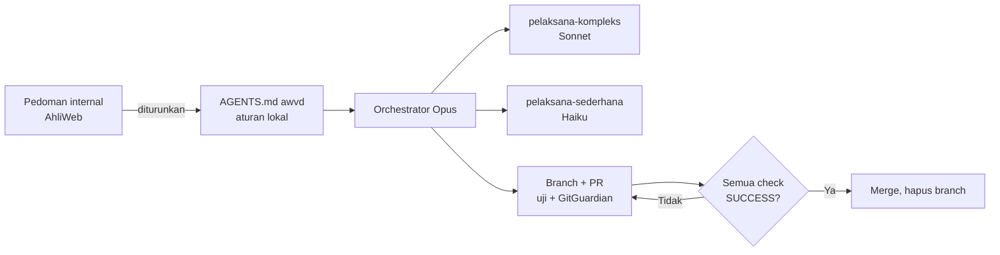
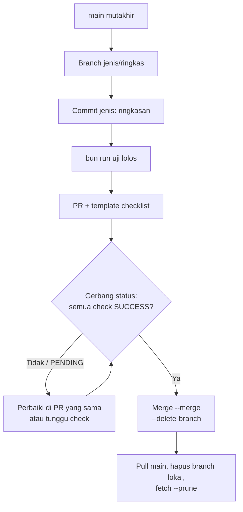
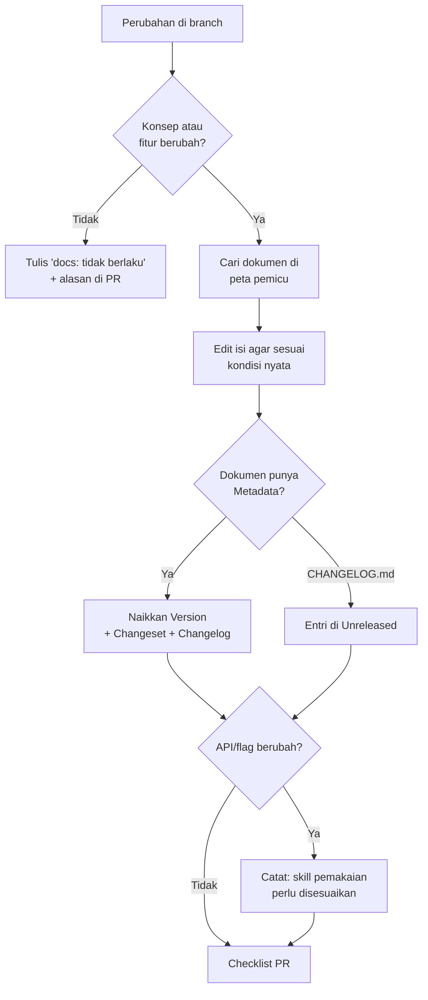

# AGENTS.md — aturan kerja AI agent di awvd

## Metadata

- Version: `v1.4.0`
- Last updated: `2026-11-07`
- Changeset: `Menetapkan awvd hanya sebagai upstream: aturan 11, pemicu perubahan yang memengaruhi repo proyek, dan butir penguncian SHA di Rilis dan Deployment.`

awvd adalah renderer video MP4 dari kode web (lihat [README.md](README.md)). Aturan di dokumen ini menurunkan **pedoman internal AhliWeb** (tidak publik): eksekusi terkelola orchestrator (skill `eksekusi-terkelola`), standar dokumen (skill `standar-dokumen-repo`), standar koordinasi kontributor, standar dokumen formal, dan prosedur pemakaian awvd (skill `video-terprogram`). Nomor keputusan `DL-0xx` merujuk decision log internal tersebut. Isi yang dibutuhkan agent sudah dituangkan di sini, jadi agent di repo ini tidak perlu mengakses pedoman internal.

**Repo ini publik.** Jangan menyebut nama, path berkas, atau tautan repo internal AhliWeb yang privat di dokumen, komentar kode, commit, maupun deskripsi PR.



## Aturan

1. **Bun-only.** Tidak ada Node.js di lingkungan ini. Jalankan skrip dengan `bun`/`bunx`, bukan `node`/`npx`.
2. **Determinisme wajib.** Komposisi tidak boleh memakai `Date.now()`, `Math.random()` tak ber-seed (pakai `acak(seed)`), atau CSS animation/transition. Gerak hanya dari nomor frame. Lihat README §Aturan determinisme.
3. **Jangan commit** video keluaran (`*.mp4`, `*.webm`, `*.mov`, folder `out/`) maupun `node_modules`.
4. **Tidak ada data nyata** pasien, pelanggan, atau pegawai di komposisi contoh atau props; pakai data fiktif.
5. **TTS daring hanya untuk konten publik** (standar dokumen formal internal, DL-037); konten internal atau sensitif tidak dikirim ke layanan daring.
6. **Larangan menyalin Remotion.** Jangan membaca atau menyalin kode atau teks Remotion maupun repositori skill-nya. awvd adalah karya asli.
7. **Alur perubahan:** setiap perubahan lewat branch dan pull request. Merge hanya bila semua check wajib (`uji`, GitGuardian) berstatus SUCCESS. Tidak push langsung ke `main`, tidak force push. Rinciannya di §Git dan PR.
8. **Jalankan `bun run uji`** sampai lolos sebelum membuka PR.
9. **Dokumentasi ikut setiap perubahan konsep atau fitur**, dalam PR yang sama. Dokumen yang basi adalah cacat. Rinciannya di §Dokumentasi.
10. Jangan menyatakan rilis atau tag yang belum ada. Lihat §Rilis dan Deployment.
11. **awvd hanya upstream** (keputusan pemilik, lihat README §Peran repo: upstream). Jangan menambahkan komposisi proyek, aset klien atau merek, naskah atau narasi, maupun hasil render proyek ke repo ini. Template di `templates/` hanya contoh generik berdata fiktif untuk dokumentasi dan uji. Permintaan membuat video diarahkan ke repo proyek video yang memakai awvd sebagai dependensi; perbaikan generik dari repo proyek masuk lewat PR ke repo ini.

## Pedoman Eksekusi Wajib (Orchestrator & Agent)

> Standar lintas-portofolio AhliWeb (standing instruction pemilik sejak 2026-11-01, DL-034); berlaku untuk **setiap** pekerjaan yang mengubah repo ini. Prosedur dan checklist lengkapnya ada di skill internal `eksekusi-terkelola`. Subagent pelaksana ada di [`.claude/agents/`](.claude/agents/).

**Opus adalah manajer dan koordinator utama.** Opus menganalisis pekerjaan, menilai kompleksitas dan risiko, memecah serta memprioritaskan tugas, mendelegasikan, mengawasi progres, mengelola ketergantungan, lalu meninjau, mengintegrasikan, menguji, dan memverifikasi semua hasil.

| Peran | Claude Code | Codex / OpenAI | Dipakai untuk |
| --- | --- | --- | --- |
| Manajer / orchestrator | Opus 5.5, `high` (`xhigh` untuk pekerjaan kritis) | GPT-6.1 Sol, `high` | Seluruh koordinasi dan verifikasi akhir |
| Agent kompleks | Sonnet 5.5, `medium` (`high` bila risiko tinggi), subagent `pelaksana-kompleks` | GPT-6.1 Sol atau Terra, `medium` | Penalaran dalam, keputusan arsitektur atau lintas komponen, fungsi kritis, implementasi besar, risiko keamanan/performa/integrasi/regresi |
| Agent sederhana | Haiku 5.5, `low`, subagent `pelaksana-sederhana` | GPT-6 Luna atau Terra, `low` | Tugas sederhana, terdefinisi jelas, risiko rendah, berulang, mekanis |

**Fable tidak dipakai sebagai orchestrator** (keputusan pemilik, DL-034).

Aturan:

1. **Pilih agent per tugas** berdasarkan kompleksitas, ketergantungan, risiko, kedalaman penalaran, dan dampak. Tugas kecil yang lebih murah dikerjakan langsung tidak dipecah.
2. **Eskalasi, jangan menebak.** Tugas Haiku yang ternyata kompleks, ambigu, berisiko, atau menyentuh arsitektur dikembalikan ke Opus untuk dinilai ulang, lalu bila perlu dipindahkan ke Sonnet.
3. **Paralel hanya bila terisolasi.** Agent paralel tidak boleh:
   - tumpang-tindih scope atau mengerjakan hal yang sama;
   - mengubah file, modul, atau area yang saling bergantung secara bersamaan;
   - memicu race condition;
   - membuat ketergantungan tak perlu;
   - menimpa hasil agent lain;
   - membawa keputusan yang tidak kompatibel;
   - memicu konflik merge.

   Ketergantungan dipetakan **sebelum** eksekusi. Tugas yang bergantung dijalankan berurutan.
4. **Agent pelaksana tetap di scope-nya.** Agent tidak mendefinisikan ulang arsitektur, tidak memakai strategi yang bertentangan, tidak menyentuh area di luar tugas tanpa izin Opus, dan tidak mendelegasikan lagi.
5. **Verifikasi tetap di Opus.** Diff, uji, angka, dan check dicek sendiri; laporan agent bukan bukti.
6. **Setiap issue dan PR adalah unit kerja atomik** yang bisa diverifikasi sendiri sampai selesai diimplementasikan, diuji, di-review, dan diselesaikan.
7. **Laporan progres ringkas paling lama tiap 5 menit kerja aktif** sampai semua kebutuhan, issue, dan PR dalam scope selesai dan terverifikasi. Isinya: yang selesai, yang berjalan, berikutnya atau hambatan. Hasil yang belum datang tidak boleh dikarang.
8. **Keputusan arsitektur, pilihan implementasi, atau trade-off dinilai sebelum diimplementasikan.** Kriterianya: kelebihan dan kekurangan, keamanan, performa, kemudahan perawatan, skalabilitas, aksesibilitas, dampak SEO, UI/UX, kompatibilitas, kompleksitas operasional, dan implikasi jangka panjang. Sajikan rekomendasi lebih dulu.
9. **Dokumentasi harus sama dengan kondisi nyata repo setelah implementasi**, bukan rencana atau perilaku lama. Pemetaan bidangnya untuk awvd ada di §Dokumentasi.
10. **Gerbang merge ketat.** Merge hanya bila semua check wajib `SUCCESS`, diperiksa lewat status (bukan output yang disalurkan ke `tail`). Approval manusia yang diwajibkan (review branch protection, rilis) tidak dilewati.
11. **Pembersihan dan integrasi akhir.** Setelah implementasi dan PR yang ada selesai:
    - buat PR untuk branch relevan yang tersisa, review dengan proses yang sama, dan merge hanya bila check lolos;
    - hapus branch lokal/remote yang sudah di-merge, tetapi pertahankan branch yang dilindungi, permanen, rilis, atau sengaja disimpan;
    - perbarui versi dokumen serta metadata **Document Changeset** dan **Changelog** bila mengubah dokumen; untuk perubahan software, ikuti §Rilis dan Deployment — jangan samakan keduanya (DL-035);
    - commit dengan pesan jelas;
    - push commit, branch, dan tag yang memang diputuskan.

    **Perubahan sah tidak ditinggalkan hanya di working tree lokal.**
12. **Aturan repo ini tetap berlaku** untuk setiap agent: alur kerja, gerbang, guardrail keamanan, dan konvensi commit.
13. **Koordinasi dengan kontributor lain** (DL-036). Isolasi paralel (aturan 3) berlaku juga terhadap kontributor dan sesi lain. Bila repo ini punya papan koordinasi (issue hidup di luar git), baca sebelum bekerja. Sebelum meluncurkan agent yang akan **merge atau rilis**, Opus membaca papan dan daftar PR terbuka, mencantumkan kunci rilis (atau "tidak ada kunci") di brief, dan tidak merge atau rilis bila kunci rilis dipegang orang lain. Agent yang menemukan bentrok berhenti dan melapor; ia tidak mengambil alih klaim atau kunci.

### Penerapan di awvd

- Area yang saling bergantung dan **tidak boleh** dikerjakan paralel oleh dua agent: `scripts/runtime.js` bersama README §Referensi API runtime; `scripts/render.mjs` bersama README §Flag CLI; `scripts/uji.mjs` bersama `.github/workflows/uji.yml`. Template di `templates/<nama>/` yang berbeda boleh paralel.
- Perubahan pada determinisme, protokol `window.video`/`renderFrame`, atau pipa ffmpeg tergolong risiko tinggi: delegasikan ke `pelaksana-kompleks` dengan effort `high`, atau kerjakan langsung oleh Opus.
- Perintah verifikasi yang wajib ada di setiap brief: `bun run uji`.
- Papan koordinasi: belum ada (dicek 2026-11-07). Penggantinya `gh pr list --state open`; usulkan papan ke pemilik bila kontributor aktif lebih dari satu.

## Skill

- Repo ini **tidak** menyimpan skill lokal. Prosedur pemakaian awvd oleh AI agent (membuat dan merevisi video) dipelihara sebagai skill internal `video-terprogram`; jangan menyalinnya ke repo ini, karena salinan akan basi.
- Subagent Claude Code repo ini: [`.claude/agents/pelaksana-kompleks.md`](.claude/agents/pelaksana-kompleks.md) dan [`.claude/agents/pelaksana-sederhana.md`](.claude/agents/pelaksana-sederhana.md).
- Bila kelak skill lokal dibutuhkan: simpan di `.claude/skills/<nama>/SKILL.md` dengan blok Metadata dan Changelog, satu sumber saja (`.agents/skills` berupa symlink ke `.claude/skills`, bukan salinan), dan catat di README §Struktur repo. Skill pihak ketiga hanya boleh disalin bila lisensinya mengizinkan, dengan atribusi dicatat.

## Git dan PR



- **Branch:** satu branch per PR, dibuat dari `main` yang mutakhir, bernama `<jenis>/<ringkas>`. Jenis: `feat`, `fix`, `docs`, `test`, `ci`, `chore`, `refactor`.
- **Commit:** `<jenis>: <ringkasan dalam bahasa Indonesia>`, sama dengan riwayat repo. Satu commit, satu tujuan.
- **PR atomik:** satu PR, satu tujuan. Temuan di luar scope masuk PR atau issue lain. PR tidak bergantung pada PR lain yang belum di-merge, kecuali urutannya ditulis eksplisit.
- **Check wajib:** `uji` (GitHub Actions) dan GitGuardian Security Checks. Temuan GitGuardian diperiksa satu per satu: rahasia nyata dirotasi lebih dulu, false positive diperbaiki kalimatnya dan dilaporkan.
- **Gerbang merge berbasis status.** Jangan menyalurkan perintah gerbang ke `tail`/`head`, karena pipe menelan status keluar:

  ```bash
  gh pr checks <PR> --watch --interval 15 >/dev/null 2>&1; rc=$?
  bad=$(gh pr checks <PR> --json state --jq '[.[] | select(.state != "SUCCESS" and .state != "SKIPPED")] | length')
  [ "$rc" -eq 0 ] && [ "$bad" -eq 0 ] && gh pr merge <PR> --merge --delete-branch
  ```

  Status keluar non-nol berarti **jangan merge**. Periksa lagi dengan `gh pr checks <PR>`, karena check mungkin belum terdaftar atau masih `PENDING`.
- **Metode merge:** merge commit (`--merge`), sama dengan riwayat repo.
- **Dilarang:** push langsung ke `main`, force push, rewrite riwayat yang sudah di-push, memakai hak admin untuk melompati check, dan AI menyetujui PR-nya sendiri bila review diwajibkan.
- **Setelah merge:** `git checkout main && git pull --ff-only`, hapus branch lokal, lalu `git fetch --prune`. Pertahankan `main` dan branch yang sengaja disimpan.
- **Cek penutup:**

  ```bash
  git status --short                       # tidak ada sisa perubahan sesi ini
  git log --oneline @{u}..HEAD 2>/dev/null # tidak ada commit yang belum di-push
  git branch --merged origin/main          # kandidat branch lokal untuk dihapus
  gh pr list --state open                  # PR terbuka dilaporkan beserta alasannya
  ```

- **Pengaturan GitHub (sejak 2026-11-07):** `main` diproteksi: check `uji` dan `GitGuardian Security Checks` wajib SUCCESS dan branch harus mutakhir terhadap `main` sebelum merge; semua percakapan review harus diselesaikan; force push dan penghapusan `main` diblokir; aturan berlaku juga untuk admin. Tidak ada kewajiban review karena pemilik bekerja sendiri dan GitHub tidak mengizinkan menyetujui PR sendiri. Hanya merge commit yang diizinkan, dan branch dihapus otomatis setelah merge. Riwayat `main` pernah ditulis ulang sekali pada 2026-11-07 atas keputusan pemilik untuk menghapus rujukan repo internal; force push selain itu tetap dilarang.

## Rilis dan Deployment

- **Deployment: tidak berlaku.** awvd adalah alat CLI yang dijalankan lokal dan di CI. Tidak ada server, environment staging/production, atau GitHub Deployment, sehingga gerbang release readiness produk tidak berlaku.
- **Penempatan di alur pengembangan produk:** awvd adalah alat internal, bukan produk berdata pengguna. Jalur yang dipakai adalah jalur ringkas: issue (bila perlu), implementasi, lalu PR dan CI. Pekerjaan yang kelak menyentuh data pribadi atau layanan daring harus dinilai ulang lebih dulu.
- **Rilis:** belum ada tag maupun GitHub Release. `package.json` berversi `0.1.0` dan semua perubahan software dicatat di `CHANGELOG.md` bagian `[Unreleased]`. Keputusan perlu atau tidaknya rilis bertag ada di tangan pemilik.
- **Bila rilis diputuskan:**
  1. Ambil kunci rilis (papan koordinasi, atau umumkan ke pemilik bila belum ada papan) dan pastikan tidak ada merge lain selama rilis berjalan.
  2. Lewat PR rilis: pindahkan isi `[Unreleased]` ke `## [X.Y.Z] - YYYY-MM-DD`, lalu naikkan `version` di `package.json`.
  3. Setelah merge dan check SUCCESS, buat tag `vX.Y.Z` pada commit merge, lalu GitHub Release. Jangan lampirkan MP4 ke repo; aset rilis hanya bila pemilik memintanya.
  4. Verifikasi tag dan Release benar-benar ada (`gh release view vX.Y.Z`) sebelum menyatakan "sudah rilis", lalu lepas kunci.
- **Penguncian oleh repo proyek:** repo proyek mengunci awvd ke SHA commit (README §Memakai awvd di repo proyek). Bila kelak ada tag rilis, repo proyek boleh mengunci tag. Karena itu perubahan jalur `scripts/` dan protokol runtime wajib ditandai di `CHANGELOG.md`.
- Repo ini **tidak** memakai Release Changeset (`.changeset/`).

## Lisensi dan Aset

- Dilarang membaca untuk menyalin atau mengadaptasi kode produk sejenis yang lisensinya membatasi (Remotion, dan repo tanpa lisensi).
- Dependensi baru wajib berlisensi permisif (MIT/Apache-2.0/BSD/ISC). Dependensi copyleft perlu keputusan pemilik. Cek lisensi sebelum `bun add`.
- Setiap aset pihak ketiga dicatat di `templates/<nama>/ASET.md` (sumber, lisensi, tanggal).
- Pertahankan atribusi mulberry32 di `scripts/runtime.js`.

## Dokumentasi

Dasarnya adalah pedoman dokumen internal AhliWeb (skill `standar-dokumen-repo`, DL-035, dan `eksekusi-terkelola` §7), yang diturunkan menjadi aturan berikut:

- blok Metadata, versi dokumen `vX.Y.Z`, Changelog, dan Mermaid untuk alur atau arsitektur;
- Document Changeset, Release Changeset, dan Changelog adalah tiga hal berbeda;
- dokumentasi harus menggambarkan kondisi repo yang sebenarnya, bukan rencana atau perilaku lama.

### Kapan wajib

Setiap PR yang mengubah **konsep** (cara kerja komposisi, model render, aturan determinisme, alur kerja) atau **fitur** (API runtime, flag CLI, mode URL, format keluaran, template, uji, CI, dependensi) wajib menyertakan pembaruan dokumen di PR yang sama. Perubahan yang murni internal tanpa efek yang terlihat pengguna tidak wajib, tetapi sebutkan "docs: tidak berlaku" beserta alasannya di deskripsi PR.

### Peta pemicu ke dokumen

| Perubahan | Dokumen yang diperbarui |
| --- | --- |
| API runtime, `ctx`, mode URL (`?preview`, `?frame`, `?props`) | README §Konsep komposisi, §Referensi API runtime; komentar kepala `scripts/runtime.js` |
| Flag CLI, kode keluar, perilaku renderer | README §Flag CLI, §Alur render; `PETUNJUK` di `scripts/render.mjs` |
| Aturan determinisme | README §Aturan determinisme; aturan 2 di dokumen ini |
| Format keluaran, performa, platform | README §Batasan yang diketahui |
| Template baru atau berubah | README §Struktur repo; `templates/<nama>/ASET.md` |
| Uji atau CI | README §Struktur repo (daftar uji dan opsi `bun run uji`); §Git dan PR bila check wajib berubah |
| Dependensi atau lisensi pihak ketiga | README §Pihak ketiga; cek lisensi (§Lisensi dan Aset) |
| Perubahan yang memengaruhi cara repo proyek memakai awvd (jalur `scripts/`, protokol runtime `window.video`/`renderFrame`, struktur paket) | README §Peran repo: upstream; `CHANGELOG.md` (tandai butirnya sebagai memengaruhi repo proyek) |
| Aturan kerja agent, subagent, alur git, rilis | `AGENTS.md`, `.claude/agents/` (CLAUDE.md hanya merujuk ke AGENTS.md) |
| Semua perubahan software di atas | `CHANGELOG.md` bagian `[Unreleased]` |

Skill internal `video-terprogram` merujuk API awvd. Bila API atau flag berubah, tulis di deskripsi PR bahwa "skill pemakaian awvd perlu disesuaikan", tanpa menyebut lokasi internalnya. Penyesuaian dikerjakan pemilik di luar repo ini.

### Bidang dokumentasi yang berlaku untuk awvd

| Bidang | Status di awvd |
| --- | --- |
| Arsitektur | Berlaku: README §Alur render, §Konsep komposisi |
| Dokumentasi API | Berlaku sebagai API JavaScript runtime dan CLI (README), bukan OpenAPI |
| Aksesibilitas | Berlaku: README §Aksesibilitas |
| Pengujian | Berlaku: README §Struktur repo, `scripts/uji.mjs` |
| Deployment | Tidak berlaku; alasannya tercatat di §Rilis dan Deployment |
| Alur kerja pengembangan | Berlaku: §Git dan PR, README §Kontribusi dan dokumentasi |
| Instruksi agent | Berlaku: `AGENTS.md`, `CLAUDE.md`, `.claude/agents/` |
| Pedoman repo | Berlaku: README, CHANGELOG, template PR |
| Skill | Berlaku sebagai rujukan (§Skill); tidak ada skill lokal |
| Manajemen media/aset | Berlaku: `templates/<nama>/ASET.md` |
| Basis data, CMS, otorisasi, audit logging, taksonomi, routing, iklan, SEO, UI responsif | Tidak berlaku: awvd tidak memiliki komponen tersebut |

### Dua jenis versi, jangan dicampur

- **Dokumen ber-metadata** (`README.md`, `AGENTS.md`, `templates/<nama>/ASET.md`): naikkan `Version`, ganti `Last updated` dan `Changeset` (ringkasan revisi terakhir saja), lalu tambahkan satu entri di `## Changelog` dokumen tanpa menghapus entri lama. Patch untuk koreksi, minor untuk bagian baru yang kompatibel, major untuk perubahan struktur atau kebijakan.
- **Software** (`CHANGELOG.md`, `package.json`): format Keep a Changelog, perubahan masuk `[Unreleased]`. Versi `package.json` hanya dinaikkan saat rilis yang diputuskan pemilik (§Rilis dan Deployment).
- Versi dokumen tidak sama dengan versi software. README `v1.4.0` tidak berarti awvd `1.4.0`.



### Checklist sebelum membuka PR

- [ ] Isi dokumen sesuai kode yang di-commit (contoh di README dapat dijalankan apa adanya).
- [ ] `Version` berformat `vX.Y.Z` dan konsisten di Metadata serta judul Changelog; `Last updated` berformat `YYYY-MM-DD`.
- [ ] Entri lama di Changelog dokumen dan `CHANGELOG.md` tetap utuh.
- [ ] Tidak ada klaim rilis, tag, atau deploy yang belum terverifikasi.
- [ ] Tidak ada data nyata, secret, atau token di contoh.
- [ ] Tidak ada nama, path, atau tautan repo internal AhliWeb yang privat.
- [ ] Bahasa Indonesia, konsisten dengan dokumen sekitarnya.

Template PR di `.github/pull_request_template.md` memuat checklist ini.

## Changelog

### 2026-11-07 - v1.4.0

- Menambahkan aturan 11: awvd hanya upstream; materi proyek video tidak masuk repo ini dan perbaikan generik masuk lewat PR.
- Peta pemicu memuat perubahan yang memengaruhi repo proyek; Rilis dan Deployment mencatat penguncian SHA (atau tag) oleh repo proyek.

### 2026-11-07 - v1.3.1

- Kondisi GitHub diperbarui setelah proteksi branch dan pengaturan merge diterapkan; mencatat penulisan ulang riwayat atas keputusan pemilik.

### 2026-11-07 - v1.3.0

- Menambahkan Pedoman Eksekusi Wajib (orchestrator Opus, subagent `pelaksana-kompleks`/`pelaksana-sederhana`, 13 aturan, penerapan di awvd), bagian Skill, Git dan PR, serta Rilis dan Deployment.
- Memetakan bidang dokumentasi ke awvd (berlaku/tidak berlaku).
- Menghapus rujukan nama, path, dan tautan repo pedoman internal karena repo itu privat; menambahkan larangan menyebutnya di repo publik ini.

### 2026-11-07 - v1.2.0

- Menambahkan bagian Dokumentasi: kewajiban memperbarui dokumen pada setiap perubahan konsep/fitur, peta pemicu, pemisahan versi dokumen dan software (DL-035), diagram alur, dan checklist PR. Aturan 9 kini merujuk ke bagian ini.

### 2026-11-07 - v1.1.0

- Menambahkan bagian Lisensi dan Aset.

### 2026-11-07 - v1.0.0

- Baseline aturan kerja AI agent.
