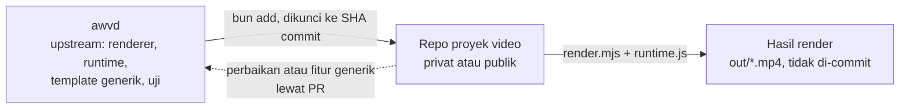
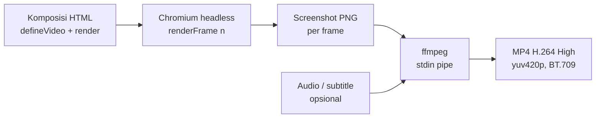
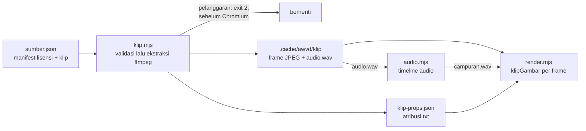
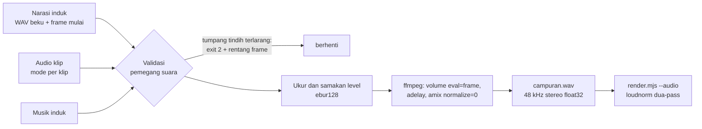
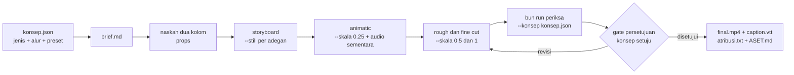
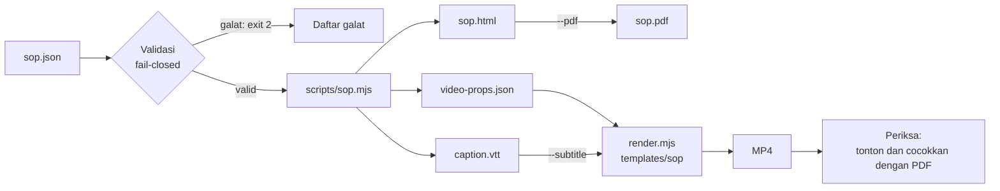

# awvd — AhliWeb Video Dev

## Metadata

- Version: `v1.10.0`
- Last updated: `2026-11-07`
- Changeset: `Bagian baru Konsep: jenis video dan alur produksi (bun run konsep): 13 jenis video dan 5 alur produksi sebagai data preset bertingkat bukti, brief, gate persetujuan berhash, presetJenis di runtime, dan flag periksa --konsep.`

Video MP4 dari kode web (HTML/CSS/JS) yang digambar per nomor frame, untuk dibuat dan dirawat oleh manusia maupun AI agent. awvd adalah renderer sendiri berbasis Chromium headless dan ffmpeg: sebuah komposisi adalah halaman web yang menggambar ulang dirinya untuk setiap nomor frame, sehingga hasilnya deterministik dan bisa ditinjau sebagai kode.

## Klasifikasi repo

| Atribut | Nilai |
| --- | --- |
| Status | `active` |
| Kelas repo | `internal` |
| Domain operasional | `internal-ops` |
| Tingkat risiko | `low` |
| Source of truth | `primary` untuk kode renderer awvd |
| Owner operasional | AhliWeb (akun GitHub `ahliweb`) |
| Risiko dan batasan | Tidak menyentuh production dan tidak di-deploy. Repo publik: tanpa secret, data nyata, aset tanpa lisensi jelas, atau rujukan ke repo internal yang privat. Bukan tempat proyek video: pekerjaan proyek ada di repo proyek terpisah (lihat Peran repo: upstream). |

Klasifikasi ditetapkan pemilik pada 2026-11-07.

## Peran repo: upstream

awvd hanya menjadi **upstream**: mesin renderer, runtime, template contoh generik, dan uji. awvd **bukan** repo proyek pengembangan atau pembuatan video. Pekerjaan proyek video berada di repo proyek terpisah, privat atau publik, dengan lisensi pilihan pemilik proyek itu. Penetapan ini adalah keputusan pemilik pada 2026-11-07.

| Masuk awvd | Tidak masuk awvd (masuk repo proyek) |
| --- | --- |
| Renderer `scripts/render.mjs` dan runtime `scripts/runtime.js` | Komposisi proyek (halaman HTML video milik proyek) |
| Uji otomatis dan CI | Props dan naskah proyek |
| Template contoh generik berdata fiktif di `templates/` untuk dokumentasi dan uji | Aset klien atau merek (logo, font, gambar, musik, footage) |
| Dokumentasi API runtime, flag CLI, dan aturan determinisme | Narasi, TTS, dan subtitle proyek |
| Perbaikan dan fitur generik yang berguna bagi semua proyek | Hasil render (MP4, PNG) dan kode khusus proyek |



Kode khusus proyek tidak masuk awvd. Perbaikan atau fitur yang bersifat generik, yang ditemukan saat mengerjakan proyek, dikirim balik sebagai pull request ke awvd (ikuti [AGENTS.md](AGENTS.md) §Git dan PR).

### Memakai awvd di repo proyek

Repo proyek memasang awvd sebagai dependensi git Bun yang dikunci ke satu commit:

```bash
bun add "github:ahliweb/awvd#<sha-commit>"
```

Contoh struktur repo proyek:

```text
package.json                 dependensi awvd (dikunci ke SHA commit)
video/<nama>/index.html      komposisi proyek
video/<nama>/props.json      props dan naskah proyek (data fiktif untuk contoh)
video/<nama>/aset/           font, gambar, audio milik proyek, dicatat lisensinya
out/                         hasil render; diabaikan git (tambahkan ke .gitignore)
```

Komposisi memuat runtime dari paket yang terpasang, dengan jalur relatif dari `video/<nama>/index.html`:

```html
<script src="../../node_modules/awvd/scripts/runtime.js"></script>
```

Render dijalankan dengan renderer dari paket yang sama:

```bash
bun node_modules/awvd/scripts/render.mjs video/<nama>/index.html \
  --out out/<nama>.mp4 --props-file video/<nama>/props.json
```

Prasyarat (Bun, `ffmpeg`, Chromium untuk Playwright) sama dengan §Mulai cepat; flag CLI sama dengan §Flag CLI.

**Menaikkan versi.** Baca [CHANGELOG.md](CHANGELOG.md) awvd, terutama butir yang ditandai memengaruhi repo proyek, lalu ulangi `bun add "github:ahliweb/awvd#<sha-baru>"` dan render ulang video yang terdampak. Cara lain sengaja tidak dipakai: git submodule (alurnya lebih rumit) serta menyalin atau mem-fork awvd (menyimpang dari upstream).

**Lisensi.** awvd berlisensi MIT. Pemberitahuan MIT ikut terpasang di `node_modules/awvd/LICENSE` dan wajib dipertahankan. Repo proyek boleh memakai lisensi lain, termasuk non-komersial atau source-available, hanya untuk materi orisinal proyeknya sendiri, bukan untuk kode awvd.

## Alur render



Tidak ada berkas sementara per frame: PNG dialirkan langsung ke stdin ffmpeg.

## Mulai cepat

Prasyarat: Linux, [Bun](https://bun.sh), `ffmpeg` (termasuk `ffprobe`), dan Chromium untuk Playwright. Tidak ada Node.js yang dibutuhkan.

```bash
bun install
bunx playwright-core install chromium-headless-shell   # sekali saja
bun run render templates/contoh-dasar/index.html --out out/contoh.mp4 \
  --props-file templates/contoh-dasar/props.json
```

Hasil contoh: 1280x720, 30 fps, 180 frame (6 detik). Folder `out/` diabaikan git.

Pratinjau di browser (putar real-time, slider, tombol putar/jeda), buka berkas komposisi dengan query `?preview`:

```text
file:///jalur/ke/awvd/templates/contoh-dasar/index.html?preview
```

Server statis apa pun juga bisa dipakai. Satu frame saja: `?frame=60`. Props pratinjau: `?props={"judul":"Halo"}`.

## Konsep komposisi

Video adalah fungsi murni dari nomor frame. Komposisi memuat `scripts/runtime.js`, memanggil `defineVideo`, dan menggambar ulang DOM di `render(frame, ctx)`.

```html
<script src="../../scripts/runtime.js"></script>
<script>
  defineVideo({
    width: 1280, height: 720, fps: 30, durationInFrames: 180,
    render(frame, ctx) {
      const { judul } = ctx.props;
      document.getElementById("judul").textContent = judul ?? "";
      document.getElementById("judul").style.opacity =
        fade(frame, ctx.durationInFrames);
    },
  });
</script>
```

- `render` boleh `async`; renderer menunggu hasilnya dan `document.fonts.ready` sebelum mengambil screenshot.
- `props` datang dari `--props`/`--props-file` (menjadi `window.videoProps`) atau `?props=` saat pratinjau.
- Contoh lengkap: [`templates/contoh-dasar/`](templates/contoh-dasar/).

## Referensi API runtime

Semua fungsi tersedia sebagai global dan di `window.VideoTerprogram`.

| API | Keterangan |
| --- | --- |
| `defineVideo({ width, height, fps, durationInFrames, render(frame, ctx) })` | Mendaftarkan komposisi dan membuat `window.video`. Semua angka wajib positif; `durationInFrames` bilangan bulat; `render` wajib fungsi. Melempar galat bila tidak valid. |
| `ctx` (argumen kedua `render`) | `{ fps, durationInFrames, width, height, props, detik }`; `detik = frame / fps`. |
| `window.video` | `{ width, height, fps, durationInFrames, renderFrame(n) }`. `renderFrame` membulatkan `n`, menolak di luar `0..durationInFrames-1`, dan menjalankan render secara berurutan (satu pada satu waktu). |
| `interpolasi(frame, masukan[], keluaran[], { clamp = true, easing })` | Pemetaan piecewise-linear. `masukan` naik tegas, panjang sama dengan `keluaran`, minimal 2 titik. `clamp: false` mengekstrapolasi linear. Easing hanya berlaku di dalam segmen. |
| `easing.*` | `linear`, `masukQuad`, `keluarQuad`, `masukKeluarQuad`, `masukCubic`, `keluarCubic`, `masukKeluarCubic`, `masukBack`, `keluarBack`, `keluarElastis`, dan `bezier(x1, y1, x2, y2)` (setara `cubic-bezier` CSS). |
| `pegas(frame, fps, { dari = 0, ke = 1, kekakuan = 100, redaman = 10, massa = 1, tunda = 0 })` | Pegas teredam bentuk-tertutup, mulai diam; murni fungsi dari frame. |
| `urutan(frame, { dari = 0, durasi = Infinity })` | Segmen waktu: mengembalikan `{ aktif, lokal, progres }`. Aktif di `[dari, dari + durasi)`. |
| `fade(frame, durasiTotal, { masuk = 15, keluar = 15 })` | Opasitas 0..1: naik selama `masuk` frame pertama, turun selama `keluar` frame terakhir. |
| `acak(seed)` | PRNG ber-seed (mulberry32), seed angka atau string; mengembalikan fungsi `() => [0,1)`. Seed sama menghasilkan urutan sama. |
| `easing.standar`, `percepat`, `perlambat`, `ditekankanMasuk`, `ditekankanKeluar` | Preset easing bezier: `(0.2,0,0,1)`, `(0.3,0,1,1)`, `(0,0,0,1)`, `(0.05,0.7,0.1,1)`, `(0.3,0,0.8,0.15)`. Sumber: token easing Material Design 3. Easing lama tidak berubah. |
| `durasi.*` | Preset milidetik: `pendek` 150, `sedang` 300, `panjang` 500, `sangatPanjang` 800 (token durasi Material Design 3), `masuk` 300, `keluar` 200 (elemen masuk sedikit lebih lama dari keluar; NN/g, Laubheimer 2020). |
| `ms(milidetik, fps)` | Milidetik ke jumlah frame, dibulatkan ke terdekat (setengah naik); input > 0 minimal 1 frame, input 0 menghasilkan 0. Contoh `ms(durasi.sedang, ctx.fps)`; `ms(300, 30)` = 9. |
| `berjenjang(frame, indeks, { mulai = 0, jeda = 6 })` | Frame lokal elemen ke-`indeks`: `frame - mulai - indeks * jeda`. Untuk stagger satu ide per ketukan; negatif berarti belum mulai. |
| `areaAman(lebar, tinggi)` | `{ aksi: {x,y,w,h}, grafis: {x,y,w,h} }`. Area aksi 93% (margin 3,5% per sisi) dan grafis 90% (5% per sisi), EBU R 95 v1.1 (2017) catatan 5. Margin per sisi dibulatkan ke piksel terdekat (setengah naik), lalu dipakai simetris: `w = lebar - 2 * x`. Contoh 1920x1080: aksi `{67,38,1786,1004}`, grafis `{96,54,1728,972}`. |
| `luminansRelatif(warna)`, `kontras(a, b)` | Luminansi relatif dan rasio kontras 1..21 (tidak dibulatkan) menurut WCAG 2.2 SC 1.4.3. `warna` = `[r,g,b]` 0..255 atau `"#rgb"`/`"#rrggbb"`; format lain melempar galat. `kontras("#000","#fff")` = 21; `kontras("#777","#fff")` ≈ 4,48 (di bawah 4,5). |
| `pilihTeksKontras(latar)` | `"#000000"` atau `"#ffffff"`, mana yang rasio kontrasnya lebih tinggi terhadap `latar`. |
| `durasiBaca(teks, { cps = 17, min = 5/6, maks = 7, fps })` | `{ detik }`, plus `frame` bila `fps` diberikan. Detik = karakter (termasuk spasi; spasi berurutan dirapikan) / `cps`, dijepit ke `[min, maks]`. Netflix Timed Text Style Guide: dewasa maksimal 20 cps, anak 17 cps; angka untuk bahasa Indonesia belum ada sumber primer, jadi bawaan konservatif 17. |
| `pecahBaris(teks, { maks = 42, baris = 2 })` | Mengembalikan **array** baris, dengan properti `melebihi` (boolean) pada array itu. Muat satu baris: satu elemen. Selain itu dipakai jumlah baris minimum dan potongan di spasi dengan prioritas: semua baris <= `maks`; baris atas bukan 1-2 kata; potongan setelah tanda baca (`, . ; : ? !`) atau sebelum kata sambung umum (dan, atau, tetapi, yang, untuk, dengan, di, ke, dari, karena, agar, sehingga); bentuk piramida terbalik (bawah >= atas); baris seimbang. Tidak muat dalam `baris` baris: `melebihi = true` dan array berisi seluruh teks dibungkus greedy (jumlah elemen bisa > `baris`; tidak ada teks hilang). Teks kosong menghasilkan `[]`. Pedoman: Netflix Timed Text Style Guide (maksimal 42 karakter per baris, dua baris). Properti `melebihi` hilang bila array diserialisasi JSON. |
| `captionAktif(cues, frame, fps)` | Cue aktif atau `null`. `cues` = array `{ mulai, akhir, teks }` dalam detik; aktif bila `mulai <= frame/fps < akhir`. Cue tumpang tindih: yang pertama dalam array. Untuk burn-in caption di DOM. |
| `presetJenis(nama)` | Salinan dalam preset jenis video (`formal`, `edukasi`, `kreatif`, `promo`, `produk`, `panduan`, `dokumenter`, `sosial`, `data`, `testimoni`, `psa`, `internal`, `acara`): `{ kunci, label, deskripsi, tujuan, alurBawaan, alurCocok, nilai, bukti, pemeriksaanTambahan }`. Data dimuat lewat `<script src=".../preset-jenis.js">` sebelum dipanggil (lihat §Konsep); tanpa itu, atau untuk nama tak dikenal, melempar galat berpetunjuk. Murni dan deterministik. |
| `parseVtt(teks)`, `parseSrt(teks)` | Teks berkas ke array cues. Timestamp `hh:mm:ss.mmm` atau `mm:ss.mmm` (koma juga diterima). Header, `NOTE`, `STYLE`, nomor/id cue, dan pengaturan cue diabaikan; tag seperti `<i>` dan `<v Nama>` dibuang; `parseVtt` juga mengurai `&amp; &lt; &gt; &nbsp;`. Cue kosong atau berakhir sebelum mulai dibuang. |
| `gambarKosong` | String `data:` URI GIF 1x1 transparan, `src` awal untuk target `` (renderer menolak `` tanpa gambar termuat saat halaman dibuka). Target `<canvas>` tidak membutuhkannya. |
| `indeksFrameKlip(klip, frameLokal, { ulang = false, kecepatan = 1 })` | Indeks frame sumber (0 = frame pertama klip) untuk frame lokal klip: `floor(frameLokal * kecepatan)`. Negatif menghasilkan `-1` (belum mulai); melewati akhir ditahan di frame terakhir, atau diulang bila `ulang: true`. Frame diekstrak pada fps komposisi, jadi `kecepatan` <> 1 menduplikasi atau melewati frame tanpa interpolasi. |
| `jalurFrameKlip(klip, frameLokal, opsi)` | URL gambar frame (`akar/folder/000123.jpg`) atau `null` bila belum mulai. `klip` datang dari `klip-props.json` (props `klip[]`). |
| `klipGambar(target, klip, frameLokal, opsi)` | `async`; menggambar frame klip ke `target` lalu menunggu siap, jadi `await klipGambar(...)` di dalam `render` menjamin frame tergambar sebelum screenshot. Mengembalikan `false` (target tidak disentuh) bila belum mulai; melempar galat bila berkas frame tidak termuat. Target `<canvas>` (**dianjurkan**): `Image` lepas didekode (`decode()`) lalu digambar sinkron dengan `drawImage` pada ukuran aslinya. Target ``: `src` diganti lalu `decode()` ditunggu; pada uji, screenshot kadang masih memuat frame sebelumnya (pengecatan gambar baru asinkron), jadi tidak deterministik. |
| `kreditKlip(klip, { ringkas = true })` | Atribusi TASL dari `klip.atribusi`. Ringkas (untuk layar): `"Judul" oleh Pencipta · CC BY 4.0 · diubah`. `ringkas: false` (kredit akhir): `"Judul" oleh Pencipta. Sumber: URL. Lisensi: CC BY 4.0 (URL lisensi). Diubah: ....` Sama persis dengan baris di `atribusi.txt`. |
| `angka(n, { desimal })`, `persen(n, { desimal })`, `rupiah(n, { desimal = 0 })` | Format Indonesia, ditulis manual (bukan `Intl`) agar hasil sama di semua mesin: titik ribuan, koma desimal. `angka(1234567.891)` = `1.234.567,891`; tanpa `desimal` sampai 3 desimal tanpa nol berekor, dengan `desimal` tepat sekian digit. `persen(0.256)` = `25,6%` (n pecahan, tanpa spasi). `rupiah(1500000)` = `Rp1.500.000` (tanpa spasi setelah Rp, negatif `-Rp1.500`). Pembulatan setengah menjauhi nol pada representasi desimal terpendek: `angka(1.005, { desimal: 2 })` = `1,01`. `NaN`, tak hingga, dan nilai >= 1e21 melempar galat. Sumber aturan Rp tanpa spasi: EYD Edisi V (Badan Bahasa, 2022), hanya sumber sekunder; dokumen resmi belum dibaca. |
| `kenBurns(frame, { mulai = 0, durasi, dari: {x,y,skala}, ke: {x,y,skala}, easing })` | Nilai CSS `transform` (`translate(..%, ..%) scale(..)`) untuk pan dan zoom foto diam di dalam wadah `overflow:hidden`. `x`,`y` = titik pusat tampilan (0..1, bawaan 0,5), `skala >= 1` (bawaan 1 lalu 1,2); pusat dijepit agar tepi gambar tidak terbuka. Sebelum `mulai` = `dari`, sesudah `mulai + durasi` = `ke`; easing bawaan linear. Murni dari frame. Hanya gaya estetika: tidak ditemukan bukti eksperimen bahwa efek ini memengaruhi pemahaman atau atensi; parameter (zoom 1,0 ke 1,1-1,3, gerak lambat) adalah praktik. |

Semua helper di atas murni (tanpa `Date`, `Math.random`, atau timer), jadi aman dipakai di `render`.

Mode URL (tanpa query: diam menunggu renderer): `?preview`, `?frame=N`, `?props={...}`.

## Flag CLI

```text
bun scripts/render.mjs <komposisi.html|URL> --out hasil.mp4 [opsi]
```

| Flag | Bawaan | Keterangan |
| --- | --- | --- |
| `--out F` | wajib | Berkas keluaran (`.mp4`, atau `.png` bersama `--still`). Folder tujuan dibuat otomatis bila belum ada. |
| `--props JSON` / `--props-file F` | `{}` | Props komposisi; pakai salah satu, harus objek JSON. |
| `--dari N` / `--sampai M` | `0` / frame terakhir | Rentang frame (inklusif). Audio dan subtitle diselaraskan ke frame awal. |
| `--skala X` | `1` | Faktor skala keluaran (min 0,1); layout tetap, raster dibuat ulang tajam. Dimensi ganjil dipotong 1 px ke genap. |
| `--crf N` | `18` | Kualitas x264, `0..51`. |
| `--audio F` | - | Trek audio, di-encode AAC-LC 48 kHz stereo 384 kbps; yang pendek diberi senyap (setelah normalisasi), yang panjang dipotong sesuai durasi video. |
| `--kenyaringan M` | `web` | Normalisasi kenyaringan audio dengan `loudnorm` dua-pass (mode `linear`); hanya berlaku bersama `--audio`, diabaikan (dengan peringatan) tanpa `--audio`. `web`: -16 LUFS, true peak -1,5 dBTP, LRA 11. `siaran`: -23 LUFS, -1 dBTP, LRA 11 (EBU R 128; toleransi R 128 ±1 LU). `mati`: tanpa normalisasi. Nilai lain: kode keluar `2`. Pass 1 mengukur segmen audio yang sama dengan yang dipakai video (offset `--dari`, dipotong sepanjang video); audio senyap total dilewati dengan peringatan. |
| `--subtitle F` | - | `.vtt` atau `.srt`, disematkan sebagai trek lunak `mov_text`. |
| `--bahasa KODE` | `ind` | Kode bahasa trek subtitle. |
| `--still N` | - | Render satu frame N sebagai PNG, bukan video. |
| `--browser PATH` | otomatis | Jalur Chromium. Tanpa ini: `PLAYWRIGHT_BROWSERS_PATH` atau `~/.cache/ms-playwright`, lalu `google-chrome`/`chromium` sistem. |
| `-h`, `--help` | - | Tampilkan petunjuk. |

Setelah encode berhasil dan ada audio, renderer mengukur hasil akhir dan mencetak `kenyaringan: I=.. LUFS, TP=.. dBTP (target ..)`. Ini hanya laporan; kegagalan pengukuran tidak menggagalkan render.

**Encode video.** Piksel PNG sRGB rentang penuh dari browser dikonversi eksplisit ke YUV 4:2:0 matriks BT.709 rentang TV (`scale=in_range=full:out_range=tv:out_color_matrix=bt709`) dan ditandai SDR BT.709 (primaries, transfer, matriks, rentang `tv`), sehingga warna sama di semua pemutar. Profil H.264 High, progresif, B-frame 2, GOP tertutup sepanjang setengah fps, `faststart`. Audio AAC-LC 48 kHz stereo 384 kbps. Parameter ini mengikuti YouTube Help "Recommended upload encoding settings" (support.google.com/youtube/answer/1722171). Target kenyaringan mengikuti EBU R 128 (-23 LUFS, true peak maks -1 dBTP) untuk siaran dan AES TD1004/TD1008 (streaming -14 sampai -20 LUFS, dipilih -16) untuk web.

Kode keluar `0` bila berhasil, `2` untuk argumen tidak valid, `1` untuk galat saat render (termasuk halaman tanpa `window.video` setelah 15 detik).

## Video di dalam video

Klip (video lain) dapat tampil di dalam komposisi sebagai PiP atau split-screen **tanpa elemen `<video>`**. Setiap frame klip dibuat ulang sesuai metode awvd: `scripts/klip.mjs` meminta ffmpeg mengekstrak frame pada fps komposisi (satu gambar per nomor frame) ke cache, lalu komposisi menggambar frame ke-n klip sebagai fungsi murni dari nomor frame (`klipGambar`). Tidak ada seek saat render.



### Aturan sumber

Hanya sumber yang lisensinya mengizinkan penggunaan dengan menyebut sumber. Validasi berjalan di `klip.mjs` sebelum ekstraksi dan sebelum Chromium diluncurkan; semua pelanggaran dilaporkan sekaligus dengan kode keluar `2`.

| Lisensi (kode di manifest) | Status |
| --- | --- |
| `CC-BY-x.y` | Diizinkan dengan atribusi. |
| `CC-BY-SA-x.y` | Diizinkan bila `proyek.lisensiKeluaran` adalah `CC-BY-SA-x.y` dengan versi sama atau lebih baru daripada sumber; kalau tidak, ditolak. |
| `CC-BY-NC-x.y`, `CC-BY-NC-SA-x.y` | Hanya bila `proyek.tujuan` adalah `nonkomersial` (NC-SA juga butuh `lisensiKeluaran` `CC-BY-NC-SA-x.y`). Campuran BY-SA dan BY-NC-SA ditolak (tak ada satu lisensi keluaran yang memenuhi keduanya). |
| `CC0-1.0`, `PDM-1.0` | Diizinkan; atribusi tetap dicatat. |
| `STOK:<penyedia>` | Diizinkan bila `bukti` (berkas atau URL lisensi tertulis dari penyedia) diisi. |
| `...-ND-...` | Selalu ditolak: ND tidak mengizinkan adaptasi, dan frame klip dibuat ulang (di-resample, dipotong, ditimpa elemen komposisi). |
| kosong atau tak dikenal | Ditolak. |

Pemeriksaan lain: `judul`, `pencipta`, `sumberUrl`, dan `perubahan` wajib terisi (judul dan pencipta boleh dikosongkan hanya dengan `tanpaJudul: true` atau `penciptaAnonim: true`); `sha256` wajib cocok dengan isi berkas; `proyek.tujuan` wajib `komersial` atau `nonkomersial`; klip wajib merujuk sumber yang ada.

Catatan hukum, bukan nasihat hukum: tafsir ShareAlike untuk video gabungan (adaptasi atau kumpulan) belum terverifikasi dari sumber primer, sehingga awvd bersikap konservatif: klip BY-SA diperlakukan sebagai Adapted Material dan seluruh keluaran harus dilisensikan BY-SA (atau kompatibel). "Komersial" tidak didefinisikan oleh CC; kasus batas diserahkan ke pemilik proyek. Lisensi CC tidak mencakup hak pihak ketiga yang melekat pada isi klip (wajah orang, merek, musik di dalam klip).

### Manifest `sumber.json`

Jalur `berkas` dan `bukti` relatif terhadap folder manifest. Contoh lengkap: [`templates/klip-tertanam/sumber.json`](templates/klip-tertanam/sumber.json).

```json
{
  "proyek": { "tujuan": "nonkomersial", "lisensiKeluaran": "CC-BY-SA-4.0" },
  "sumber": [{
    "id": "wawancara-1",
    "berkas": "aset/wawancara-1.mp4",
    "sha256": "<64 digit heksadesimal>",
    "judul": "Wawancara 1",
    "pencipta": "Nama Pencipta",
    "sumberUrl": "https://contoh.example/wawancara-1",
    "lisensi": "CC-BY-SA-4.0",
    "perubahan": "dipotong 00:12-00:20; diperkecil; dibuat ulang per frame"
  }],
  "klip": [{ "id": "k1", "sumber": "wawancara-1", "lebar": 480, "tinggi": 270, "dari": 12, "panjang": 8 }]
}
```

| Bagian | Kunci |
| --- | --- |
| `proyek` | `tujuan` (wajib), `lisensiKeluaran` (wajib bila ada sumber ShareAlike). |
| `sumber[]` | `id`, `berkas`, `sha256`, `judul` (atau `tanpaJudul`), `pencipta` (atau `penciptaAnonim`), `sumberUrl` (URL asli, jangan dipendekkan), `lisensi` (kode beserta versi), `perubahan`, opsional `urlLisensi` (bawaan dari kode lisensi) dan `bukti` (wajib untuk `STOK:`). |
| `klip[]` | `id`, `sumber`, `lebar` dan `tinggi` (piksel, ukuran tampil dikali skala render; rasio berbeda dari sumber memberi peringatan), `dari` dan `panjang` (detik; bawaan 0 dan sampai akhir), `format` (`jpg` bawaan, atau `png` lossless untuk tangkapan layar dan grafik), `kualitas` (JPEG `q:v` 1..31, bawaan 2). Satu sumber boleh dipakai beberapa klip. |

### `scripts/klip.mjs`

```text
bun scripts/klip.mjs <sumber.json> --fps N [--out .cache/awvd/klip] [--gabung props.json] [--paksa]
```

| Flag | Keterangan |
| --- | --- |
| `--fps N` | Wajib; fps komposisi. Frame diambil dengan filter `fps` (sumber VFR atau fps lain dinormalisasi). |
| `--out DIR` | Folder cache dan keluaran (bawaan `.cache/awvd/klip`, diabaikan git). |
| `--gabung F` | Berkas props dasar (objek JSON tanpa kunci `klip`); hasil digabung dengan daftar klip ke `props-gabungan.json` untuk `--props-file`. |
| `--paksa` | Ekstrak ulang walau cache ada. |

Keluaran di `--out`: `<kunci>/` (frame `000000.jpg`..., `audio.wav` bila sumber beraudio, `meta.json` berisi hash seluruh frame), `klip-props.json` (daftar `klip[]`: `id`, `akar` URL `file://` folder cache, `folder`, `ekstensi`, `digit`, `jumlah`, `fps`, `lebar`, `tinggi`, `audio`, `atribusi`), `atribusi.txt` (format TASL siap tempel di deskripsi), dan `props-gabungan.json` bila `--gabung`. Kode keluar: `0` berhasil, `2` manifest atau argumen tidak valid (tidak ada ekstraksi), `1` galat ffmpeg.

**Cache.** Kunci = sha256 dari {hash berkas sumber, fps, lebar, tinggi, dari, panjang, matriks warna, rentang, format, kualitas, versi ffmpeg}. Cache hit tidak menjalankan ffmpeg. Ekstraksi dua kali menghasilkan frame identik byte demi byte (diuji lewat `framesSha256`). Cache tidak dibersihkan otomatis; hapus `.cache/awvd/klip` bila perlu. Ekstraksi memakai `-flags +bitexact` agar JPEG tidak memuat tag versi ffmpeg.

**Warna.** Chromium mendekode video tak bertag dengan matriks BT.709 sedangkan ffmpeg bawaannya BT.601; pada uji riset PSNR frame yang sama 25,6 dB (bawaan) berbanding 46,1 dB (matriks eksplisit). Karena itu `klip.mjs` memberi matriks dan rentang eksplisit dari tag `ffprobe` (`color_space`, `color_range`); sumber tak bertag dianggap `bt709` (juga untuk resolusi SD; konvensi SD = BT.601 belum diverifikasi), rentang tak bertag dianggap `tv` (`pc` untuk `yuvj*`). Sumber HDR (`smpte2084`, `arib-std-b67`) ditolak. SAR non-persegi dikoreksi, rotasi mengikuti autorotate ffmpeg. Frame JPEG disimpan `yuvj444p`; frame PNG `rgb24`.

### Memakai klip di komposisi

Gambar frame ke `<canvas>` (bukan ``, lihat `klipGambar` di §Referensi API runtime) dan tampilkan kredit saat klip tampil. Jadwal (kapan klip tampil) adalah milik komposisi; `klip.mjs` hanya menyediakan frame.

```html
<canvas id="pip"></canvas>
<script>
  const klip = (ctx) => ctx.props.klip.find((k) => k.id === "k1");
  defineVideo({
    width: 1280, height: 720, fps: 30, durationInFrames: 480,
    async render(frame, ctx) {
      const lokal = frame - 105;                       // klip tampil mulai frame 105
      const tampil = await klipGambar(document.getElementById("pip"), klip(ctx), lokal);
      document.getElementById("pip").style.display = tampil && lokal < 90 ? "block" : "none";
      document.getElementById("kredit").textContent = kreditKlip(klip(ctx));
    },
  });
</script>
```

Kredit TASL tampil di layar saat klip tampil (`kreditKlip`, ringkas) dan di kredit akhir (`kreditKlip(k, { ringkas: false })`, lengkap dengan sumber, tautan lisensi, dan pernyataan perubahan); `atribusi.txt` untuk deskripsi video. Praktik CC: kredit boleh di dalam rekaman dan di deskripsi; halaman CC tidak menetapkan lama tayang. PiP sebaiknya sementara, kecil, dekat konten yang dirujuk narasi, dan tidak menutup informasi penting (split attention); posisikan di dalam `areaAman`.

### Templat `klip-tertanam`

[`templates/klip-tertanam/`](templates/klip-tertanam/): komposisi 1280x720, 30 fps, 16 detik: judul, panel PiP berisi dua klip buatan proyek (ffmpeg lavfi: `pola-uji` CC0, `pola-warna` CC BY), kredit TASL di layar dan kredit akhir, caption, serta rencana audio dengan narasi nada sinus (bukan suara orang) yang bergantian (klip `k1`) dan campur (klip `k2`) dengan audio klip. Jalankan dari akar repo:

```bash
bun templates/klip-tertanam/buat-audio.mjs                # narasi dan musik nada ke .cache/awvd/contoh
bun scripts/klip.mjs templates/klip-tertanam/sumber.json --fps 30 \
  --out .cache/awvd/klip --gabung templates/klip-tertanam/props.json
bun scripts/audio.mjs templates/klip-tertanam/rencana-audio.json --fps 30 \
  --klip-props .cache/awvd/klip/klip-props.json --out .cache/awvd/campuran.wav
bun scripts/render.mjs templates/klip-tertanam/index.html \
  --props-file .cache/awvd/klip/props-gabungan.json \
  --audio .cache/awvd/campuran.wav --out out/klip-tertanam.mp4
# opsional: pemeriksaan mutu hasil dengan scripts/periksa.mjs, bila tersedia
```

Jadwal klip ada di dua tempat (`props.json` untuk komposisi dan `rencana-audio.json` untuk audio); `scripts/uji-klip.mjs` memastikan keduanya sama.

### Batasan

- Disk proporsional dengan durasi klip x fps x ukuran frame; JPEG menambah satu generasi kompresi (pakai `format: "png"` bila kualitas kritis).
- Tidak ada interpolasi frame: sumber dengan fps lain diduplikasi atau dilewati ke fps komposisi. `kecepatan` di `indeksFrameKlip` juga tanpa interpolasi.
- `akar` di `klip-props.json` adalah URL `file://` absolut; pratinjau lewat server HTTP tidak bisa memuatnya (buka komposisi lewat `file://`).
- Hanya SDR; hasil ekstraksi diuji determinismenya pada satu mesin dan satu versi Chromium/ffmpeg, belum lintas mesin.

## Timeline audio

`scripts/audio.mjs` merakit satu WAV dari narasi induk, musik induk, dan audio klip tertanam, dengan aturan **pemegang suara eksklusif** supaya audio klip tidak bertabrakan dengan audio induk. WAV itu diberikan ke `render.mjs --audio`, yang menormalisasi kenyaringan campuran (`--kenyaringan`).

```text
bun scripts/audio.mjs <rencana-audio.json> --fps N --out campuran.wav
     [--klip-props klip-props.json] [--ketat-campur]
```



### Rencana audio

Jalur berkas relatif terhadap folder rencana. Rentang frame setengah terbuka: `akhir` eksklusif. Contoh: [`templates/klip-tertanam/rencana-audio.json`](templates/klip-tertanam/rencana-audio.json).

```json
{
  "durasiFrame": 480,
  "narasi": [{ "id": "n1", "berkas": "narasi-1.wav", "mulai": 0 }],
  "musik": { "berkas": "musik.wav", "levelDb": -12, "bebasDb": -6 },
  "klip": [
    { "id": "k1", "mulai": 105, "akhir": 195, "mode": "bergantian" },
    { "id": "k2", "mulai": 270, "akhir": 390, "mode": "campur", "turunDb": 12 }
  ]
}
```

| Kunci | Keterangan |
| --- | --- |
| `durasiFrame` | Wajib; jumlah frame komposisi. WAV hasil tepat sepanjang `durasiFrame / fps`. |
| `narasi[]` | `berkas` (WAV atau MP3 beku), `mulai` (frame), `id` opsional. Akhir segmen = `mulai + ceil(durasi x fps)` dari `ffprobe`. |
| `musik` | Opsional. `levelDb` (bawaan -12, rentang -20..-8): level musik di bawah ucapan saat ada suara. `bebasDb` (bawaan -6, antara `levelDb` dan 0): level saat tak ada suara. |
| `klip[]` | `id`, `mulai`, `akhir`, `mode` (`bergantian` bawaan, `campur`, `bisu`), `berkas` audio (bisa dihilangkan bila ada `--klip-props`, diambil dari `audio.wav` hasil `klip.mjs`), `gainDb`, `turunDb` (hanya `campur`, bawaan 12, rentang 8..20), `dariDetik` (offset di berkas audio). |
| `fadeMs` | Bawaan 200, rentang 100..300. |
| `ucapanLufs` | Level ucapan acuan, bawaan -16 LUFS. |

### Mode klip dan validasi

| Mode | Perilaku |
| --- | --- |
| `bergantian` | Klip memegang suara eksklusif pada rentangnya. **Gagal** (exit 2, dengan rentang frame) bila narasi induk tumpang tindih; musik induk dibisukan. |
| `campur` | Semua terdengar. Audio induk (narasi dan musik) tetap dominan pada level normal; audio klip diturunkan `turunDb` selama narasi aktif. Narasi yang tumpang tindih memberi peringatan (dua aliran ucapan); `--ketat-campur` menjadikannya gagal. |
| `bisu` | Audio klip tidak dimasukkan; boleh tumpang tindih dengan apa pun. |

Gagal juga bila: dua klip bersuara (bergantian atau campur) tumpang tindih; dua narasi tumpang tindih; `turunDb` di luar 8..20 atau `fadeMs` di luar 100..300; klip bermode bersuara tanpa berkas audio (gunakan `bisu`); berkas tidak ditemukan; rentang tidak valid. Contoh pesan: `narasi "n1" (frame 0..179) tumpang tindih audio klip "k" mode bergantian (frame 150..239) pada frame 150..179`. Setelah validasi, `audio.mjs` mencetak tabel pemegang suara per rentang frame (narasi, klip, campur, musik bebas, senyap).

### Gain dan perakitan

- **Penyamaan level.** Tiap sumber diukur (`ebur128`) dan diberi gain ke `ucapanLufs`; musik ke `ucapanLufs + bebasDb`. Tanpa ini pergantian narasi-klip terdengar sebagai lonjakan. Sumber senyap tidak diubah (diberi peringatan).
- **Narasi** 0 dB (level normal, dominan) pada semua mode. **Klip bergantian** 0 dB dengan fade-in dan fade-out `fadeMs` di batasnya sendiri. **Klip campur** 0 dB, turun `turunDb` selama narasi aktif.
- **Musik**: `bebasDb` saat tak ada suara, `levelDb` saat ada narasi atau klip campur, bisu saat klip bergantian.
- **Transisi**: gain yang turun selesai tepat di batas pergantian pemegang, gain yang naik mulai di batas (tak ada tumpang tindih saat pemegang berganti). Rampa linear amplitudo dengan kemiringan puncak/fade per frame, jadi transisi parsial (mis. 12 dB) lebih singkat daripada `fadeMs`.
- **Deterministik.** Envelope dihitung dari timeline lalu dijadikan ekspresi `volume=...:eval=frame` pada blok 10 ms, `adelay` dalam sampel, `amix normalize=0`, `-filter_complex_threads 1`, tanpa metadata versi. Dua run menghasilkan WAV identik byte demi byte (diuji).
- **Keluaran**: WAV 48 kHz stereo float32 (perantara; float menghindari clipping sebelum `loudnorm` di `render.mjs`). Mono diduplikasi ke dua kanal tanpa potongan -3 dB.

Dasar dan batas bukti. Ucapan simultan saling mengganggu (Salamé & Baddeley 1982; Brungart 2001; riset itu hanya terverifikasi sampai metadata), tetapi tingkat bukti untuk aturan ini tidak langsung dan tidak ada standar siaran terverifikasi yang melarang audio tumpang tindih. Selisih 12 dB (rentang 8..20), fade 200 ms, dan musik 12 dB di bawah ucapan adalah usulan rekayasa dari riset rasio dialog-latar (Sugimoto 2026; Ricketts dkk. 2026), bukan standar; riset itu memakai latar non-ucapan, padahal latar klip sering berupa ucapan, sehingga pilih nilai atas rentang bila ragu.

### Narasi dan TTS

awvd tidak membundel mesin TTS. Antarmuka narasi adalah **berkas WAV beku**: hasil rekaman atau TTS dibekukan sebagai berkas, dihash, dicatat (mesin, versi, model, lisensi) di repo proyek, dan hanya berkas itu yang dipakai saat render (TTS saraf bisa tidak deterministik antar-run). Per 2026-11-07 riset tidak menemukan model TTS bahasa Indonesia berlisensi permisif dengan asal data yang jelas: Piper MIT sudah diarsipkan dan penerusnya GPL-3.0; suara `id_ID-news_tts-medium` berlisensi MIT tetapi asal data pelatihannya tidak jelas; MMS-TTS berlisensi CC BY-NC. TTS daring hanya untuk konten publik (DL-037).

## Aturan determinisme

Dua render dari komposisi dan props yang sama harus menghasilkan frame identik (diverifikasi oleh `bun run uji` lewat `framemd5`).

- Seluruh gerak hanya berasal dari `frame` atau `ctx.detik`.
- Jangan pakai `Date.now()`, `performance.now()`, `setTimeout`/`setInterval`, atau `requestAnimationFrame` untuk menggerakkan animasi.
- Jangan pakai `Math.random()`; pakai `acak(seed)`.
- Jangan pakai CSS animation atau transition; runtime menyuntikkan aturan yang mematikannya.
- Font dan gambar harus termuat sebelum frame pertama; renderer menunggu `document.fonts.ready` dan semua ``, dan gagal bila ada gambar rusak.
- Frame klip digambar ke `<canvas>` lewat `klipGambar` (bukan ``, yang kadang tertangkap dengan frame sebelumnya). Teramati di Chromium mesin pengembangan: kotak berlatar dengan `border-radius` pada posisi pecahan (mis. caption `inline-block` di tengah) menghasilkan 1-2 piksel tepi yang berubah antar-run pada render berurutan; latar bersudut siku atau posisi bulat tidak. Templat `klip-tertanam` memakai latar caption bersudut siku dan lolos uji frame identik.

## Pemeriksaan mutu (bun run periksa)

```text
bun run periksa <video.mp4> [--subtitle F.vtt|.srt] [--kenyaringan web|siaran]
                [--jenis penjelasan|promo] [--cps 17] [--konsep konsep.json] [--json]
```

Alat QC pasca-render: memeriksa berkas MP4 hasil render dengan `ffprobe`/`ffmpeg` sistem (tanpa dependensi baru) dan mencetak tabel `LOLOS`/`GAGAL`/`PERINGATAN` per pemeriksaan (`INFO` dan `LEWATI` untuk yang tidak dinilai). `--json` mencetak satu objek JSON (`lolos`, `ringkasan`, `pemeriksaan[]` dengan `id`, `status`, `wajib`, `ringkas`, `rincian`, `data`) untuk CI. Kode keluar `0` bila semua pemeriksaan **wajib** lolos, `1` bila ada yang gagal, `2` untuk argumen salah (flag tidak valid, berkas tidak ada, berkas tanpa trek video atau tidak terbaca ffprobe).

| Flag | Bawaan | Keterangan |
| --- | --- | --- |
| `--subtitle F` | - | `.vtt` atau `.srt`; mengaktifkan pemeriksaan subtitle. |
| `--kenyaringan M` | `web` | Target kenyaringan: `web` atau `siaran`. |
| `--jenis J` | - | `penjelasan` atau `promo`; menentukan penilaian durasi. |
| `--cps N` | `17` | Batas karakter per detik subtitle (Netflix dewasa: 20). |
| `--konsep F` | - | `konsep.json` (lihat §Konsep): kenyaringan dan cps diambil dari konsep (flag eksplisit `--kenyaringan`/`--cps` menang), durasi dinilai terhadap durasi maks preset jenis (dengan `override`), rasio video dibandingkan dengan rasio konsep (`GAGAL` bila beda, wajib), dan harapan burn-in dicatat sebagai `INFO` (tidak bisa dideteksi otomatis). `--jenis` diabaikan bila `--konsep` dipakai. Konsep tidak valid: exit `2`. Tanpa flag ini perilaku tidak berubah. |
| `--json` | mati | Cetak hasil sebagai JSON, bukan tabel. |

| Pemeriksaan | Wajib | Ambang | Sumber |
| --- | --- | --- | --- |
| Encoding | ya | Video: H.264 profil High, `yuv420p`, `color_primaries`/`color_transfer`/`color_space` = `bt709`, `color_range` = `tv`. Kontainer: `moov` sebelum `mdat` (faststart; dibaca dari urutan kotak tingkat atas MP4). Audio (bila ada): AAC, 48000 Hz. | YouTube Help "Recommended upload encoding settings" |
| Kenyaringan | ya bila ada audio (tanpa audio: `LEWATI`) | `web`: I = -16 LUFS +-1 LU, true peak <= -1,0 dBTP. `siaran`: I = -23 LUFS +-1 LU, true peak <= -1,0 dBTP. Diukur dengan `ebur128=peak=true`. | EBU R 128; AES TD1004/TD1008 |
| Kilatan umum dan kilatan merah | ya | Gagal bila ada lebih dari 3 flash (lebih dari 6 transisi berlawanan) dalam jendela geser 1 detik pada area uji (lihat di bawah). | WCAG 2.2 SC 2.3.1 Three Flashes or Below Threshold |
| Subtitle | ya bila `--subtitle` | Gagal bila baris > 42 karakter, > 2 baris per cue, cps > `--cps`, durasi cue < 5/6 detik atau > 7 detik, atau cue tumpang tindih. `PERINGATAN` bila `pecahBaris` menghasilkan pemecahan baris yang berbeda dari yang ada. Nomor cue = urutan cue yang terurai (mulai 1; cue yang tidak sah dibuang parser). | Netflix Timed Text Style Guide |
| Durasi | tidak (hanya peringatan) | `--jenis penjelasan`: `PERINGATAN` bila > 6 menit. `promo`: hanya `INFO` (tidak ada ambang berbasis bukti). Tanpa `--jenis`: `INFO`. Dengan `--konsep`: `PERINGATAN` bila melebihi durasi maks preset jenis (mis. 360 s untuk `edukasi`, 60 s untuk `promo`); target konsep dicantumkan. | Guo, Kim & Rubin (2014), keterlibatan penonton video pembelajaran; tingkat bukti ambang preset lain tertera di `data/jenis-video.json` |
| Rasio (hanya `--konsep`) | ya | Lebar:tinggi video sama dengan `rasio` konsep (toleransi 1%). | konsep.json |
| Burn-in (hanya `--konsep`) | tidak (`INFO`) | Mencatat apakah konsep mengharapkan caption burn-in atau sidecar. | konsep.json |

**Kilatan fotosensitif.** Video didekode `ffmpeg` pada fps aslinya, diskalakan (`scale=48:48:flags=area`, rata-rata area) ke kisi sampel 48x48, dialirkan sebagai `rgb24` mentah (tidak ada frame yang disimpan; memori konstan). Tiap sampel dilinearisasi sRGB dan dirata-ratakan per blok, lalu luminans relatif WCAG dihitung dari rata-rata RGB linear blok. Satu **flash** adalah pasangan transisi berlawanan (naik lalu turun, atau sebaliknya) dengan selisih luminans relatif >= 0,10 dan sisi lebih gelap < 0,80. Transisi dihitung per blok dengan penyaring zig-zag per frame dan jendela geser 1 detik (jumlah frame = fps); gagal bila ada blok dengan lebih dari 6 transisi dalam jendela mana pun. **Flash merah** dihitung terpisah: transisi dengan selisih `(R-G-B)*320` >= 20 yang salah satu sisinya merah jenuh (`R/(R+G+B)` >= 0,8, nilai RGB linear).

Aproksimasi area uji: WCAG menguji flash yang luasnya lebih dari sekitar 0,006 steradian (persegi 341x256 piksel pada layar 1024x768, sekitar 11% luas layar). Alat ini memakai blok seluas 1/9 layar (sekitar 11%) dan menggesernya per setengah blok (jendela 5x5 yang tumpang tindih; kisi 3x3 sejajar adalah himpunan bagiannya) agar hasil tidak bergantung pada posisi flash terhadap kisi.

> **Penting.** Ini penyaringan konservatif untuk menangkap kilatan yang jelas, **bukan sertifikasi** PEAT/Harding atau bukti kepatuhan WCAG. Batasannya: (1) blok dirata-ratakan, sehingga elemen kecil berkontras penuh yang berkedip (sekitar 1% layar atau lebih) sudah bisa memicu `GAGAL` meski WCAG tidak menganggapnya pelanggaran (positif palsu); (2) rata-rata area dilakukan pada nilai sRGB sebelum linearisasi, jadi luminans campuran sedikit meleset; (3) tidak memodelkan sudut pandang 10 derajat atau ukuran layar nyata; (4) dihitung dari video yang sudah dikompresi, bukan master. Untuk siaran atau kebutuhan regulasi, pakai alat uji tersertifikasi.

Batasan lain: encoding hanya memeriksa trek video pertama; subtitle dinilai dari berkas `.vtt`/`.srt`, bukan trek `mov_text` di dalam MP4; waktu kilatan mengasumsikan fps konstan. Contoh waktu: video 6 detik 1280x720 selesai dalam sekitar 0,3 detik.

## Konsep: jenis video dan alur produksi

Saat mendesain konsep video ada dua pilihan awal: **jenis video** (formal, edukasi, kreatif, promo, dan seterusnya) dan **alur produksi** (dari ringkas sampai formal berjenjang). Keduanya adalah data, bukan kode: [`data/jenis-video.json`](data/jenis-video.json) memuat 13 jenis beserta presetnya, dan [`data/alur-produksi.json`](data/alur-produksi.json) memuat 5 alur beserta tahap, gate, RACI, dan artefaknya. `scripts/konsep.mjs` (`bun run konsep`) memakai data itu untuk membuat `konsep.json`, memeriksanya, menulis brief, dan mencatat persetujuan; `bun run periksa --konsep` memakainya sebagai ambang QC.



Tahap dan gate yang berlaku bergantung pada alur yang dipilih (lihat tabel alur); `konsep.json` mencatat tahap saat ini dan persetujuan tiap gate.

### Subperintah

```text
bun run konsep -- baru --jenis J --alur A --out konsep.json [--judul T] [--timpa]
bun run konsep -- daftar [jenis|alur [kunci]]
bun run konsep -- periksa konsep.json [--video F]
bun run konsep -- brief konsep.json [--out brief.md]
bun run konsep -- setuju konsep.json --gate G --oleh "Peran" --tanggal YYYY-MM-DD [--berkas F] [--catatan T]
bun run konsep -- preset konsep.json
bun run konsep -- sinkron-preset [--periksa] [--keluar F]
```

| Subperintah | Fungsi |
| --- | --- |
| `baru` | Membuat `konsep.json` dari preset: field isian kosong (tujuan, audiens, pesan utama, CTA, ...), pilihan yang terisi dari preset (durasi target, rasio, caption, musik, kenyaringan), dan satu entri `persetujuan` per gate alur. Tanpa `--jenis`/`--alur` mencetak tabel pilihan dan exit `2`. Menolak menimpa berkas yang ada tanpa `--timpa`. Alur di luar rekomendasi jenis diterima dengan catatan. |
| `daftar` | Tabel 13 jenis (dengan alur yang cocok) dan 5 alur. `daftar jenis promo` atau `daftar alur formal` menampilkan rincian, termasuk tingkat bukti tiap nilai. |
| `periksa` | Validasi skema: jenis dan alur dikenal, tahap sah, rasio sesuai preset, durasi target tidak melebihi durasi maks, `override` hanya untuk kunci preset yang ada (tipe dan enum dicek, kontras tidak boleh di bawah 4,5:1) dan butuh `overrideAlasan`, `tts-daring` dilarang untuk jenis `internal` atau `kepatuhan.sensitif`, tidak ada pola data pribadi (surel, NIK 16 digit, NIP 18 digit, nomor telepon; nilainya tidak ikut dicetak), serta konsistensi persetujuan. Isian inti (judul, tujuan, audiens, pesan utama, CTA; untuk alur instruksional juga `tujuanBelajar`; untuk alur formal juga `kepatuhan.dasarHukum`) hanya peringatan pada tahap pertama dan menjadi galat setelah brief dilewati. `--video F` membandingkan hash SHA-256 video dengan hash gate berhash terakhir. Exit `0` atau `2`. |
| `brief` | Brief Markdown deterministik: ringkasan, tujuan, audiens, pesan, struktur adegan, preset terpilih beserta tingkat bukti dan rujukan (nilai yang ditimpa ditandai), aturan teknis, kepatuhan, rencana tahap dengan checklist gate dan RACI, tabel persetujuan, dan kriteria selesai. Kolom kosong ditandai `[isi]`; tidak ada cap waktu. |
| `setuju` | Mencatat persetujuan satu gate. `--tanggal` wajib (tidak memakai jam sistem agar hasilnya deterministik). Gate berhash (`G5` dan `G6` pada alur formal) wajib `--berkas`; yang dicatat adalah SHA-256 berkas itu. Tahap maju ke tahap sesudah gate. Persetujuan ditolak bila konsep belum cukup lengkap untuk tahap berikutnya. Alur `formal` menolak gate di luar urutan; alur lain hanya memberi catatan. Persetujuan yang sudah ada tidak bisa diubah: perubahan sesudah disahkan berarti versi baru dengan pengesahan ulang. |
| `preset` | Mencetak `{ jenis, preset }` berisi preset efektif (preset jenis ditambah `override`) sebagai JSON, untuk disuntikkan ke komposisi lewat `--props-file`. |
| `sinkron-preset` | Menulis `scripts/preset-jenis.js` dari `data/jenis-video.json`; dengan `--periksa` hanya memeriksa dan exit `1` bila salinan basi. |

Contoh alur kerja (data fiktif; hasil lengkapnya ada di [`templates/konsep-contoh/`](templates/konsep-contoh/)):

```bash
bun run konsep -- baru --jenis panduan --alur instruksional --judul "Mengelola tautan di portal" --out konsep.json
# isi tujuan, audiens, pesanUtama, cta, tujuanBelajar di konsep.json
bun run konsep -- periksa konsep.json
bun run konsep -- brief konsep.json --out brief.md
bun run konsep -- setuju konsep.json --gate GA --oleh PS --tanggal 2026-11-07
bun run periksa out/final.mp4 --konsep konsep.json --subtitle caption.vtt
```

### Isi konsep.json

| Field | Isi |
| --- | --- |
| `versi`, `id`, `judul` | Skema versi `1`; `id` huruf kecil dan tanda hubung; judul bebas. |
| `jenis`, `alur`, `tahap` | Pilihan jenis dan alur, serta id tahap saat ini (`T1`, `T2`, ...; maju otomatis lewat `setuju`). |
| `tujuan`, `tujuanBelajar[]`, `audiens`, `pesanUtama`, `cta`, `nada` | Isian brief. `audiens` berisi `deskripsi`, `bahasa`, `konteksTonton[]`, `tanpaSuara`. |
| `durasiTarget`, `rasio` | Pilihan proyek (detik; `16:9`, `9:16`, `1:1`, `4:5`, atau `21:9`), divalidasi terhadap preset. |
| `narasi`, `musik`, `kenyaringan`, `caption` | Pilihan proyek yang terisi dari preset. `narasi.mode`: `tanpa`, `tts-lokal`, `tts-daring`, `rekaman`. `caption`: `burnIn`, `cps`, `mode` (`pop-on` atau `sorot-kata`), `bahasa`. `kenyaringan`: `web` atau `siaran`. |
| `kepatuhan` | `dasarHukum[]`, `izinPotret`, `klaim`, `dataNyata` (harus `false` pada contoh dan templat), `sensitif`. |
| `persetujuan[]` | Satu entri per gate: `gate`, `nama`, `peranDiminta`, `status` (`menunggu` atau `disetujui`), `oleh`, `tanggal`, `hash`, `berkas`, `catatan`. |
| `override{}`, `overrideAlasan` | Penimpa nilai preset yang tidak tercakup field di atas (mis. `transisi`, `easing`, `tipografi`, `kontrasMin`, `durasiMaks`). Kunci harus ada di preset; alasan wajib. Preset tidak memaksa, tetapi batas aksesibilitas (kontras minimal 4,5:1) tidak boleh diturunkan. |

### Jenis video

Tabel ringkas kolom inti; seluruh atribut (fps, resolusi, easing, tipografi, palet, kontras minimum, selisih narasi-musik, gaya narasi, kenyaringan, adegan wajib dan umum, kepatuhan) dan rujukannya ada di `data/jenis-video.json` atau lewat `bun run konsep -- daftar jenis <kunci>`.

| Jenis (`kunci`) | Tujuan | Rasio | Target/maks (s) | Detik per adegan | cps | Burn-in | Musik | Alur bawaan (cocok) |
| --- | --- | --- | --- | --- | --- | --- | --- | --- |
| Formal (`formal`) | Menyampaikan informasi resmi dengan otoritas. | 16:9 | 90/300 | 10 | 17 | tidak | tidak | `formal` |
| Edukasi (`edukasi`) | Mengubah pengetahuan atau kemampuan. | 16:9 | 240/360 | 12 | 17 | tidak | tidak | `instruksional` |
| Kreatif (`kreatif`) | Membangun emosi dan citra. | 16:9, 21:9 | 60/180 | 4 | 17 | tidak | sedang | `standar` |
| Promo (`promo`) | Mendorong tindakan (kunjungan, daftar, beli). | 16:9, 9:16, 1:1 | 30/60 | 3 | 17 | ya | sedang | `standar` (`ringkas`) |
| Penjelasan produk (`produk`) | Memahamkan cara kerja dan manfaat produk. | 16:9 | 75/120 | 7 | 17 | tidak | rendah | `standar` |
| Panduan atau tutorial (`panduan`) | Memandu penonton menyelesaikan langkah demi langkah. | 16:9 | 150/360 | 10 | 17 | tidak | tidak | `instruksional` |
| Dokumenter (`dokumenter`) | Menceritakan fakta dan konteks. | 16:9 | 300/600 | 7 | 17 | tidak | rendah | `dokumenter` |
| Sosial vertikal (`sosial`) | Menarik perhatian cepat di feed. | 9:16 | 20/60 | 2,5 | 20 | ya | sedang | `ringkas` (`standar`) |
| Laporan data (`data`) | Menyampaikan angka dan temuan. | 16:9 | 90/180 | 10 | 17 | tidak | tidak | `standar` (`formal`) |
| Testimoni atau profil (`testimoni`) | Membangun kepercayaan. | 16:9, 9:16 | 60/120 | 8 | 17 | tidak | rendah | `standar` |
| Layanan masyarakat (`psa`) | Mengubah perilaku atau kesadaran publik. | 16:9, 9:16 | 30/60 | 4 | 17 | ya | rendah | `standar` (`formal`) |
| Internal atau onboarding (`internal`) | Orientasi, kebijakan, dan prosedur. | 16:9 | 180/360 | 12 | 17 | tidak | tidak | `ringkas` (`instruksional`) |
| Acara atau rekap (`acara`) | Mengabadikan acara dan mengundang berikutnya. | 16:9, 9:16 | 75/180 | 3 | 17 | tidak | sedang | `standar` (`ringkas`) |

### Alur produksi

Urutan tahap (pra-produksi, produksi, pasca-produksi, distribusi, evaluasi) dan peta artefak adalah konvensi yang stabil di buku teks produksi dan praktik agensi. Jumlah gate, ronde review, dan penyetuju adalah keputusan desain: tidak ditemukan bukti empiris yang membandingkan alur produksi untuk motion graphics. Artefak dipetakan ke fitur awvd: `konsep.json` + `brief.md`, naskah di `props`, `--still N` per adegan sebagai storyboard, `--skala 0.25`/`0.5` dengan `--dari`/`--sampai` dan `--audio` sementara sebagai animatic dan rough cut, `bun run periksa`, `caption.vtt`, `atribusi.txt`, `templates/<nama>/ASET.md`, dan `sop.json` untuk panduan atau SOP bila fitur SOP tersedia di versi yang dipakai.

| Alur (`kunci`) | Gate (`R` = review, `*` = opsional) | Ronde review | Overhead | Cocok untuk | Tahap |
| --- | --- | --- | --- | --- | --- |
| Ringkas (`ringkas`) | G1, G2 | 1 | rendah | `promo`, `sosial`, `internal`, `acara` | 5 |
| Standar (`standar`) | G1, G2, G3, R1, R2, G4, G5* | 2 | sedang | `kreatif`, `promo`, `produk`, `sosial`, `data`, `testimoni`, `psa`, `acara` | 8 |
| Instruksional (`instruksional`) | GA, GD, GV1, GV2, GV3, GI, GE | 2 | sedang-tinggi | `edukasi`, `panduan`, `internal` | 7 |
| Formal (`formal`) | G1, G2, G3, R1, R2, G4, G5, G6 | 2 | tinggi | `formal`, `data`, `psa` | 10 |
| Dokumenter (`dokumenter`) | G1, G2, R1, R2, G3, G4 | 3 | tinggi | `dokumenter` | 10 |

Peran RACI memakai kode `PS` (pemilik/sponsor isi), `PM` (produser), `PN` (penulis naskah), `DS` (desainer gerak/operator awvd), `AU` (audio), `AH` (ahli materi), `KP` (kepatuhan/humas), `PJ` (pejabat pengesah), dan `QC`; satu orang boleh memegang beberapa peran. Alur `formal` menolak gate di luar urutan dan mewajibkan hash pada `G5` dan `G6` (versi yang disahkan harus sama dengan video terbit, diperiksa lewat `periksa konsep.json --video`). Pengesahan berjenjang oleh beberapa pejabat belum didukung sebagai beberapa tanda tangan per gate: satu gate mencatat satu penyetuju.

### Tingkat bukti

Setiap atribut preset membawa `bukti.tingkat` dan `bukti.rujukan`:

| Tingkat | Arti |
| --- | --- |
| `bukti` | Berbasis riset empiris atau meta-analisis (mis. batas 6 menit Guo, Kim & Rubin 2014; prinsip koherensi Mayer; gaya percakapan Mayer dkk. 2004 dan Ginns dkk. 2013, yang belum diuji untuk bahasa Indonesia). |
| `standar` | Standar teknis atau teks peraturan (WCAG 2.2, EBU R 128, Perpres 63/2019 Pasal 41, UU 28/2014 Pasal 12). |
| `pedoman-industri` | Pedoman platform atau praktik industri (Netflix Timed Text Style Guide, TikTok for Business, YouTube Help, Wistia); bukan eksperimen, dan sebagian data milik vendor. |
| `keputusan-desain` | Usulan awvd tanpa sumber ilmiah. |

Dari 273 nilai (13 jenis kali 21 atribut) pada 2026-11-07: 171 `keputusan-desain`, 80 `pedoman-industri`, 16 `standar`, dan 6 `bukti`. Jadi sebagian besar preset adalah titik awal yang masuk akal, **bukan** hasil riset: durasi target, tempo adegan, skala tipografi, palet, tingkat musik, selisih narasi-musik, transisi, dan easing per jenis tidak punya bukti kuat (riset warna-emosi dan huruf-emosi hanya menunjukkan efek yang bergantung konteks). Ubahlah lewat `override` dengan alasan bila proyek memerlukan. Rujukan peraturan bukan nasihat hukum: hanya Perpres 63/2019 Pasal 41 dan UU 28/2014 Pasal 12 yang dibaca dari teks peraturan; Etika Pariwara Indonesia, UU 8/1999, dan ketentuan kehumasan hanya dari sumber sekunder, jadi tim kepatuhan wajib memeriksanya. Penyerahan siaran file-based (mis. DPP AS-11 di Inggris, MXF) bukan keluaran awvd; minta spesifikasi stasiun.

### Konflik pedoman: TikTok dan lint caption

Halaman bantuan TikTok for Business menganjurkan teks layar "5-10 kata per detik", sedangkan lint caption awvd (`bun run periksa --subtitle`, Netflix Timed Text Style Guide) membatasi 17-20 karakter per detik (sekitar 3 kata per detik). awvd mempertahankan lint caption untuk **caption ucapan**, dan memperlakukan teks hook TikTok sebagai judul pendek di layar, bukan caption. Karena itu preset `sosial` memakai 20 cps (batas dewasa Netflix), bukan angka TikTok. Keputusan ini perlu dikonfirmasi pemilik; angka optimum untuk bahasa Indonesia belum diverifikasi.

### Preset di komposisi (browser)

Runtime berjalan di browser tanpa `fetch` berkas data, jadi preset disediakan sebagai salinan yang **dihasilkan** dari `data/jenis-video.json`: `scripts/preset-jenis.js` (isinya `window.PRESET_JENIS_DATA`). Muat sebelum memanggil `presetJenis`:

```html
<script src="../../scripts/runtime.js"></script>
<script src="../../scripts/preset-jenis.js"></script>
<script>
  const preset = presetJenis("promo"); // salinan; preset.nilai.durasiMaks, preset.nilai.easing, ...
</script>
```

Berkas itu tidak boleh diedit tangan. Setelah mengubah `data/jenis-video.json`, jalankan `bun run konsep -- sinkron-preset`; `bun run uji` gagal bila salinan basi. Untuk preset efektif dengan `override` konsep, suntikkan lewat props, yang sama deterministiknya: `bun run konsep -- preset konsep.json > preset.json` lalu `bun run render komposisi.html --props-file preset.json --out hasil.mp4` dan baca `ctx.props.preset`. Catatan: mode caption `sorot-kata` (preset `sosial`) baru berupa pilihan di data; belum ada helper runtime yang menyorot kata per kata, sedangkan `pop-on` didukung `captionAktif`.

### Batasan konsep

- Preset adalah bantuan keputusan, bukan standar. Hanya `periksa` yang menegakkan ambang, dan hanya sebagian (lihat §Pemeriksaan mutu); `pemeriksaanTambahan` di data (logo, istilah pra-latih, nomor langkah, dan sejenisnya) adalah daftar periksa manual di brief.
- Tidak ada hubungan otomatis antara `konsep.json` dan komposisi selain preset yang disuntikkan lewat props.
- `setuju` mencatat siapa, kapan, dan hash artefak; ia tidak memverifikasi identitas penyetuju (bukan tanda tangan digital).
- Data pribadi: `periksa` menyaring pola umum (surel, NIK, NIP, telepon), bukan jaminan; konsep dan brief di repo awvd wajib berdata fiktif.

## Aksesibilitas

- **Subtitle lunak:** `--subtitle teks.vtt` menyematkan trek `mov_text` yang bisa dinyalakan atau dimatikan pemutar.
- **Berkas sidecar:** simpan `.vtt`/`.srt` berdampingan dengan MP4 untuk platform yang meminta berkas terpisah.
- Pastikan kontras teks memadai dan jangan menyampaikan informasi hanya lewat warna atau audio.
- Kontrol pratinjau memiliki label ARIA (`Kontrol pratinjau video`, `Posisi frame`).

## SOP sebagai bahan video

`scripts/sop.mjs` mengubah satu berkas data `sop.json` menjadi dokumen SOP cetak (HTML dan PDF) **dan** bahan video (props, jadwal, caption) dari sumber yang sama, sehingga dokumen dan video tidak bisa saling menyimpang. Format dokumen mengikuti Lampiran Peraturan Menteri PAN-RB Nomor 35 Tahun 2012 tentang Pedoman Penyusunan Standar Operasional Prosedur Administrasi Pemerintahan (SOP AP): identitas, matriks diagram alir bercabang dengan kolom pelaksana, mutu baku, dan lembar pengesahan.



**Catatan penting.** SOP nyata milik instansi disimpan di **repo proyek** instansi itu, bukan di awvd (README §Peran repo: upstream, AGENTS.md aturan 11). awvd hanya memuat generator, template, dan contoh fiktif di [`templates/sop/`](templates/sop/).

### Perintah

```bash
bun run sop templates/sop/sop.json --out out/sop --pdf
bun run render templates/sop/index.html --props-file out/sop/video-props.json \
  --subtitle out/sop/caption.vtt --out out/sop.mp4
```

```text
bun scripts/sop.mjs <sop.json> --out DIR [--pdf] [--fps 30] [--cps 17] [--wpm 140]
    [--jeda-segmen 2] [--langkah-per-halaman 10] [--browser PATH]
```

| Flag | Bawaan | Keterangan |
| --- | --- | --- |
| `--out DIR` | wajib | Folder keluaran (dibuat otomatis): `sop.html`, `video-props.json`, `caption.vtt`, dan `sop.pdf` bila `--pdf`. |
| `--pdf` | mati | Cetak `sop.pdf` (A4 landscape, `printBackground`, bertag) lewat Chromium yang sama dengan `render.mjs` (aturan pencarian browser sama; fungsinya diduplikasi di `sop.mjs`, utang teknis agar perilaku `render.mjs` tidak berubah). |
| `--fps N` | `30` | Frame per detik jadwal video dan caption (bilangan bulat 1..120). Template dirancang untuk 30. |
| `--cps N` | `17` | Batas karakter per detik caption (5..40). Caption tidak pernah melampauinya. |
| `--wpm N` | `140` | Laju narasi (kata per menit, 60..300) untuk memperkirakan durasi narasi bila belum ada audio. Bawaan 140 ada di rentang 130-150 yang dianjurkan riset prosedural, tetapi itu titik awal yang dapat dikonfigurasi, bukan temuan tervalidasi untuk bahasa Indonesia; uji dengan penutur asli. |
| `--jeda-segmen S` | `2` | Jeda (detik, 2..5) setelah langkah penutup tiap subtugas (van der Meij dan van der Meij 2013: jeda 2-5 detik antar subtugas). |
| `--langkah-per-halaman N` | `10` | Batas langkah per halaman cetak (3..40). Lebih banyak dipecah ke beberapa halaman dengan segilima penghubung. **Keputusan desain**: peraturan tidak menetapkan batas ini. |
| `--browser PATH` | otomatis | Jalur Chromium untuk `--pdf`. |

Kode keluar: `0` berhasil, `2` data atau argumen tidak valid (daftar galat dicetak ke stderr, tidak ada keluaran yang dibuat), `1` galat saat membuat PDF. Peringatan lunak dicetak ke stderr sebagai `peringatan: ...` dan tidak mengubah kode keluar.

### Skema `sop.json`

Kunci yang tidak dikenal ditolak (mencegah salah ketik yang diam-diam diabaikan). Tanggal berformat `YYYY-MM-DD`. Teks tidak boleh kosong dan tidak boleh memuat karakter kontrol (termasuk baris baru).

| Kunci | Isi |
| --- | --- |
| `identitas` | `{ judul, nomor, unit, logo?, tanggalPembuatan, tanggalRevisi?, tanggalEfektif, disahkanOleh }`. `unit` = nama instansi atau unit kerja. `logo` = berkas gambar (png, jpg, svg, webp; maks 256 KB) relatif terhadap `sop.json`, disematkan ke HTML. `disahkanOleh` = `{ jabatan, nama?, nip?, fiktif? }`. Tanggal revisi kosong ditampilkan `-`. |
| `dasarHukum`, `kualifikasiPelaksana`, `keterkaitan`, `peralatan`, `peringatan`, `pencatatan` | Larik teks, minimal satu butir (tulis "Tidak ada" bila memang tidak ada). Bersama `identitas`, ini 13 unsur identitas menurut Lampiran II.C.2.a. |
| `pelaksana` | `[{ id, nama }]`, id unik. Hanya registrasi: **urutan kolom pelaksana dihitung otomatis** dari kemunculan pertama dalam sekuen kegiatan (Lampiran II.B.2.c), bukan dari urutan larik ini. |
| `prosedur` | `[{ kode, judul, tujuan, langkah }]`; `kode` unik. |
| `prosedur[].langkah` | `[{ no, aktivitas, pelaksana, jenis, kelengkapan, waktu, output, keterangan?, ya?, tidak?, narasi? }]`. `no` berurutan 1..n. `jenis`: `mulai`, `proses`, `keputusan`, `selesai`. `pelaksana` = id terdaftar. `ya`/`tidak` = nomor langkah tujuan, wajib dan hanya untuk `keputusan`. `narasi` = teks narasi video; bila kosong disusun otomatis. |
| `pengesahan` | `{ ditetapkanDi, tanggal, penandatangan: [{ peran, jabatan, nama?, nip?, fiktif? }] }`. |
| `fiktif` | `true` di akar atau pada objek tertentu menandai data sebagai fiktif (lihat larangan data pribadi). |

Contoh lengkap: [`templates/sop/sop.json`](templates/sop/sop.json).

### Validasi

Fail-closed: satu galat saja menghentikan proses (exit 2) dan semua galat dicetak dengan jalurnya, mis. `prosedur[0].langkah[2].ya: menuju langkah 99 yang tidak ada (langkah 1..7)`.

- Galat: field wajib kosong atau salah tipe; kunci tidak dikenal; tanggal tidak valid; id pelaksana duplikat; kode prosedur duplikat; nomor langkah tidak unik atau tidak berurutan; pelaksana tidak terdaftar; langkah pertama bukan `mulai` dan terakhir bukan `selesai`; `mulai` selain di langkah pertama; keputusan tanpa `ya` dan `tidak`, atau menuju langkah yang tidak ada, ke dirinya sendiri, atau sama; `ya`/`tidak` pada langkah bukan keputusan; waktu kosong; karakter kontrol; langkah yang tidak terjangkau dari langkah 1.
- Data pribadi: pola NIK (16 digit), NIP (18 digit, juga berspasi), nomor telepon, dan surel di seluruh berkas menggagalkan validasi, kecuali objek pemuatnya (atau induknya) bertanda `"fiktif": true`. Pemindai ini heuristik dan bisa memberi positif palsu. Contoh dan props wajib tetap data fiktif (AGENTS.md aturan 4; UU 27/2022).
- Peringatan (tidak menghentikan): kegiatan berawalan nama pelaksana (Lampiran II.B.2.c menetapkan kegiatan ditulis kata kerja aktif tanpa subjek; pelaksana hanya di kolom pelaksana) dan pelaksana terdaftar yang tidak dipakai.

### Dokumen cetak

`sop.html` adalah dokumen mandiri (tanpa skrip, `lang="id"`, teks di-escape) berukuran A4 landscape lewat `@page`:

1. **Halaman identitas**: kop (instansi dan logo, nomor, tanggal pembuatan, revisi, efektif, pengesahan dengan ruang tanda tangan dan stempel, nama SOP), grid 2 kolom kali 3 baris (dasar hukum, kualifikasi pelaksana, keterkaitan, peralatan, peringatan, pencatatan), dan daftar prosedur.
2. **Per prosedur**: matriks dengan kolom No, Kegiatan, satu kolom per pelaksana (swimlane), Mutu Baku (Kelengkapan, Waktu, Output), dan Keterangan.
3. **Lembar penetapan dan pengesahan**.

Simbol hanya lima, sesuai Lampiran II.B.2.b: kapsul (mulai dan selesai), kotak (proses), belah ketupat (keputusan), anak panah (arah, dengan cabang berlabel Ya dan Tidak), dan **segilima** (penghubung antar halaman). Tidak ada lingkaran penghubung dalam satu halaman. Simbol polos berisi nomor langkah; uraian kegiatan ada di kolom Kegiatan, dan cabang keputusan juga ditulis sebagai teks di kolom Keterangan (tidak hanya dalam gambar). Kolom pelaksana mengikuti urutan kemunculan dalam sekuen kegiatan, sehingga langkah pertama selalu di kolom paling kiri.

Garis alir digambar sebagai SVG per baris tabel (tinggi baris diperkirakan dari panjang teks, lalu dicek terhadap hasil tata letak saat `--pdf`; ketidaksesuaian dilaporkan sebagai `peringatan: tata letak ...`). Perutean garis dikerjakan `scripts/sop-alir.js`, modul yang sama dipakai template video. Prosedur yang lebih panjang dari `--langkah-per-halaman` dibagi seimbang; garis yang melintasi halaman diwakili segilima bernomor huruf (A, B, ...) di baris tambahan akhir halaman ("Lanjut ke langkah n") dan awal halaman berikutnya ("Sambungan dari langkah m").

**PDF.** `--pdf` menghasilkan PDF bertag dengan outline, bahasa `id`, dan judul dokumen; tabel memakai `th scope` dan SVG diberi label. Dokumen ini **tidak mengklaim PDF/UA**: kepatuhan PDF/UA belum divalidasi (mis. dengan veraPDF). Uji hanya memeriksa keberadaan struktur tag, `/Lang`, dan `/Title`.

### Video dan caption

`video-props.json` memuat identitas ringkas, daftar pelaksana, struktur prosedur (untuk menggambar diagram), `adegan`, `caption`, dan `durationInFrames` total. Adegan berurutan: judul, dasar hukum (maksimal 3 butir dan daftar pelaksana, sebagai pra-latihan istilah), lalu per prosedur satu adegan tujuan dan satu adegan per langkah, dan penutup (ringkasan dan peringatan).

- **Jadwal deterministik.** Narasi tiap adegan dipecah menjadi cue; durasi cue adalah yang lebih lama antara waktu baca `durasiBaca` pada `--cps` dan waktu narasi `kata / --wpm`, dibulatkan ke atas ke frame, dijepit 5/6 sampai 7 detik. Durasi adegan = jumlah durasi cue (minimal 2 detik per langkah, 3 detik adegan lain, 4 detik penutup) + jeda 0,5 detik. Tanpa audio, `--wpm` adalah perkiraan; setelah ada rekaman narasi, sesuaikan jadwal.
- **Segmen.** Langkah tiap prosedur dikelompokkan menjadi subtugas 3-5 aksi (7 langkah menjadi 4 + 3); langkah penutup subtugas diberi tambahan jeda `--jeda-segmen`.
- **Narasi otomatis** bila `narasi` kosong: `<Pelaksana> <aktivitas>. Hasilnya: <output>.`; untuk keputusan: `<Pelaksana> memeriksa: <aktivitas> Jika ya, lanjut ke langkah n; jika tidak, kembali ke langkah m.` Narasi boleh menyebut pelaksana sebagai subjek; kolom Kegiatan tidak.
- **Caption.** Tiap cue memuat paling banyak 2 baris dan 42 karakter per baris (`pecahBaris`), tidak melampaui `--cps`, berdurasi 5/6 sampai 7 detik, berbatas frame, tidak tumpang tindih, dan gabungan cue sama dengan gabungan narasi. `caption.vtt` untuk `--subtitle`; template juga membakar caption ke frame di area aman bawah (`captionAktif`).
- **Template** [`templates/sop/index.html`](templates/sop/index.html) (1280x720, 30 fps): membaca `window.videoProps` yang disuntik renderer sebelum skrip berjalan (`durationInFrames` diambil darinya; tanpa props tampil layar petunjuk). Diagram swimlane dibangun bertahap, langkah aktif disorot dan langkah lain diredupkan (signaling), panel menampilkan kegiatan, pelaksana, waktu, output, dan kelengkapan. Semua pasangan warna teks diperiksa dengan `kontras()` minimal 4,5:1 saat dimuat; transisi memakai `easing.standar`/`easing.perlambat` dan `ms(durasi.masuk)`; tanpa CSS animation.
- **Cabang Ya/Tidak** di video (label, urutan penelusuran) adalah **inferensi desain**: belum ada riset empiris langsung tentang penyajian keputusan di video prosedural. Perlakukan sebagai hipotesis yang diuji lewat uji coba pengguna.

### Keputusan desain (bukan aturan regulasi)

Lampiran 35/2012 tidak mengatur: batas langkah per halaman (`--langkah-per-halaman`, bawaan 10), jumlah kolom pelaksana per halaman, ukuran kertas dan huruf, pelabelan penghubung antar halaman (dipakai huruf A, B, ...), kecepatan narasi, dan panjang jeda. Semua itu keputusan awvd yang dapat diubah.

Uji: `bun run uji:sop` (validasi, dokumen, props, caption, PDF, perutean, render still template). Dasar format: PermenPAN-RB 35/2012 (masih berlaku; Lampiran II.B dan II.C).

## Batasan yang diketahui

- Render serial, sekitar 21 fps pada mesin pengembangan (komposisi contoh); tidak ada paralelisasi antar frame.
- Hanya Linux yang diuji.
- Elemen `<video>` di DOM tidak di-seek per frame. Untuk video di dalam video pakai fitur klip tertanam (§Video di dalam video: frame diekstrak ke cache lalu digambar per nomor frame); untuk gambar diam pakai `` atau `<canvas>`.
- Keluaran hanya H.264 (MP4) dan PNG (still). Tidak ada WebM/ProRes/GIF.
- Hanya SDR BT.709; tidak ada HDR atau ruang warna lain. Normalisasi kenyaringan memakai `loudnorm` linear; bila mode linear tidak dapat dicapai tanpa melewati batas true peak, ffmpeg beralih ke mode dinamis, dan hasil ukur bisa menyimpang dari target (periksa laporan `kenyaringan:`). Hasil dikodekan AAC setelah normalisasi, jadi true peak akhir dapat berbeda sedikit.
- Resolusi dasar diambil dari `width`/`height` komposisi; ubah ukuran akhir dengan `--skala`.

## Struktur repo

```text
scripts/render.mjs     CLI renderer (Chromium + ffmpeg)
scripts/runtime.js     runtime komposisi (defineVideo, interpolasi, helper, dst.)
scripts/periksa.mjs    alat QC pasca-render (bun run periksa)
scripts/uji-runtime.mjs  uji unit helper runtime (tanpa browser)
scripts/uji-periksa.mjs  uji alat QC periksa.mjs
scripts/sop.mjs        generator SOP: sop.json -> sop.html/pdf, video-props.json, caption.vtt
scripts/sop-alir.js    perutean garis alir swimlane (dokumen cetak dan template video)
scripts/uji-sop.mjs    uji fitur SOP (bun run uji:sop)
scripts/uji.mjs        uji otomatis renderer (bun run uji)
templates/<nama>/      komposisi contoh + ASET.md (catatan aset pihak ketiga)
templates/sop/         template video SOP + sop.json fiktif + props.json hasil generator
scripts/klip.mjs       validasi manifest sumber dan ekstraksi frame klip ke cache (video di dalam video)
scripts/audio.mjs      perakit timeline audio (pemegang suara bergantian/campur/bisu)
scripts/uji-klip.mjs   uji klip.mjs, audio.mjs, helper klip/format id-ID/kenBurns, templat klip-tertanam
scripts/uji.mjs        uji otomatis renderer (bun run uji)
templates/<nama>/      komposisi contoh + ASET.md (catatan aset pihak ketiga)
templates/klip-tertanam/  contoh video di dalam video: sumber.json, props, rencana-audio.json, klip kecil buatan sendiri (.mkv)
.cache/                cache frame klip dan audio contoh (diabaikan git)
scripts/konsep.mjs     konsep video: jenis, alur, brief, persetujuan (bun run konsep)
scripts/preset-jenis.js  salinan preset jenis untuk browser (DIHASILKAN dari data/jenis-video.json)
scripts/uji-konsep.mjs   uji data preset, alur, konsep.mjs, preset runtime, periksa --konsep
data/jenis-video.json  13 jenis video + preset bertingkat bukti (sumber kebenaran)
data/alur-produksi.json  5 alur produksi: tahap, gate, RACI, artefak
scripts/uji.mjs        uji otomatis renderer (bun run uji)
templates/<nama>/      komposisi contoh + ASET.md (catatan aset pihak ketiga)
templates/konsep-contoh/  konsep.json fiktif + brief.md hasil generator
.github/workflows/     CI uji
.github/pull_request_template.md   checklist uji dan dokumentasi PR
.claude/agents/        subagent pelaksana (kompleks, sederhana) untuk orchestrator
AGENTS.md              aturan kerja AI agent (orchestrator, git, rilis, dokumentasi)
CHANGELOG.md           riwayat perubahan software
```

Perintah utama:

- `bun run render <komposisi> --out ...`: render video atau still.
- `bun run periksa <video.mp4>`: pemeriksaan mutu (lihat §Pemeriksaan mutu).
- `bun run sop <sop.json> --out DIR`: SOP menjadi dokumen dan bahan video (lihat §SOP sebagai bahan video).
- `bun run klip <sumber.json> --fps N` dan `bun run audio <rencana.json> --fps N --out ...`: video di dalam video dan timeline audio.
- `bun run konsep -- <subperintah>`: konsep video, pilihan jenis video dan alur produksi (lihat §Konsep).
- `bun run uji`: uji unit runtime, uji periksa, uji SOP, uji klip, uji konsep, lalu sembilan uji renderer (properti video, determinisme, still, rentang, audio, subtitle, skala, galat, kenyaringan siaran); sekitar dua setengah menit. `bun run uji -- --simpan DIR` juga menyalin PNG still hasil uji ke `DIR`; CI memakainya untuk artefak `frame-contoh`.

## Kontribusi dan dokumentasi

Setiap perubahan lewat branch dan pull request (`<jenis>/<ringkas>`), dan merge hanya setelah semua check (`uji`, GitGuardian) berstatus SUCCESS. Perubahan konsep atau fitur wajib membawa pembaruan dokumen di PR yang sama. Aturan lengkapnya ada di [AGENTS.md](AGENTS.md): §Git dan PR untuk alur git, dan §Dokumentasi untuk peta "perubahan apa memperbarui dokumen mana".

Ada dua jenis versi yang berbeda. Versi dokumen (`Version` di blok Metadata README dan AGENTS.md) menandai revisi dokumen. Versi software ada di `package.json` dan `CHANGELOG.md`. README `v1.10.0` tidak berarti awvd `1.10.0`.

## Rilis

Belum ada rilis bertag. Versi paket `0.1.0`, dan semua perubahan dicatat di [CHANGELOG.md](CHANGELOG.md) bagian `[Unreleased]`. awvd tidak di-deploy ke server mana pun; ia dipakai lokal dan di CI. Prosedur rilis bila kelak diputuskan pemilik ada di AGENTS.md §Rilis dan Deployment.

## Pemakaian di AhliWeb

- Proyek video AhliWeb dikerjakan di repo proyek terpisah yang memakai awvd sebagai dependensi (lihat Peran repo: upstream), bukan di repo ini.
- AI agent AhliWeb memakai awvd lewat skill internal `video-terprogram`, yang berisi prosedur membuat dan merevisi video.
- Panduan video formal untuk pemerintah dan swasta mengikuti standar dokumen formal internal AhliWeb; awvd menjadi alat render videonya.

## Lisensi dan Kepatuhan

- awvd berlisensi [MIT](LICENSE).
- Kode awvd ditulis sendiri. awvd tidak memakai, tidak bergantung pada, dan tidak menyalin kode Remotion maupun remotion-dev/skills. Pemeriksaan 2026-11-07 membandingkan interpolasi, pegas, easing/bezier, dan PRNG dengan sumber Remotion: pendekatan dan implementasinya berbeda. Satu-satunya kesamaan adalah algoritma mulberry32, yang berstatus domain publik (atribusi di `scripts/runtime.js`).
- Konsep "video dari kode yang digambar per frame" adalah ide/metode, bukan ekspresi. Ide dan metode tidak dilindungi hak cipta (UU 28/2014 Pasal 41 huruf b; doktrin dikotomi ide-ekspresi).
- "Remotion" adalah merek milik pemiliknya. Nama itu disebut hanya untuk menjelaskan bahwa awvd tidak memakainya. Tidak ada afiliasi.

### Pihak ketiga

- **playwright-core 1.64.1:** Apache-2.0 (Microsoft). Dependensi npm, bukan kode yang disalin ke repo; LICENSE/NOTICE-nya ikut dalam paket.
- **Chromium/Chrome:** dipakai dari instalasi lokal dan tidak didistribusikan.
- **ffmpeg:** dipanggil sebagai program sistem lewat CLI dan tidak didistribusikan atau ditautkan, sehingga kewajiban LGPL/GPL (libx264) tidak berlaku untuk repo ini. Video keluaran tidak terkena GPL.
- **H.264:** lisensi paten AVC (dulu MPEG LA, kini Via LA) secara historis tidak memungut royalti untuk video internet yang gratis bagi pengguna akhir. Untuk distribusi berbayar, siaran, atau platform streaming komersial, cek ketentuan Via LA terbaru. Status 2026 belum diverifikasi dari halaman resmi.

### Tanggung jawab pengguna atas aset

Font, musik (`--audio`), gambar, footage, klip tertanam, dan suara TTS wajib berlisensi jelas dan dicatat sumbernya (klip tertanam divalidasi `klip.mjs`). Video yang memuat data pribadi tunduk pada UU 27/2022 tentang Pelindungan Data Pribadi (dasar pemrosesan atau persetujuan). Jangan pakai data nyata di contoh. TTS daring hanya untuk konten publik (DL-037).

## Changelog

### 2026-11-07 - v1.10.0

- Menambahkan §Konsep: jenis video dan alur produksi: subperintah `bun run konsep` (`baru`, `daftar`, `periksa`, `brief`, `setuju`, `preset`, `sinkron-preset`), skema `konsep.json`, tabel 13 jenis dan 5 alur, diagram alur konsep sampai final, penjelasan tingkat bukti (banyak nilai adalah keputusan desain), konflik pedoman TikTok dan lint caption, preset di komposisi, dan batasan.
- §Referensi API runtime: menambahkan `presetJenis(nama)` (data dimuat lewat `scripts/preset-jenis.js`, dihasilkan dari `data/jenis-video.json`).
- §Pemeriksaan mutu: menambahkan flag `--konsep` (ambang durasi maks, cps, kenyaringan dari preset; pemeriksaan rasio; info burn-in).
- §Struktur repo: mencantumkan `scripts/konsep.mjs`, `scripts/preset-jenis.js`, `scripts/uji-konsep.mjs`, `data/`, dan `templates/konsep-contoh/`; `bun run uji` kini juga menjalankan uji konsep.

### 2026-11-07 - v1.9.0

- Menambahkan bagian Video di dalam video (aturan sumber dan lisensi, manifest `sumber.json`, `scripts/klip.mjs`, cache, warna, memakai klip di komposisi, templat `klip-tertanam`, batasan) dan Timeline audio (rencana audio, mode klip dan validasi pemegang suara, gain dan perakitan, narasi dan TTS).
- §Referensi API runtime: `gambarKosong`, `indeksFrameKlip`, `jalurFrameKlip`, `klipGambar`, `kreditKlip`, `angka`/`persen`/`rupiah`, dan `kenBurns`.
- §Aturan determinisme, §Batasan yang diketahui (butir `<video>` diganti rujukan ke fitur klip tertanam), §Struktur repo, dan §Tanggung jawab pengguna atas aset disesuaikan.

### 2026-11-07 - v1.8.0

- Menambahkan bagian SOP sebagai bahan video: alur Mermaid, perintah dan flag `scripts/sop.mjs`, skema `sop.json`, aturan validasi (termasuk pemindai data pribadi), isi dokumen cetak (lima simbol, segilima penghubung antar halaman, PDF bertag tanpa klaim PDF/UA), video dan caption (jadwal, segmen, narasi otomatis, cabang Ya/Tidak sebagai inferensi), dan daftar keputusan desain.
- §Struktur repo: `scripts/sop.mjs`, `scripts/sop-alir.js`, `scripts/uji-sop.mjs`, `templates/sop/`; `bun run uji` kini menjalankan `uji-sop.mjs` sebelum uji renderer.

### 2026-11-07 - v1.7.0

- Menambahkan §Pemeriksaan mutu (bun run periksa): flag, kode keluar, tabel pemeriksaan (encoding, kenyaringan, kilatan fotosensitif, subtitle, durasi) dengan ambang dan sumbernya, aproksimasi area uji kilatan, serta batasannya (penyaringan konservatif, bukan sertifikasi).
- §Struktur repo: mencantumkan `scripts/periksa.mjs`, `scripts/uji-periksa.mjs`, dan perintah `bun run periksa`; `bun run uji` kini juga menjalankan uji alat QC.

### 2026-11-07 - v1.6.0

- §Referensi API runtime: menambahkan `areaAman`, `ms` dan `durasi`, preset `easing` (standar, percepat, perlambat, ditekankanMasuk, ditekankanKeluar), `luminansRelatif`/`kontras`/`pilihTeksKontras`, `durasiBaca`, `pecahBaris`, `captionAktif`/`parseVtt`/`parseSrt`, dan `berjenjang`, masing-masing dengan sumbernya (EBU R 95, Material Design 3, NN/g, WCAG 2.2 SC 1.4.3, Netflix Timed Text Style Guide).
- §Struktur repo: mencantumkan `scripts/uji-runtime.mjs` dan `bun run uji:runtime`; `bun run uji` kini menjalankan uji unit runtime sebelum uji renderer.

### 2026-11-07 - v1.5.0

- §Flag CLI: menambahkan `--kenyaringan web|siaran|mati` dan laporan kenyaringan; `--audio` kini AAC-LC 48 kHz 384k; catatan encode BT.709, H.264 High, GOP tertutup beserta rujukan YouTube Help, EBU R 128, dan AES.
- §Alur render, §Batasan yang diketahui, dan §Struktur repo (sembilan uji) disesuaikan.

### 2026-11-07 - v1.4.1

- §Flag CLI: `--out` membuat folder tujuan bila belum ada.

### 2026-11-07 - v1.4.0

- Menambahkan bagian Peran repo: upstream: awvd hanya upstream, tabel batas isi awvd dan repo proyek, diagram hubungan dengan repo proyek, dan subbagian Memakai awvd di repo proyek (dependensi git terkunci SHA, struktur repo proyek, naik versi, lisensi).
- Risiko dan batasan di Klasifikasi repo dan bagian Pemakaian di AhliWeb disesuaikan.

### 2026-11-07 - v1.3.1

- Klasifikasi repo ditetapkan pemilik; menambahkan tingkat risiko.

### 2026-11-07 - v1.3.0

- Menambahkan bagian Klasifikasi repo (kelas dan domain masih usulan) dan Rilis.
- Struktur repo mencantumkan `.claude/agents/`.
- Mengganti "Hubungan dengan repo lain" menjadi "Pemakaian di AhliWeb" dan menghapus nama, path, serta tautan repo pedoman internal yang privat.

### 2026-11-07 - v1.2.0

- Menambahkan bagian Kontribusi dan dokumentasi (rujukan ke AGENTS.md §Dokumentasi, pemisahan versi dokumen dan software).
- Mendokumentasikan opsi `--simpan DIR` pada `bun run uji`.
- Struktur repo mencantumkan `templates/<nama>/ASET.md` dan template PR.

### 2026-11-07 - v1.1.0

- Menambahkan bagian Lisensi dan Kepatuhan menggantikan bagian Lisensi singkat.

### 2026-11-07 - v1.0.0

- README lengkap pertama: alur render, mulai cepat, konsep komposisi, API runtime, flag CLI, determinisme, aksesibilitas, batasan, struktur repo, dan hubungan dengan repo lain.
