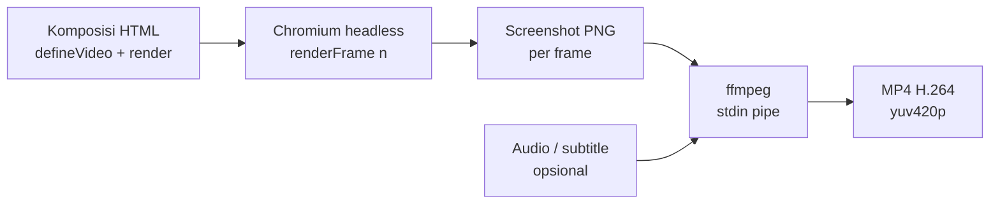

# awvd — AhliWeb Video Dev

## Metadata

- Version: `v1.0.0`
- Last updated: `2026-11-07`
- Changeset: `Mengganti README singkat dengan dokumentasi lengkap renderer: mulai cepat, API runtime, flag CLI, determinisme, aksesibilitas, batasan, dan struktur repo.`

Video MP4 dari kode web (HTML/CSS/JS) yang digambar per nomor frame, untuk dibuat dan dirawat oleh manusia maupun AI agent. awvd adalah renderer sendiri berbasis Chromium headless dan ffmpeg: sebuah komposisi adalah halaman web yang menggambar ulang dirinya untuk setiap nomor frame, sehingga hasilnya deterministik dan bisa ditinjau sebagai kode.

## Alur render



Tidak ada berkas sementara per frame: PNG dialirkan langsung ke stdin ffmpeg.

## Mulai cepat

Prasyarat: Linux, [Bun](https://bun.sh), `ffmpeg` (termasuk `ffprobe`), dan Chromium untuk Playwright. Tidak ada Node.js yang dibutuhkan.

```bash
bun install
bunx playwright-core install chromium-headless-shell   # sekali saja
bun run render templates/contoh-dasar/index.html --out out/contoh.mp4 \
  --props-file templates/contoh-dasar/props.json
```

Hasil contoh: 1280x720, 30 fps, 180 frame (6 detik). Folder `out/` diabaikan git.

Pratinjau di browser (putar real-time, slider, tombol putar/jeda), buka berkas komposisi dengan query `?preview`:

```text
file:///jalur/ke/awvd/templates/contoh-dasar/index.html?preview
```

Server statis apa pun juga bisa dipakai. Satu frame saja: `?frame=60`. Props pratinjau: `?props={"judul":"Halo"}`.

## Konsep komposisi

Video adalah fungsi murni dari nomor frame. Komposisi memuat `scripts/runtime.js`, memanggil `defineVideo`, dan menggambar ulang DOM di `render(frame, ctx)`.

```html
<script src="../../scripts/runtime.js"></script>
<script>
  defineVideo({
    width: 1280, height: 720, fps: 30, durationInFrames: 180,
    render(frame, ctx) {
      const { judul } = ctx.props;
      document.getElementById("judul").textContent = judul ?? "";
      document.getElementById("judul").style.opacity =
        fade(frame, ctx.durationInFrames);
    },
  });
</script>
```

- `render` boleh `async`; renderer menunggu hasilnya dan `document.fonts.ready` sebelum mengambil screenshot.
- `props` datang dari `--props`/`--props-file` (menjadi `window.videoProps`) atau `?props=` saat pratinjau.
- Contoh lengkap: [`templates/contoh-dasar/`](templates/contoh-dasar/).

## Referensi API runtime

Semua fungsi tersedia sebagai global dan di `window.VideoTerprogram`.

| API | Keterangan |
| --- | --- |
| `defineVideo({ width, height, fps, durationInFrames, render(frame, ctx) })` | Mendaftarkan komposisi dan membuat `window.video`. Semua angka wajib positif; `durationInFrames` bilangan bulat; `render` wajib fungsi. Melempar galat bila tidak valid. |
| `ctx` (argumen kedua `render`) | `{ fps, durationInFrames, width, height, props, detik }`; `detik = frame / fps`. |
| `window.video` | `{ width, height, fps, durationInFrames, renderFrame(n) }`. `renderFrame` membulatkan `n`, menolak di luar `0..durationInFrames-1`, dan menjalankan render secara berurutan (satu pada satu waktu). |
| `interpolasi(frame, masukan[], keluaran[], { clamp = true, easing })` | Pemetaan piecewise-linear. `masukan` naik tegas, panjang sama dengan `keluaran`, minimal 2 titik. `clamp: false` mengekstrapolasi linear. Easing hanya berlaku di dalam segmen. |
| `easing.*` | `linear`, `masukQuad`, `keluarQuad`, `masukKeluarQuad`, `masukCubic`, `keluarCubic`, `masukKeluarCubic`, `masukBack`, `keluarBack`, `keluarElastis`, dan `bezier(x1, y1, x2, y2)` (setara `cubic-bezier` CSS). |
| `pegas(frame, fps, { dari = 0, ke = 1, kekakuan = 100, redaman = 10, massa = 1, tunda = 0 })` | Pegas teredam bentuk-tertutup, mulai diam; murni fungsi dari frame. |
| `urutan(frame, { dari = 0, durasi = Infinity })` | Segmen waktu: mengembalikan `{ aktif, lokal, progres }`. Aktif di `[dari, dari + durasi)`. |
| `fade(frame, durasiTotal, { masuk = 15, keluar = 15 })` | Opasitas 0..1: naik selama `masuk` frame pertama, turun selama `keluar` frame terakhir. |
| `acak(seed)` | PRNG ber-seed (mulberry32), seed angka atau string; mengembalikan fungsi `() => [0,1)`. Seed sama menghasilkan urutan sama. |

Mode URL (tanpa query: diam menunggu renderer): `?preview`, `?frame=N`, `?props={...}`.

## Flag CLI

```text
bun scripts/render.mjs <komposisi.html|URL> --out hasil.mp4 [opsi]
```

| Flag | Bawaan | Keterangan |
| --- | --- | --- |
| `--out F` | wajib | Berkas keluaran (`.mp4`, atau `.png` bersama `--still`). |
| `--props JSON` / `--props-file F` | `{}` | Props komposisi; pakai salah satu, harus objek JSON. |
| `--dari N` / `--sampai M` | `0` / frame terakhir | Rentang frame (inklusif). Audio dan subtitle diselaraskan ke frame awal. |
| `--skala X` | `1` | Faktor skala keluaran (min 0,1); layout tetap, raster dibuat ulang tajam. Dimensi ganjil dipotong 1 px ke genap. |
| `--crf N` | `18` | Kualitas x264, `0..51`. |
| `--audio F` | - | Trek audio, di-encode AAC 192k; yang pendek diberi senyap, yang panjang dipotong sesuai durasi video. |
| `--subtitle F` | - | `.vtt` atau `.srt`, disematkan sebagai trek lunak `mov_text`. |
| `--bahasa KODE` | `ind` | Kode bahasa trek subtitle. |
| `--still N` | - | Render satu frame N sebagai PNG, bukan video. |
| `--browser PATH` | otomatis | Jalur Chromium. Tanpa ini: `PLAYWRIGHT_BROWSERS_PATH` atau `~/.cache/ms-playwright`, lalu `google-chrome`/`chromium` sistem. |
| `-h`, `--help` | - | Tampilkan petunjuk. |

Kode keluar `0` bila berhasil, `2` untuk argumen tidak valid, `1` untuk galat saat render (termasuk halaman tanpa `window.video` setelah 15 detik).

## Aturan determinisme

Dua render dari komposisi dan props yang sama harus menghasilkan frame identik (diverifikasi oleh `bun run uji` lewat `framemd5`).

- Seluruh gerak hanya berasal dari `frame` atau `ctx.detik`.
- Jangan pakai `Date.now()`, `performance.now()`, `setTimeout`/`setInterval`, atau `requestAnimationFrame` untuk menggerakkan animasi.
- Jangan pakai `Math.random()`; pakai `acak(seed)`.
- Jangan pakai CSS animation atau transition; runtime menyuntikkan aturan yang mematikannya.
- Font dan gambar harus termuat sebelum frame pertama; renderer menunggu `document.fonts.ready` dan semua ``, dan gagal bila ada gambar rusak.

## Aksesibilitas

- **Subtitle lunak:** `--subtitle teks.vtt` menyematkan trek `mov_text` yang bisa dinyalakan atau dimatikan pemutar.
- **Berkas sidecar:** simpan `.vtt`/`.srt` berdampingan dengan MP4 untuk platform yang meminta berkas terpisah.
- Pastikan kontras teks memadai dan jangan menyampaikan informasi hanya lewat warna atau audio.
- Kontrol pratinjau memiliki label ARIA (`Kontrol pratinjau video`, `Posisi frame`).

## Batasan yang diketahui

- Render serial, sekitar 21 fps pada mesin pengembangan (komposisi contoh); tidak ada paralelisasi antar frame.
- Hanya Linux yang diuji.
- Elemen `<video>` di DOM tidak di-seek per frame; gunakan gambar atau `<canvas>` yang digambar dari nomor frame.
- Keluaran hanya H.264 (MP4) dan PNG (still). Tidak ada WebM/ProRes/GIF.
- Resolusi dasar diambil dari `width`/`height` komposisi; ubah ukuran akhir dengan `--skala`.

## Struktur repo

```text
scripts/render.mjs     CLI renderer (Chromium + ffmpeg)
scripts/runtime.js     runtime komposisi (defineVideo, interpolasi, dst.)
scripts/uji.mjs        uji otomatis (bun run uji)
templates/             komposisi contoh
.github/workflows/     CI uji
AGENTS.md              aturan kerja AI agent
CHANGELOG.md           riwayat perubahan software
```

Perintah: `bun run render <komposisi> --out ...` dan `bun run uji` (delapan uji: properti video, determinisme, still, rentang, audio, subtitle, skala, galat; sekitar satu menit).

## Hubungan dengan repo lain

- Prosedur pemakaian oleh AI agent: skill `video-terprogram` di [`ahliweb/personal-coding`](https://github.com/ahliweb/personal-coding).
- Panduan video formal untuk pemerintah dan swasta mengikuti standar dokumen formal DL-037 (`docs/standar-dokumen-formal-panduan-sop-video.md` di `ahliweb/personal-coding`); awvd menjadi alat render videonya.

## Lisensi

[MIT](LICENSE). awvd adalah karya asli dan tidak memakai, menyalin, atau menurunkan kode maupun teks Remotion.

## Changelog

### 2026-11-07 - v1.0.0

- README lengkap pertama: alur render, mulai cepat, konsep komposisi, API runtime, flag CLI, determinisme, aksesibilitas, batasan, struktur repo, dan hubungan dengan repo lain.
