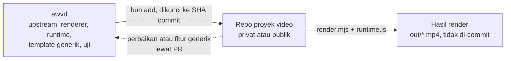
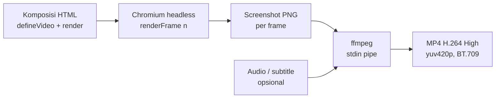

# awvd — AhliWeb Video Dev

## Metadata

- Version: `v1.6.0`
- Last updated: `2026-11-07`
- Changeset: `Referensi API runtime: helper generik baru (areaAman, ms/durasi, preset easing, kontras WCAG, durasiBaca, pecahBaris, captionAktif/parseVtt/parseSrt, berjenjang) beserta uji unit scripts/uji-runtime.mjs.`

Video MP4 dari kode web (HTML/CSS/JS) yang digambar per nomor frame, untuk dibuat dan dirawat oleh manusia maupun AI agent. awvd adalah renderer sendiri berbasis Chromium headless dan ffmpeg: sebuah komposisi adalah halaman web yang menggambar ulang dirinya untuk setiap nomor frame, sehingga hasilnya deterministik dan bisa ditinjau sebagai kode.

## Klasifikasi repo

| Atribut | Nilai |
| --- | --- |
| Status | `active` |
| Kelas repo | `internal` |
| Domain operasional | `internal-ops` |
| Tingkat risiko | `low` |
| Source of truth | `primary` untuk kode renderer awvd |
| Owner operasional | AhliWeb (akun GitHub `ahliweb`) |
| Risiko dan batasan | Tidak menyentuh production dan tidak di-deploy. Repo publik: tanpa secret, data nyata, aset tanpa lisensi jelas, atau rujukan ke repo internal yang privat. Bukan tempat proyek video: pekerjaan proyek ada di repo proyek terpisah (lihat Peran repo: upstream). |

Klasifikasi ditetapkan pemilik pada 2026-11-07.

## Peran repo: upstream

awvd hanya menjadi **upstream**: mesin renderer, runtime, template contoh generik, dan uji. awvd **bukan** repo proyek pengembangan atau pembuatan video. Pekerjaan proyek video berada di repo proyek terpisah, privat atau publik, dengan lisensi pilihan pemilik proyek itu. Penetapan ini adalah keputusan pemilik pada 2026-11-07.

| Masuk awvd | Tidak masuk awvd (masuk repo proyek) |
| --- | --- |
| Renderer `scripts/render.mjs` dan runtime `scripts/runtime.js` | Komposisi proyek (halaman HTML video milik proyek) |
| Uji otomatis dan CI | Props dan naskah proyek |
| Template contoh generik berdata fiktif di `templates/` untuk dokumentasi dan uji | Aset klien atau merek (logo, font, gambar, musik, footage) |
| Dokumentasi API runtime, flag CLI, dan aturan determinisme | Narasi, TTS, dan subtitle proyek |
| Perbaikan dan fitur generik yang berguna bagi semua proyek | Hasil render (MP4, PNG) dan kode khusus proyek |



Kode khusus proyek tidak masuk awvd. Perbaikan atau fitur yang bersifat generik, yang ditemukan saat mengerjakan proyek, dikirim balik sebagai pull request ke awvd (ikuti [AGENTS.md](AGENTS.md) §Git dan PR).

### Memakai awvd di repo proyek

Repo proyek memasang awvd sebagai dependensi git Bun yang dikunci ke satu commit:

```bash
bun add "github:ahliweb/awvd#<sha-commit>"
```

Contoh struktur repo proyek:

```text
package.json                 dependensi awvd (dikunci ke SHA commit)
video/<nama>/index.html      komposisi proyek
video/<nama>/props.json      props dan naskah proyek (data fiktif untuk contoh)
video/<nama>/aset/           font, gambar, audio milik proyek, dicatat lisensinya
out/                         hasil render; diabaikan git (tambahkan ke .gitignore)
```

Komposisi memuat runtime dari paket yang terpasang, dengan jalur relatif dari `video/<nama>/index.html`:

```html
<script src="../../node_modules/awvd/scripts/runtime.js"></script>
```

Render dijalankan dengan renderer dari paket yang sama:

```bash
bun node_modules/awvd/scripts/render.mjs video/<nama>/index.html \
  --out out/<nama>.mp4 --props-file video/<nama>/props.json
```

Prasyarat (Bun, `ffmpeg`, Chromium untuk Playwright) sama dengan §Mulai cepat; flag CLI sama dengan §Flag CLI.

**Menaikkan versi.** Baca [CHANGELOG.md](CHANGELOG.md) awvd, terutama butir yang ditandai memengaruhi repo proyek, lalu ulangi `bun add "github:ahliweb/awvd#<sha-baru>"` dan render ulang video yang terdampak. Cara lain sengaja tidak dipakai: git submodule (alurnya lebih rumit) serta menyalin atau mem-fork awvd (menyimpang dari upstream).

**Lisensi.** awvd berlisensi MIT. Pemberitahuan MIT ikut terpasang di `node_modules/awvd/LICENSE` dan wajib dipertahankan. Repo proyek boleh memakai lisensi lain, termasuk non-komersial atau source-available, hanya untuk materi orisinal proyeknya sendiri, bukan untuk kode awvd.

## Alur render



Tidak ada berkas sementara per frame: PNG dialirkan langsung ke stdin ffmpeg.

## Mulai cepat

Prasyarat: Linux, [Bun](https://bun.sh), `ffmpeg` (termasuk `ffprobe`), dan Chromium untuk Playwright. Tidak ada Node.js yang dibutuhkan.

```bash
bun install
bunx playwright-core install chromium-headless-shell   # sekali saja
bun run render templates/contoh-dasar/index.html --out out/contoh.mp4 \
  --props-file templates/contoh-dasar/props.json
```

Hasil contoh: 1280x720, 30 fps, 180 frame (6 detik). Folder `out/` diabaikan git.

Pratinjau di browser (putar real-time, slider, tombol putar/jeda), buka berkas komposisi dengan query `?preview`:

```text
file:///jalur/ke/awvd/templates/contoh-dasar/index.html?preview
```

Server statis apa pun juga bisa dipakai. Satu frame saja: `?frame=60`. Props pratinjau: `?props={"judul":"Halo"}`.

## Konsep komposisi

Video adalah fungsi murni dari nomor frame. Komposisi memuat `scripts/runtime.js`, memanggil `defineVideo`, dan menggambar ulang DOM di `render(frame, ctx)`.

```html
<script src="../../scripts/runtime.js"></script>
<script>
  defineVideo({
    width: 1280, height: 720, fps: 30, durationInFrames: 180,
    render(frame, ctx) {
      const { judul } = ctx.props;
      document.getElementById("judul").textContent = judul ?? "";
      document.getElementById("judul").style.opacity =
        fade(frame, ctx.durationInFrames);
    },
  });
</script>
```

- `render` boleh `async`; renderer menunggu hasilnya dan `document.fonts.ready` sebelum mengambil screenshot.
- `props` datang dari `--props`/`--props-file` (menjadi `window.videoProps`) atau `?props=` saat pratinjau.
- Contoh lengkap: [`templates/contoh-dasar/`](templates/contoh-dasar/).

## Referensi API runtime

Semua fungsi tersedia sebagai global dan di `window.VideoTerprogram`.

| API | Keterangan |
| --- | --- |
| `defineVideo({ width, height, fps, durationInFrames, render(frame, ctx) })` | Mendaftarkan komposisi dan membuat `window.video`. Semua angka wajib positif; `durationInFrames` bilangan bulat; `render` wajib fungsi. Melempar galat bila tidak valid. |
| `ctx` (argumen kedua `render`) | `{ fps, durationInFrames, width, height, props, detik }`; `detik = frame / fps`. |
| `window.video` | `{ width, height, fps, durationInFrames, renderFrame(n) }`. `renderFrame` membulatkan `n`, menolak di luar `0..durationInFrames-1`, dan menjalankan render secara berurutan (satu pada satu waktu). |
| `interpolasi(frame, masukan[], keluaran[], { clamp = true, easing })` | Pemetaan piecewise-linear. `masukan` naik tegas, panjang sama dengan `keluaran`, minimal 2 titik. `clamp: false` mengekstrapolasi linear. Easing hanya berlaku di dalam segmen. |
| `easing.*` | `linear`, `masukQuad`, `keluarQuad`, `masukKeluarQuad`, `masukCubic`, `keluarCubic`, `masukKeluarCubic`, `masukBack`, `keluarBack`, `keluarElastis`, dan `bezier(x1, y1, x2, y2)` (setara `cubic-bezier` CSS). |
| `pegas(frame, fps, { dari = 0, ke = 1, kekakuan = 100, redaman = 10, massa = 1, tunda = 0 })` | Pegas teredam bentuk-tertutup, mulai diam; murni fungsi dari frame. |
| `urutan(frame, { dari = 0, durasi = Infinity })` | Segmen waktu: mengembalikan `{ aktif, lokal, progres }`. Aktif di `[dari, dari + durasi)`. |
| `fade(frame, durasiTotal, { masuk = 15, keluar = 15 })` | Opasitas 0..1: naik selama `masuk` frame pertama, turun selama `keluar` frame terakhir. |
| `acak(seed)` | PRNG ber-seed (mulberry32), seed angka atau string; mengembalikan fungsi `() => [0,1)`. Seed sama menghasilkan urutan sama. |
| `easing.standar`, `percepat`, `perlambat`, `ditekankanMasuk`, `ditekankanKeluar` | Preset easing bezier: `(0.2,0,0,1)`, `(0.3,0,1,1)`, `(0,0,0,1)`, `(0.05,0.7,0.1,1)`, `(0.3,0,0.8,0.15)`. Sumber: token easing Material Design 3. Easing lama tidak berubah. |
| `durasi.*` | Preset milidetik: `pendek` 150, `sedang` 300, `panjang` 500, `sangatPanjang` 800 (token durasi Material Design 3), `masuk` 300, `keluar` 200 (elemen masuk sedikit lebih lama dari keluar; NN/g, Laubheimer 2020). |
| `ms(milidetik, fps)` | Milidetik ke jumlah frame, dibulatkan ke terdekat (setengah naik); input > 0 minimal 1 frame, input 0 menghasilkan 0. Contoh `ms(durasi.sedang, ctx.fps)`; `ms(300, 30)` = 9. |
| `berjenjang(frame, indeks, { mulai = 0, jeda = 6 })` | Frame lokal elemen ke-`indeks`: `frame - mulai - indeks * jeda`. Untuk stagger satu ide per ketukan; negatif berarti belum mulai. |
| `areaAman(lebar, tinggi)` | `{ aksi: {x,y,w,h}, grafis: {x,y,w,h} }`. Area aksi 93% (margin 3,5% per sisi) dan grafis 90% (5% per sisi), EBU R 95 v1.1 (2017) catatan 5. Margin per sisi dibulatkan ke piksel terdekat (setengah naik), lalu dipakai simetris: `w = lebar - 2 * x`. Contoh 1920x1080: aksi `{67,38,1786,1004}`, grafis `{96,54,1728,972}`. |
| `luminansRelatif(warna)`, `kontras(a, b)` | Luminansi relatif dan rasio kontras 1..21 (tidak dibulatkan) menurut WCAG 2.2 SC 1.4.3. `warna` = `[r,g,b]` 0..255 atau `"#rgb"`/`"#rrggbb"`; format lain melempar galat. `kontras("#000","#fff")` = 21; `kontras("#777","#fff")` ≈ 4,48 (di bawah 4,5). |
| `pilihTeksKontras(latar)` | `"#000000"` atau `"#ffffff"`, mana yang rasio kontrasnya lebih tinggi terhadap `latar`. |
| `durasiBaca(teks, { cps = 17, min = 5/6, maks = 7, fps })` | `{ detik }`, plus `frame` bila `fps` diberikan. Detik = karakter (termasuk spasi; spasi berurutan dirapikan) / `cps`, dijepit ke `[min, maks]`. Netflix Timed Text Style Guide: dewasa maksimal 20 cps, anak 17 cps; angka untuk bahasa Indonesia belum ada sumber primer, jadi bawaan konservatif 17. |
| `pecahBaris(teks, { maks = 42, baris = 2 })` | Mengembalikan **array** baris, dengan properti `melebihi` (boolean) pada array itu. Muat satu baris: satu elemen. Selain itu dipakai jumlah baris minimum dan potongan di spasi dengan prioritas: semua baris <= `maks`; baris atas bukan 1-2 kata; potongan setelah tanda baca (`, . ; : ? !`) atau sebelum kata sambung umum (dan, atau, tetapi, yang, untuk, dengan, di, ke, dari, karena, agar, sehingga); bentuk piramida terbalik (bawah >= atas); baris seimbang. Tidak muat dalam `baris` baris: `melebihi = true` dan array berisi seluruh teks dibungkus greedy (jumlah elemen bisa > `baris`; tidak ada teks hilang). Teks kosong menghasilkan `[]`. Pedoman: Netflix Timed Text Style Guide (maksimal 42 karakter per baris, dua baris). Properti `melebihi` hilang bila array diserialisasi JSON. |
| `captionAktif(cues, frame, fps)` | Cue aktif atau `null`. `cues` = array `{ mulai, akhir, teks }` dalam detik; aktif bila `mulai <= frame/fps < akhir`. Cue tumpang tindih: yang pertama dalam array. Untuk burn-in caption di DOM. |
| `parseVtt(teks)`, `parseSrt(teks)` | Teks berkas ke array cues. Timestamp `hh:mm:ss.mmm` atau `mm:ss.mmm` (koma juga diterima). Header, `NOTE`, `STYLE`, nomor/id cue, dan pengaturan cue diabaikan; tag seperti `<i>` dan `<v Nama>` dibuang; `parseVtt` juga mengurai `&amp; &lt; &gt; &nbsp;`. Cue kosong atau berakhir sebelum mulai dibuang. |

Semua helper di atas murni (tanpa `Date`, `Math.random`, atau timer), jadi aman dipakai di `render`.

Mode URL (tanpa query: diam menunggu renderer): `?preview`, `?frame=N`, `?props={...}`.

## Flag CLI

```text
bun scripts/render.mjs <komposisi.html|URL> --out hasil.mp4 [opsi]
```

| Flag | Bawaan | Keterangan |
| --- | --- | --- |
| `--out F` | wajib | Berkas keluaran (`.mp4`, atau `.png` bersama `--still`). Folder tujuan dibuat otomatis bila belum ada. |
| `--props JSON` / `--props-file F` | `{}` | Props komposisi; pakai salah satu, harus objek JSON. |
| `--dari N` / `--sampai M` | `0` / frame terakhir | Rentang frame (inklusif). Audio dan subtitle diselaraskan ke frame awal. |
| `--skala X` | `1` | Faktor skala keluaran (min 0,1); layout tetap, raster dibuat ulang tajam. Dimensi ganjil dipotong 1 px ke genap. |
| `--crf N` | `18` | Kualitas x264, `0..51`. |
| `--audio F` | - | Trek audio, di-encode AAC-LC 48 kHz stereo 384 kbps; yang pendek diberi senyap (setelah normalisasi), yang panjang dipotong sesuai durasi video. |
| `--kenyaringan M` | `web` | Normalisasi kenyaringan audio dengan `loudnorm` dua-pass (mode `linear`); hanya berlaku bersama `--audio`, diabaikan (dengan peringatan) tanpa `--audio`. `web`: -16 LUFS, true peak -1,5 dBTP, LRA 11. `siaran`: -23 LUFS, -1 dBTP, LRA 11 (EBU R 128; toleransi R 128 ±1 LU). `mati`: tanpa normalisasi. Nilai lain: kode keluar `2`. Pass 1 mengukur segmen audio yang sama dengan yang dipakai video (offset `--dari`, dipotong sepanjang video); audio senyap total dilewati dengan peringatan. |
| `--subtitle F` | - | `.vtt` atau `.srt`, disematkan sebagai trek lunak `mov_text`. |
| `--bahasa KODE` | `ind` | Kode bahasa trek subtitle. |
| `--still N` | - | Render satu frame N sebagai PNG, bukan video. |
| `--browser PATH` | otomatis | Jalur Chromium. Tanpa ini: `PLAYWRIGHT_BROWSERS_PATH` atau `~/.cache/ms-playwright`, lalu `google-chrome`/`chromium` sistem. |
| `-h`, `--help` | - | Tampilkan petunjuk. |

Setelah encode berhasil dan ada audio, renderer mengukur hasil akhir dan mencetak `kenyaringan: I=.. LUFS, TP=.. dBTP (target ..)`. Ini hanya laporan; kegagalan pengukuran tidak menggagalkan render.

**Encode video.** Piksel PNG sRGB rentang penuh dari browser dikonversi eksplisit ke YUV 4:2:0 matriks BT.709 rentang TV (`scale=in_range=full:out_range=tv:out_color_matrix=bt709`) dan ditandai SDR BT.709 (primaries, transfer, matriks, rentang `tv`), sehingga warna sama di semua pemutar. Profil H.264 High, progresif, B-frame 2, GOP tertutup sepanjang setengah fps, `faststart`. Audio AAC-LC 48 kHz stereo 384 kbps. Parameter ini mengikuti YouTube Help "Recommended upload encoding settings" (support.google.com/youtube/answer/1722171). Target kenyaringan mengikuti EBU R 128 (-23 LUFS, true peak maks -1 dBTP) untuk siaran dan AES TD1004/TD1008 (streaming -14 sampai -20 LUFS, dipilih -16) untuk web.

Kode keluar `0` bila berhasil, `2` untuk argumen tidak valid, `1` untuk galat saat render (termasuk halaman tanpa `window.video` setelah 15 detik).

## Aturan determinisme

Dua render dari komposisi dan props yang sama harus menghasilkan frame identik (diverifikasi oleh `bun run uji` lewat `framemd5`).

- Seluruh gerak hanya berasal dari `frame` atau `ctx.detik`.
- Jangan pakai `Date.now()`, `performance.now()`, `setTimeout`/`setInterval`, atau `requestAnimationFrame` untuk menggerakkan animasi.
- Jangan pakai `Math.random()`; pakai `acak(seed)`.
- Jangan pakai CSS animation atau transition; runtime menyuntikkan aturan yang mematikannya.
- Font dan gambar harus termuat sebelum frame pertama; renderer menunggu `document.fonts.ready` dan semua ``, dan gagal bila ada gambar rusak.

## Aksesibilitas

- **Subtitle lunak:** `--subtitle teks.vtt` menyematkan trek `mov_text` yang bisa dinyalakan atau dimatikan pemutar.
- **Berkas sidecar:** simpan `.vtt`/`.srt` berdampingan dengan MP4 untuk platform yang meminta berkas terpisah.
- Pastikan kontras teks memadai dan jangan menyampaikan informasi hanya lewat warna atau audio.
- Kontrol pratinjau memiliki label ARIA (`Kontrol pratinjau video`, `Posisi frame`).

## Batasan yang diketahui

- Render serial, sekitar 21 fps pada mesin pengembangan (komposisi contoh); tidak ada paralelisasi antar frame.
- Hanya Linux yang diuji.
- Elemen `<video>` di DOM tidak di-seek per frame; gunakan gambar atau `<canvas>` yang digambar dari nomor frame.
- Keluaran hanya H.264 (MP4) dan PNG (still). Tidak ada WebM/ProRes/GIF.
- Hanya SDR BT.709; tidak ada HDR atau ruang warna lain. Normalisasi kenyaringan memakai `loudnorm` linear; bila mode linear tidak dapat dicapai tanpa melewati batas true peak, ffmpeg beralih ke mode dinamis, dan hasil ukur bisa menyimpang dari target (periksa laporan `kenyaringan:`). Hasil dikodekan AAC setelah normalisasi, jadi true peak akhir dapat berbeda sedikit.
- Resolusi dasar diambil dari `width`/`height` komposisi; ubah ukuran akhir dengan `--skala`.

## Struktur repo

```text
scripts/render.mjs     CLI renderer (Chromium + ffmpeg)
scripts/runtime.js     runtime komposisi (defineVideo, interpolasi, helper, dst.)
scripts/uji-runtime.mjs  uji unit helper runtime (tanpa browser)
scripts/uji.mjs        uji otomatis renderer (bun run uji)
templates/<nama>/      komposisi contoh + ASET.md (catatan aset pihak ketiga)
.github/workflows/     CI uji
.github/pull_request_template.md   checklist uji dan dokumentasi PR
.claude/agents/        subagent pelaksana (kompleks, sederhana) untuk orchestrator
AGENTS.md              aturan kerja AI agent (orchestrator, git, rilis, dokumentasi)
CHANGELOG.md           riwayat perubahan software
```

Perintah: `bun run render <komposisi> --out ...` dan `bun run uji` (uji unit helper runtime lewat `scripts/uji-runtime.mjs`, lalu sembilan uji renderer: properti video, determinisme, still, rentang, audio, subtitle, skala, galat, kenyaringan siaran; sekitar satu setengah menit). `bun run uji -- --simpan DIR` juga menyalin PNG still hasil uji ke `DIR`; CI memakainya untuk artefak `frame-contoh`.

## Kontribusi dan dokumentasi

Setiap perubahan lewat branch dan pull request (`<jenis>/<ringkas>`), dan merge hanya setelah semua check (`uji`, GitGuardian) berstatus SUCCESS. Perubahan konsep atau fitur wajib membawa pembaruan dokumen di PR yang sama. Aturan lengkapnya ada di [AGENTS.md](AGENTS.md): §Git dan PR untuk alur git, dan §Dokumentasi untuk peta "perubahan apa memperbarui dokumen mana".

Ada dua jenis versi yang berbeda. Versi dokumen (`Version` di blok Metadata README dan AGENTS.md) menandai revisi dokumen. Versi software ada di `package.json` dan `CHANGELOG.md`. README `v1.6.0` tidak berarti awvd `1.6.0`.

## Rilis

Belum ada rilis bertag. Versi paket `0.1.0`, dan semua perubahan dicatat di [CHANGELOG.md](CHANGELOG.md) bagian `[Unreleased]`. awvd tidak di-deploy ke server mana pun; ia dipakai lokal dan di CI. Prosedur rilis bila kelak diputuskan pemilik ada di AGENTS.md §Rilis dan Deployment.

## Pemakaian di AhliWeb

- Proyek video AhliWeb dikerjakan di repo proyek terpisah yang memakai awvd sebagai dependensi (lihat Peran repo: upstream), bukan di repo ini.
- AI agent AhliWeb memakai awvd lewat skill internal `video-terprogram`, yang berisi prosedur membuat dan merevisi video.
- Panduan video formal untuk pemerintah dan swasta mengikuti standar dokumen formal internal AhliWeb; awvd menjadi alat render videonya.

## Lisensi dan Kepatuhan

- awvd berlisensi [MIT](LICENSE).
- Kode awvd ditulis sendiri. awvd tidak memakai, tidak bergantung pada, dan tidak menyalin kode Remotion maupun remotion-dev/skills. Pemeriksaan 2026-11-07 membandingkan interpolasi, pegas, easing/bezier, dan PRNG dengan sumber Remotion: pendekatan dan implementasinya berbeda. Satu-satunya kesamaan adalah algoritma mulberry32, yang berstatus domain publik (atribusi di `scripts/runtime.js`).
- Konsep "video dari kode yang digambar per frame" adalah ide/metode, bukan ekspresi. Ide dan metode tidak dilindungi hak cipta (UU 28/2014 Pasal 41 huruf b; doktrin dikotomi ide-ekspresi).
- "Remotion" adalah merek milik pemiliknya. Nama itu disebut hanya untuk menjelaskan bahwa awvd tidak memakainya. Tidak ada afiliasi.

### Pihak ketiga

- **playwright-core 1.64.1:** Apache-2.0 (Microsoft). Dependensi npm, bukan kode yang disalin ke repo; LICENSE/NOTICE-nya ikut dalam paket.
- **Chromium/Chrome:** dipakai dari instalasi lokal dan tidak didistribusikan.
- **ffmpeg:** dipanggil sebagai program sistem lewat CLI dan tidak didistribusikan atau ditautkan, sehingga kewajiban LGPL/GPL (libx264) tidak berlaku untuk repo ini. Video keluaran tidak terkena GPL.
- **H.264:** lisensi paten AVC (dulu MPEG LA, kini Via LA) secara historis tidak memungut royalti untuk video internet yang gratis bagi pengguna akhir. Untuk distribusi berbayar, siaran, atau platform streaming komersial, cek ketentuan Via LA terbaru. Status 2026 belum diverifikasi dari halaman resmi.

### Tanggung jawab pengguna atas aset

Font, musik (`--audio`), gambar, footage, dan suara TTS wajib berlisensi jelas dan dicatat sumbernya. Video yang memuat data pribadi tunduk pada UU 27/2022 tentang Pelindungan Data Pribadi (dasar pemrosesan atau persetujuan). Jangan pakai data nyata di contoh. TTS daring hanya untuk konten publik (DL-037).

## Changelog

### 2026-11-07 - v1.6.0

- §Referensi API runtime: menambahkan `areaAman`, `ms` dan `durasi`, preset `easing` (standar, percepat, perlambat, ditekankanMasuk, ditekankanKeluar), `luminansRelatif`/`kontras`/`pilihTeksKontras`, `durasiBaca`, `pecahBaris`, `captionAktif`/`parseVtt`/`parseSrt`, dan `berjenjang`, masing-masing dengan sumbernya (EBU R 95, Material Design 3, NN/g, WCAG 2.2 SC 1.4.3, Netflix Timed Text Style Guide).
- §Struktur repo: mencantumkan `scripts/uji-runtime.mjs` dan `bun run uji:runtime`; `bun run uji` kini menjalankan uji unit runtime sebelum uji renderer.

### 2026-11-07 - v1.5.0

- §Flag CLI: menambahkan `--kenyaringan web|siaran|mati` dan laporan kenyaringan; `--audio` kini AAC-LC 48 kHz 384k; catatan encode BT.709, H.264 High, GOP tertutup beserta rujukan YouTube Help, EBU R 128, dan AES.
- §Alur render, §Batasan yang diketahui, dan §Struktur repo (sembilan uji) disesuaikan.

### 2026-11-07 - v1.4.1

- §Flag CLI: `--out` membuat folder tujuan bila belum ada.

### 2026-11-07 - v1.4.0

- Menambahkan bagian Peran repo: upstream: awvd hanya upstream, tabel batas isi awvd dan repo proyek, diagram hubungan dengan repo proyek, dan subbagian Memakai awvd di repo proyek (dependensi git terkunci SHA, struktur repo proyek, naik versi, lisensi).
- Risiko dan batasan di Klasifikasi repo dan bagian Pemakaian di AhliWeb disesuaikan.

### 2026-11-07 - v1.3.1

- Klasifikasi repo ditetapkan pemilik; menambahkan tingkat risiko.

### 2026-11-07 - v1.3.0

- Menambahkan bagian Klasifikasi repo (kelas dan domain masih usulan) dan Rilis.
- Struktur repo mencantumkan `.claude/agents/`.
- Mengganti "Hubungan dengan repo lain" menjadi "Pemakaian di AhliWeb" dan menghapus nama, path, serta tautan repo pedoman internal yang privat.

### 2026-11-07 - v1.2.0

- Menambahkan bagian Kontribusi dan dokumentasi (rujukan ke AGENTS.md §Dokumentasi, pemisahan versi dokumen dan software).
- Mendokumentasikan opsi `--simpan DIR` pada `bun run uji`.
- Struktur repo mencantumkan `templates/<nama>/ASET.md` dan template PR.

### 2026-11-07 - v1.1.0

- Menambahkan bagian Lisensi dan Kepatuhan menggantikan bagian Lisensi singkat.

### 2026-11-07 - v1.0.0

- README lengkap pertama: alur render, mulai cepat, konsep komposisi, API runtime, flag CLI, determinisme, aksesibilitas, batasan, struktur repo, dan hubungan dengan repo lain.
