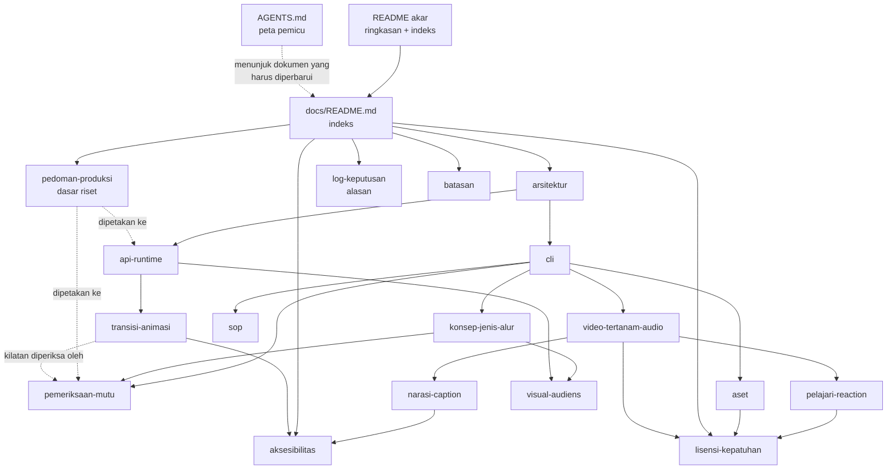

# Dokumentasi awvd

## Metadata

- Version: `v1.6.0`
- Last updated: `2026-11-07`
- Changeset: `Mendaftarkan narasi-caption.md (naskah.json, bun run narasi, caption sinkron voice over) dan memperbarui versi dokumen yang berubah; tabel kini memuat 19 dokumen docs/.`

Pintu masuk ke seluruh dokumentasi rinci awvd. Ringkasan proyek, mulai cepat, dan perintah utama ada di [README akar](../README.md); aturan kerja kontributor dan AI agent ada di [AGENTS.md](../AGENTS.md); riwayat perubahan software ada di [CHANGELOG.md](../CHANGELOG.md).

## Indeks dokumen

Kolom Versi adalah versi dokumen (bukan versi software); nilainya harus sama dengan `Version` di blok Metadata dokumen itu.

| Dokumen | Isi | Versi |
| --- | --- | --- |
| [arsitektur.md](arsitektur.md) | Alur render, konsep komposisi, protokol `window.video`/`renderFrame`, pemblokiran jaringan, aturan determinisme, peran upstream, memakai awvd di repo proyek | `v1.1.0` |
| [api-runtime.md](api-runtime.md) | Referensi seluruh API `scripts/runtime.js`, mode URL, sumber riset helper | `v1.2.0` |
| [cli.md](cli.md) | Flag `render.mjs`, kode keluar, jaringan dan font, encode BT.709, kenyaringan, daftar perintah lain | `v1.3.0` |
| [aset.md](aset.md) | `bun run aset`: manifest `aset.json`, matriks lisensi, SVG berdaftar-izin, resolusi, sRGB, atribusi, rencana helper runtime | `v1.0.0` |
| [pemeriksaan-mutu.md](pemeriksaan-mutu.md) | `bun run periksa` (termasuk `--konsep`): pemeriksaan, ambang, kilatan fotosensitif | `v1.0.1` |
| [konsep-jenis-alur.md](konsep-jenis-alur.md) | `bun run konsep`, `konsep.json`, 13 jenis video, 5 alur produksi, tingkat bukti, profil audiens | `v1.1.0` |
| [sop.md](sop.md) | SOP sebagai dokumen cetak (PermenPAN-RB 35/2012) dan bahan video | `v1.0.0` |
| [video-tertanam-audio.md](video-tertanam-audio.md) | Video di dalam video (lisensi sumber, `klip.mjs`) dan timeline audio (`audio.mjs`) | `v1.2.0` |
| [narasi-caption.md](narasi-caption.md) | `bun run narasi`: skema `naskah.json`, estimasi timing berjangkar jeda, cue VTT/SRT dengan lint cps profil audiens, rencana audio, mesin suara pluggable | `v1.0.0` |
| [pelajari-reaction.md](pelajari-reaction.md) | `bun run pelajari` (statistik gaya), kebijakan kutipan wajar, gerbang hukum GH, templat reaction, dasar hukum ringkas (bukan nasihat hukum) | `v1.0.0` |
| [visual-audiens.md](visual-audiens.md) | Profil audiens, ukuran teks, buta warna dan jarak warna, ketajaman (garis 2 px, 4:2:0, supersampling), efek dekoratif | `v1.0.0` |
| [transisi-animasi.md](transisi-animasi.md) | Modul `scripts/transisi.js`: 21 transisi, 13 animasi elemen, kustomisasi, profil dan `kurangiGerak`, biaya kompresi | `v1.0.0` |
| [aksesibilitas.md](aksesibilitas.md) | Subtitle, kontras, kilatan, kontrol pratinjau, gerak, teks alternatif aset, peta fitur aksesibilitas | `v1.4.0` |
| [batasan.md](batasan.md) | Batasan yang diketahui dan penunjuk ke batasan per fitur | `v1.5.0` |
| [lisensi-kepatuhan.md](lisensi-kepatuhan.md) | Lisensi MIT, asal kode, pihak ketiga, tanggung jawab atas aset, matriks lisensi aset, video pihak ketiga dan kutipan wajar | `v1.3.0` |
| [pedoman-produksi.md](pedoman-produksi.md) | Pedoman produksi berbasis riset, dipetakan ke fitur awvd, checklist, rencana | `v1.1.0` |
| [roadmap.md](roadmap.md) | Roadmap: visi, fase F1–F6 dan kriteria keluarnya, paritas fitur, label dan milestone GitHub | `v1.1.0` |
| [log-keputusan.md](log-keputusan.md) | Log keputusan awvd (KP-001 dst.) beserta alasan dan rujukan PR | `v1.5.0` |
| [README.md](README.md) | Indeks ini | `v1.6.0` |

## Peta dokumen

Panah menunjukkan arah rujukan utama: dokumen fitur merujuk ke dokumen dasar, dan pedoman serta log keputusan menjelaskan alasannya.

## Menambah atau mengubah dokumen

- Setiap dokumen Markdown di `docs/` wajib memiliki blok `## Metadata` tepat setelah judul (`Version` `vX.Y.Z`, `Last updated` `YYYY-MM-DD`, `Changeset` berisi ringkasan revisi terakhir saja) dan `## Changelog` di bagian bawah dengan entri `### YYYY-MM-DD - vX.Y.Z` terbaru di atas.
- Dokumen baru wajib didaftarkan di tabel Indeks dokumen di atas dan di indeks dokumentasi [README akar](../README.md#dokumentasi).
- Setiap perubahan dokumen menaikkan `Version` dokumen itu dan nilainya di kolom Versi di atas. Patch untuk koreksi, minor untuk bagian baru yang kompatibel, major untuk perubahan struktur atau kebijakan.
- Dokumen harus sama dengan kondisi nyata repo; jangan menulis rencana sebagai fitur. Rencana boleh ditulis di bagian tersendiri tanpa janji tanggal (contoh: [pedoman-produksi.md](pedoman-produksi.md#rencana)).
- Gunakan Mermaid hanya bila diagram menambah informasi (arsitektur, alur, atau keputusan), dengan label singkat.
- Document Changeset (blok Metadata dokumen) tidak sama dengan Release Changeset (tidak dipakai di repo ini) maupun `CHANGELOG.md` software. Aturan lengkap dan peta "perubahan apa memperbarui dokumen mana" ada di [AGENTS.md](../AGENTS.md) §Dokumentasi.
- Dokumen berbahasa Indonesia dan tidak menyebut nama, path, atau tautan repo internal AhliWeb yang privat.

## Changelog

### 2026-11-07 - v1.6.0

- Mendaftarkan `narasi-caption.md` (v1.0.0); indeks kini memuat 19 dokumen. Versi dokumen yang berubah: `video-tertanam-audio.md` v1.2.0, `cli.md` v1.3.0, `aksesibilitas.md` v1.4.0, `batasan.md` v1.5.0, `roadmap.md` v1.1.0, `log-keputusan.md` v1.5.0.

### 2026-11-07 - v1.5.0

- Mendaftarkan `roadmap.md` (v1.0.0); indeks kini memuat 18 dokumen.

### 2026-11-07 - v1.4.0

- Menambahkan [pelajari-reaction.md](pelajari-reaction.md) (v1.0.0) ke tabel indeks dan peta dokumen (17 dokumen) dan memperbarui versi dokumen yang berubah (`video-tertanam-audio.md` v1.1.0, `cli.md` v1.2.0, `lisensi-kepatuhan.md` v1.3.0, `batasan.md` v1.4.0, `log-keputusan.md` v1.4.0).

### 2026-11-07 - v1.3.0

- Mendaftarkan `aset.md` (v1.0.0) ke tabel indeks dan peta dokumen (16 dokumen) dan memperbarui versi dokumen yang berubah (`arsitektur.md` v1.1.0, `cli.md` v1.1.0, `lisensi-kepatuhan.md` v1.2.0, `batasan.md` v1.3.0, `aksesibilitas.md` v1.3.0, `log-keputusan.md` v1.3.0).

### 2026-11-07 - v1.2.0

- Menambahkan `transisi-animasi.md` (v1.0.0) ke tabel indeks, peta dokumen, dan memperbarui versi dokumen yang berubah (`lisensi-kepatuhan.md` v1.1.0, `api-runtime.md` v1.2.0, `batasan.md` v1.2.0, `aksesibilitas.md` v1.2.0, `log-keputusan.md` v1.2.0); indeks kini memuat 15 dokumen.

### 2026-11-07 - v1.1.0

- Mendaftarkan `visual-audiens.md` (14 dokumen) dan memperbarui kolom Versi dokumen yang berubah.

### 2026-11-07 - v1.0.0

- Indeks dokumentasi pertama: 13 dokumen docs/ beserta peta dokumen dan aturan menambah dokumen.
