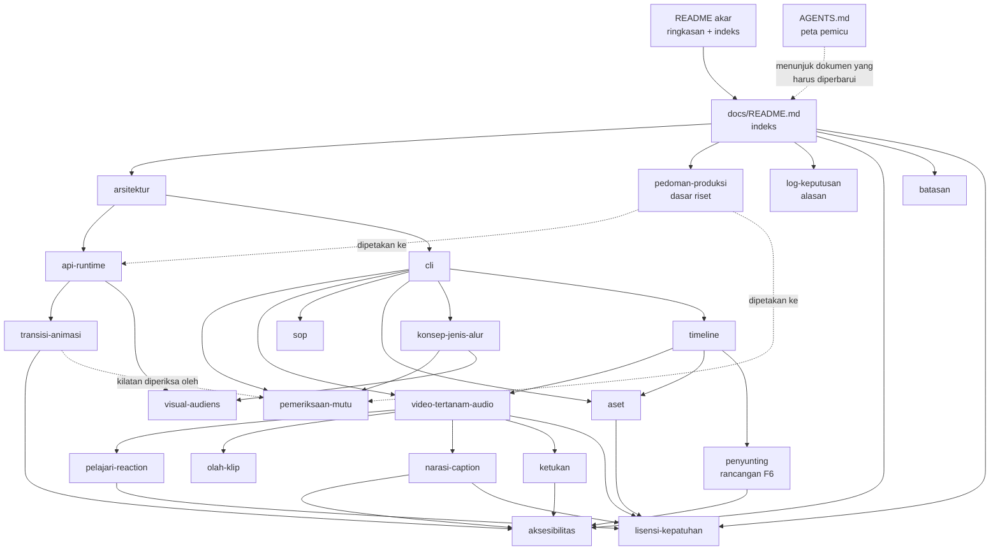

# Dokumentasi awvd

## Metadata

- Version: `v1.17.3`
- Last updated: `2026-11-08`
- Changeset: `Versi timeline.md v1.3.1 dan video-tertanam-audio.md v1.9.1 (R09 memeriksa jangkauan tempo, #84). Sebelumnya: Versi timeline.md v1.3.0 dan roadmap.md v1.18.0 (F2 selesai).`

Pintu masuk ke seluruh dokumentasi rinci awvd. Ringkasan proyek, mulai cepat, dan perintah utama ada di [README akar](../README.md); aturan kerja kontributor dan AI agent ada di [AGENTS.md](../AGENTS.md); riwayat perubahan software ada di [CHANGELOG.md](../CHANGELOG.md).

## Indeks dokumen

Kolom Versi adalah versi dokumen (bukan versi software); nilainya harus sama dengan `Version` di blok Metadata dokumen itu.

| Dokumen | Isi | Versi |
| --- | --- | --- |
| [arsitektur.md](arsitektur.md) | Alur render, konsep komposisi, protokol `window.video`/`renderFrame`, pemblokiran jaringan, aturan determinisme, peran upstream, memakai awvd di repo proyek | `v1.2.0` |
| [api-runtime.md](api-runtime.md) | Referensi seluruh API `scripts/runtime.js`, pemetaan waktu klip, mode URL, sumber riset helper | `v1.6.1` |
| [cli.md](cli.md) | Flag `render.mjs`, kode keluar, jaringan dan font, encode BT.709, kenyaringan, daftar perintah lain | `v1.8.1` |
| [aset.md](aset.md) | `bun run aset`: manifest `aset.json`, matriks lisensi, SVG berdaftar-izin, resolusi, sRGB, atribusi, helper runtime (logo, ikon, kredit, font) | `v1.1.0` |
| [pemeriksaan-mutu.md](pemeriksaan-mutu.md) | `bun run periksa` (termasuk `--konsep`): pemeriksaan, ambang, kilatan fotosensitif | `v1.0.1` |
| [konsep-jenis-alur.md](konsep-jenis-alur.md) | `bun run konsep`, `konsep.json`, 13 jenis video, 5 alur produksi, tingkat bukti, profil audiens | `v1.2.0` |
| [sop.md](sop.md) | SOP sebagai dokumen cetak (PermenPAN-RB 35/2012) dan bahan video | `v1.0.1` |
| [video-tertanam-audio.md](video-tertanam-audio.md) | Video di dalam video (lisensi sumber, `klip.mjs`) dan timeline audio (`audio.mjs`) | `v1.9.1` |
| [olah-klip.md](olah-klip.md) | Efek klip saat ekstraksi: `klip[].efek` (LUT `.cube`, warna, keseimbangan), rantai ffmpeg, kunci cache, LUT identitas, titik perluasan | `v1.2.0` |
| [pelajari-reaction.md](pelajari-reaction.md) | `bun run pelajari` (statistik gaya), kebijakan kutipan wajar, gerbang hukum GH, templat reaction, dasar hukum ringkas (bukan nasihat hukum) | `v1.0.0` |
| [visual-audiens.md](visual-audiens.md) | Profil audiens, ukuran teks, buta warna dan jarak warna, ketajaman (garis 2 px, 4:2:0, supersampling), efek dekoratif | `v1.0.0` |
| [transisi-animasi.md](transisi-animasi.md) | Modul `scripts/transisi.js`: 21 transisi, 13 animasi elemen, kustomisasi, profil dan `kurangiGerak`, biaya kompresi | `v1.1.0` |
| [aksesibilitas.md](aksesibilitas.md) | Subtitle, kontras, kilatan, kontrol pratinjau, gerak, teks alternatif aset, peta fitur aksesibilitas | `v1.7.0` |
| [batasan.md](batasan.md) | Batasan yang diketahui dan penunjuk ke batasan per fitur | `v1.8.1` |
| [lisensi-kepatuhan.md](lisensi-kepatuhan.md) | Lisensi MIT, asal kode, pihak ketiga, model TTS dan OpenRAIL-M, tanggung jawab atas aset, matriks lisensi aset, video pihak ketiga dan kutipan wajar | `v1.5.0` |
| [pedoman-produksi.md](pedoman-produksi.md) | Pedoman produksi berbasis riset, dipetakan ke fitur awvd, checklist, rencana | `v1.1.0` |
| [roadmap.md](roadmap.md) | Roadmap: visi, fase F1–F6 dan kriteria keluarnya, paritas fitur, label dan milestone GitHub | `v1.18.0` |
| [log-keputusan.md](log-keputusan.md) | Log keputusan awvd (KP-001 dst.) beserta alasan dan rujukan PR | `v1.22.0` |
| [narasi-caption.md](narasi-caption.md) | `bun run narasi`: skema `naskah.json`, estimasi timing berjangkar jeda, cue VTT/SRT dengan lint cps profil audiens, rencana audio, mode dan posisi caption, mesin suara pluggable, TTS dan ASR lokal opsional | `v1.3.0` |
| [ketukan.md](ketukan.md) | `bun run ketukan`: onset fluks spektral, tempo autokorelasi, ketukan berselaras grid, skema `ketukan.json`, helper `window.Ketukan`, batas bukti | `v1.0.0` |
| [reframe.md](reframe.md) | Reframe 16:9 ke 9:16: crop berkeyframe deterministik, skema `reframe.json`, `window.Reframe`, saran fokus opsional tanpa model, templat `reframe-contoh` | `v1.0.0` |
| [timeline.md](timeline.md) | `timeline.json` (skema 1): track, butir, transisi tumpang tindih, pemetaan waktu klip; validator `bun run timeline periksa`, aturan R01-R17 dan W01-W09, kebijakan kutipan turunan; templat render generik `templates/timeline/` dan rencana audio turunan | `v1.3.1` |
| [penyunting.md](penyunting.md) | Rancangan penyunting pratinjau lokal F6 (disetujui, belum diimplementasikan): server lokal `Bun.serve` dengan validator `timeline.mjs`, wireframe, alur sunting, aksesibilitas WCAG 2.2 AA, pemecahan #54 dan #55 | `v1.0.0` |
| [README.md](README.md) | Indeks ini | `v1.17.3` |

## Peta dokumen

Panah menunjukkan arah rujukan utama: dokumen fitur merujuk ke dokumen dasar, dan pedoman serta log keputusan menjelaskan alasannya.

## Menambah atau mengubah dokumen

- Setiap dokumen Markdown di `docs/` wajib memiliki blok `## Metadata` tepat setelah judul (`Version` `vX.Y.Z`, `Last updated` `YYYY-MM-DD`, `Changeset` berisi ringkasan revisi terakhir saja) dan `## Changelog` di bagian bawah dengan entri `### YYYY-MM-DD - vX.Y.Z` terbaru di atas.
- Dokumen baru wajib didaftarkan di tabel Indeks dokumen di atas dan di indeks dokumentasi [README akar](../README.md#dokumentasi).
- Setiap perubahan dokumen menaikkan `Version` dokumen itu dan nilainya di kolom Versi di atas. Patch untuk koreksi, minor untuk bagian baru yang kompatibel, major untuk perubahan struktur atau kebijakan.
- Dokumen harus sama dengan kondisi nyata repo; jangan menulis rencana sebagai fitur. Rencana boleh ditulis di bagian tersendiri tanpa janji tanggal (contoh: [pedoman-produksi.md](pedoman-produksi.md#rencana)).
- Gunakan Mermaid hanya bila diagram menambah informasi (arsitektur, alur, atau keputusan), dengan label singkat.
- Document Changeset (blok Metadata dokumen) tidak sama dengan Release Changeset (tidak dipakai di repo ini) maupun `CHANGELOG.md` software. Aturan lengkap dan peta "perubahan apa memperbarui dokumen mana" ada di [AGENTS.md](../AGENTS.md) §Dokumentasi.
- Dokumen berbahasa Indonesia dan tidak menyebut nama, path, atau tautan repo internal AhliWeb yang privat.

## Changelog

### 2026-11-08 - v1.17.3

- Kolom Versi `timeline.md` v1.3.1 dan `video-tertanam-audio.md` v1.9.1 (R09 memeriksa jangkauan tempo audio, #84).

### 2026-11-08 - v1.17.2

- Kolom Versi `timeline.md` v1.3.0 (dokumen penutup F2) dan `roadmap.md` v1.18.0 (F2 selesai) diperbarui.

### 2026-11-08 - v1.17.1

- Kolom Versi `api-runtime.md` v1.6.1, `video-tertanam-audio.md` v1.9.0 (audio klip ber-speed), `timeline.md` v1.2.0, `roadmap.md` v1.17.0, dan `log-keputusan.md` v1.22.0 diperbarui.

### 2026-11-08 - v1.17.0

- Mendaftarkan `penyunting.md` (v1.0.0) di tabel indeks dan peta dokumen; kolom Versi `roadmap.md`, `log-keputusan.md`, dan baris indeks ini diperbarui (baris indeks ini sebelumnya basi di v1.15.2).

### 2026-11-08 - v1.16.4

- Kolom Versi `cli.md` dan `batasan.md` menjadi v1.8.1 (tahap akhir audio/subtitle memakai `-t`, subtitle pendek tidak memotong video; isu #79).

### 2026-11-08 - v1.16.3

- Kolom Versi dan deskripsi `timeline.md` v1.1.0 (templat render generik, rencana audio), `roadmap.md`, dan `log-keputusan.md` diperbarui.

### 2026-11-08 - v1.16.2

- Kolom Versi `cli.md` v1.8.0, `arsitektur.md` v1.2.0, `batasan.md` v1.8.0 (render paralel per segmen), `roadmap.md`, dan `log-keputusan.md` diperbarui.

### 2026-11-08 - v1.16.1

- Kolom Versi `video-tertanam-audio.md` v1.8.0 (rencana audio dari `timeline.json`), `roadmap.md`, dan `log-keputusan.md` diperbarui.

### 2026-11-08 - v1.16.0

- Mendaftarkan `reframe.md` (v1.0.0) di indeks; versi `cli.md`, `roadmap.md`, dan `log-keputusan.md` diperbarui.

### 2026-11-08 - v1.15.3

- Kolom Versi `api-runtime.md` v1.6.0 (helper `keyframe`) dan `roadmap.md` diperbarui.

### 2026-11-07 - v1.15.2

- Kolom Versi `log-keputusan.md` v1.16.1.

### 2026-11-07 - v1.15.1

- Versi `timeline.md` di indeks menjadi v1.0.1.

### 2026-11-07 - v1.15.0

- Mendaftarkan `timeline.md` (v1.0.0) di indeks dan peta dokumen; versi `cli.md` (v1.6.0), `batasan.md` (v1.7.0), `roadmap.md` (v1.10.0), dan `log-keputusan.md` (v1.16.0) diperbarui.

### 2026-11-07 - v1.14.0

- Versi dokumen yang berubah diperbarui (`narasi-caption.md` v1.3.0, `lisensi-kepatuhan.md` v1.5.0, `aksesibilitas.md` v1.7.0, `batasan.md` v1.6.1, `cli.md` v1.5.0, `roadmap.md` v1.9.0, `log-keputusan.md` v1.15.0); deskripsi `narasi-caption.md` memuat ASR lokal opsional.

### 2026-11-07 - v1.13.0

- Mendaftarkan `ketukan.md` (v1.0.0); indeks kini memuat 21 dokumen. Versi dokumen yang berubah: `cli.md` v1.4.0, `batasan.md` v1.6.0, `roadmap.md` v1.7.0, `log-keputusan.md` v1.13.0.

### 2026-11-07 - v1.12.0

- Kolom Versi `api-runtime.md` v1.5.0, `video-tertanam-audio.md` v1.7.0, `roadmap.md` v1.7.0, dan `log-keputusan.md` v1.13.0 diperbarui; deskripsi `api-runtime.md` memuat pemetaan waktu klip.

### 2026-11-07 - v1.11.0

- Versi dokumen yang berubah diperbarui (`narasi-caption.md` v1.1.0, `lisensi-kepatuhan.md` v1.4.0, `aksesibilitas.md` v1.5.0, `video-tertanam-audio.md` v1.4.0, `batasan.md` v1.5.1, `cli.md` v1.3.1, `roadmap.md` v1.3.0, `log-keputusan.md` v1.8.0); peta dokumen menambah rujukan narasi ke lisensi (model TTS).

### 2026-11-07 - v1.10.0

- Kolom Versi `api-runtime.md`, `aksesibilitas.md`, `roadmap.md`, `log-keputusan.md`, dan `narasi-caption.md` diperbarui; deskripsi `narasi-caption.md` memuat mode dan posisi caption.

### 2026-11-07 - v1.9.0

- `olah-klip.md` v1.2.0 (stabilisasi dan chroma key); versi dokumen yang berubah: `video-tertanam-audio.md` v1.4.0, `roadmap.md` v1.3.0, `log-keputusan.md` v1.8.0.

### 2026-11-07 - v1.8.1

- Versi `video-tertanam-audio.md` v1.4.0 (olah suara per trek), `roadmap.md` v1.3.0, dan `log-keputusan.md` v1.8.0 di tabel indeks.

### 2026-11-07 - v1.8.0

- Memperbarui kolom Versi: `konsep-jenis-alur.md` v1.2.0, `transisi-animasi.md` v1.1.0, `aksesibilitas.md` v1.4.1, `log-keputusan.md` v1.8.0.

### 2026-11-07 - v1.8.0

- Memperbarui kolom Versi: `konsep-jenis-alur.md` v1.2.0, `transisi-animasi.md` v1.1.0, `aksesibilitas.md` v1.4.1, `log-keputusan.md` v1.8.0.

### 2026-11-07 - v1.7.0

- Mendaftarkan `narasi-caption.md` (v1.0.0); indeks kini memuat 19 dokumen. Versi dokumen yang berubah: `video-tertanam-audio.md` v1.2.0, `cli.md` v1.3.0, `aksesibilitas.md` v1.4.0, `batasan.md` v1.5.0, `roadmap.md` v1.1.0, `log-keputusan.md` v1.5.0.

### 2026-11-07 - v1.6.0

- Mendaftarkan `olah-klip.md` (v1.0.0); indeks kini memuat 19 dokumen. Versi `video-tertanam-audio.md` v1.2.0, `log-keputusan.md` v1.5.0, `lisensi-kepatuhan.md` v1.3.1, dan `roadmap.md` v1.1.0 diperbarui.

### 2026-11-07 - v1.5.2

- Memperbarui versi dokumen yang berubah di tabel indeks (`arsitektur.md` v1.1.1, `cli.md` v1.2.1, `transisi-animasi.md` v1.0.1, `batasan.md` v1.4.1).

### 2026-11-07 - v1.5.1

- Kolom Versi dan deskripsi baris `aset.md` diperbarui untuk helper runtime aset (`api-runtime.md` v1.3.0, `aset.md` v1.1.0, `aksesibilitas.md` v1.3.1, `roadmap.md` v1.0.1, `log-keputusan.md` v1.5.0).

### 2026-11-07 - v1.5.0

- Mendaftarkan `roadmap.md` (v1.0.0); indeks kini memuat 18 dokumen.

### 2026-11-07 - v1.4.0

- Menambahkan [pelajari-reaction.md](pelajari-reaction.md) (v1.0.0) ke tabel indeks dan peta dokumen (17 dokumen) dan memperbarui versi dokumen yang berubah (`video-tertanam-audio.md` v1.1.0, `cli.md` v1.2.0, `lisensi-kepatuhan.md` v1.3.0, `batasan.md` v1.4.0, `log-keputusan.md` v1.4.0).

### 2026-11-07 - v1.3.0

- Mendaftarkan `aset.md` (v1.0.0) ke tabel indeks dan peta dokumen (16 dokumen) dan memperbarui versi dokumen yang berubah (`arsitektur.md` v1.1.0, `cli.md` v1.1.0, `lisensi-kepatuhan.md` v1.2.0, `batasan.md` v1.3.0, `aksesibilitas.md` v1.3.0, `log-keputusan.md` v1.3.0).

### 2026-11-07 - v1.2.0

- Menambahkan `transisi-animasi.md` (v1.0.0) ke tabel indeks, peta dokumen, dan memperbarui versi dokumen yang berubah (`lisensi-kepatuhan.md` v1.1.0, `api-runtime.md` v1.2.0, `batasan.md` v1.2.0, `aksesibilitas.md` v1.2.0, `log-keputusan.md` v1.2.0); indeks kini memuat 15 dokumen.

### 2026-11-07 - v1.1.0

- Mendaftarkan `visual-audiens.md` (14 dokumen) dan memperbarui kolom Versi dokumen yang berubah.

### 2026-11-07 - v1.0.0

- Indeks dokumentasi pertama: 13 dokumen docs/ beserta peta dokumen dan aturan menambah dokumen.
