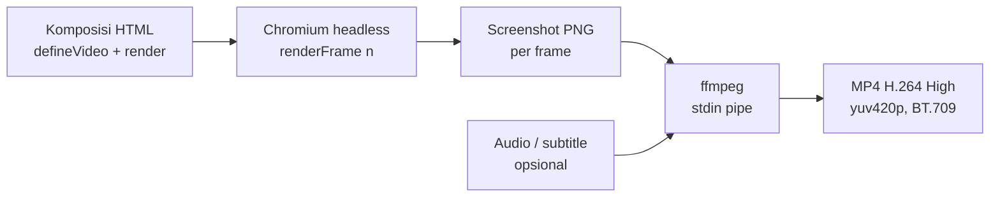
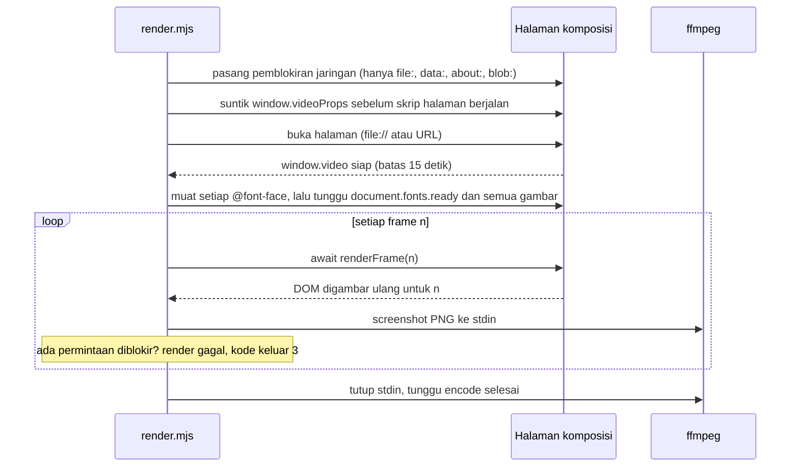
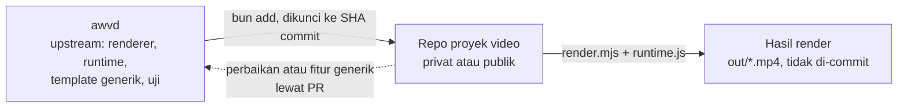

# Arsitektur awvd

## Metadata

- Version: `v1.1.0`
- Last updated: `2026-11-07`
- Changeset: `Protokol renderer diperbarui: semua permintaan non-lokal diblokir (kode keluar 3), setiap @font-face dimuat eksplisit sebelum frame pertama; aturan determinisme memuat larangan sumber luar.`

Dokumen ini menjelaskan cara awvd bekerja: dari komposisi web sampai MP4, kontrak antara komposisi dan renderer, aturan yang menjaga hasil tetap deterministik, serta peran awvd sebagai upstream bagi repo proyek video. Referensi rinci ada di [api-runtime.md](api-runtime.md) dan [cli.md](cli.md).

## Alur render



Tidak ada berkas sementara per frame: PNG dialirkan langsung ke stdin ffmpeg.

## Konsep komposisi

Video adalah fungsi murni dari nomor frame. Komposisi memuat `scripts/runtime.js`, memanggil `defineVideo`, dan menggambar ulang DOM di `render(frame, ctx)`.

```html
<script src="../../scripts/runtime.js"></script>
<script>
  defineVideo({
    width: 1280, height: 720, fps: 30, durationInFrames: 180,
    render(frame, ctx) {
      const { judul } = ctx.props;
      document.getElementById("judul").textContent = judul ?? "";
      document.getElementById("judul").style.opacity =
        fade(frame, ctx.durationInFrames);
    },
  });
</script>
```

- `render` boleh `async`; renderer menunggu hasilnya dan `document.fonts.ready` sebelum mengambil screenshot.
- `props` datang dari `--props`/`--props-file` (menjadi `window.videoProps`) atau `?props=` saat pratinjau.
- Contoh lengkap: [`templates/contoh-dasar/`](../templates/contoh-dasar/).

## Protokol window.video dan renderFrame

Kontrak antara komposisi dan renderer hanya tiga hal: `window.videoProps` (masuk), `window.video` (keluar), dan `renderFrame(n)` (dipanggil per frame). `defineVideo` ([api-runtime.md](api-runtime.md)) membuat `window.video`; `scripts/render.mjs` menjalankan urutan berikut.



| Elemen | Arah | Isi |
| --- | --- | --- |
| `window.videoProps` | renderer ke komposisi | Objek props dari `--props`/`--props-file`, disuntik sebelum skrip halaman berjalan; tersedia sebagai `ctx.props` di `render`. Saat pratinjau datang dari `?props=`. |
| `window.video` | komposisi ke renderer | `{ width, height, fps, durationInFrames, renderFrame(n) }`. Renderer menunggu paling lama 15 detik; tanpa itu render gagal dengan kode keluar `1`. Keempat angka harus positif. |
| `renderFrame(n)` | renderer memanggil | Membulatkan `n`, menolak di luar `0..durationInFrames-1`, dan berjalan berurutan (satu pada satu waktu). Boleh `async`; renderer menunggu hasilnya. |

Langkah renderer sesudah `window.video` siap: viewport diatur ke `width` x `height` komposisi; renderer memuat eksplisit setiap `@font-face` (`FontFace.load()` untuk semua `document.fonts`; render gagal bila ada yang gagal dimuat), menunggu `document.fonts.ready` dan semua `` (render gagal bila ada gambar rusak); tiap frame ditangkap sebagai PNG lewat CDP dengan faktor `--skala` (layout tetap, raster dibuat ulang tajam); PNG dialirkan ke stdin ffmpeg tanpa berkas sementara. Mode `--still N` memanggil `renderFrame(N)` satu kali dan menyimpan PNG.

Mode URL untuk pratinjau dan debug (tanpa query, halaman diam menunggu renderer): `?preview`, `?frame=N`, `?props={...}`. Rinciannya ada di [api-runtime.md](api-runtime.md#mode-url).

## Aturan determinisme

Dua render dari komposisi dan props yang sama harus menghasilkan frame identik (diverifikasi oleh `bun run uji` lewat `framemd5`).

- Seluruh gerak hanya berasal dari `frame` atau `ctx.detik`.
- Jangan pakai `Date.now()`, `performance.now()`, `setTimeout`/`setInterval`, atau `requestAnimationFrame` untuk menggerakkan animasi.
- Jangan pakai `Math.random()`; pakai `acak(seed)`.
- Jangan pakai CSS animation atau transition; runtime menyuntikkan aturan yang mematikannya.
- Font dan gambar harus termuat sebelum frame pertama; renderer memuat eksplisit setiap `@font-face`, menunggu `document.fonts.ready` dan semua ``, dan gagal bila ada gambar atau font rusak.
- Tidak ada sumber luar: semua permintaan selain `file:`, `data:`, `about:`, dan `blob:` (HTTP, HTTPS, WebSocket, `fetch`, `sendBeacon`) diblokir dan menggagalkan render dengan kode keluar `3` beserta daftar URL-nya. Aset berupa berkas lokal yang tercatat ([aset.md](aset.md)); rinciannya di [cli.md](cli.md#jaringan-dan-font).
- Frame klip digambar ke `<canvas>` lewat `klipGambar` (bukan ``, yang kadang tertangkap dengan frame sebelumnya). Teramati di Chromium mesin pengembangan: kotak berlatar dengan `border-radius` pada posisi pecahan (mis. caption `inline-block` di tengah) menghasilkan 1-2 piksel tepi yang berubah antar-run pada render berurutan; latar bersudut siku atau posisi bulat tidak. Templat `klip-tertanam` memakai latar caption bersudut siku dan lolos uji frame identik.

## Peran repo: upstream

awvd hanya menjadi **upstream**: mesin renderer, runtime, template contoh generik, dan uji. awvd **bukan** repo proyek pengembangan atau pembuatan video. Pekerjaan proyek video berada di repo proyek terpisah, privat atau publik, dengan lisensi pilihan pemilik proyek itu. Penetapan ini adalah keputusan pemilik pada 2026-11-07.

| Masuk awvd | Tidak masuk awvd (masuk repo proyek) |
| --- | --- |
| Renderer `scripts/render.mjs` dan runtime `scripts/runtime.js` | Komposisi proyek (halaman HTML video milik proyek) |
| Uji otomatis dan CI | Props dan naskah proyek |
| Template contoh generik berdata fiktif di `templates/` untuk dokumentasi dan uji | Aset klien atau merek (logo, font, gambar, musik, footage) |
| Dokumentasi API runtime, flag CLI, dan aturan determinisme | Narasi, TTS, dan subtitle proyek |
| Perbaikan dan fitur generik yang berguna bagi semua proyek | Hasil render (MP4, PNG) dan kode khusus proyek |



Kode khusus proyek tidak masuk awvd. Perbaikan atau fitur yang bersifat generik, yang ditemukan saat mengerjakan proyek, dikirim balik sebagai pull request ke awvd (ikuti [AGENTS.md](../AGENTS.md) §Git dan PR).

### Memakai awvd di repo proyek

Repo proyek memasang awvd sebagai dependensi git Bun yang dikunci ke satu commit:

```bash
bun add "github:ahliweb/awvd#<sha-commit>"
```

Contoh struktur repo proyek:

```text
package.json                 dependensi awvd (dikunci ke SHA commit)
video/<nama>/index.html      komposisi proyek
video/<nama>/props.json      props dan naskah proyek (data fiktif untuk contoh)
video/<nama>/aset/           font, gambar, audio milik proyek, dicatat lisensinya
out/                         hasil render; diabaikan git (tambahkan ke .gitignore)
```

Komposisi memuat runtime dari paket yang terpasang, dengan jalur relatif dari `video/<nama>/index.html`:

```html
<script src="../../node_modules/awvd/scripts/runtime.js"></script>
```

Render dijalankan dengan renderer dari paket yang sama:

```bash
bun node_modules/awvd/scripts/render.mjs video/<nama>/index.html \
  --out out/<nama>.mp4 --props-file video/<nama>/props.json
```

Prasyarat (Bun, `ffmpeg`, Chromium untuk Playwright) sama dengan [Mulai cepat di README](../README.md#mulai-cepat); flag CLI sama dengan [cli.md](cli.md).

**Menaikkan versi.** Baca [CHANGELOG.md](../CHANGELOG.md) awvd, terutama butir yang ditandai memengaruhi repo proyek, lalu ulangi `bun add "github:ahliweb/awvd#<sha-baru>"` dan render ulang video yang terdampak. Cara lain sengaja tidak dipakai: git submodule (alurnya lebih rumit) serta menyalin atau mem-fork awvd (menyimpang dari upstream).

**Lisensi.** awvd berlisensi MIT. Pemberitahuan MIT ikut terpasang di `node_modules/awvd/LICENSE` dan wajib dipertahankan. Repo proyek boleh memakai lisensi lain, termasuk non-komersial atau source-available, hanya untuk materi orisinal proyeknya sendiri, bukan untuk kode awvd.

## Pemakaian di AhliWeb

- Proyek video AhliWeb dikerjakan di repo proyek terpisah yang memakai awvd sebagai dependensi (lihat [Peran repo: upstream](#peran-repo-upstream)), bukan di repo ini.
- AI agent AhliWeb memakai awvd lewat skill internal `video-terprogram`, yang berisi prosedur membuat dan merevisi video.
- Panduan video formal untuk pemerintah dan swasta mengikuti standar dokumen formal internal AhliWeb; awvd menjadi alat render videonya.

## Changelog

### 2026-11-07 - v1.1.0

- Protokol renderer: pemblokiran semua permintaan non-lokal (kode keluar `3`) dan pemuatan eksplisit setiap `@font-face` sebelum frame pertama ditambahkan ke diagram urutan, langkah renderer, dan aturan determinisme.

### 2026-11-07 - v1.0.0

- Dokumen baru, dipindah dari README v1.10.0 (§Alur render, §Konsep komposisi, §Aturan determinisme, §Peran repo: upstream, §Pemakaian di AhliWeb); isi dipertahankan.
- Menambahkan bagian Protokol window.video dan renderFrame (diagram urutan dan tabel kontrak) berdasarkan perilaku `scripts/render.mjs` dan `scripts/runtime.js`.
