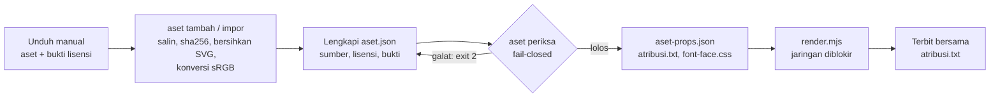

# Aset: gambar, logo, ikon, SVG, font, audio

## Metadata

- Version: `v1.0.0`
- Last updated: `2026-11-07`
- Changeset: `Dokumen baru: manifest aset.json (skema 1), bun run aset (tambah, impor, periksa), matriks lisensi per jenis, aturan validasi fail-closed, pembersih SVG berdaftar-izin, pemeriksa resolusi, deteksi ICC/EXIF dan konversi sRGB, keluaran aset-props.json, atribusi.txt, font-face.css, serta pemblokiran jaringan dan pemuatan font di renderer.`

Fitur aset mencatat sumber, lisensi, dan bukti setiap aset, menolak pemakaian yang jelas melanggar aturan teknis atau lisensi yang dikenal, dan memastikan render hanya memakai berkas lokal yang ber-hash. Alur render ada di [arsitektur.md](arsitektur.md), flag renderer di [cli.md](cli.md), ringkasan lisensi di [lisensi-kepatuhan.md](lisensi-kepatuhan.md). Dasar risetnya: pola manifest sumber klip ([video-tertanam-audio.md](video-tertanam-audio.md#aturan-sumber)) diperluas menjadi manifest generik berjenis.

> **Ini bukan nasihat hukum.** Fitur ini membantu mencatat sumber, lisensi, dan bukti, serta menolak pemakaian yang jelas melanggar aturan teknis dan lisensi yang dikenal. Ia tidak menjamin bahwa suatu aset boleh dipakai. Lisensi dapat berubah dan syarat pihak ketiga (merek, hak potret, data pribadi, musik, hasil AI) tidak dapat diverifikasi mesin. Logo atau lambang pihak lain, logo instansi pemerintah, lambang negara, foto orang yang dapat dikenali, dan musik wajib ditinjau ahli hukum atau tim hukum/humas sebelum rilis. Simpan bukti lisensi (tangkapan halaman, teks lisensi, tanggal) dan pedoman merek pemilik. Gunakan data fiktif pada contoh; jangan memasukkan data pribadi nyata.

## Alur



awvd tidak mengunduh aset dari URL (anti-hotlink): unduh sendiri, simpan bukti lisensi, lalu masukkan lewat `tambah` atau `impor`. Manifest dan aset milik proyek berada di repo proyek; di repo awvd hanya ada templat contoh [`templates/aset-contoh/`](../templates/aset-contoh/) (logo dan ikon fiktif buatan sendiri).

## Perintah

```text
bun run aset tambah <jenis> <berkas> [--id ID] [--manifest aset.json] [--konversi] [--tanggal YYYY-MM-DD]
bun run aset impor <daftar.json|folder> [--manifest aset.json] [--konversi]
bun run aset periksa [aset.json] [--skala N] [--ketat] [--json] [--out DIR]
                     [--komposisi F]... [--gabung props.json]
```

| Perintah | Fungsi |
| --- | --- |
| `tambah` | Menyalin satu berkas ke `aset/<id>.<ekstensi>` di sebelah manifest, menghitung `sha256`, dan menulis kerangka entri. SVG dibersihkan (ditolak bila rusak). Gambar diperiksa (animasi, CMYK, format) dan, dengan `--konversi`, dikonversi ke PNG sRGB. Bidang manusia (sumber, lisensi, bukti, ...) berisi `"[isi]"` sehingga `periksa` gagal sampai diganti. Menolak menimpa berkas yang ada dan id ganda. Membuat `aset.json` bila belum ada. |
| `impor` | Batch. Dari `daftar.json` (`{ "aset": [ { jenis, sumberBerkas, id?, ...bidang manifest selain berkas/sha256 } ] }`, `sumberBerkas` relatif terhadap daftar) memasukkan berkas dan menyalin bidang yang sudah diisi manusia; dari folder membuat kerangka per berkas (jenis dari ekstensi: `.svg` menjadi `svg`, gambar menjadi `gambar`, font menjadi `font`, audio menjadi `audio`). Semua id dan sumber diperiksa sebelum ada berkas yang disalin, lalu manifest langsung diperiksa. |
| `periksa` | Gerbang. Memvalidasi seluruh manifest (semua pelanggaran dikumpulkan sekaligus), memindai komposisi bila diberi `--komposisi`, lalu menulis keluaran ke `--out` (bawaan `.cache/awvd/aset`). Tidak menulis apa pun bila ada galat. `--skala` adalah skala render untuk pemeriksaan resolusi (bawaan 1, samakan dengan `render.mjs --skala`). `--ketat` memperlakukan peringatan sebagai galat. `--json` mencetak laporan JSON. `--komposisi` (boleh berulang) memindai URL jaringan dan rujukan `aset/...` yang tak terdaftar. `--gabung props.json` menulis `props-gabungan.json` (props dasar ditambah kunci `aset`). |

Jenis: `gambar`, `logo`, `ikon`, `svg`, `font`, `audio`. Jenis `lottie` belum didukung (lihat [Rencana](#rencana)).

Kode keluar: `0` berhasil; `2` argumen, manifest, atau aset tidak valid (juga peringatan bila `--ketat`), sama dengan `klip.mjs`; `1` galat saat menjalankan (browser tak ditemukan, `ffprobe` tak ada, berkas tak terbaca). Validasi tidak memerlukan Chromium; hanya `--konversi` yang meluncurkannya.

## Skema `aset.json` (skema 1)

```json
{
  "skema": 1,
  "proyek": { "tujuan": "komersial", "lisensiKeluaran": "CC-BY-SA-4.0", "jenisVideo": "formal" },
  "aset": [
    {
      "id": "logo-contoh", "jenis": "logo", "berkas": "aset/logo-contoh.svg", "sha256": "<64 hex>",
      "judul": "Logo Contoh Karya", "pencipta": "Proyek awvd", "sumberUrl": "https://github.com/ahliweb/awvd",
      "lisensi": "MILIK-SENDIRI", "tanggalAkses": "2026-11-07", "perubahan": "tidak ada",
      "atribusiTampil": "tidak", "teksAlternatif": "Logo Contoh Karya (fiktif)",
      "merek": { "kategori": "milik-sendiri", "pemilik": "Proyek awvd",
        "aturan": { "ukuranMinPx": 96, "clearSpace": { "nilai": 0.25, "satuan": "tinggi" }, "warnaDiizinkan": ["#0b5fa5"], "larangan": ["distorsi", "rotasi"] } },
      "izin": { "jenis": "milik-sendiri" }, "ai": { "status": "tidak" },
      "tampil": { "lebar": 360, "tinggi": 120, "fit": "contain" }
    }
  ]
}
```

Contoh lengkap yang lolos `periksa --ketat`: [`templates/aset-contoh/aset.json`](../templates/aset-contoh/aset.json).

| Bidang | Aturan |
| --- | --- |
| `proyek.tujuan` | Wajib: `komersial` atau `nonkomersial` (lisensi NC hanya lolos bila `nonkomersial`). `lisensiKeluaran` wajib bila ada aset ShareAlike. `jenisVideo: "formal"` mewajibkan satu logo ber-kategori `milik-sendiri`, `instansi-pemerintah`, atau `lambang-negara` dengan `izin` terisi. |
| `id` | `^[a-z0-9][a-z0-9_-]*$`, unik. |
| `berkas`, `sha256` | `aset/<nama>` di bawah folder manifest (karakter huruf, angka, `.`, `_`, `-`, `/`); tanpa skema (`http:`, `file:`, `data:`), jalur mutlak, `..`, atau simlink yang keluar. `sha256` 64 heksadesimal dan harus cocok dengan isi berkas. Untuk SVG, hash adalah hash berkas setelah dibersihkan. Berkas maks 50 MB. |
| `judul`/`tanpaJudul`, `pencipta`/`penciptaAnonim`, `sumberUrl`, `tanggalAkses` | Atribusi TASL. `sumberUrl` (http/https) dan `tanggalAkses` (`YYYY-MM-DD`) wajib kecuali `MILIK-SENDIRI`. |
| `lisensi`, `urlLisensi` | Kode dikenal saja (tabel di bawah). `urlLisensi` bawaan untuk CC diisi otomatis di keluaran. |
| `perubahan` | Wajib: pernyataan modifikasi (tulis `tidak ada` bila dipakai apa adanya). |
| `bukti` | Wajib untuk `STOK:` dan `IZIN-TERTULIS:`; berkas relatif di folder proyek (harus ada) atau URL. |
| `hakCipta`, `berkasLisensi` | Wajib untuk MIT, Apache-2.0, ISC, BSD, OFL, dan CC BY pada ikon (pemberitahuan harus ikut terdistribusi). |
| `atribusiTampil` | `tidak`, `layar`, atau `akhir`. Lisensi CC BY/BY-SA mewajibkan `layar` atau `akhir` (bawaan `akhir`). |
| `teksAlternatif`, `peran` | Wajib untuk `gambar`, `logo`, `svg` kecuali `peran: "dekoratif"` (WCAG 1.1.1; teks di dalam gambar hanya wajar untuk logotype, WCAG 1.4.5). |
| `ai` | `status` (`tidak`, `dibantu`, `dihasilkan`) wajib untuk `gambar`, `logo`, `svg`, `audio`. `dihasilkan` wajib `alat`, `lisensiLayanan` (URL syarat layanan) dan `tanggal`; `dibantu` wajib `kontribusiManusia`. |
| `izin` | `{ jenis, persetujuanHukum? }`; `jenis` mis. `milik-sendiri`, `izin-tertulis`, `pedoman-publik`. |
| `tampil` | `{ lebar, tinggi, fit?: contain/cover/fill, zoomMaks? >= 1, rotasi? }` dalam piksel komposisi; wajib untuk gambar raster. |
| `fokus` | `{ x, y }` 0..1, titik subjek untuk pemotongan dan `kenBurns`. |
| `orang` (gambar) | `ada` wajib. `ada: true` wajib `modelRelease` (`{ berkas, sha256 }`) atau `izin.jenis`; `anak` atau `sensitif` wajib `izin.persetujuanHukum`. |
| `merek` (logo) | `kategori` wajib (lihat di bawah). `aturan`: `ukuranMinPx`, `clearSpace`, `warnaDiizinkan`, `larangan`. |
| `font` | `famili`, `bobot` (1..1000), `gaya`, `reservedFontName?`, `dimodifikasi?`, `dijualTerpisah?`. |
| `ikon` | `keluarga`, `gaya` (`outline` atau `solid`). Peringatan bila ikon berasal dari lebih dari satu keluarga. |
| `audio` | `peran`: `musik`, `narasi`, atau `efek`. |

Bidang yang tidak dikenal untuk suatu jenis memberi peringatan (menangkap salah ketik; galat dengan `--ketat`). Nilai `"[isi]"` di mana pun adalah galat.

## Matriks lisensi per jenis

Kode lisensi: `CC0-1.0`, `PDM-1.0`, `CC-BY-x.y`, `CC-BY-SA-x.y` (varian `-NC-` hanya proyek nonkomersial), `OFL-1.1`, `MIT`, `Apache-2.0`, `ISC`, `BSD-2-Clause`, `BSD-3-Clause`, `STOK:<penyedia>`, `MILIK-SENDIRI`, `IZIN-TERTULIS:<pemegang>`. Kode lain (GPL/AGPL, Ubuntu Font License, dan seterusnya) ditolak sampai ada keputusan pemilik; varian ND selalu ditolak karena renderer menskalakan, memotong, atau menggambar ulang aset.

| Jenis | Diizinkan |
| --- | --- |
| `gambar`, `svg` | CC0, PDM, CC BY, CC BY-SA, `STOK:`, `MILIK-SENDIRI`, `IZIN-TERTULIS:` |
| `logo` | `MILIK-SENDIRI`, `IZIN-TERTULIS:`, CC0, PDM; di luar daftar ini = galat (logo adalah gerbang izin) |
| `ikon` | MIT, Apache-2.0, ISC, BSD, CC0, CC BY, `MILIK-SENDIRI` |
| `font` | OFL-1.1, Apache-2.0, CC0, MIT, `MILIK-SENDIRI`, `IZIN-TERTULIS:` |
| `audio` | CC0, CC BY, CC BY-SA, `STOK:`, `MILIK-SENDIRI`, `IZIN-TERTULIS:` |

Lisensi yang dikenal tetapi tidak ada di daftar suatu jenis (mis. MIT pada foto) memberi peringatan "tidak lazim", bukan galat (kecuali `logo`). `STOK:youtube-audio-library` memberi peringatan karena dinyatakan aman hanya di YouTube. ShareAlike memaksa `proyek.lisensiKeluaran` yang kompatibel (konservatif, sama dengan klip; tafsir ShareAlike untuk video gabungan belum terverifikasi dari sumber primer).

### Logo, merek, lambang

`merek.kategori`: `milik-sendiri`, `merek-pihak-lain`, `instansi-pemerintah`, atau `lambang-negara`.

- `milik-sendiri`: lisensi `MILIK-SENDIRI`, CC0, atau PDM.
- Tiga lainnya: lisensi `IZIN-TERTULIS:<pemegang>`, `merek.pemilik`, `izin.jenis` `izin-tertulis` atau `pedoman-publik`, dan `bukti`. `instansi-pemerintah` dan `lambang-negara` juga wajib `izin.persetujuanHukum` (id memo atau gate tinjauan hukum). Logo seperti ini tidak boleh diputar (`tampil.rotasi`), diwarnai ulang (`merek.warnaDiubah`), dipotong atau diregangkan (`tampil.fit` wajib `contain`). `lambang-negara` wajib `merek.rasio` dan rasio berkas harus cocok (toleransi 1%): bentuk, warna, dan perbandingan ukuran diambil dari berkas resmi tanpa distorsi.
- `aturan.ukuranMinPx` dibandingkan dengan lebar tampil logo (untuk `contain`: yang lebih kecil dari lebar kotak dan tinggi kotak dikali rasio).
- Validator hanya memeriksa kelengkapan catatan. Tinjauan hukum (UU 20/2016 tentang merek, UU 24/2009 tentang bendera, bahasa, lambang negara) tetap manusia; peringatan selalu dicetak untuk logo pihak lain.

### Font (SIL OFL 1.1)

- Video keluaran adalah "dokumen yang dibuat dengan font"; repo atau templat yang menyimpan berkas font mendistribusikan Font Software, sehingga `OFL.txt` dan baris hak cipta wajib (`berkasLisensi`, `hakCipta`).
- Font tidak boleh dijual sendiri (`dijualTerpisah: true` = galat). Versi modifikasi tidak boleh memakai Reserved Font Name (`reservedFontName` terisi dan `dimodifikasi: true` = galat kecuali ada `izin.jenis: "izin-tertulis"` dan `bukti`).
- Apakah subset atau konversi WOFF2 dihitung modifikasi, dan apakah RFN berlaku pada subset, belum terverifikasi: pakai berkas upstream apa adanya. Tidak ada font pihak ketiga di repo awvd; templat memakai font sistem.
- Berkas font diperiksa tanda awalnya (`wOF2`, `wOFF`, TrueType, `OTTO`) dan harus cocok dengan ekstensi.

### Foto orang dan hasil AI

Foto orang yang dapat dikenali memerlukan `modelRelease` ber-hash atau `izin`, memberi peringatan hak potret (UU 28/2014 Pasal 12) dan data pribadi (UU 27/2022), dan tinjauan manusia. Hasil AI murni belum jelas dapat dilindungi hak cipta di Indonesia (analisis sekunder, belum terverifikasi primer): orang lain mungkin boleh menyalinnya, dan syarat layanan AI wajib dibaca per layanan. Gambar `dihasilkan` yang memuat orang (wajah nyata) ditolak. `atribusi.txt` memuat baris pengungkapan konten AI untuk aset `dihasilkan` atau `dibantu`.

## SVG: daftar-izin

SVG yang dimuat lewat `` tidak menjalankan skrip dan tidak memuat sumber luar, tetapi SVG yang disisipkan **inline** ke halaman menjalankan skrip dan memuat sumber luar (uji lokal Chromium). Komposisi sering menyisipkan SVG inline (mis. `fill: currentColor`), jadi setiap SVG (jenis `svg`, `ikon`, `logo`) harus lolos pemeriksa berdaftar-izin buatan awvd (`scripts/aset-svg.js`, tanpa dependensi).

- Tokenizer XML kecil yang menolak apa pun yang tak dipahami: DOCTYPE/ENTITY (XXE), instruksi pemrosesan selain deklarasi XML di awal (`xml-stylesheet` memuat CSS luar), atribut tanpa kutip, `<` atau `&` mentah, atribut ganda, lebih dari satu akar, dan XML tak seimbang.
- Hanya elemen di daftar izin (bentuk dasar, gradien, pola, clip, mask, marker, filter `fe*`, `title`, `desc`, `style`, `text`, `image`, `use`) dan atribut di daftar izin. Ditolak: `script`, `foreignObject`, `a`, `iframe`, `feImage`, `cursor`, SMIL (`animate`, `set`, ...), namespace asing (mis. XHTML), `on*`, `xml:base`.
- `href`: `<use>` hanya `#id` lokal; `<image>` hanya `data:image/(png|jpeg|webp);base64`. `url()` hanya `#id`. Entitas XML dan escape CSS (`\75 rl(`) didekode sebelum diperiksa.
- CSS (`<style>` dan atribut `style`): semua at-rule (`@import`, `@font-face`, `@keyframes`), `animation`/`transition` (determinisme), `expression(`, `-moz-binding`, `image-set(`/`cross-fade(`/`element(`/`paint(`/`src(`, dan URL jaringan ditolak.
- Batas: 1 MB, 20.000 elemen, kedalaman 64, 200 atribut per elemen, dan ekspansi `<use>` 50.000 elemen (siklus `<use>` dan ledakan bersarang ditolak).
- Metadata editor (`inkscape:*`, `sodipodi:*`, `metadata`) adalah peringatan yang dibuang `tambah`/`impor`. `<text>` memberi peringatan karena bergantung pada font terpasang: ubah teks logo menjadi kurva. `viewBox` wajib untuk logo (rasio dikunci dari `viewBox`).
- `tambah`/`impor` membuang elemen/atribut terlarang lalu memeriksa ulang keluarannya, dan menolak (tanpa menyalin) bila rusak secara struktural atau masih bergalat.

Keterbatasan: bukan pengganti pustaka matang untuk SVG tak tepercaya dari internet; belum diuji dengan korpus XSS publik; kerumitan filter/pola (CPU) tidak dinilai; isi data URI gambar tidak dibedah. Uji (`uji:aset`) memuat 33 SVG jahat buatan sendiri, fuzz ber-seed, dan memuat keluaran `bersihkan` di Chromium (0 permintaan jaringan, 0 skrip jalan).

## Gambar raster, resolusi, dan warna

- Format: PNG, JPEG, WebP. GIF, APNG, dan WebP animasi ditolak (gerak harus dari nomor frame; ekstrak frame atau pakai `klip.mjs`). JPEG CMYK dan profil ICC non-RGB ditolak. AVIF tidak dijadikan format impor. Header dibaca sendiri (`ffprobe` tidak melaporkan ICC maupun orientasi EXIF) dan dimensi dicocokkan dengan `ffprobe`.
- **Resolusi:** `rasio = piksel sumber / piksel diperlukan = 1 / (faktor fit x --skala x zoomMaks)`; `contain` memakai faktor skala terkecil, `cover` dan `fill` yang terbesar. `rasio < 1` = galat (di-upscale, buram), `< 1,25` tanpa zoom = peringatan margin, `> 4` = peringatan boros; berkas `> 5 MB` = peringatan. Ambang 1,25 adalah usulan praktik, bukan standar. Contoh terukur: logo 64 px tampil 100x100 pada skala 2 = 0,32 (galat); foto 1200x800 tampil 640x360 `cover` = 1,875 pada skala 1 (lolos) dan 0,94 pada skala 2 (galat).
- **Orientasi EXIF** (juga PNG `eXIf` dan WebP `EXIF`) bukan 1 = galat: Chromium memutar tampilan tetapi ffmpeg tidak. Dimensi efektif memperhitungkan orientasi. Normalkan dengan `tambah --konversi`.
- **Profil ICC** non-sRGB = peringatan: Chromium mengonversi ke sRGB saat render (PNG Adobe RGB bernilai (200,100,50) dirender (227,100,42)), tetapi ffmpeg mengabaikan profil, sehingga jalur klip tertanam tidak. Konversikan sekali saat impor.
- **Konversi (`--konversi`):** memakai Chromium yang sama dengan renderer (tanpa dependensi baru): `createImageBitmap` dengan `imageOrientation: "from-image"` dan `colorSpaceConversion: "default"`, digambar ke `OffscreenCanvas` sRGB, lalu PNG tanpa profil. Deterministik pada mesin dan build Chromium yang sama (uji: byte identik dua kali). Build Chromium berbeda dapat menggeser nilai 1 pada satu kanal, dan alpha melewati kanvas pra-kali (piksel semi-transparan dapat berselisih 1). Keluaran selalu PNG RGBA; foto besar menjadi lebih besar daripada JPEG asal, jadi konversi hanya bila perlu.
- PNG 16-bit dan gamma PNG tak standar memberi peringatan.

## Keluaran `periksa`

| Berkas | Isi |
| --- | --- |
| `aset-props.json` | `{ skema: 1, aset: { <id>: { jenis, jalur, sha256, bytes, format, lebar, tinggi, rasio, durasi, alpha, teksAlternatif, peran, fokus, tampil, merek, font, ikon, atribusi: { ..., tampil, kredit }, ai } } }`. `jalur` relatif terhadap folder manifest (bukan jalur mutlak); `lebar`/`tinggi`/`rasio` SVG dari `viewBox`. |
| `atribusi.txt` | Kredit TASL (`"Judul" oleh Pencipta. Sumber: .... Lisensi: ... (url). Diubah: ...`) per aset yang `atribusiTampil` bukan `tidak`, pemberitahuan hak cipta dan lisensi, dan pengungkapan konten AI. Sertakan saat video terbit; **tidak dapat dideteksi dari MP4**, jadi `periksa` pasca-render tidak memeriksanya. |
| `font-face.css` | `@font-face` dari entri font (`font-display: block`). Jalur `url()` relatif terhadap berkas CSS itu sendiri: muat dengan `<link rel="stylesheet">`. |
| `props-gabungan.json` | Dengan `--gabung`: props dasar ditambah kunci `aset`. |

Komposisi memakai aset dengan `` atau CSS `url()` lokal (relatif terhadap komposisi) dan membaca `aset-props.json` lewat props bila perlu. SVG dipakai lewat `` atau inline setelah lolos pemeriksa. Renderer menunggu semua `` dan `document.fonts` sebelum frame pertama dan memblokir semua permintaan jaringan ([cli.md](cli.md#jaringan-dan-font)).

## Rencana

Belum ada di kode; tanpa janji tanggal. Dikerjakan di PR berikutnya karena menyentuh `scripts/runtime.js`:

- Helper runtime: `asetGambar(id)` (promise, gagal keras bila id tak ada), `pasangFont(...)`, `logo(id, posisi, {...})` (area aman, ukuran minimum, kontras varian latar, tanpa rotasi atau regang), `kreditAset(...)`, dan `ikon(id, {...})`.
- Uji-tayang `render --periksa-aset` (pencatat pemakaian per frame sampel).
- Jenis `lottie` (hanya `animationData` tervalidasi, `goToAndStop(frame)`), audio lewat `idAset` di rencana audio, `periksa --aset`, dan logo wajib untuk jenis `formal` lewat `konsep.json`.

## Batasan

- Lisensi dan syarat pihak ketiga tidak dapat diverifikasi mesin; hanya kelengkapan catatan dan kecocokan dengan matriks yang diperiksa.
- Konversi sRGB bergantung pada build Chromium; AVIF dan subset font tidak diuji; Lottie belum ada.
- Pemindaian komposisi (`--komposisi`) adalah lapis kedua berbasis teks (peringatan, bukan jaminan); lapis utama adalah pemblokiran jaringan saat render.
- Kebijakan lisensi dan hukum yang belum terverifikasi dari sumber primer (FAQ OFL tentang subset, Ubuntu Font License, Pixabay untuk musik, YouTube Audio Library di luar YouTube, tafsir ShareAlike, status hak cipta hasil AI di Indonesia) ditandai di pesan validator atau di dokumen ini.

## Changelog

### 2026-11-07 - v1.0.0

- Dokumen baru: manifest `aset.json` (skema 1), perintah `bun run aset` (`tambah`, `impor`, `periksa`), matriks lisensi, aturan validasi, pembersih SVG, pemeriksa resolusi, ICC/EXIF dan konversi sRGB, keluaran, dan rencana helper runtime.
