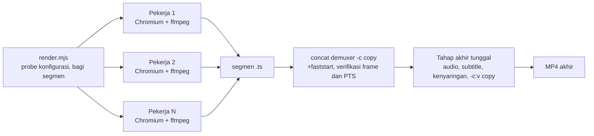

# Flag CLI renderer

## Metadata

- Version: `v1.8.1`
- Last updated: `2026-11-08`
- Changeset: `Durasi MP4 selalu sama dengan rentang frame: tahap akhir memakai -t dari jumlah frame, bukan -shortest; subtitle yang berakhir lebih awal tidak lagi memotong video dan audio. Sebelumnya: Semua render lewat jalur segmen dengan pekerja paralel.`

Referensi CLI `scripts/render.mjs` (`bun run render`). Alur di balik perintah ini ada di [arsitektur.md](arsitektur.md).

## Flag

```text
bun scripts/render.mjs <komposisi.html|URL> --out hasil.mp4 [opsi]
```

| Flag | Bawaan | Keterangan |
| --- | --- | --- |
| `--out F` | wajib | Berkas keluaran (`.mp4`, atau `.png` bersama `--still`). Folder tujuan dibuat otomatis bila belum ada. |
| `--props JSON` / `--props-file F` | `{}` | Props komposisi; pakai salah satu, harus objek JSON. |
| `--dari N` / `--sampai M` | `0` / frame terakhir | Rentang frame (inklusif). Audio dan subtitle diselaraskan ke frame awal. |
| `--skala X` | `1` | Faktor skala keluaran (min 0,1); layout tetap. `X >= 1`: raster dibuat ulang tajam pada ukuran akhir. `X < 1`: tangkapan skala 1 diperkecil `ffmpeg` (lanczos), sehingga deterministik. Dimensi ganjil dipotong 1 px ke genap. |
| `--crf N` | `18` | Kualitas x264, `0..51`. |
| `--audio F` | - | Trek audio, di-encode AAC-LC 48 kHz stereo 384 kbps; yang pendek diberi senyap (setelah normalisasi), yang panjang dipotong sesuai durasi video (rentang frame yang dirender). |
| `--kenyaringan M` | `web` | Normalisasi kenyaringan audio dengan `loudnorm` dua-pass (mode `linear`); hanya berlaku bersama `--audio`, diabaikan (dengan peringatan) tanpa `--audio`. `web`: -16 LUFS, true peak -1,5 dBTP, LRA 11. `siaran`: -23 LUFS, -1 dBTP, LRA 11 (EBU R 128; toleransi R 128 ±1 LU). `mati`: tanpa normalisasi. Nilai lain: kode keluar `2`. Pass 1 mengukur segmen audio yang sama dengan yang dipakai video (offset `--dari`, dipotong sepanjang video); audio senyap total dilewati dengan peringatan. |
| `--subtitle F` | - | `.vtt` atau `.srt`, disematkan sebagai trek lunak `mov_text`. Cue yang berakhir sebelum video habis tidak memendekkan keluaran; durasi MP4 tetap sama dengan rentang frame. |
| `--bahasa KODE` | `ind` | Kode bahasa trek subtitle. |
| `--paralel N` | `min(4, inti/2)`, minimal 1 | Jumlah pekerja (proses Chromium) yang merender segmen secara bersamaan, bilangan bulat `>= 1`. **Tidak memengaruhi keluaran**: MP4 sama persis untuk N berapa pun; serial adalah `--paralel 1`. Lihat [Render paralel dan segmen](#render-paralel-dan-segmen). Diabaikan (dengan peringatan) bersama `--still`. |
| `--tangkap png\|jpeg` | `png` | Format tangkapan layar yang dialirkan ke encoder. `png`: lossless (bawaan, untuk rilis). `jpeg`: **draf pratinjau**, lossy (kualitas 95, sekitar 42 dB PSNR terhadap PNG pada contoh terukur), 6-38% lebih cepat; mencetak peringatan, jangan dipakai untuk rilis. Nilai lain atau bersama `--still`: kode keluar `2`. |
| `--md5-tangkapan F` | - | Diagnostik: tulis ke `F` satu baris `nomor-frame md5` untuk setiap tangkapan frame (tidak termasuk pemanasan). Dipakai uji determinisme (bukti tangkapan sama untuk jumlah pekerja berbeda); tidak diperlukan untuk render biasa. |
| `--still N` | - | Render satu frame N sebagai PNG, bukan video. Memakai pemanasan 2 frame yang sama dengan segmen video (lihat di bawah), jadi PNG-nya identik dengan tangkapan frame itu di dalam video. |
| `--browser PATH` | otomatis | Jalur Chromium. Tanpa ini: `PLAYWRIGHT_BROWSERS_PATH` atau `~/.cache/ms-playwright`, lalu `google-chrome`/`chromium` sistem. |
| `--izinkan-jaringan` | mati | Mematikan pemblokiran jaringan (lihat [Jaringan dan font](#jaringan-dan-font)). Hanya untuk pratinjau; mencetak peringatan, dan hasil bisa tidak deterministik. |
| `-h`, `--help` | - | Tampilkan petunjuk. |

## Laporan kenyaringan

Setelah encode berhasil dan ada audio, renderer mengukur hasil akhir dan mencetak `kenyaringan: I=.. LUFS, TP=.. dBTP (target ..)`. Ini hanya laporan; kegagalan pengukuran tidak menggagalkan render.

## Render paralel dan segmen

Semua render video (bukan `--still`) memakai satu jalur: rentang frame dibagi menjadi **segmen berukuran tetap**, tiap segmen dirender pekerja di proses Chromium sendiri, lalu segmen digabung tanpa encode ulang. Serial hanyalah satu pekerja di jalur yang sama, sehingga **MP4 hasilnya byte-identik untuk `--paralel` berapa pun** dan tangkapan PNG per frame sama dengan tangkapan berurutan satu proses.



Yang membuat keluaran tidak bergantung pada jumlah pekerja:

- **Ukuran segmen tetap** `CH = 4 x round(fps/2)` frame (kelipatan GOP; 60 frame pada 30 fps), dihitung dari `--dari`. `--paralel` hanya mengatur berapa segmen yang dikerjakan bersamaan, bukan batas segmen. Setiap aliran x264 diawali IDR dan GOP tertutup, jadi segmen bisa disambung dengan `-c copy` tanpa mengubah aliran.
- **`-threads 2` x264 per segmen**: jumlah thread otomatis mengubah byte keluaran dan bergantung jumlah inti mesin; dipatok agar keluaran sama di mesin berbeda.
- **Pemanasan 2 frame** (dirender dan ditangkap lalu dibuang) sebelum tiap segmen, juga di render serial dan `--still`. Dua tangkapan pertama sebuah proses Chromium dapat berbeda sekitar 20 piksel (selisih maksimum 5/255) dari frame yang sama di tengah proses; terukur pada `transisi-galeri` frame 245-246. Frame pemanasan adalah dua frame tepat sebelum segmen (dua frame pertama komposisi bila segmen mulai di frame 0 atau 1).
- Tiap segmen **proses browser sendiri** dengan pemblokiran jaringan dan pemuatan font yang sama dengan sebelumnya (kode bersama di `scripts/render-sesi.mjs`).

Langkah orkestrasi:

1. `render.mjs` membuka halaman sekali (probe) untuk membaca `window.video` dan menutupnya; kegagalan halaman, font, gambar, dan jaringan di tahap ini dilaporkan seperti biasa.
2. Pengukuran kenyaringan pass 1 (bila `--audio`), lalu pekerja `scripts/render-segmen.mjs` (internal, bukan antarmuka publik) dijalankan sampai `--paralel` proses bersamaan. Tiap pekerja menghasilkan MP4 video-saja (x264 sama dengan [Encode video](#encode-video)) lalu me-remux ke MPEG-TS.
3. Segmen digabung dengan concat demuxer `-c copy` ke MP4 `+faststart`. Hasilnya diverifikasi: jumlah frame sama dengan rentang dan PTS rapat (selisih tetap, tanpa lubang atau duplikat); bila tidak, render gagal dengan kode keluar `1`.
4. Bila ada `--audio` atau `--subtitle`, satu tahap akhir memasang audio (AAC, normalisasi kenyaringan dua-pass), subtitle, dan `faststart` dengan `-c:v copy`. Tidak ada encode video ulang. Durasi keluaran dikunci dengan `-t` = jumlah frame / fps (bukan `-shortest`, yang ikut menghitung trek subtitle dan memotong video di akhir cue terakhir), jadi durasi dan jumlah frame MP4 selalu sama dengan rentang yang dirender: audio panjang dipotong, audio pendek di-pad senyap.
5. Keluaran ditulis ke `<out>.sementara` lalu di-rename ke `--out` hanya bila semuanya berhasil; kegagalan tidak meninggalkan MP4 setengah jadi atau menimpa `--out` yang sudah ada.

**Kegagalan fail-closed.** Satu pekerja gagal (galat render, permintaan jaringan diblokir, ffmpeg gagal) berarti seluruh render gagal: pekerja lain dihentikan (SIGTERM, lalu SIGKILL setelah 3 detik), berkas sementara dihapus, tidak ada sisa proses Chromium, dan pesan galat pekerja yang gagal dicetak (kode keluar `3` bila penyebabnya jaringan, selain itu `1`). Ctrl+C membersihkan hal yang sama dan keluar dengan `130`. Berkas sementara ada di folder unik `awvd-render-*` di `$TMPDIR` (atau `/tmp`).

**Memilih `--paralel`.** Bawaannya `min(4, inti/2)`. Segmentasi punya biaya tetap (tiap segmen meluncurkan Chromium, memuat halaman, dan memanaskan 2 frame), jadi `--paralel 1` lebih lambat daripada renderer serial lama pada klip panjang dan klip pendek (kurang dari sekitar 100 frame) tidak mendapat untung dari paralel. Di atas sekitar 8 pekerja hasilnya menurun dan memori Chromium belum diukur.

Percepatan terukur (satu mesin 20 thread yang dipakai bersama, beban tidak terkontrol; angka bergantung mesin dan beban, rasio lebih bermakna daripada detik absolut):

| Skenario (`transisi-galeri`, frame 200-379 = 180 frame, 720p) | Waktu dinding | Terhadap renderer serial lama |
| --- | --- | --- |
| Renderer serial lama (satu proses, tanpa segmen) | 12,4 s dan 11,7 s | 1,0x |
| `--paralel 1` (3 segmen, satu pekerja) | 15,9 s | 0,75x (overhead segmentasi sekitar 30%) |
| `--paralel 4` (3 segmen, 3 pekerja efektif) | 6,8 s dan 7,2 s | sekitar 1,7x |

Dua pengukuran per konfigurasi (satu untuk `--paralel 1`), `loadavg` sekitar 12 selama pengukuran pada mesin 20 thread. Pada 180 frame hanya ada 3 segmen sehingga paling banyak 3 pekerja yang terpakai; klip lebih panjang dengan segmen lebih banyak memberi percepatan lebih tinggi (riset awal pada klip 480 frame, mesin lebih longgar: serial 22,6 s menjadi 8,7 s dengan 4 pekerja dan 6,6 s dengan 8 pekerja). Ukuran berkas keluaran sekitar 5% lebih kecil daripada renderer lama (717 KB dibanding 751 KB pada contoh ini).

## Encode video

Piksel PNG sRGB rentang penuh dari browser dikonversi eksplisit ke YUV 4:2:0 matriks BT.709 rentang TV (`scale=in_range=full:out_range=tv:out_color_matrix=bt709`) dan ditandai SDR BT.709 (primaries, transfer, matriks, rentang `tv`), sehingga warna sama di semua pemutar. Profil H.264 High, progresif, B-frame 2, GOP tertutup sepanjang setengah fps, x264 `medium` dengan `-threads 2`, `faststart`. Audio AAC-LC 48 kHz stereo 384 kbps. Parameter ini mengikuti YouTube Help "Recommended upload encoding settings" (support.google.com/youtube/answer/1722171). Target kenyaringan mengikuti EBU R 128 (-23 LUFS, true peak maks -1 dBTP) untuk siaran dan AES TD1004/TD1008 (streaming -14 sampai -20 LUFS, dipilih -16) untuk web.

**Catatan migrasi.** Jalur segmen menjadi satu-satunya jalur sejak versi dokumen ini: byte MP4 berubah satu kali dibanding renderer serial lama (isi gambar setara: PSNR sekitar 53 dB dan SSIM 0,999 pada contoh terukur, ukuran berkas sekitar 5% lebih kecil). Sesudahnya byte stabil untuk jumlah pekerja berapa pun. Video yang sudah dirilis tidak perlu dirender ulang; render ulang menghasilkan byte berbeda walau tampilannya sama.

## Kode keluar

Kode keluar `0` bila berhasil, `2` untuk argumen tidak valid (termasuk `--paralel` bukan bilangan bulat `>= 1` dan `--tangkap` selain `png`/`jpeg`), `3` bila ada permintaan jaringan yang diblokir (lihat di bawah), `1` untuk galat saat render lainnya (termasuk halaman tanpa `window.video` setelah 15 detik, `@font-face` yang gagal dimuat, satu pekerja segmen yang gagal, dan gabungan segmen yang gagal verifikasi), `130` bila dihentikan Ctrl+C (SIGINT) dan `143` bila dihentikan SIGTERM.

## Jaringan dan font

Render tidak boleh bergantung pada sumber luar. Secara bawaan Chromium dijalankan dengan semua permintaan selain `file:`, `data:`, `about:`, dan `blob:` dicegat dan dibatalkan: HTTP/HTTPS (gambar, CSS, skrip, font, `fetch`, `sendBeacon`, ...) lewat `context.route`, dan WebSocket lewat `routeWebSocket` (route biasa tidak menutup WebSocket). Setiap permintaan yang diblokir dicatat.

- Render **gagal dengan kode keluar `3`** dan mencetak jumlah serta daftar URL yang diblokir (metode, URL, jenis sumber; maksimal 20 baris). Pemeriksaan berjalan di probe dan di setiap pekerja segmen: setelah halaman dimuat, setelah setiap frame, dan sebelum encode selesai, jadi render berhenti segera (pekerja lain dihentikan) dan tidak ada `.mp4` yang ditulis; mode `--still` tidak menulis PNG. Bila ada galat lain yang menyertai, ia dicetak sebagai "galat yang menyertai".
- **Komposisi yang dibuka lewat `http(s)://`** (mis. server pengembangan) hanya boleh meminta asalnya sendiri (host dan port yang sama, termasuk `ws:`); asal lain diblokir.
- `--izinkan-jaringan` mematikan semua pemblokiran dengan peringatan. Pakai hanya untuk pratinjau; jangan untuk render rilis.
- Aset harus berupa berkas lokal yang tercatat: lihat [aset.md](aset.md) dan `bun run aset`.
- Batasan: yang dicegat adalah permintaan yang dikirim halaman lewat jaringan browser. Pra-koneksi (`<link rel="preconnect">`, DNS prefetch) tidak lewat mekanisme pencegat dan tidak dicatat (tidak ada data halaman yang terkirim lewatnya); perilaku pencegat pada `<iframe>`/`<object>` bersumber `file:` belum diuji.

Sebelum frame pertama renderer memuat eksplisit setiap `@font-face` (`FontFace.load()` untuk semua `document.fonts`), baru menunggu `document.fonts.ready` dan semua gambar. `document.fonts.ready` saja tidak memuat face yang belum dipakai DOM awal, sehingga elemen berfont yang dibuat di dalam `render()` bisa diukur dengan font cadangan (terukur: lebar 168,6 px lalu 189,8 px). `@font-face` yang gagal dimuat (berkas hilang atau format tak didukung) menggagalkan render (kode keluar `1`, pesan `font gagal dimuat: ...`) alih-alih diam-diam memakai font cadangan. Sebagai jaring pengaman, setelah `renderFrame(n)` face yang baru ditambahkan di dalam `render()` (mis. `new FontFace(...)` + `document.fonts.add`) juga dimuat sebelum tangkapan; ukuran teks yang diukur di dalam render yang sama tetap tanggung jawab komposisi (tunggu `face.load()` di `render` async).

## Perintah lain

| Perintah | Fungsi | Dokumen |
| --- | --- | --- |
| `bun run periksa <video.mp4>` | Pemeriksaan mutu pasca-render | [pemeriksaan-mutu.md](pemeriksaan-mutu.md) |
| `bun run sop <sop.json> --out DIR` | SOP menjadi dokumen cetak dan bahan video | [sop.md](sop.md) |
| `bun run klip <sumber.json> --fps N [--draf]` | Validasi sumber (termasuk kebijakan kutipan dan gerbang GH) dan ekstraksi frame klip | [video-tertanam-audio.md](video-tertanam-audio.md) |
| `bun run audio <rencana.json> --fps N --out F` | Perakit timeline audio | [video-tertanam-audio.md](video-tertanam-audio.md) |
| `bun run narasi <naskah.json> --out DIR [--cache DIR] [--sintesis-ulang] [--selaras whisper]` | Naskah narasi dan WAV beku (atau TTS lokal opsional `sherpa-onnx`, dengan cache dan label suara sintetis) menjadi cue caption VTT/SRT, stempel kata, dan rencana audio; `--selaras whisper` memakai ASR whisper.cpp lokal opsional untuk stempel kata (flag `--whisper-bin`, `--whisper-model`, `--cache-asr`, `--asr-ulang`, `--koreksi-asr`) | [narasi-caption.md](narasi-caption.md#asr-lokal-whispercpp) |
| `bun run narasi transkripsi <audio> --out DIR [--bahasa id] [--fps 30] [--audiens umum]` | Caption dari audio tanpa naskah lewat whisper.cpp lokal opsional; semua keluaran ditandai "hasil ASR, wajib ditinjau manusia" | [narasi-caption.md](narasi-caption.md#caption-dari-audio-tanpa-naskah) |
| `bun run ketukan <audio> [--fps N] [--out ketukan.json]` | Deteksi onset dan ketukan musik (fluks spektral, tempo autokorelasi) menjadi `ketukan.json` berisi tempo, ketukan, dan onset dalam detik dan frame untuk sinkron potongan | [ketukan.md](ketukan.md) |
| `bun run timeline periksa [timeline.json] [--klip-props F] [--ketat] [--json] [--draf]` | Validator `timeline.json` (skema 1) fail-closed: skema, rujukan ke `aset.json` dan `sumber.json` nyata, tumpang tindih dan transisi, waktu klip, audio, atribusi, kutipan; kode keluar 2 untuk timeline tidak valid. Tidak menulis berkas; render menyusul | [timeline.md](timeline.md) |
| `bun run reframe periksa <reframe.json> [--durasi N]`, `bun run reframe saran <video> [--keluar 1080x1920] [--fps N] [--out reframe.json]` | Reframe 16:9 ke 9:16: validasi `reframe.json` (skema, teks sumber terpotong, teks keluaran di area aman 9:16) dan saran keyframe fokus heuristik tanpa model (opsional, wajib ditinjau) | [reframe.md](reframe.md) |
| `bun run pelajari <video-lokal> --sumber-sah CARA` | Statistik gaya dari video lokal yang sah dimiliki (ritme potongan, palet, kenyaringan, pola); laporan JSON/Markdown | [pelajari-reaction.md](pelajari-reaction.md) |
| `bun run kutipan -- periksa\|hash <sumber.json>` | Periksa kebijakan kutipan wajar; hitung hash gerbang hukum GH | [pelajari-reaction.md](pelajari-reaction.md#bun-run-kutipan) |
| `bun run konsep -- <subperintah>` | Konsep video: jenis, alur, brief, persetujuan | [konsep-jenis-alur.md](konsep-jenis-alur.md) |
| `bun run aset tambah\|impor\|periksa` | Aset (gambar, logo, ikon, SVG, font, audio): manifest `aset.json`, validasi, pembersih SVG, konversi sRGB, atribusi | [aset.md](aset.md) |
| `bun run uji` | Seluruh uji otomatis | [README](../README.md#perintah-utama) |

## Changelog

### 2026-11-08 - v1.8.1

- Tahap akhir audio dan subtitle memakai `-t` dari jumlah frame alih-alih `-shortest`; subtitle yang berakhir lebih awal tidak lagi memotong video dan audio (isu #79).

### 2026-11-08 - v1.8.0

- Semua render video memakai jalur segmen (segmen tetap `4 x round(fps/2)` frame, tiap segmen satu proses Chromium dan encode video-saja, gabung `-c copy`, audio dan kenyaringan di tahap akhir `-c:v copy`); serial adalah `--paralel 1` dan keluaran MP4 sama untuk N berapa pun. Menambahkan flag `--paralel`, `--tangkap png|jpeg` (jpeg = draf), dan `--md5-tangkapan`, bagian Render paralel dan segmen, pemanasan 2 frame di semua mode, `-threads 2` x264, keluaran ditulis atomik (`.sementara`), dan kode keluar `130`/`143`. Byte MP4 berubah satu kali dibanding renderer lama (catatan migrasi di Encode video).

### 2026-11-08 - v1.7.0

- Tabel Perintah lain: `bun run reframe periksa|saran`; `render.mjs` tidak berubah.

### 2026-11-07 - v1.6.0

- Tabel Perintah lain: `bun run timeline periksa`; `render.mjs` tidak berubah.

### 2026-11-07 - v1.5.0

- Baris `bun run narasi`: flag `--selaras whisper` dan flag ASR; baris baru `bun run narasi transkripsi`; `render.mjs` tidak berubah.

### 2026-11-07 - v1.4.0

- Tabel Perintah lain: `bun run ketukan`; `render.mjs` tidak berubah.

### 2026-11-07 - v1.3.1

- Baris `bun run narasi`: flag `--cache` dan `--sintesis-ulang` untuk mesin TTS; `render.mjs` tidak berubah.

### 2026-11-07 - v1.3.0

- Tabel Perintah lain: `bun run narasi`; `render.mjs` tidak berubah.

### 2026-11-07 - v1.2.1

- `--skala X` dengan `X < 1` kini menangkap frame pada skala 1 lalu memperkecilnya dengan `ffmpeg` (lanczos); sebelumnya `clip.scale < 1` menghasilkan raster yang berbeda acak antar render (isu #26). Keluaran skala 1 tidak berubah.

### 2026-11-07 - v1.2.0

- Tabel Perintah lain: `bun run pelajari`, `bun run kutipan`, dan flag `--draf` pada `bun run klip`; `render.mjs` tidak berubah.

### 2026-11-07 - v1.1.0

- Menambahkan `--izinkan-jaringan`, kode keluar `3`, dan bagian Jaringan dan font: pemblokiran semua permintaan non-lokal (HTTP, HTTPS, WebSocket) secara bawaan, pemuatan eksplisit setiap `@font-face` sebelum frame pertama, dan galat jelas untuk font yang gagal dimuat.
- Menambahkan `bun run aset` ke tabel Perintah lain.

### 2026-11-07 - v1.0.0

- Dokumen baru, dipindah dari README v1.10.0 (§Flag CLI); isi dipertahankan.
- Menambahkan tabel Perintah lain sebagai penunjuk ke dokumen perintah masing-masing.
