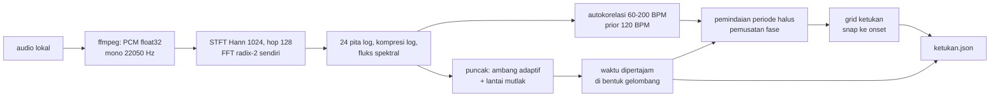

# Deteksi ketukan musik

## Metadata

- Version: `v1.0.0`
- Last updated: `2026-11-07`
- Changeset: `Dokumen baru: bun run ketukan (onset fluks spektral, tempo autokorelasi, ketukan berselaras grid), skema ketukan.json, helper window.Ketukan, parameter, batas bukti, rujukan algoritma.`

`bun run ketukan` membaca satu berkas audio lokal dan menghasilkan daftar ketukan (detik dan frame) serta tempo, supaya potongan, transisi, dan gerak komposisi bisa diselaraskan ke musik. Seluruh analisis berjalan di Bun tanpa dependensi baru; satu-satunya alat luar adalah `ffmpeg` untuk mendekode audio. Tidak ada model, layanan daring, atau aset pihak ketiga. Ringkasan perintah ada di [cli.md](cli.md#perintah-lain); uji dan batas bukti di [bagian Batasan](#batasan).

## Alur



## Pemakaian

```text
bun run ketukan <audio> [--fps 30] [--out ketukan.json]
```

| Flag | Bawaan | Keterangan |
| --- | --- | --- |
| `--fps N` | `30` | Frame per detik komposisi (`0 < N <= 240`, boleh pecahan). Hanya menentukan nilai `frame` di keluaran. |
| `--out F` | `ketukan.json` | Berkas JSON keluaran; folder tujuan dibuat bila belum ada. |

Kode keluar: `0` berhasil (juga bila tidak ada ketukan terdeteksi; lihat `peringatan` di JSON dan stderr), `2` argumen tidak valid (tanpa berkas, berkas tidak ada, URL, `--fps` di luar rentang, opsi tak dikenal), `1` galat dekode `ffmpeg` (misalnya berkas bukan audio). Berkas yang boleh dibaca hanya lokal; URL ditolak. `ffmpeg` mendekode apa pun yang dibacanya, termasuk trek audio di dalam video.

Contoh (komposisi memakai 30 fps; berkas audio contoh dibuat sendiri):

```bash
bun run ketukan musik.wav --fps 30 --out props/ketukan.json
bun run render komposisi.html --out out/video.mp4 --props-file props/ketukan.json
```

`ketukan.json` adalah objek JSON, jadi dapat langsung dipakai sebagai `--props-file`; di komposisi, `ctx.props` menjadi `data` untuk helper di bawah. Untuk menggabungkannya dengan props lain, gabungkan objeknya di skrip pembangun props proyek (mis. `{ ...ketukan, judul }`).

## Keluaran: ketukan.json

```json
{
  "versi": 1,
  "fps": 30,
  "durasi": 12,
  "tempo": { "bpm": 120, "periode": 0.5, "fase": 0.2501 },
  "ketukan": [{ "detik": 0.2497, "frame": 7, "dariOnset": true }],
  "onset": [{ "detik": 0.2497, "frame": 7, "kekuatan": 0.982 }],
  "keyakinan": 0.998,
  "peringatan": []
}
```

| Bidang | Arti |
| --- | --- |
| `versi` | Versi skema (`1`). |
| `fps` | Nilai `--fps` yang dipakai menghitung `frame`. |
| `durasi` | Durasi audio hasil dekode (detik, 3 desimal). |
| `tempo` | `bpm` (2 desimal), `periode` (detik per ketukan, 5 desimal), `fase` (detik, posisi grid terdekat dari 0). `null` bila tempo tidak dapat diperkirakan. |
| `ketukan[]` | Ketukan terurut. `detik` (4 desimal), `frame` = `round(detik * fps)`, `dariOnset` = `true` bila posisinya diambil dari onset terdeteksi (di dalam toleransi), `false` bila hanya posisi grid. |
| `onset[]` | Onset mentah terurut: `detik`, `frame`, `kekuatan` (0..1, relatif terhadap onset terkuat berkas ini). |
| `keyakinan` | 0..1: rata-rata dua angka, puncak autokorelasi ternormalisasi (0..1) dan bagian ketukan yang didukung onset. Heuristik untuk membandingkan hasil, **bukan** probabilitas terkalibrasi. |
| `peringatan[]` | Teks bebas (mis. onset kurang dari 4, tidak ada periodisitas, `keyakinan` di bawah 0,4). Selalu diperiksa sebelum memakai hasil. |

Rentang ketukan: dari satu toleransi sebelum onset pertama sampai satu toleransi sesudah onset terakhir. Grid tidak diperpanjang ke bagian senyap di awal atau akhir.

## Algoritma dan parameter

Angka diambil dari `PARAMETER` di `scripts/ketukan.mjs` (diekspor; nilai di bawah adalah nilai saat ini).

1. **Dekode.** `ffmpeg` memberi PCM float32 mono 22050 Hz (pengubahan sampel dan campuran kanal oleh `ffmpeg`).
2. **Onset (fluks spektral).** STFT jendela Hann 1024 sampel (46 ms), hop 128 (5,8 ms), FFT radix-2 iteratif tulisan sendiri (dua frame nyata dibungkus dalam satu FFT kompleks). Magnitudo dirata-rata dalam 24 pita berjarak logaritmik 40 Hz sampai 10 kHz, dikompresi `log(1 + 100 * magnitudo)` (sinus skala penuh = magnitudo 1), lalu fungsi onset = rata-rata per pita dari kenaikan positif terhadap 2 hop sebelumnya (`half-wave rectified spectral flux`).
3. **Puncak.** Maksimum lokal (+-50 ms) yang melewati ambang adaptif `rata-rata lokal + 0,25 * (maksimum lokal - rata-rata lokal)` pada jendela +-1 detik **dan** lantai mutlak 0,2 (kenaikan log rata-rata per pita). Lantai mutlak mencegah derau stasioner dianggap onset; harganya, onset yang sangat lembut (di bawah lantai) tidak terdeteksi.
4. **Waktu onset dipertajam.** Fluks berjendela panjang menyala lebih awal daripada serangan sebenarnya, dan seberapa awal bergantung pada kerasnya bunyi. Untuk tiap puncak, kenaikan energi log terbesar antarblok 64 sampel (hop 32) pada jendela -5 ms sampai +35 ms dicari di bentuk gelombang. Hasil uji: galat waktu metronom sintetis di bawah 1 ms.
5. **Tempo kasar.** Autokorelasi tanpa bias dari fungsi onset (dikurangi rata-rata lokal) pada lag 60 sampai 200 BPM, dibobot log-Gaussian berpusat 120 BPM selebar 1 oktaf (pemilih oktaf perseptual), dengan interpolasi parabola. Ambiguitas oktaf (60 atau 120, 90 atau 180) diselesaikan oleh bobot ini; untuk musik yang tempo "rasanya"-nya di luar pusat prior, hasilnya bisa setengah atau dua kali tempo yang diharapkan.
6. **Tempo halus dan fase.** Periode dipindai +-3 % di sekitar tempo kasar (langkah 0,002 %) untuk memaksimalkan resultan lingkaran berbobot `|sum k_j exp(2 pi i t_j / P)|` atas waktu onset (pemusatan fase). Arah resultan memberi fase. Satu periode dan satu fase berlaku untuk seluruh berkas (tempo tetap).
7. **Ketukan.** Grid `fase + k * periode` pada rentang di atas; tiap titik grid disnap ke onset terdekat bila jaraknya di dalam `min(50 ms, 20 % periode)` (`dariOnset: true`), jika tidak dibiarkan di posisi grid (`false`).

Deterministik: aritmetika murni tanpa `Date.now`, `Math.random`, atau penghitung waktu; waktu dibulatkan ke 0,1 ms. Dua jalan pada berkas yang sama memberi JSON identik (diuji, termasuk sinyal yang dibangkitkan ulang). Fungsi trigonometri `Math.sin` dan `Math.cos` bergantung pada mesin JavaScript; hasil dijamin identik pada platform dan versi Bun yang sama, dan pembulatan menjaga selisih antarplatform jauh di bawah satu frame.

Waktu proses: sekitar 3 detik untuk 10 menit audio stereo MP3 pada mesin pengembangan.

## Memakai di komposisi

`scripts/ketukan.js` (tanpa dependensi, tidak bergantung pada `runtime.js`) menyediakan `window.Ketukan`. Semua fungsi murni dari nomor frame dan data; tanpa `Date.now`, `Math.random`, atau animasi CSS. `data` adalah isi `ketukan.json` (lewat props); `fps` bawaan `data.fps`, dan diganti dengan argumen `fps` bila komposisi memakai fps lain dari saat analisis.

```html
<script src="../../scripts/ketukan.js"></script>
<script>
  defineVideo({ /* ... */ render(ctx) {
    const k = window.Ketukan;
    const data = ctx.props;                               // isi ketukan.json lewat --props-file
    const denyut = k.denyut(data, ctx.frame, { panjang: 0.25 });   // 1 di ketukan, meluruh ke 0
    const potong = k.rapatkan(data, rencanaPotongFrame, { maks: 4 }); // geser potongan ke ketukan terdekat
    // ...
  } });
</script>
```

| Fungsi | Hasil |
| --- | --- |
| `ketukanTerdekat(data, frame, fps?)` | `{ indeks, frame, detik, selisih }` (`selisih` = frame ketukan dikurangi `frame`) atau `null` bila tidak ada ketukan. |
| `rapatkan(data, frame, { maks = 3, fps })` | Frame ketukan terdekat bila jaraknya `<= maks` frame; selain itu `frame` semula. Berguna untuk menggeser titik potong atau transisi ke ketukan. |
| `fasaKetukan(data, frame, fps?)` | `{ indeks, fase (0..1 di antara dua ketukan), sejak, menuju }` (frame) atau `null` di luar rentang ketukan. |
| `denyut(data, frame, { panjang = 0.2, fps })` | `1` tepat di frame ketukan, meluruh kuadratik ke `0` dalam `panjang` detik; `0` sebelum ketukan pertama. Nilai (bukan gerak): komposisi memetakannya ke skala atau kecerahan, dan aturan `kurangiGerak` serta batas kilatan tetap berlaku ([transisi-animasi.md](transisi-animasi.md), [pemeriksaan-mutu.md](pemeriksaan-mutu.md#kilatan-fotosensitif)). |
| `ketukanDalam(data, dari, sampai, fps?)` | `[{ indeks, frame, detik }]` pada rentang frame inklusif. |

Data tanpa larik `ketukan`, atau tanpa `fps` (bila argumen `fps` tidak diberikan), ditolak dengan galat yang jelas. Helper bukan bagian `runtime.js` (agar API runtime tidak membengkak); memuatnya hanya bila komposisi perlu sinkron ketukan.

Kebiasaan produksi: ketukan kuat dipakai untuk potongan (`rapatkan`), ketukan lemah untuk gerak halus; hindari kedipan penuh layar pada setiap ketukan: 180 BPM berarti 3 ketukan per detik, tepat di batas kilatan fotosensitif ([pemeriksaan-mutu.md](pemeriksaan-mutu.md#kilatan-fotosensitif)).

## Uji

`bun run uji:ketukan` (`scripts/uji-ketukan.mjs`, ikut `bun run uji`). Sinyal dibangkitkan `ffmpeg` lavfi, tanpa berkas audio di repo:

| Uji | Isi |
| --- | --- |
| FFT | Sama dengan DFT naif (galat < 1e-9) dan sinus memuncak di bin yang benar; panjang bukan pangkat dua ditolak. |
| Metronom klik 120 BPM + derau putih ber-seed | Jumlah ketukan tepat, setiap ketukan dalam +-1 frame pada 30 fps, tempo dalam +-2 BPM, kontrol negatif (harapan digeser 6 frame ditolak). |
| Metronom klik 90 BPM + derau lebih keras | Idem. |
| Presisi 60 fps | Metronom 120 dan 90 BPM dalam +-1 frame pada 60 fps dan galat waktu < 3 ms. |
| Metronom kick 60 Hz, 100 BPM | Onset bernada rendah, ketukan +-1 frame, tempo +-2 BPM. |
| Tepi rentang | 60 dan 160 BPM terdeteksi tanpa lompat oktaf. |
| Senyap, derau putih stasioner, audio sangat pendek | Tanpa tempo dan ketukan palsu, `keyakinan` 0, ada peringatan, tidak galat. |
| Determinisme | Dua analisis sama; sinyal dibangkitkan ulang memberi JSON identik. |
| CLI | Skema JSON, `frame = round(detik * fps)`, `--fps`, berkas identik antarjalan, kode keluar 0, 1, 2. |
| Helper | Seluruh fungsi `window.Ketukan` dan penolakan data buruk; `ketukan.json` hasil CLI dipakai helper. |

## Batasan

- **Hanya sinyal sintetis yang diuji.** Metronom klik, kick, dan derau lavfi menjadi satu-satunya bukti otomatis. Musik nyata (campuran instrumen, reverb, vokal, kompresi lossy) **belum diuji** di repo ini; hanya diperiksa sekilas pada klik sintetis yang di-encode MP3 (tempo benar, `keyakinan` sedikit turun) dan tidak menjadi uji otomatis. Jangan mengandalkan toleransi +-1 frame untuk musik nyata tanpa memeriksa hasilnya.
- **Tempo tetap.** Satu periode dan satu fase untuk seluruh berkas. Musik dengan tempo berubah (rubato, akselerasi, ganti bagian) tidak terlacak. Pengamatan sekali jalan (bukan uji otomatis) pada klik 120 BPM selama 10 detik disambung klik 100 BPM selama 10 detik: tempo dilaporkan 119,79 BPM, 20 dari 20 ketukan di bagian pertama didukung onset tetapi hanya 4 dari 20 di bagian kedua (sisanya posisi grid yang meleset dari klik sebenarnya), dan `keyakinan` turun ke 0,57. Daftar `onset` mentah tetap memuat klik bagian kedua, dan `keyakinan` rendah adalah petunjuk untuk tidak memercayai `ketukan`. Pelacakan ketukan dinamis (seperti Ellis 2007) belum diimplementasikan.
- **Ketukan lemah, sinkopasi, dan tanpa serangan.** Onset di bawah lantai fluks (0,2) tidak terdeteksi; instrumen dengan serangan lambat (string pad, vokal legato) memberi onset samar atau tidak ada. Pola dengan tekanan di luar ketukan (offbeat) dapat menggeser fase grid karena fase diambil dari rata-rata sirkular seluruh onset berbobot.
- **Ambiguitas oktaf.** Tempo setengah atau dua kali dari yang dirasakan mungkin keluar; prior 120 BPM hanya heuristik.
- **Onset pertama di awal berkas.** Fluks butuh dua hop sebelumnya, jadi onset pada sekitar 12 ms pertama tidak terdeteksi (ketukan di detik 0 tidak muncul; grid mulai dari onset pertama yang terdeteksi).
- **Bukan analisis genre, downbeat, atau birama.** Semua ketukan diperlakukan setara; tidak ada penanda ketukan kuat (downbeat).
- **Hak cipta musik.** Mendeteksi ketukan tidak memberi hak memakai musik. Lisensi dan atribusi musik tetap tanggung jawab pengguna ([lisensi-kepatuhan.md](lisensi-kepatuhan.md), [aset.md](aset.md)).
- Satu trek audio pertama (`-map 0:a:0`); audio multi-trek perlu dipilih atau dicampur lebih dulu dengan [`bun run audio`](video-tertanam-audio.md).

## Rujukan algoritma

Hanya konsep yang dirujuk; kode ditulis sendiri dan tidak disalin dari proyek lain.

- J. P. Bello, L. Daudet, S. Abdallah, C. Duxbury, M. Davies, M. B. Sandler, "A Tutorial on Onset Detection in Music Signals", IEEE Transactions on Speech and Audio Processing 13(5), 2005: fluks spektral, kompresi log, dan ambang adaptif.
- D. P. W. Ellis, "Beat Tracking by Dynamic Programming", Journal of New Music Research 36(1), 2007: autokorelasi fungsi onset dengan jendela perseptual berpusat 120 BPM. Pelacakan dinamis di makalah itu belum dipakai di sini.
- J. W. Cooley dan J. W. Tukey, "An Algorithm for the Machine Calculation of Complex Fourier Series", Mathematics of Computation 19(90), 1965: FFT radix-2.
- Resultan lingkaran (statistik sirkular) untuk memusatkan fase onset: konsep umum statistik arah (mis. K. V. Mardia dan P. E. Jupp, "Directional Statistics", 2000).

## Changelog

### 2026-11-07 - v1.0.0

- Dokumen baru untuk `bun run ketukan` (F5/02): alur, skema `ketukan.json`, algoritma dan parameter, helper `window.Ketukan`, uji, batas bukti, dan rujukan algoritma.
