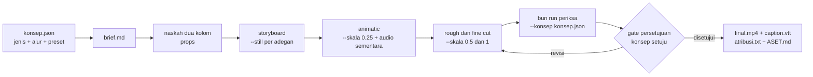

# Konsep: jenis video dan alur produksi

## Metadata

- Version: `v1.0.0`
- Last updated: `2026-11-07`
- Changeset: `Dokumen baru dipindah dari README v1.10.0: bun run konsep, skema konsep.json, 13 jenis video, 5 alur produksi, tingkat bukti, preset di komposisi, dan batasan.`

Saat mendesain konsep video ada dua pilihan awal: **jenis video** (formal, edukasi, kreatif, promo, dan seterusnya) dan **alur produksi** (dari ringkas sampai formal berjenjang). Keduanya adalah data, bukan kode: [`data/jenis-video.json`](../data/jenis-video.json) memuat 13 jenis beserta presetnya, dan [`data/alur-produksi.json`](../data/alur-produksi.json) memuat 5 alur beserta tahap, gate, RACI, dan artefaknya. `scripts/konsep.mjs` (`bun run konsep`) memakai data itu untuk membuat `konsep.json`, memeriksanya, menulis brief, dan mencatat persetujuan; `bun run periksa --konsep` memakainya sebagai ambang QC.



Tahap dan gate yang berlaku bergantung pada alur yang dipilih (lihat tabel alur); `konsep.json` mencatat tahap saat ini dan persetujuan tiap gate.

## Subperintah

```text
bun run konsep -- baru --jenis J --alur A --out konsep.json [--judul T] [--timpa]
bun run konsep -- daftar [jenis|alur [kunci]]
bun run konsep -- periksa konsep.json [--video F]
bun run konsep -- brief konsep.json [--out brief.md]
bun run konsep -- setuju konsep.json --gate G --oleh "Peran" --tanggal YYYY-MM-DD [--berkas F] [--catatan T]
bun run konsep -- preset konsep.json
bun run konsep -- sinkron-preset [--periksa] [--keluar F]
```

| Subperintah | Fungsi |
| --- | --- |
| `baru` | Membuat `konsep.json` dari preset: field isian kosong (tujuan, audiens, pesan utama, CTA, ...), pilihan yang terisi dari preset (durasi target, rasio, caption, musik, kenyaringan), dan satu entri `persetujuan` per gate alur. Tanpa `--jenis`/`--alur` mencetak tabel pilihan dan exit `2`. Menolak menimpa berkas yang ada tanpa `--timpa`. Alur di luar rekomendasi jenis diterima dengan catatan. |
| `daftar` | Tabel 13 jenis (dengan alur yang cocok) dan 5 alur. `daftar jenis promo` atau `daftar alur formal` menampilkan rincian, termasuk tingkat bukti tiap nilai. |
| `periksa` | Validasi skema: jenis dan alur dikenal, tahap sah, rasio sesuai preset, durasi target tidak melebihi durasi maks, `override` hanya untuk kunci preset yang ada (tipe dan enum dicek, kontras tidak boleh di bawah 4,5:1) dan butuh `overrideAlasan`, `tts-daring` dilarang untuk jenis `internal` atau `kepatuhan.sensitif`, tidak ada pola data pribadi (surel, NIK 16 digit, NIP 18 digit, nomor telepon; nilainya tidak ikut dicetak), serta konsistensi persetujuan. Isian inti (judul, tujuan, audiens, pesan utama, CTA; untuk alur instruksional juga `tujuanBelajar`; untuk alur formal juga `kepatuhan.dasarHukum`) hanya peringatan pada tahap pertama dan menjadi galat setelah brief dilewati. `--video F` membandingkan hash SHA-256 video dengan hash gate berhash terakhir. Exit `0` atau `2`. |
| `brief` | Brief Markdown deterministik: ringkasan, tujuan, audiens, pesan, struktur adegan, preset terpilih beserta tingkat bukti dan rujukan (nilai yang ditimpa ditandai), aturan teknis, kepatuhan, rencana tahap dengan checklist gate dan RACI, tabel persetujuan, dan kriteria selesai. Kolom kosong ditandai `[isi]`; tidak ada cap waktu. |
| `setuju` | Mencatat persetujuan satu gate. `--tanggal` wajib (tidak memakai jam sistem agar hasilnya deterministik). Gate berhash (`G5` dan `G6` pada alur formal) wajib `--berkas`; yang dicatat adalah SHA-256 berkas itu. Tahap maju ke tahap sesudah gate. Persetujuan ditolak bila konsep belum cukup lengkap untuk tahap berikutnya. Alur `formal` menolak gate di luar urutan; alur lain hanya memberi catatan. Persetujuan yang sudah ada tidak bisa diubah: perubahan sesudah disahkan berarti versi baru dengan pengesahan ulang. |
| `preset` | Mencetak `{ jenis, preset }` berisi preset efektif (preset jenis ditambah `override`) sebagai JSON, untuk disuntikkan ke komposisi lewat `--props-file`. |
| `sinkron-preset` | Menulis `scripts/preset-jenis.js` dari `data/jenis-video.json`; dengan `--periksa` hanya memeriksa dan exit `1` bila salinan basi. |

Contoh alur kerja (data fiktif; hasil lengkapnya ada di [`templates/konsep-contoh/`](../templates/konsep-contoh/)):

```bash
bun run konsep -- baru --jenis panduan --alur instruksional --judul "Mengelola tautan di portal" --out konsep.json
# isi tujuan, audiens, pesanUtama, cta, tujuanBelajar di konsep.json
bun run konsep -- periksa konsep.json
bun run konsep -- brief konsep.json --out brief.md
bun run konsep -- setuju konsep.json --gate GA --oleh PS --tanggal 2026-11-07
bun run periksa out/final.mp4 --konsep konsep.json --subtitle caption.vtt
```

## Isi konsep.json

| Field | Isi |
| --- | --- |
| `versi`, `id`, `judul` | Skema versi `1`; `id` huruf kecil dan tanda hubung; judul bebas. |
| `jenis`, `alur`, `tahap` | Pilihan jenis dan alur, serta id tahap saat ini (`T1`, `T2`, ...; maju otomatis lewat `setuju`). |
| `tujuan`, `tujuanBelajar[]`, `audiens`, `pesanUtama`, `cta`, `nada` | Isian brief. `audiens` berisi `deskripsi`, `bahasa`, `konteksTonton[]`, `tanpaSuara`. |
| `durasiTarget`, `rasio` | Pilihan proyek (detik; `16:9`, `9:16`, `1:1`, `4:5`, atau `21:9`), divalidasi terhadap preset. |
| `narasi`, `musik`, `kenyaringan`, `caption` | Pilihan proyek yang terisi dari preset. `narasi.mode`: `tanpa`, `tts-lokal`, `tts-daring`, `rekaman`. `caption`: `burnIn`, `cps`, `mode` (`pop-on` atau `sorot-kata`), `bahasa`. `kenyaringan`: `web` atau `siaran`. |
| `kepatuhan` | `dasarHukum[]`, `izinPotret`, `klaim`, `dataNyata` (harus `false` pada contoh dan templat), `sensitif`. |
| `persetujuan[]` | Satu entri per gate: `gate`, `nama`, `peranDiminta`, `status` (`menunggu` atau `disetujui`), `oleh`, `tanggal`, `hash`, `berkas`, `catatan`. |
| `override{}`, `overrideAlasan` | Penimpa nilai preset yang tidak tercakup field di atas (mis. `transisi`, `easing`, `tipografi`, `kontrasMin`, `durasiMaks`). Kunci harus ada di preset; alasan wajib. Preset tidak memaksa, tetapi batas aksesibilitas (kontras minimal 4,5:1) tidak boleh diturunkan. |

## Jenis video

Tabel ringkas kolom inti; seluruh atribut (fps, resolusi, easing, tipografi, palet, kontras minimum, selisih narasi-musik, gaya narasi, kenyaringan, adegan wajib dan umum, kepatuhan) dan rujukannya ada di `data/jenis-video.json` atau lewat `bun run konsep -- daftar jenis <kunci>`.

| Jenis (`kunci`) | Tujuan | Rasio | Target/maks (s) | Detik per adegan | cps | Burn-in | Musik | Alur bawaan (cocok) |
| --- | --- | --- | --- | --- | --- | --- | --- | --- |
| Formal (`formal`) | Menyampaikan informasi resmi dengan otoritas. | 16:9 | 90/300 | 10 | 17 | tidak | tidak | `formal` |
| Edukasi (`edukasi`) | Mengubah pengetahuan atau kemampuan. | 16:9 | 240/360 | 12 | 17 | tidak | tidak | `instruksional` |
| Kreatif (`kreatif`) | Membangun emosi dan citra. | 16:9, 21:9 | 60/180 | 4 | 17 | tidak | sedang | `standar` |
| Promo (`promo`) | Mendorong tindakan (kunjungan, daftar, beli). | 16:9, 9:16, 1:1 | 30/60 | 3 | 17 | ya | sedang | `standar` (`ringkas`) |
| Penjelasan produk (`produk`) | Memahamkan cara kerja dan manfaat produk. | 16:9 | 75/120 | 7 | 17 | tidak | rendah | `standar` |
| Panduan atau tutorial (`panduan`) | Memandu penonton menyelesaikan langkah demi langkah. | 16:9 | 150/360 | 10 | 17 | tidak | tidak | `instruksional` |
| Dokumenter (`dokumenter`) | Menceritakan fakta dan konteks. | 16:9 | 300/600 | 7 | 17 | tidak | rendah | `dokumenter` |
| Sosial vertikal (`sosial`) | Menarik perhatian cepat di feed. | 9:16 | 20/60 | 2,5 | 20 | ya | sedang | `ringkas` (`standar`) |
| Laporan data (`data`) | Menyampaikan angka dan temuan. | 16:9 | 90/180 | 10 | 17 | tidak | tidak | `standar` (`formal`) |
| Testimoni atau profil (`testimoni`) | Membangun kepercayaan. | 16:9, 9:16 | 60/120 | 8 | 17 | tidak | rendah | `standar` |
| Layanan masyarakat (`psa`) | Mengubah perilaku atau kesadaran publik. | 16:9, 9:16 | 30/60 | 4 | 17 | ya | rendah | `standar` (`formal`) |
| Internal atau onboarding (`internal`) | Orientasi, kebijakan, dan prosedur. | 16:9 | 180/360 | 12 | 17 | tidak | tidak | `ringkas` (`instruksional`) |
| Acara atau rekap (`acara`) | Mengabadikan acara dan mengundang berikutnya. | 16:9, 9:16 | 75/180 | 3 | 17 | tidak | sedang | `standar` (`ringkas`) |

## Alur produksi

Urutan tahap (pra-produksi, produksi, pasca-produksi, distribusi, evaluasi) dan peta artefak adalah konvensi yang stabil di buku teks produksi dan praktik agensi. Jumlah gate, ronde review, dan penyetuju adalah keputusan desain: tidak ditemukan bukti empiris yang membandingkan alur produksi untuk motion graphics. Artefak dipetakan ke fitur awvd: `konsep.json` + `brief.md`, naskah di `props`, `--still N` per adegan sebagai storyboard, `--skala 0.25`/`0.5` dengan `--dari`/`--sampai` dan `--audio` sementara sebagai animatic dan rough cut, `bun run periksa`, `caption.vtt`, `atribusi.txt`, `templates/<nama>/ASET.md`, dan `sop.json` untuk panduan atau SOP (lihat [sop.md](sop.md)).

| Alur (`kunci`) | Gate (`R` = review, `*` = opsional) | Ronde review | Overhead | Cocok untuk | Tahap |
| --- | --- | --- | --- | --- | --- |
| Ringkas (`ringkas`) | G1, G2 | 1 | rendah | `promo`, `sosial`, `internal`, `acara` | 5 |
| Standar (`standar`) | G1, G2, G3, R1, R2, G4, G5* | 2 | sedang | `kreatif`, `promo`, `produk`, `sosial`, `data`, `testimoni`, `psa`, `acara` | 8 |
| Instruksional (`instruksional`) | GA, GD, GV1, GV2, GV3, GI, GE | 2 | sedang-tinggi | `edukasi`, `panduan`, `internal` | 7 |
| Formal (`formal`) | G1, G2, G3, R1, R2, G4, G5, G6 | 2 | tinggi | `formal`, `data`, `psa` | 10 |
| Dokumenter (`dokumenter`) | G1, G2, R1, R2, G3, G4 | 3 | tinggi | `dokumenter` | 10 |

Peran RACI memakai kode `PS` (pemilik/sponsor isi), `PM` (produser), `PN` (penulis naskah), `DS` (desainer gerak/operator awvd), `AU` (audio), `AH` (ahli materi), `KP` (kepatuhan/humas), `PJ` (pejabat pengesah), dan `QC`; satu orang boleh memegang beberapa peran. Alur `formal` menolak gate di luar urutan dan mewajibkan hash pada `G5` dan `G6` (versi yang disahkan harus sama dengan video terbit, diperiksa lewat `periksa konsep.json --video`). Pengesahan berjenjang oleh beberapa pejabat belum didukung sebagai beberapa tanda tangan per gate: satu gate mencatat satu penyetuju.

## Tingkat bukti

Setiap atribut preset membawa `bukti.tingkat` dan `bukti.rujukan`:

| Tingkat | Arti |
| --- | --- |
| `bukti` | Berbasis riset empiris atau meta-analisis (mis. batas 6 menit Guo, Kim & Rubin 2014; prinsip koherensi Mayer; gaya percakapan Mayer dkk. 2004 dan Ginns dkk. 2013, yang belum diuji untuk bahasa Indonesia). |
| `standar` | Standar teknis atau teks peraturan (WCAG 2.2, EBU R 128, Perpres 63/2019 Pasal 41, UU 28/2014 Pasal 12). |
| `pedoman-industri` | Pedoman platform atau praktik industri (Netflix Timed Text Style Guide, TikTok for Business, YouTube Help, Wistia); bukan eksperimen, dan sebagian data milik vendor. |
| `keputusan-desain` | Usulan awvd tanpa sumber ilmiah. |

Dari 273 nilai (13 jenis kali 21 atribut) pada 2026-11-07: 171 `keputusan-desain`, 80 `pedoman-industri`, 16 `standar`, dan 6 `bukti`. Jadi sebagian besar preset adalah titik awal yang masuk akal, **bukan** hasil riset: durasi target, tempo adegan, skala tipografi, palet, tingkat musik, selisih narasi-musik, transisi, dan easing per jenis tidak punya bukti kuat (riset warna-emosi dan huruf-emosi hanya menunjukkan efek yang bergantung konteks). Ubahlah lewat `override` dengan alasan bila proyek memerlukan. Rujukan peraturan bukan nasihat hukum: hanya Perpres 63/2019 Pasal 41 dan UU 28/2014 Pasal 12 yang dibaca dari teks peraturan; Etika Pariwara Indonesia, UU 8/1999, dan ketentuan kehumasan hanya dari sumber sekunder, jadi tim kepatuhan wajib memeriksanya. Penyerahan siaran file-based (mis. DPP AS-11 di Inggris, MXF) bukan keluaran awvd; minta spesifikasi stasiun.

## Konflik pedoman: TikTok dan lint caption

Halaman bantuan TikTok for Business menganjurkan teks layar "5-10 kata per detik", sedangkan lint caption awvd (`bun run periksa --subtitle`, Netflix Timed Text Style Guide) membatasi 17-20 karakter per detik (sekitar 3 kata per detik). awvd mempertahankan lint caption untuk **caption ucapan**, dan memperlakukan teks hook TikTok sebagai judul pendek di layar, bukan caption. Karena itu preset `sosial` memakai 20 cps (batas dewasa Netflix), bukan angka TikTok. Keputusan ini perlu dikonfirmasi pemilik; angka optimum untuk bahasa Indonesia belum diverifikasi.

## Preset di komposisi (browser)

Runtime berjalan di browser tanpa `fetch` berkas data, jadi preset disediakan sebagai salinan yang **dihasilkan** dari `data/jenis-video.json`: `scripts/preset-jenis.js` (isinya `window.PRESET_JENIS_DATA`). Muat sebelum memanggil `presetJenis`:

```html
<script src="../../scripts/runtime.js"></script>
<script src="../../scripts/preset-jenis.js"></script>
<script>
  const preset = presetJenis("promo"); // salinan; preset.nilai.durasiMaks, preset.nilai.easing, ...
</script>
```

Berkas itu tidak boleh diedit tangan. Setelah mengubah `data/jenis-video.json`, jalankan `bun run konsep -- sinkron-preset`; `bun run uji` gagal bila salinan basi. Untuk preset efektif dengan `override` konsep, suntikkan lewat props, yang sama deterministiknya: `bun run konsep -- preset konsep.json > preset.json` lalu `bun run render komposisi.html --props-file preset.json --out hasil.mp4` dan baca `ctx.props.preset`. Catatan: mode caption `sorot-kata` (preset `sosial`) baru berupa pilihan di data; belum ada helper runtime yang menyorot kata per kata, sedangkan `pop-on` didukung `captionAktif`.

## Batasan konsep

- Preset adalah bantuan keputusan, bukan standar. Hanya `periksa` yang menegakkan ambang, dan hanya sebagian (lihat [pemeriksaan-mutu.md](pemeriksaan-mutu.md)); `pemeriksaanTambahan` di data (logo, istilah pra-latih, nomor langkah, dan sejenisnya) adalah daftar periksa manual di brief.
- Tidak ada hubungan otomatis antara `konsep.json` dan komposisi selain preset yang disuntikkan lewat props.
- `setuju` mencatat siapa, kapan, dan hash artefak; ia tidak memverifikasi identitas penyetuju (bukan tanda tangan digital).
- Data pribadi: `periksa` menyaring pola umum (surel, NIK, NIP, telepon), bukan jaminan; konsep dan brief di repo awvd wajib berdata fiktif.

## Changelog

### 2026-11-07 - v1.0.0

- Dokumen baru, dipindah dari README v1.10.0 (§Konsep: jenis video dan alur produksi); isi dipertahankan, rujukan silang diperbarui.
- Rujukan ke fitur SOP tidak lagi bersyarat ("bila tersedia"); fitur itu sudah ada ([sop.md](sop.md)).
