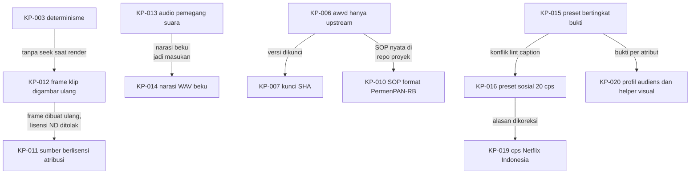

# Log keputusan awvd

## Metadata

- Version: `v1.1.0`
- Last updated: `2026-11-07`
- Changeset: `Menambahkan KP-019 (koreksi cps Netflix Indonesia) dan KP-020 (profil audiens dan helper visual berlabel keputusan desain); alasan KP-016 dikoreksi (20 cps = batas SDH dewasa).`

Log ini mencatat keputusan awvd yang sudah berlaku beserta alasannya, supaya kontributor dan agent tidak perlu menebak mengapa sesuatu dibuat begitu. Ini log keputusan awvd sendiri; nomor `DL-0xx` di AGENTS.md merujuk ke pedoman internal AhliWeb dan bukan bagian log ini. Keputusan ditulis ulang bila berubah: ubah kolom Status, tambahkan keputusan pengganti, dan jangan hapus baris lama.

Status: `Berlaku`, `Menunggu konfirmasi pemilik`, `Diusulkan`, atau `Digantikan oleh KP-xxx`. Semua keputusan di bawah diambil pada 2026-11-07 (awal repo); tanggal di kolom mengikuti riwayat repo.

| ID | Keputusan | Tanggal | Status | Alasan | Rujukan PR |
| --- | --- | --- | --- | --- | --- |
| KP-001 | awvd adalah renderer sendiri (Chromium headless + ffmpeg) tanpa memakai atau menyalin Remotion maupun repositori skill-nya. | 2026-11-07 | Berlaku | Menghindari risiko lisensi produk berlisensi membatasi. Ide "video dari kode yang digambar per frame" adalah metode, bukan ekspresi; pemeriksaan membandingkan interpolasi, pegas, easing, dan PRNG dengan sumber lain dan hasilnya berbeda. Satu-satunya kesamaan, algoritma mulberry32, berstatus domain publik dan atribusinya dipertahankan. | #1 |
| KP-002 | Bun-only: skrip dijalankan dengan `bun`/`bunx`, bukan `node`/`npx`. | 2026-11-07 | Berlaku | Lingkungan kerja tidak memiliki Node.js; satu runtime menyederhanakan CI dan instruksi. | #1 |
| KP-003 | Determinisme wajib: gerak hanya dari nomor frame; tanpa `Date.now()`, `Math.random()` tak ber-seed (pakai `acak(seed)`), atau CSS animation/transition (runtime mematikannya). | 2026-11-07 | Berlaku | Dua render dari komposisi dan props yang sama harus identik (diuji lewat `framemd5`) agar video dapat ditinjau sebagai kode dan dirender ulang. | #1 |
| KP-004 | Encode SDR BT.709 eksplisit (H.264 High, 4:2:0, rentang TV, GOP tertutup, faststart); audio AAC-LC 48 kHz 384 kbps dengan normalisasi kenyaringan bawaan: web -16 LUFS / -1,5 dBTP, siaran -23 LUFS / -1 dBTP. | 2026-11-07 | Berlaku | Warna dan level sama di semua pemutar; mengikuti YouTube Help "Recommended upload encoding settings", EBU R 128, dan AES TD1004/TD1008. Perilaku lama dapat dipilih dengan `--kenyaringan mati`. | #7 |
| KP-005 | Pemeriksa kilatan di `bun run periksa` adalah penyaringan konservatif, bukan sertifikasi PEAT/Harding atau bukti kepatuhan WCAG. | 2026-11-07 | Berlaku | Pengukuran dari video terkompresi dengan aproksimasi area uji dapat memberi positif palsu; klaim sertifikasi tidak dapat dipertanggungjawabkan. Kebutuhan regulasi memakai alat tersertifikasi. | #9 |
| KP-006 | awvd hanya upstream: renderer, runtime, template contoh generik berdata fiktif, uji, dan dokumentasi. Komposisi proyek, aset klien atau merek, naskah, dan hasil render ada di repo proyek terpisah. | 2026-11-07 | Berlaku | Memisahkan alat dari materi proyek yang lisensinya dipilih pemilik proyek masing-masing; menjaga repo publik bebas aset tanpa lisensi dan data nyata. Keputusan pemilik; aturan 11 AGENTS.md. | #5 |
| KP-007 | Repo proyek memasang awvd sebagai dependensi git Bun yang dikunci ke SHA commit (tag bila kelak ada rilis); tanpa git submodule dan tanpa fork atau salinan. | 2026-11-07 | Berlaku | Render dapat diulang pada versi yang sama; submodule lebih rumit, fork menyimpang dari upstream. Karena itu perubahan jalur `scripts/` dan protokol runtime wajib ditandai di `CHANGELOG.md`. | #5 |
| KP-008 | Repo publik tidak menyebut nama, path, atau tautan repo internal AhliWeb yang privat (rujukannya hanya "pedoman internal AhliWeb"). Riwayat `main` ditulis ulang sekali pada 2026-11-07 untuk menghapus rujukan itu; force push selain itu tetap dilarang. | 2026-11-07 | Berlaku | Repo internal privat; tautannya tidak bisa diakses pembaca publik dan membocorkan struktur internal. Keputusan pemilik. | #3, #4 |
| KP-009 | `main` diproteksi: check `uji` dan GitGuardian wajib SUCCESS, branch mutakhir sebelum merge, percakapan review diselesaikan, force push dan penghapusan diblokir (berlaku juga untuk admin); hanya merge commit; branch dihapus otomatis setelah merge; tanpa kewajiban review karena pemilik bekerja sendiri. | 2026-11-07 | Berlaku | Gerbang berbasis status menjaga `main` selalu lolos uji; GitHub tidak mengizinkan menyetujui PR sendiri sehingga review manusia tidak diwajibkan. Merge commit sama dengan riwayat repo. | #3, #4 |
| KP-010 | SOP dihasilkan dari satu berkas `sop.json` menjadi dokumen cetak dan bahan video; format dokumen mengikuti Lampiran PermenPAN-RB 35/2012 (SOP AP), validasi fail-closed (exit 2 dengan daftar galat), dan SOP nyata instansi disimpan di repo proyek, hanya contoh fiktif di awvd. | 2026-11-07 | Berlaku | Dokumen dan video dari sumber yang sama tidak bisa saling menyimpang. Peraturan itu masih berlaku. Batas langkah per halaman, kecepatan narasi, dan jeda adalah keputusan desain awvd, bukan aturan regulasi. | #10 |
| KP-011 | Video tertanam hanya dari sumber berlisensi yang mengizinkan penggunaan dengan atribusi (CC BY, BY-SA dengan lisensi keluaran kompatibel, BY-NC hanya untuk proyek nonkomersial, CC0, PDM, stok dengan bukti). Lisensi ND, kosong, atau tak dikenal ditolak sebelum Chromium diluncurkan. | 2026-11-07 | Berlaku | Frame klip dibuat ulang (di-resample, dipotong, ditimpa elemen komposisi) sehingga ND tidak berlaku. Tafsir ShareAlike untuk video gabungan belum terverifikasi dari sumber primer, jadi awvd konservatif; bukan nasihat hukum. | #11 |
| KP-012 | Klip tampil tanpa elemen `<video>`: `klip.mjs` mengekstrak frame pada fps komposisi ke cache, lalu komposisi menggambar frame ke-n lewat `klipGambar` ke `<canvas>`. | 2026-11-07 | Berlaku | Menjaga determinisme (KP-003): tidak ada seek saat render. `` kadang tertangkap dengan frame sebelumnya, sehingga `<canvas>` dianjurkan. | #11 |
| KP-013 | Audio klip memakai pemegang suara eksklusif dengan mode `bergantian` (gagal bila narasi induk tumpang tindih), `campur` (audio induk tetap dominan, audio klip turun 8..20 dB, bawaan 12), dan `bisu`. | 2026-11-07 | Berlaku | Ucapan simultan saling mengganggu; tidak ada standar siaran yang melarang tumpang tindih, jadi angka (12 dB, fade 200 ms, musik 12 dB di bawah ucapan) adalah usulan rekayasa dari riset rasio dialog-latar, bukan standar. | #11 |
| KP-014 | awvd tidak membundel mesin TTS; antarmuka narasi adalah berkas WAV beku (dihash dan dicatat di repo proyek). TTS daring hanya untuk konten publik. | 2026-11-07 | Berlaku | TTS saraf bisa tidak deterministik antar-run. Per 2026-11-07 tidak ditemukan model TTS bahasa Indonesia berlisensi permisif dengan asal data yang jelas. Konten internal atau sensitif tidak dikirim ke layanan daring. | #1, #11 |
| KP-015 | Preset jenis video (13 jenis) dan alur produksi (5 alur) adalah data bertingkat bukti (`bukti`, `standar`, `pedoman-industri`, `keputusan-desain`); preset adalah bantuan keputusan, bukan standar, dan dapat ditimpa lewat `override` beralasan dengan batas kontras 4,5:1 yang tidak boleh turun. | 2026-11-07 | Berlaku | Pada 2026-11-07 dari 273 nilai preset, 171 berupa keputusan desain dan hanya 6 berbasis bukti; pelabelan jujur mencegah preset dianggap hasil riset. | #12 |
| KP-016 | Preset `sosial` memakai batas 20 cps (batas SDH dewasa Netflix Indonesia; lihat KP-019), bukan angka TikTok "5-10 kata per detik"; teks hook TikTok diperlakukan sebagai judul pendek, bukan caption ucapan. | 2026-11-07 | Menunggu konfirmasi pemilik | Lint caption (Netflix Timed Text Style Guide) bertentangan dengan anjuran TikTok for Business; angka optimum bahasa Indonesia belum diverifikasi. Rumusan batas cps terbaru ada di [pedoman-produksi.md](pedoman-produksi.md). | #12 |
| KP-017 | Dokumentasi rinci dipindah dari README ke folder `docs/`; README menjadi ringkas dan memuat indeks. Setiap dokumen di `docs/` memuat Metadata, Changelog, dan terdaftar di [README.md](README.md) (indeks docs) serta indeks README akar. | 2026-11-07 | Berlaku | README yang panjang menjadi sumber konflik merge di setiap PR; dokumen terpisah per topik mengurangi tumpang tindih perubahan dan memudahkan peta pemicu di AGENTS.md. | #13 |
| KP-018 | Repo ini tidak memakai Release Changeset (`.changeset/`); perubahan software dicatat di `CHANGELOG.md` bagian `[Unreleased]`, versi dokumen dipisah dari versi software, dan rilis bertag belum ada (keputusan di tangan pemilik). | 2026-11-07 | Berlaku | awvd adalah alat CLI internal tanpa deployment; Document Changeset, Release Changeset, dan Changelog adalah tiga hal berbeda dan tidak dicampur. | #2, #3 |
| KP-019 | Batas cps mengikuti Netflix Indonesian Timed Text Style Guide: subtitle dewasa 17 dan anak 13, SDH dewasa 20 dan anak 17. Preset jenis memakai subtitle dewasa 17; `sosial` tetap 20 sebagai batas SDH dewasa (menunggu konfirmasi pemilik, lihat KP-016); profil audiens `anak` menurunkan `caption.cps` ke 13. | 2026-11-07 | Berlaku (nilai `sosial` mengikuti KP-016) | Rumusan lama ("dewasa 20, anak 17") berasal dari panduan Inggris. Panduan Indonesia dibaca langsung pada 2026-11-07. Angka preset tidak berubah karena preset sudah memakai 17; yang dikoreksi adalah rujukan, dokumentasi, dan pembeda anak. | #15 |
| KP-020 | Profil audiens (`data/audiens.json`) dan helper visual (`ukuranTeks`, `periksaPalet`, `simulasiButaWarna`, `bedaWarna`) dibuat sebagai alat bantu keputusan, bukan standar: ambang selisih warna delta E00 10, pengali ukuran teks, pengali tempo, dan ambang elemen per adegan berlabel `keputusan-desain`; nilai efektif adalah yang paling ketat dari preset jenis dan profil. | 2026-11-07 | Berlaku | Tidak ada riset yang menetapkan angka-angka itu untuk video motion graphics; yang didukung bukti hanya arahnya (WCAG, W3C WAI, Netflix Indonesia). Pelabelan jujur mencegah angka dianggap standar. Rumus (CIEDE2000, Machado) diuji terhadap data uji publikasi. | #15 |

## Changelog

### 2026-11-07 - v1.1.0

- Menambahkan KP-019 (koreksi cps Netflix Indonesia) dan KP-020 (profil audiens dan helper visual); alasan KP-016 dikoreksi.

### 2026-11-07 - v1.0.0

- Baseline log keputusan KP-001 sampai KP-018.
