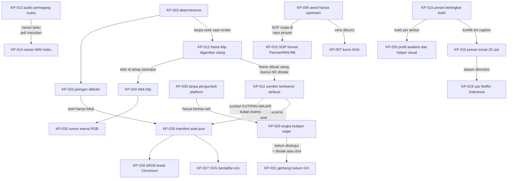

# Log keputusan awvd

## Metadata

- Version: `v1.5.0`
- Last updated: `2026-11-07`
- Changeset: `Menambahkan KP-034 (efek klip diterapkan saat ekstraksi lewat registri efek dan kunci cache berhash) dan KP-035 (rumus warna eksplisit di RGB, bukan eq; interpolasi LUT bawaan tetrahedral); nomor KP menyusul saat merge.`

Log ini mencatat keputusan awvd yang sudah berlaku beserta alasannya, supaya kontributor dan agent tidak perlu menebak mengapa sesuatu dibuat begitu. Ini log keputusan awvd sendiri; nomor `DL-0xx` di AGENTS.md merujuk ke pedoman internal AhliWeb dan bukan bagian log ini. Keputusan ditulis ulang bila berubah: ubah kolom Status, tambahkan keputusan pengganti, dan jangan hapus baris lama.

Status: `Berlaku`, `Menunggu konfirmasi pemilik`, `Diusulkan`, atau `Digantikan oleh KP-xxx`. Semua keputusan di bawah diambil pada 2026-11-07 (awal repo); tanggal di kolom mengikuti riwayat repo.

| ID | Keputusan | Tanggal | Status | Alasan | Rujukan PR |
| --- | --- | --- | --- | --- | --- |
| KP-001 | awvd adalah renderer sendiri (Chromium headless + ffmpeg) tanpa memakai atau menyalin Remotion maupun repositori skill-nya. | 2026-11-07 | Berlaku | Menghindari risiko lisensi produk berlisensi membatasi. Ide "video dari kode yang digambar per frame" adalah metode, bukan ekspresi; pemeriksaan membandingkan interpolasi, pegas, easing, dan PRNG dengan sumber lain dan hasilnya berbeda. Satu-satunya kesamaan, algoritma mulberry32, berstatus domain publik dan atribusinya dipertahankan. | #1 |
| KP-002 | Bun-only: skrip dijalankan dengan `bun`/`bunx`, bukan `node`/`npx`. | 2026-11-07 | Berlaku | Lingkungan kerja tidak memiliki Node.js; satu runtime menyederhanakan CI dan instruksi. | #1 |
| KP-003 | Determinisme wajib: gerak hanya dari nomor frame; tanpa `Date.now()`, `Math.random()` tak ber-seed (pakai `acak(seed)`), atau CSS animation/transition (runtime mematikannya). | 2026-11-07 | Berlaku | Dua render dari komposisi dan props yang sama harus identik (diuji lewat `framemd5`) agar video dapat ditinjau sebagai kode dan dirender ulang. | #1 |
| KP-004 | Encode SDR BT.709 eksplisit (H.264 High, 4:2:0, rentang TV, GOP tertutup, faststart); audio AAC-LC 48 kHz 384 kbps dengan normalisasi kenyaringan bawaan: web -16 LUFS / -1,5 dBTP, siaran -23 LUFS / -1 dBTP. | 2026-11-07 | Berlaku | Warna dan level sama di semua pemutar; mengikuti YouTube Help "Recommended upload encoding settings", EBU R 128, dan AES TD1004/TD1008. Perilaku lama dapat dipilih dengan `--kenyaringan mati`. | #7 |
| KP-005 | Pemeriksa kilatan di `bun run periksa` adalah penyaringan konservatif, bukan sertifikasi PEAT/Harding atau bukti kepatuhan WCAG. | 2026-11-07 | Berlaku | Pengukuran dari video terkompresi dengan aproksimasi area uji dapat memberi positif palsu; klaim sertifikasi tidak dapat dipertanggungjawabkan. Kebutuhan regulasi memakai alat tersertifikasi. | #9 |
| KP-006 | awvd hanya upstream: renderer, runtime, template contoh generik berdata fiktif, uji, dan dokumentasi. Komposisi proyek, aset klien atau merek, naskah, dan hasil render ada di repo proyek terpisah. | 2026-11-07 | Berlaku | Memisahkan alat dari materi proyek yang lisensinya dipilih pemilik proyek masing-masing; menjaga repo publik bebas aset tanpa lisensi dan data nyata. Keputusan pemilik; aturan 11 AGENTS.md. | #5 |
| KP-007 | Repo proyek memasang awvd sebagai dependensi git Bun yang dikunci ke SHA commit (tag bila kelak ada rilis); tanpa git submodule dan tanpa fork atau salinan. | 2026-11-07 | Berlaku | Render dapat diulang pada versi yang sama; submodule lebih rumit, fork menyimpang dari upstream. Karena itu perubahan jalur `scripts/` dan protokol runtime wajib ditandai di `CHANGELOG.md`. | #5 |
| KP-008 | Repo publik tidak menyebut nama, path, atau tautan repo internal AhliWeb yang privat (rujukannya hanya "pedoman internal AhliWeb"). Riwayat `main` ditulis ulang sekali pada 2026-11-07 untuk menghapus rujukan itu; force push selain itu tetap dilarang. | 2026-11-07 | Berlaku | Repo internal privat; tautannya tidak bisa diakses pembaca publik dan membocorkan struktur internal. Keputusan pemilik. | #3, #4 |
| KP-009 | `main` diproteksi: check `uji` dan GitGuardian wajib SUCCESS, branch mutakhir sebelum merge, percakapan review diselesaikan, force push dan penghapusan diblokir (berlaku juga untuk admin); hanya merge commit; branch dihapus otomatis setelah merge; tanpa kewajiban review karena pemilik bekerja sendiri. | 2026-11-07 | Berlaku | Gerbang berbasis status menjaga `main` selalu lolos uji; GitHub tidak mengizinkan menyetujui PR sendiri sehingga review manusia tidak diwajibkan. Merge commit sama dengan riwayat repo. | #3, #4 |
| KP-010 | SOP dihasilkan dari satu berkas `sop.json` menjadi dokumen cetak dan bahan video; format dokumen mengikuti Lampiran PermenPAN-RB 35/2012 (SOP AP), validasi fail-closed (exit 2 dengan daftar galat), dan SOP nyata instansi disimpan di repo proyek, hanya contoh fiktif di awvd. | 2026-11-07 | Berlaku | Dokumen dan video dari sumber yang sama tidak bisa saling menyimpang. Peraturan itu masih berlaku. Batas langkah per halaman, kecepatan narasi, dan jeda adalah keputusan desain awvd, bukan aturan regulasi. | #10 |
| KP-011 | Video tertanam hanya dari sumber berlisensi yang mengizinkan penggunaan dengan atribusi (CC BY, BY-SA dengan lisensi keluaran kompatibel, BY-NC hanya untuk proyek nonkomersial, CC0, PDM, stok dengan bukti). Lisensi ND, kosong, atau tak dikenal ditolak sebelum Chromium diluncurkan. | 2026-11-07 | Berlaku | Frame klip dibuat ulang (di-resample, dipotong, ditimpa elemen komposisi) sehingga ND tidak berlaku. Tafsir ShareAlike untuk video gabungan belum terverifikasi dari sumber primer, jadi awvd konservatif; bukan nasihat hukum. | #11 |
| KP-012 | Klip tampil tanpa elemen `<video>`: `klip.mjs` mengekstrak frame pada fps komposisi ke cache, lalu komposisi menggambar frame ke-n lewat `klipGambar` ke `<canvas>`. | 2026-11-07 | Berlaku | Menjaga determinisme (KP-003): tidak ada seek saat render. `` kadang tertangkap dengan frame sebelumnya, sehingga `<canvas>` dianjurkan. | #11 |
| KP-013 | Audio klip memakai pemegang suara eksklusif dengan mode `bergantian` (gagal bila narasi induk tumpang tindih), `campur` (audio induk tetap dominan, audio klip turun 8..20 dB, bawaan 12), dan `bisu`. | 2026-11-07 | Berlaku | Ucapan simultan saling mengganggu; tidak ada standar siaran yang melarang tumpang tindih, jadi angka (12 dB, fade 200 ms, musik 12 dB di bawah ucapan) adalah usulan rekayasa dari riset rasio dialog-latar, bukan standar. | #11 |
| KP-014 | awvd tidak membundel mesin TTS; antarmuka narasi adalah berkas WAV beku (dihash dan dicatat di repo proyek). TTS daring hanya untuk konten publik. | 2026-11-07 | Berlaku | TTS saraf bisa tidak deterministik antar-run. Per 2026-11-07 tidak ditemukan model TTS bahasa Indonesia berlisensi permisif dengan asal data yang jelas. Konten internal atau sensitif tidak dikirim ke layanan daring. | #1, #11 |
| KP-015 | Preset jenis video (13 jenis) dan alur produksi (5 alur) adalah data bertingkat bukti (`bukti`, `standar`, `pedoman-industri`, `keputusan-desain`); preset adalah bantuan keputusan, bukan standar, dan dapat ditimpa lewat `override` beralasan dengan batas kontras 4,5:1 yang tidak boleh turun. | 2026-11-07 | Berlaku | Pada 2026-11-07 dari 273 nilai preset, 171 berupa keputusan desain dan hanya 6 berbasis bukti; pelabelan jujur mencegah preset dianggap hasil riset. | #12 |
| KP-016 | Preset `sosial` memakai batas 20 cps (batas SDH dewasa Netflix Indonesia; lihat KP-019), bukan angka TikTok "5-10 kata per detik"; teks hook TikTok diperlakukan sebagai judul pendek, bukan caption ucapan. | 2026-11-07 | Menunggu konfirmasi pemilik | Lint caption (Netflix Timed Text Style Guide) bertentangan dengan anjuran TikTok for Business; angka optimum bahasa Indonesia belum diverifikasi. Rumusan batas cps terbaru ada di [pedoman-produksi.md](pedoman-produksi.md). | #12 |
| KP-017 | Dokumentasi rinci dipindah dari README ke folder `docs/`; README menjadi ringkas dan memuat indeks. Setiap dokumen di `docs/` memuat Metadata, Changelog, dan terdaftar di [README.md](README.md) (indeks docs) serta indeks README akar. | 2026-11-07 | Berlaku | README yang panjang menjadi sumber konflik merge di setiap PR; dokumen terpisah per topik mengurangi tumpang tindih perubahan dan memudahkan peta pemicu di AGENTS.md. | #13 |
| KP-018 | Repo ini tidak memakai Release Changeset (`.changeset/`); perubahan software dicatat di `CHANGELOG.md` bagian `[Unreleased]`, versi dokumen dipisah dari versi software, dan rilis bertag belum ada (keputusan di tangan pemilik). | 2026-11-07 | Berlaku | awvd adalah alat CLI internal tanpa deployment; Document Changeset, Release Changeset, dan Changelog adalah tiga hal berbeda dan tidak dicampur. | #2, #3 |
| KP-019 | Batas cps mengikuti Netflix Indonesian Timed Text Style Guide: subtitle dewasa 17 dan anak 13, SDH dewasa 20 dan anak 17. Preset jenis memakai subtitle dewasa 17; `sosial` tetap 20 sebagai batas SDH dewasa (menunggu konfirmasi pemilik, lihat KP-016); profil audiens `anak` menurunkan `caption.cps` ke 13. | 2026-11-07 | Berlaku (nilai `sosial` mengikuti KP-016) | Rumusan lama ("dewasa 20, anak 17") berasal dari panduan Inggris. Panduan Indonesia dibaca langsung pada 2026-11-07. Angka preset tidak berubah karena preset sudah memakai 17; yang dikoreksi adalah rujukan, dokumentasi, dan pembeda anak. | #15 |
| KP-020 | Profil audiens (`data/audiens.json`) dan helper visual (`ukuranTeks`, `periksaPalet`, `simulasiButaWarna`, `bedaWarna`) dibuat sebagai alat bantu keputusan, bukan standar: ambang selisih warna delta E00 10, pengali ukuran teks, pengali tempo, dan ambang elemen per adegan berlabel `keputusan-desain`; nilai efektif adalah yang paling ketat dari preset jenis dan profil. | 2026-11-07 | Berlaku | Tidak ada riset yang menetapkan angka-angka itu untuk video motion graphics; yang didukung bukti hanya arahnya (WCAG, W3C WAI, Netflix Indonesia). Pelabelan jujur mencegah angka dianggap standar. Rumus (CIEDE2000, Machado) diuji terhadap data uji publikasi. | #15 |
| KP-021 | Transisi dan animasi elemen berada di modul mandiri `scripts/transisi.js` (`window.Transisi`, dimuat opsional setelah `runtime.js`), bukan digabung ke `runtime.js`, dan tidak membuat alias global. | 2026-11-07 | Berlaku | Runtime tetap kecil dan stabil untuk repo proyek yang mengunci SHA; modul besar (sekitar 1.200 baris) hanya dimuat bila dipakai; tanpa alias global tidak bentrok dengan `easing`, `fade`, dan `pegas` runtime. Konsekuensinya tabel kurva easing diduplikasi demi kemandirian; menyatukannya dengan runtime adalah pekerjaan lanjutan. | #16 |
| KP-022 | Efek piksel pada konten DOM (blur arah, glitch, RGB split) memakai filter SVG; `<canvas>` hanya untuk lapisan generatif (grain). Tidak memakai pustaka penangkap DOM ke kanvas. | 2026-11-07 | Berlaku | Kanvas tidak dapat membaca piksel DOM; pustaka penangkap menambah dependensi, risiko lisensi, dan fidelitas yang berbeda. Filter SVG terbukti deterministik di Chromium renderer (framemd5 identik) dan diuji di `uji:transisi`. | #16 |
| KP-023 | `kurangiGerak` adalah praktik terbaik, bukan klaim kepatuhan: ia mengganti jenis gerak besar dan berkilat (kecuali `celup`) dengan `pudar`, dan mematikan kamera, paralaks, dan getar. Diberikan lewat props `profil`, bukan flag CLI. | 2026-11-07 | Berlaku | WCAG 2.3.3 (AAA) secara normatif hanya untuk animasi yang dipicu interaksi, sehingga tidak berlaku langsung ke MP4; yang berlaku langsung ialah SC 2.3.1 (kilatan). Penggantian ke `pudar` mengikuti pola `prefers-reduced-motion` dan pemahaman 2.3.3 bahwa perubahan opasitas bukan animasi gerak. Flag `--gerak` di `render.mjs` belum ada (dijaga agar `render.mjs` tidak berubah di PR ini). | #16 |
| KP-024 | Efek berbiaya kompresi tinggi (jenis `gangguan`, grain hidup) mati bawaan: `grain` bawaan diam, dan bila opsi `jenisVideo` diberikan, `efekBerat(jenisVideo)` hanya `true` untuk `kreatif`, `promo`, `sosial`, `acara`; selainnya `gangguan` diganti `pudar` kecuali `paksaEfekBerat`. | 2026-11-07 | Berlaku | Terukur pada riset awal (satu mesin, konten sintetis): glitch sekitar 5,3x dan grain hidup sekitar 7,5x ukuran `potong`, sedangkan grain diam 1,16x. Daftar jenis yang mengizinkan efek berat adalah keputusan desain. | #16 |
| KP-025 | Renderer memblokir semua permintaan jaringan selain `file:`, `data:`, `about:`, `blob:` (HTTP, HTTPS, WebSocket) secara bawaan; render gagal dengan kode keluar 3 beserta daftar URL; `--izinkan-jaringan` (mati bawaan) hanya untuk pratinjau; komposisi yang dibuka lewat http(s) boleh meminta asalnya sendiri. | 2026-11-07 | Berlaku | Uji lokal: renderer lama meneruskan ``, CSS `url()`, `fetch`, `sendBeacon`, dan WebSocket ke server luar, sehingga render bisa bocor ke layanan luar dan tidak deterministik. `context.route` saja tidak menutup WebSocket, jadi `routeWebSocket` dipasang juga. Kegagalan keras dipilih daripada peringatan karena hotlink membuat hasil bergantung pada sumber yang bisa berubah; trade-off: komposisi lama yang memuat sumber luar kini gagal (pakai aset lokal atau `--izinkan-jaringan`). Kode keluar 3 dipisah dari 1 agar skrip pemanggil dapat membedakannya. Memengaruhi repo proyek. | #56 |
| KP-026 | Aset dicatat di satu manifest `aset.json` (skema 1) berjenis (gambar, logo, ikon, svg, font, audio) dengan validasi fail-closed sebelum Chromium (kode keluar 2): lisensi dari daftar izin per jenis, `sha256`, berkas lokal di `aset/`, TASL lengkap, bukti, serta aturan khusus (OFL, merek, hak potret, hasil AI, ShareAlike). awvd tidak mengunduh aset dari URL. | 2026-11-07 | Berlaku | Memperluas pola manifest sumber klip (KP-011) agar semua aset melewati satu gerbang yang sama dan bukti lisensi tersimpan bersama aset. Validator hanya memeriksa kelengkapan dan kecocokan dengan matriks lisensi; tinjauan hukum (merek, lambang, hak potret, musik, hasil AI) tetap manusia. Bukan nasihat hukum. | #56 |
| KP-027 | SVG diperiksa dan dibersihkan dengan pemeriksa berdaftar-izin buatan sendiri (`scripts/aset-svg.js`), tanpa dependensi; SVG berbahaya ditolak, bukan diperbaiki, bila rusak secara struktural. | 2026-11-07 | Berlaku | SVG inline menjalankan skrip dan memuat sumber luar, dan komposisi sering menyisipkan SVG inline. Daftar-larang mudah dilewati (escape CSS, entitas, namespace); daftar-izin fail-closed lebih aman. Tanpa DOM di Bun, pustaka seperti DOMPurify membutuhkan DOM tambahan (dependensi baru). Batasan: belum diuji dengan korpus XSS publik dan bukan pengganti pustaka matang untuk SVG tak tepercaya dari internet. | #56 |
| KP-028 | Konversi gambar ke sRGB dan normalisasi orientasi EXIF dilakukan lewat Chromium yang sama dengan renderer (`aset tambah --konversi`), bukan alat tambahan; keluaran PNG tanpa profil. | 2026-11-07 | Berlaku | Chromium sudah dikelola warna sedangkan ffmpeg 6 mengabaikan ICC dan orientasi EXIF; konversi sekali saat impor membuat piksel di disk sama dengan yang dirender. Tanpa dependensi baru. Trade-off: hasil bergantung build Chromium (selisih 1 pada satu kanal dimungkinkan), alpha melewati kanvas pra-kali, dan PNG lebih besar daripada JPEG asal. | #56 |
| KP-029 | Kebijakan kutipan wajar untuk video reaction dan ulasan memakai angka bawaan: tiap klip kutipan maksimum 15 detik; total kutipan per sumber maksimum 45 detik atau 15% durasi sumber (yang lebih kecil); total kutipan maksimum 25% durasi video baru; komentar atau narasi asli aktif minimum 90% dari durasi kutipan; audio musik sumber dibisukan secara bawaan (musik dibahas maksimum 10 detik). Proyek boleh memperketat dan tidak boleh melonggarkan tanpa catatan izin tertulis. Diperiksa `klip.mjs` dan `audio.mjs` sebelum ekstraksi dan Chromium. | 2026-11-07 | Berlaku | Disetujui pemilik 2026-11-07. Hukum tidak menetapkan angka (UU 28/2014 Pasal 44, 17 U.S.C. §107, Konvensi Bern Pasal 10 hanya menyebut tujuan dan kewajaran), jadi angka adalah pagar konservatif yang dapat diperiksa mesin; ia bukan jaminan bahwa kutipan sah dan bukan nasihat hukum. Komentar yang menyasar karya dan dominan menjadi inti penimbangan putusan acuan. | #57 |
| KP-030 | awvd tidak menyediakan pengunduh dari platform mana pun, perekam layar atau penangkap stream, pemintas DRM, penghapus watermark, pengelak pencocokan otomatis, atau alat yang menyalin naskah, karakter, atau musik. Bahan hanya berkas lokal yang sah dimiliki dan dicatat di `sumber.json`; `bun run pelajari` hanya menghasilkan angka agregat dari berkas lokal dan menolak `--sumber-sah` `unduh-platform`, `rekam-layar-platform`, `rip-stream`, dan URL. | 2026-11-07 | Berlaku | Ketentuan layanan platform umumnya melarang pengunduhan dan akses otomatis di luar fitur resmi, dan UU 28/2014 Pasal 52 dan Pasal 7 ayat 3 melarang pemintasan sarana kontrol teknologi dan penghapusan informasi manajemen hak cipta. awvd tidak dapat memverifikasi asal berkas, sehingga hanya mencatat pernyataan pengguna dan menolak nilai yang jelas melanggar; ada uji yang menjaga agar tidak ada pengunduh di `scripts/`. | #57 |
| KP-031 | Gerbang tinjauan hukum `GH` berada di manifest (`proyek.gerbangHukum` dengan status, peninjau, tanggal, memo, dan hash SHA-256 gabungan manifest dan memo), bukan di `data/alur-produksi.json`. Sumber `KUTIPAN-WAJAR` tanpa GH disetujui ditolak sebelum render final (kode keluar 2) atau diberi tanda draf dengan `klip.mjs --draf` (`props.draf`, pita DRAF di komposisi). Perubahan manifest atau memo membatalkan persetujuan. | 2026-11-07 | Berlaku | Gerbang harus bekerja untuk repo proyek yang tidak memakai alur produksi konsep, dan penegakannya harus terjadi sebelum Chromium tanpa mengubah `render.mjs`. Hash mengikat persetujuan pada isi yang ditinjau. GH hanya mencatat bahwa peninjauan terjadi; ia tidak menilai isi memo. | #57 |
| KP-034 | Efek klip (LUT `.cube`, koreksi warna, keseimbangan warna) dideklarasikan di `klip[].efek` pada `sumber.json` dan diterapkan **sekali saat ekstraksi** dalam rantai ffmpeg di `klip.mjs`, bukan per frame di Chromium dan bukan lewat `runtime.js`. Registri jenis efek (`EFEK`) membuat jenis baru cukup satu entri; kunci cache memuat efek kanonik dan sha256 berkas LUT, efek netral dibuang, dan klip tanpa efek tidak berubah kuncinya. | 2026-11-07 | Berlaku | Frame klip sudah dibuat ulang per nomor frame oleh ffmpeg (KP-012), jadi satu kali pengolahan di sana murah, deterministik, dan di-cache; mengolah di Chromium berarti menimpa piksel tiap frame dan menambah risiko determinisme. Kunci yang memuat hash isi LUT mencegah cache basi saat LUT diedit dengan nama sama. Kekurangan: efek konstan sepanjang klip (tanpa keyframe), dan mengubah efek mengekstrak ulang. Skema tervalidasi fail-closed sebelum ffmpeg (kode keluar 2). | menyusul |
| KP-035 | Koreksi `warna` memakai rumus eksplisit di RGB 8 bit (`lutrgb` untuk gamma, kontras, kecerahan; `colorchannelmixer` dengan luma Rec. 709 untuk saturasi), bukan filter `eq`; `lut3d` memakai interpolasi `tetrahedral` sebagai bawaan, `trilinear` tersedia untuk hasil bit-eksak pada LUT identitas. | 2026-11-07 | Berlaku | Pengukuran ffmpeg 6.1 pada klip uji: `eq` pada RGB planar mengubah piksel walau parameter netral (PSNR 51,6 dB terhadap masukan) dan `saturation=0` menghasilkan abu-abu tak murni (93 96 93 pada hijau murni); lewat YUV 4:4:4 8 bit masih meleset hingga 3 level (53,7 dB) karena pembulatan. Rumus eksplisit netral secara eksak, abu-abu murni pada saturasi 0, dan terdokumentasi. Tetrahedral adalah bawaan ffmpeg dan lebih setia pada sumbu abu-abu, tetapi membulatkan float sehingga identitas tidak bit-eksak (82,6 dB PNG, ~65 dB JPEG); trilinear identik byte demi byte. | menyusul |

## Changelog

### 2026-11-07 - v1.5.0

- Menambahkan KP-034 dan KP-035 (efek warna klip saat ekstraksi); ID sementara, rujukan PR menyusul.

### 2026-11-07 - v1.4.0

- Menambahkan KP-029 (angka kebijakan kutipan wajar, disetujui pemilik 2026-11-07), KP-030 (tanpa pengunduh platform dan pemintas DRM), dan KP-031 (gerbang hukum GH berhash dengan tanda draf).

### 2026-11-07 - v1.3.0

- Menambahkan KP-025 (pemblokiran jaringan renderer), KP-026 (manifest `aset.json` fail-closed), KP-027 (SVG berdaftar-izin), dan KP-028 (konversi sRGB lewat Chromium).

### 2026-11-07 - v1.2.0

- Menambahkan KP-021 sampai KP-024 (modul transisi dan animasi).

### 2026-11-07 - v1.1.0

- Menambahkan KP-019 (koreksi cps Netflix Indonesia) dan KP-020 (profil audiens dan helper visual); alasan KP-016 dikoreksi.

### 2026-11-07 - v1.0.0

- Baseline log keputusan KP-001 sampai KP-018.
