# Log keputusan awvd

## Metadata

- Version: `v1.18.0`
- Last updated: `2026-11-08`
- Changeset: `Menambahkan KP-065 sampai KP-067 (rencana audio dari timeline lewat audio.mjs, musik sepanjang video, urutan gainDb). Sebelumnya: Menambahkan KP-063 dan KP-064 (reframe: keyframe fokus manual sebagai sumber kebenaran, saran heuristik tanpa model; parameter heuristik saran).`

Log ini mencatat keputusan awvd yang sudah berlaku beserta alasannya, supaya kontributor dan agent tidak perlu menebak mengapa sesuatu dibuat begitu. Ini log keputusan awvd sendiri; nomor `DL-0xx` di AGENTS.md merujuk ke pedoman internal AhliWeb dan bukan bagian log ini. Keputusan ditulis ulang bila berubah: ubah kolom Status, tambahkan keputusan pengganti, dan jangan hapus baris lama.

Status: `Berlaku`, `Menunggu konfirmasi pemilik`, `Diusulkan`, atau `Digantikan oleh KP-xxx`. Semua keputusan di bawah diambil pada 2026-11-07 (awal repo); tanggal di kolom mengikuti riwayat repo.

```mermaid
flowchart TD
    KP3[KP-003 determinisme] -->|tanpa seek saat render| KP12[KP-012 frame klip digambar ulang]
    KP12 -->|frame dibuat ulang,<br/>lisensi ND ditolak| KP11[KP-011 sumber berlisensi atribusi]
    KP13[KP-013 audio pemegang suara] -->|narasi beku<br/>jadi masukan| KP14[KP-014 narasi WAV beku]
    KP6[KP-006 awvd hanya upstream] -->|versi dikunci| KP7[KP-007 kunci SHA]
    KP6 -->|SOP nyata di<br/>repo proyek| KP10[KP-010 SOP format PermenPAN-RB]
    KP11 -->|diperluas ke semua jenis aset| KP26[KP-026 manifest aset.json]
    KP26 --> KP27[KP-027 SVG berdaftar-izin]
    KP26 --> KP28[KP-028 sRGB lewat Chromium]
    KP3 --> KP25[KP-025 jaringan diblokir]
    KP25 -->|aset hanya lokal| KP26
    KP11 -->|sumber KUTIPAN-WAJAR<br/>bukan lisensi| KP29[KP-029 angka kutipan wajar]
    KP30[KP-030 tanpa pengunduh<br/>platform] -->|hanya berkas sah| KP29
    KP29 -->|belum disetujui<br/>= ditolak atau draf| KP31[KP-031 gerbang hukum GH]
    KP12 -->|efek di tahap ekstraksi| KPB1[KP-034 efek klip]
    KPB1 --> KPB2[KP-035 rumus warna RGB]
    KPB1 --> KPB3[KP-043 chroma key PNG alfa]
    KPB1 --> KPB4[KP-044 stabilisasi vidstab]
    KP14 -->|adaptor opsional| KPT1[KP-048 adaptor TTS sherpa-onnx]
    KPT1 --> KPT2[KP-049 WAV beku berhash]
    KPT1 --> KPT3[KP-050 label sintetis dan konten medis]
    KPT1 --> KPT4[KP-051 normalisasi teks id]
    KP3 -->|tanpa jam atau acak| KPK1[KP-053 deteksi ketukan Bun murni]
    KPK1 --> KPK2[KP-054 tempo tetap + keyakinan]
    KPK1 --> KPK3[KP-055 helper terpisah]
    KP3 -->|gerak dari nomor frame| KPW1[KP-059 waktu frame bulat]
    KPW1 --> KPW2[KP-060 transisi tumpang tindih]
    KPW1 --> KPW3[KP-061 timeline sumber tunggal]
    KPW3 -.->|konverter ditunda| KPW4[KP-062 OTIO bukan format asli]
    KP15[KP-015 preset bertingkat bukti] -->|konflik lint caption| KP16[KP-016 preset sosial 20 cps]
    KP16 -->|alasan dikoreksi| KP19[KP-019 cps Netflix Indonesia]
    KP15 -->|bukti per atribut| KP20[KP-020 profil audiens dan helper visual]
```

| ID | Keputusan | Tanggal | Status | Alasan | Rujukan PR |
| --- | --- | --- | --- | --- | --- |
| KP-001 | awvd adalah renderer sendiri (Chromium headless + ffmpeg) tanpa memakai atau menyalin Remotion maupun repositori skill-nya. | 2026-11-07 | Berlaku | Menghindari risiko lisensi produk berlisensi membatasi. Ide "video dari kode yang digambar per frame" adalah metode, bukan ekspresi; pemeriksaan membandingkan interpolasi, pegas, easing, dan PRNG dengan sumber lain dan hasilnya berbeda. Satu-satunya kesamaan, algoritma mulberry32, berstatus domain publik dan atribusinya dipertahankan. | #1 |
| KP-002 | Bun-only: skrip dijalankan dengan `bun`/`bunx`, bukan `node`/`npx`. | 2026-11-07 | Berlaku | Lingkungan kerja tidak memiliki Node.js; satu runtime menyederhanakan CI dan instruksi. | #1 |
| KP-003 | Determinisme wajib: gerak hanya dari nomor frame; tanpa `Date.now()`, `Math.random()` tak ber-seed (pakai `acak(seed)`), atau CSS animation/transition (runtime mematikannya). | 2026-11-07 | Berlaku | Dua render dari komposisi dan props yang sama harus identik (diuji lewat `framemd5`) agar video dapat ditinjau sebagai kode dan dirender ulang. | #1 |
| KP-004 | Encode SDR BT.709 eksplisit (H.264 High, 4:2:0, rentang TV, GOP tertutup, faststart); audio AAC-LC 48 kHz 384 kbps dengan normalisasi kenyaringan bawaan: web -16 LUFS / -1,5 dBTP, siaran -23 LUFS / -1 dBTP. | 2026-11-07 | Berlaku | Warna dan level sama di semua pemutar; mengikuti YouTube Help "Recommended upload encoding settings", EBU R 128, dan AES TD1004/TD1008. Perilaku lama dapat dipilih dengan `--kenyaringan mati`. | #7 |
| KP-005 | Pemeriksa kilatan di `bun run periksa` adalah penyaringan konservatif, bukan sertifikasi PEAT/Harding atau bukti kepatuhan WCAG. | 2026-11-07 | Berlaku | Pengukuran dari video terkompresi dengan aproksimasi area uji dapat memberi positif palsu; klaim sertifikasi tidak dapat dipertanggungjawabkan. Kebutuhan regulasi memakai alat tersertifikasi. | #9 |
| KP-006 | awvd hanya upstream: renderer, runtime, template contoh generik berdata fiktif, uji, dan dokumentasi. Komposisi proyek, aset klien atau merek, naskah, dan hasil render ada di repo proyek terpisah. | 2026-11-07 | Berlaku | Memisahkan alat dari materi proyek yang lisensinya dipilih pemilik proyek masing-masing; menjaga repo publik bebas aset tanpa lisensi dan data nyata. Keputusan pemilik; aturan 11 AGENTS.md. | #5 |
| KP-007 | Repo proyek memasang awvd sebagai dependensi git Bun yang dikunci ke SHA commit (tag bila kelak ada rilis); tanpa git submodule dan tanpa fork atau salinan. | 2026-11-07 | Berlaku | Render dapat diulang pada versi yang sama; submodule lebih rumit, fork menyimpang dari upstream. Karena itu perubahan jalur `scripts/` dan protokol runtime wajib ditandai di `CHANGELOG.md`. | #5 |
| KP-008 | Repo publik tidak menyebut nama, path, atau tautan repo internal AhliWeb yang privat (rujukannya hanya "pedoman internal AhliWeb"). Riwayat `main` ditulis ulang sekali pada 2026-11-07 untuk menghapus rujukan itu; force push selain itu tetap dilarang. | 2026-11-07 | Berlaku | Repo internal privat; tautannya tidak bisa diakses pembaca publik dan membocorkan struktur internal. Keputusan pemilik. | #3, #4 |
| KP-009 | `main` diproteksi: check `uji` dan GitGuardian wajib SUCCESS, branch mutakhir sebelum merge, percakapan review diselesaikan, force push dan penghapusan diblokir (berlaku juga untuk admin); hanya merge commit; branch dihapus otomatis setelah merge; tanpa kewajiban review karena pemilik bekerja sendiri. | 2026-11-07 | Berlaku | Gerbang berbasis status menjaga `main` selalu lolos uji; GitHub tidak mengizinkan menyetujui PR sendiri sehingga review manusia tidak diwajibkan. Merge commit sama dengan riwayat repo. | #3, #4 |
| KP-010 | SOP dihasilkan dari satu berkas `sop.json` menjadi dokumen cetak dan bahan video; format dokumen mengikuti Lampiran PermenPAN-RB 35/2012 (SOP AP), validasi fail-closed (exit 2 dengan daftar galat), dan SOP nyata instansi disimpan di repo proyek, hanya contoh fiktif di awvd. | 2026-11-07 | Berlaku | Dokumen dan video dari sumber yang sama tidak bisa saling menyimpang. Peraturan itu masih berlaku. Batas langkah per halaman, kecepatan narasi, dan jeda adalah keputusan desain awvd, bukan aturan regulasi. | #10 |
| KP-011 | Video tertanam hanya dari sumber berlisensi yang mengizinkan penggunaan dengan atribusi (CC BY, BY-SA dengan lisensi keluaran kompatibel, BY-NC hanya untuk proyek nonkomersial, CC0, PDM, stok dengan bukti). Lisensi ND, kosong, atau tak dikenal ditolak sebelum Chromium diluncurkan. | 2026-11-07 | Berlaku | Frame klip dibuat ulang (di-resample, dipotong, ditimpa elemen komposisi) sehingga ND tidak berlaku. Tafsir ShareAlike untuk video gabungan belum terverifikasi dari sumber primer, jadi awvd konservatif; bukan nasihat hukum. | #11 |
| KP-012 | Klip tampil tanpa elemen `<video>`: `klip.mjs` mengekstrak frame pada fps komposisi ke cache, lalu komposisi menggambar frame ke-n lewat `klipGambar` ke `<canvas>`. | 2026-11-07 | Berlaku | Menjaga determinisme (KP-003): tidak ada seek saat render. `` kadang tertangkap dengan frame sebelumnya, sehingga `<canvas>` dianjurkan. | #11 |
| KP-013 | Audio klip memakai pemegang suara eksklusif dengan mode `bergantian` (gagal bila narasi induk tumpang tindih), `campur` (audio induk tetap dominan, audio klip turun 8..20 dB, bawaan 12), dan `bisu`. | 2026-11-07 | Berlaku | Ucapan simultan saling mengganggu; tidak ada standar siaran yang melarang tumpang tindih, jadi angka (12 dB, fade 200 ms, musik 12 dB di bawah ucapan) adalah usulan rekayasa dari riset rasio dialog-latar, bukan standar. | #11 |
| KP-014 | awvd tidak membundel mesin TTS; antarmuka narasi adalah berkas WAV beku (dihash dan dicatat di repo proyek). TTS daring hanya untuk konten publik. | 2026-11-07 | Berlaku | TTS saraf bisa tidak deterministik antar-run. Per 2026-11-07 tidak ditemukan model TTS bahasa Indonesia berlisensi permisif dengan asal data yang jelas. Konten internal atau sensitif tidak dikirim ke layanan daring. | #1, #11 |
| KP-015 | Preset jenis video (13 jenis) dan alur produksi (5 alur) adalah data bertingkat bukti (`bukti`, `standar`, `pedoman-industri`, `keputusan-desain`); preset adalah bantuan keputusan, bukan standar, dan dapat ditimpa lewat `override` beralasan dengan batas kontras 4,5:1 yang tidak boleh turun. | 2026-11-07 | Berlaku | Pada 2026-11-07 dari 273 nilai preset, 171 berupa keputusan desain dan hanya 6 berbasis bukti; pelabelan jujur mencegah preset dianggap hasil riset. | #12 |
| KP-016 | Preset `sosial` memakai batas 20 cps (batas SDH dewasa Netflix Indonesia; lihat KP-019), bukan angka TikTok "5-10 kata per detik"; teks hook TikTok diperlakukan sebagai judul pendek, bukan caption ucapan. | 2026-11-07 | Menunggu konfirmasi pemilik | Lint caption (Netflix Timed Text Style Guide) bertentangan dengan anjuran TikTok for Business; angka optimum bahasa Indonesia belum diverifikasi. Rumusan batas cps terbaru ada di [pedoman-produksi.md](pedoman-produksi.md). | #12 |
| KP-017 | Dokumentasi rinci dipindah dari README ke folder `docs/`; README menjadi ringkas dan memuat indeks. Setiap dokumen di `docs/` memuat Metadata, Changelog, dan terdaftar di [README.md](README.md) (indeks docs) serta indeks README akar. | 2026-11-07 | Berlaku | README yang panjang menjadi sumber konflik merge di setiap PR; dokumen terpisah per topik mengurangi tumpang tindih perubahan dan memudahkan peta pemicu di AGENTS.md. | #13 |
| KP-018 | Repo ini tidak memakai Release Changeset (`.changeset/`); perubahan software dicatat di `CHANGELOG.md` bagian `[Unreleased]`, versi dokumen dipisah dari versi software, dan rilis bertag belum ada (keputusan di tangan pemilik). | 2026-11-07 | Berlaku | awvd adalah alat CLI internal tanpa deployment; Document Changeset, Release Changeset, dan Changelog adalah tiga hal berbeda dan tidak dicampur. | #2, #3 |
| KP-019 | Batas cps mengikuti Netflix Indonesian Timed Text Style Guide: subtitle dewasa 17 dan anak 13, SDH dewasa 20 dan anak 17. Preset jenis memakai subtitle dewasa 17; `sosial` tetap 20 sebagai batas SDH dewasa (menunggu konfirmasi pemilik, lihat KP-016); profil audiens `anak` menurunkan `caption.cps` ke 13. | 2026-11-07 | Berlaku (nilai `sosial` mengikuti KP-016) | Rumusan lama ("dewasa 20, anak 17") berasal dari panduan Inggris. Panduan Indonesia dibaca langsung pada 2026-11-07. Angka preset tidak berubah karena preset sudah memakai 17; yang dikoreksi adalah rujukan, dokumentasi, dan pembeda anak. | #15 |
| KP-020 | Profil audiens (`data/audiens.json`) dan helper visual (`ukuranTeks`, `periksaPalet`, `simulasiButaWarna`, `bedaWarna`) dibuat sebagai alat bantu keputusan, bukan standar: ambang selisih warna delta E00 10, pengali ukuran teks, pengali tempo, dan ambang elemen per adegan berlabel `keputusan-desain`; nilai efektif adalah yang paling ketat dari preset jenis dan profil. | 2026-11-07 | Berlaku | Tidak ada riset yang menetapkan angka-angka itu untuk video motion graphics; yang didukung bukti hanya arahnya (WCAG, W3C WAI, Netflix Indonesia). Pelabelan jujur mencegah angka dianggap standar. Rumus (CIEDE2000, Machado) diuji terhadap data uji publikasi. | #15 |
| KP-021 | Transisi dan animasi elemen berada di modul mandiri `scripts/transisi.js` (`window.Transisi`, dimuat opsional setelah `runtime.js`), bukan digabung ke `runtime.js`, dan tidak membuat alias global. | 2026-11-07 | Berlaku | Runtime tetap kecil dan stabil untuk repo proyek yang mengunci SHA; modul besar (sekitar 1.200 baris) hanya dimuat bila dipakai; tanpa alias global tidak bentrok dengan `easing`, `fade`, dan `pegas` runtime. Konsekuensinya tabel kurva easing diduplikasi demi kemandirian; menyatukannya dengan runtime adalah pekerjaan lanjutan. | #16 |
| KP-022 | Efek piksel pada konten DOM (blur arah, glitch, RGB split) memakai filter SVG; `<canvas>` hanya untuk lapisan generatif (grain). Tidak memakai pustaka penangkap DOM ke kanvas. | 2026-11-07 | Berlaku | Kanvas tidak dapat membaca piksel DOM; pustaka penangkap menambah dependensi, risiko lisensi, dan fidelitas yang berbeda. Filter SVG terbukti deterministik di Chromium renderer (framemd5 identik) dan diuji di `uji:transisi`. | #16 |
| KP-023 | `kurangiGerak` adalah praktik terbaik, bukan klaim kepatuhan: ia mengganti jenis gerak besar dan berkilat (kecuali `celup`) dengan `pudar`, dan mematikan kamera, paralaks, dan getar. Diberikan lewat props `profil`, bukan flag CLI. | 2026-11-07 | Berlaku | WCAG 2.3.3 (AAA) secara normatif hanya untuk animasi yang dipicu interaksi, sehingga tidak berlaku langsung ke MP4; yang berlaku langsung ialah SC 2.3.1 (kilatan). Penggantian ke `pudar` mengikuti pola `prefers-reduced-motion` dan pemahaman 2.3.3 bahwa perubahan opasitas bukan animasi gerak. Flag `--gerak` di `render.mjs` belum ada (dijaga agar `render.mjs` tidak berubah di PR ini). | #16 |
| KP-024 | Efek berbiaya kompresi tinggi (jenis `gangguan`, grain hidup) mati bawaan: `grain` bawaan diam, dan bila opsi `jenisVideo` diberikan, `efekBerat(jenisVideo)` hanya `true` untuk `kreatif`, `promo`, `sosial`, `acara`; selainnya `gangguan` diganti `pudar` kecuali `paksaEfekBerat`. | 2026-11-07 | Berlaku | Terukur pada riset awal (satu mesin, konten sintetis): glitch sekitar 5,3x dan grain hidup sekitar 7,5x ukuran `potong`, sedangkan grain diam 1,16x. Daftar jenis yang mengizinkan efek berat adalah keputusan desain. | #16 |
| KP-025 | Renderer memblokir semua permintaan jaringan selain `file:`, `data:`, `about:`, `blob:` (HTTP, HTTPS, WebSocket) secara bawaan; render gagal dengan kode keluar 3 beserta daftar URL; `--izinkan-jaringan` (mati bawaan) hanya untuk pratinjau; komposisi yang dibuka lewat http(s) boleh meminta asalnya sendiri. | 2026-11-07 | Berlaku | Uji lokal: renderer lama meneruskan ``, CSS `url()`, `fetch`, `sendBeacon`, dan WebSocket ke server luar, sehingga render bisa bocor ke layanan luar dan tidak deterministik. `context.route` saja tidak menutup WebSocket, jadi `routeWebSocket` dipasang juga. Kegagalan keras dipilih daripada peringatan karena hotlink membuat hasil bergantung pada sumber yang bisa berubah; trade-off: komposisi lama yang memuat sumber luar kini gagal (pakai aset lokal atau `--izinkan-jaringan`). Kode keluar 3 dipisah dari 1 agar skrip pemanggil dapat membedakannya. Memengaruhi repo proyek. | #56 |
| KP-026 | Aset dicatat di satu manifest `aset.json` (skema 1) berjenis (gambar, logo, ikon, svg, font, audio) dengan validasi fail-closed sebelum Chromium (kode keluar 2): lisensi dari daftar izin per jenis, `sha256`, berkas lokal di `aset/`, TASL lengkap, bukti, serta aturan khusus (OFL, merek, hak potret, hasil AI, ShareAlike). awvd tidak mengunduh aset dari URL. | 2026-11-07 | Berlaku | Memperluas pola manifest sumber klip (KP-011) agar semua aset melewati satu gerbang yang sama dan bukti lisensi tersimpan bersama aset. Validator hanya memeriksa kelengkapan dan kecocokan dengan matriks lisensi; tinjauan hukum (merek, lambang, hak potret, musik, hasil AI) tetap manusia. Bukan nasihat hukum. | #56 |
| KP-027 | SVG diperiksa dan dibersihkan dengan pemeriksa berdaftar-izin buatan sendiri (`scripts/aset-svg.js`), tanpa dependensi; SVG berbahaya ditolak, bukan diperbaiki, bila rusak secara struktural. | 2026-11-07 | Berlaku | SVG inline menjalankan skrip dan memuat sumber luar, dan komposisi sering menyisipkan SVG inline. Daftar-larang mudah dilewati (escape CSS, entitas, namespace); daftar-izin fail-closed lebih aman. Tanpa DOM di Bun, pustaka seperti DOMPurify membutuhkan DOM tambahan (dependensi baru). Batasan: belum diuji dengan korpus XSS publik dan bukan pengganti pustaka matang untuk SVG tak tepercaya dari internet. | #56 |
| KP-028 | Konversi gambar ke sRGB dan normalisasi orientasi EXIF dilakukan lewat Chromium yang sama dengan renderer (`aset tambah --konversi`), bukan alat tambahan; keluaran PNG tanpa profil. | 2026-11-07 | Berlaku | Chromium sudah dikelola warna sedangkan ffmpeg 6 mengabaikan ICC dan orientasi EXIF; konversi sekali saat impor membuat piksel di disk sama dengan yang dirender. Tanpa dependensi baru. Trade-off: hasil bergantung build Chromium (selisih 1 pada satu kanal dimungkinkan), alpha melewati kanvas pra-kali, dan PNG lebih besar daripada JPEG asal. | #56 |
| KP-029 | Kebijakan kutipan wajar untuk video reaction dan ulasan memakai angka bawaan: tiap klip kutipan maksimum 15 detik; total kutipan per sumber maksimum 45 detik atau 15% durasi sumber (yang lebih kecil); total kutipan maksimum 25% durasi video baru; komentar atau narasi asli aktif minimum 90% dari durasi kutipan; audio musik sumber dibisukan secara bawaan (musik dibahas maksimum 10 detik). Proyek boleh memperketat dan tidak boleh melonggarkan tanpa catatan izin tertulis. Diperiksa `klip.mjs` dan `audio.mjs` sebelum ekstraksi dan Chromium. | 2026-11-07 | Berlaku | Disetujui pemilik 2026-11-07. Hukum tidak menetapkan angka (UU 28/2014 Pasal 44, 17 U.S.C. §107, Konvensi Bern Pasal 10 hanya menyebut tujuan dan kewajaran), jadi angka adalah pagar konservatif yang dapat diperiksa mesin; ia bukan jaminan bahwa kutipan sah dan bukan nasihat hukum. Komentar yang menyasar karya dan dominan menjadi inti penimbangan putusan acuan. | #57 |
| KP-030 | awvd tidak menyediakan pengunduh dari platform mana pun, perekam layar atau penangkap stream, pemintas DRM, penghapus watermark, pengelak pencocokan otomatis, atau alat yang menyalin naskah, karakter, atau musik. Bahan hanya berkas lokal yang sah dimiliki dan dicatat di `sumber.json`; `bun run pelajari` hanya menghasilkan angka agregat dari berkas lokal dan menolak `--sumber-sah` `unduh-platform`, `rekam-layar-platform`, `rip-stream`, dan URL. | 2026-11-07 | Berlaku | Ketentuan layanan platform umumnya melarang pengunduhan dan akses otomatis di luar fitur resmi, dan UU 28/2014 Pasal 52 dan Pasal 7 ayat 3 melarang pemintasan sarana kontrol teknologi dan penghapusan informasi manajemen hak cipta. awvd tidak dapat memverifikasi asal berkas, sehingga hanya mencatat pernyataan pengguna dan menolak nilai yang jelas melanggar; ada uji yang menjaga agar tidak ada pengunduh di `scripts/`. | #57 |
| KP-031 | Gerbang tinjauan hukum `GH` berada di manifest (`proyek.gerbangHukum` dengan status, peninjau, tanggal, memo, dan hash SHA-256 gabungan manifest dan memo), bukan di `data/alur-produksi.json`. Sumber `KUTIPAN-WAJAR` tanpa GH disetujui ditolak sebelum render final (kode keluar 2) atau diberi tanda draf dengan `klip.mjs --draf` (`props.draf`, pita DRAF di komposisi). Perubahan manifest atau memo membatalkan persetujuan. | 2026-11-07 | Berlaku | Gerbang harus bekerja untuk repo proyek yang tidak memakai alur produksi konsep, dan penegakannya harus terjadi sebelum Chromium tanpa mengubah `render.mjs`. Hash mengikat persetujuan pada isi yang ditinjau. GH hanya mencatat bahwa peninjauan terjadi; ia tidak menilai isi memo. | #57 |
| KP-032 | Helper runtime aset (`asetGambar`, `pasangGambar`, `logo`, `ikon`, `kreditAset`, `pasangFont`) menegakkan aturan manifest sebagai galat keras (melempar atau promise ditolak), bukan fallback senyap: aset informatif tanpa `teksAlternatif`, id atau jenis yang salah, jalur non-lokal, logo di bawah `ukuranMinPx`, logo yang tidak muat di area aman bersama clear space, `opacity < 1` bila `transparansi` dilarang, kontras latar < 3:1, rotasi atau regang, dan font gagal dimuat. Aset gambar, logo, dan SVG hanya dipasang lewat elemen `` (`pasangGambar` menolak target lain); helper tidak menyediakan SVG inline. `kreditAset(..., { ringkas: false })` mengembalikan `atribusi.kredit` dari manifest apa adanya. | 2026-11-07 | Berlaku | Pemeriksaan di `bun run aset periksa` hanya melihat manifest; ukuran dan posisi akhir ditentukan komposisi, sehingga pelanggaran baru terlihat saat `render` dipanggil dan harus menggagalkan render, bukan lolos senyap. SVG inline menjalankan skrip dan memuat sumber luar (uji lokal), sedangkan `` tidak, jadi satu jalur DOM yang hanya menerima `` menutup risikonya. Trade-off: warna ikon bebas dan SVG inline (mis. `currentColor`) tidak disediakan. Helper tidak melihat transformasi CSS yang dikenakan sesudahnya; uji-tayang per frame belum ada. Memengaruhi repo proyek: helper baru, tanpa perubahan wajib. | #59 |
| KP-033 | Angka bawaan helper aset adalah keputusan desain, bukan standar: ukuran logo bawaan 10% lebar frame, kontras logo minimum 3:1 terhadap latar, dan ikon tanpa `peran` dan tanpa `teksAlternatif` dianggap dekoratif. Warna ikon hanya `putih` atau `hitam` (filter CSS pada ``). Ukuran minimum logo membandingkan lebar kotak dengan `ukuranMinPx` dan melempar galat, tidak menjepit diam-diam. | 2026-11-07 | Berlaku | Riset tidak menemukan angka baku terverifikasi untuk ukuran bug logo (praktik penyiaran menyebut 8-12%); 3:1 adalah angka WCAG 2.2 SC 1.4.11 untuk objek grafis, tetapi menerapkannya pada logo adalah pilihan kita. Ikon lazimnya mendampingi teks, sehingga alt kosong lebih baik daripada memaksa teks berulang; ikon yang berdiri sendiri diberi `teksAlternatif` di manifest. Filter putih/hitam dipilih karena warna bebas memerlukan SVG inline atau CSS mask (risiko sumber luar atau perilaku `file://`); pakai berkas ikon yang sudah berwarna itu. Menjepit ukuran logo membuat pelanggaran pedoman merek tak terlihat, jadi galat dipilih. | #59 |
| KP-034 | Efek klip (LUT `.cube`, koreksi warna, keseimbangan warna) dideklarasikan di `klip[].efek` pada `sumber.json` dan diterapkan **sekali saat ekstraksi** dalam rantai ffmpeg di `klip.mjs`, bukan per frame di Chromium dan bukan lewat `runtime.js`. Registri jenis efek (`EFEK`) membuat jenis baru cukup satu entri; kunci cache memuat efek kanonik dan sha256 berkas LUT, efek netral dibuang, dan klip tanpa efek tidak berubah kuncinya. | 2026-11-07 | Berlaku | Frame klip sudah dibuat ulang per nomor frame oleh ffmpeg (KP-012), jadi satu kali pengolahan di sana murah, deterministik, dan di-cache; mengolah di Chromium berarti menimpa piksel tiap frame dan menambah risiko determinisme. Kunci yang memuat hash isi LUT mencegah cache basi saat LUT diedit dengan nama sama. Kekurangan: efek konstan sepanjang klip (tanpa keyframe), dan mengubah efek mengekstrak ulang. Skema tervalidasi fail-closed sebelum ffmpeg (kode keluar 2). | #61 |
| KP-035 | Koreksi `warna` memakai rumus eksplisit di RGB 8 bit (`lutrgb` untuk gamma, kontras, kecerahan; `colorchannelmixer` dengan luma Rec. 709 untuk saturasi), bukan filter `eq`; `lut3d` memakai interpolasi `tetrahedral` sebagai bawaan, `trilinear` tersedia untuk hasil bit-eksak pada LUT identitas. | 2026-11-07 | Berlaku | Pengukuran ffmpeg 6.1 pada klip uji: `eq` pada RGB planar mengubah piksel walau parameter netral (PSNR 51,6 dB terhadap masukan) dan `saturation=0` menghasilkan abu-abu tak murni (93 96 93 pada hijau murni); lewat YUV 4:4:4 8 bit masih meleset hingga 3 level (53,7 dB) karena pembulatan. Rumus eksplisit netral secara eksak, abu-abu murni pada saturasi 0, dan terdokumentasi. Tetrahedral adalah bawaan ffmpeg dan lebih setia pada sumbu abu-abu, tetapi membulatkan float sehingga identitas tidak bit-eksak (82,6 dB PNG, ~65 dB JPEG); trilinear identik byte demi byte. | #61 |
| KP-036 | Timing caption dari narasi memakai estimasi bawaan tanpa dependensi: waktu kata dibagi menurut bobot suku kata dan huruf, dan tanda baca dijangkarkan ke jeda senyap nyata di WAV (kalimat dulu, lalu klausa). Penanda kata dari mesin TTS dipakai bila ada dan jumlahnya cocok; penyelaras eksternal (ASR atau forced alignment) di luar cakupan ini. | 2026-11-07 | Berlaku | Pada 276 kata TTS bersih, jangkar jeda menurunkan galat waktu mulai kata dari sekitar 480-540 ms menjadi 110 ms (78 ms dengan kalibrasi in-sample); cukup untuk lint cps dan pemecahan cue, tetapi belum diuji pada suara manusia (lihat [narasi-caption.md](narasi-caption.md#batas-bukti)). | #62 |
| KP-037 | `bun run narasi` menulis aset beku (cue, stempel kata, rencana audio) dan boleh memakai mesin suara; `bun run render` tidak pernah memanggil mesin suara atau alat eksternal. Hash WAV dicatat di rencana dan laporan. | 2026-11-07 | Berlaku | Keluaran TTS daring tidak identik byte demi byte antar panggilan; memisahkan sintesis dari render menjaga determinisme (KP-003, KP-014). | #62 |
| KP-038 | Batas cps cue adalah `cps` efektif profil audiens (yang paling ketat dari profil yang dipilih) dan menjadi batas `gagal` (kode keluar 1); `caption.cps` boleh melonggarkan sampai 20 dengan peringatan. Caption tidak dipercepat atau diperlambat agar lolos: tampil hanya diperpanjang ke jeda berikutnya sampai 0,5 detik, tanpa menimpa cue berikut. | 2026-11-07 | Berlaku | Menyembunyikan kecepatan baca yang terlalu tinggi merugikan penonton; perbaikannya ada di naskah atau kecepatan narasi. Angka cps dari KP-019; 0,5 detik mengikuti catatan DCMP tentang pergeseran sampai 15 frame. | #62 |
| KP-039 | `naskah.json` mewajibkan `klasifikasi` (`publik` atau `internal`); mesin suara berpenanda daring ditolak untuk `internal`. Angka di teks yang dibacakan harus ditulis dengan huruf atau diberi `bacaan`. Satu bidang `mesin` dengan registri `daftarkanMesin` membuat adaptor TTS tinggal mendaftarkan mesin. | 2026-11-07 | Berlaku | TTS daring hanya untuk konten publik (AGENTS.md aturan 5); estimator tidak mengeja angka sehingga timing meleset bila angka dibiarkan. | #62 |
| KP-040 | Preset transisi per jenis video tetap hanya di `scripts/transisi.js`; `konsep.mjs` memuatnya (`Transisi.presetJenisVideo`) untuk bagian Transisi dan gerak di `brief` dan untuk keluaran `preset`. Profil gerak konsep: `kurangiGerak: true` di `konsep.json` menang; bila tidak, profil audiens paling ketat (`lansia` > `anak` > `standar`; `umum`, `remaja`, `lowVision` = `standar`); bila tidak ada, bawaan preset. Profil dipilih lewat props (`profil` dan `transisi` di keluaran `preset`), tanpa flag baru di `render.mjs`. | 2026-11-07 | Berlaku | Satu sumber untuk preset menghindari salinan kedua di `data/jenis-video.json` yang bisa basi (token `transisi` di data tetap durasi kasar runtime). Props mengikuti KP-023 (tanpa flag `--gerak`) dan konvensi `props.profil` yang sudah dibaca galeri, sehingga komposisi yang ada tidak perlu diubah. `kurangiGerak` menggantikan, bukan menambah, pengali durasi `lansia`/`anak` agar perilakunya sama dengan `--props` eksplisit. Pemetaan audiens ke profil gerak adalah keputusan desain tanpa riset. | #65 |
| KP-041 | Peredam bising per trek di `audio.mjs` memakai `afftdn` sebagai bawaan (parameter bawaan `nr` 12 dB, `nf` -40 dB, `lacak` aktif). `arnndn` hanya bila pengguna memberi berkas model sendiri; awvd tidak membundel model RNNoise, memvalidasi format berkasnya, dan menolak tanpa model. | 2026-11-07 | Berlaku | `afftdn` bawaan ffmpeg tanpa berkas tambahan, jadi tidak ada lisensi model yang harus dikelola. Pada sinus 440 Hz dengan derau putih ber-seed (SNR awal -0,7 dB), `afftdn` `nr` 20 menaikkan SNR sekitar 17,9 dB dan `lacak` menentukan (tanpa lacak hanya sekitar 2 dB). Kode RNNoise berlisensi BSD 3-Clause, tetapi lisensi model beragam dan tidak terverifikasi per model; model, TTS, dan mesin pihak ketiga bersifat opsional dan tidak dibundel. Bukti hanya dari derau putih stasioner, belum dari ucapan nyata. | #66 |
| KP-042 | Pengubah nada dan tempo memakai `rubberband` bila ada di build ffmpeg, dengan cadangan `asetrate` + `atempo` (peringatan, mesin dapat dipaksa lewat `suara.mesin`); `tempo` hanya untuk narasi, ditolak pada klip. Level tiap trek diukur sesudah olah supaya kenyaringan tetap `ucapanLufs`. | 2026-11-07 | Berlaku | `rubberband` menjaga formant ucapan dan memisahkan nada dari tempo, tetapi berlisensi GPL-2.0-or-later dan tidak ada di semua build ffmpeg; cadangan tersedia di mana-mana namun menggeser formant. Hasil `otomatis` bergantung pada build, jadi `mesin` eksplisit dianjurkan untuk hasil identik antar mesin (uji: dua run identik byte demi byte pada kedua mesin). `tempo` pada klip akan membuat audio tidak sepanjang rentang frame dan lepas dari gambar. Cue caption `bun run narasi` tidak ikut bergeser oleh `tempo`. | #66 |
| KP-043 | Chroma key adalah efek klip `kunciWarna` (`colorkey` untuk `rgb`, `chromakey` untuk `yuv`) di tahap `alfa`: setelah penskalaan dan **sebelum** efek warna, dengan keluaran PNG RGBA. Format klip menjadi `png` otomatis bila `format` tidak ditulis dan `jpg` eksplisit ditolak (exit 2); maksimal satu `kunciWarna` per klip; metode `yuv` hanya mengambil alfa dari salinan YUV 4:4:4 lalu `alphamerge` ke RGB asli. Despill dan penghalus matte tidak termasuk. | 2026-11-07 | Berlaku | Kunci sebelum koreksi warna supaya `warna` kunci mengacu ke warna sumber (menggeser warna dulu mengubah warna yang dikunci); alfa dibawa lewat `gbrap` melewati filter warna, yang diuji tidak mengubah alfa. Otomatis png menghindari konfigurasi yang pasti gagal tanpa memaksa penulis manifest menulis format, tetapi `jpg` eksplisit ditolak daripada diabaikan diam-diam. Dua kunci ditolak karena `colorkey` menimpa alfa sebelumnya, bukan menggabungkannya. `alphamerge` menjaga RGB subjek tidak berubah oleh konversi YUV. Kekurangan: PNG jauh lebih besar daripada JPEG; belum diuji pada rekaman layar hijau nyata. | #67 |
| KP-044 | Stabilisasi adalah efek klip `stabil` di tahap `pra` (setelah `fps`, **sebelum** penskalaan): `vidstab` dua pass (`vidstabdetect` ke berkas jejak sementara di folder kerja, lalu `vidstabtransform`) bila build ffmpeg memilikinya, cadangan `deshake` satu pass. Kemampuan dideteksi lewat `ffmpeg -filters` hanya bila ada klip yang memakai `stabil`, sebelum ekstraksi apa pun; filter yang diminta tidak ada = exit 2 dengan pesan jelas, `otomatis` jatuh ke deshake dengan peringatan. Mesin terpilih ikut kunci cache dan `meta.json`. | 2026-11-07 | Berlaku | Gerak diperkirakan dan dikoreksi pada resolusi sumber, sebelum skala mengecilkannya; analisis dan transformasi memakai awalan rantai yang sama sehingga frame cocok. Gagal keras bila `vidstab` diminta tetapi tidak ada, karena hasil deshake berbeda nyata (pada kamera sintetis uji: goyangan turun ke sekitar 0,3 kali dengan vidstab; deshake lebih lemah dan bergantung tekstur) dan menggantinya diam-diam menyesatkan; `otomatis` boleh jatuh karena penulis tidak menyebut mesin. Mesin ikut kunci cache agar ekstraksi dari build berbeda tidak saling menimpa. Kekurangan: pass analisis menambah waktu ekstraksi; kualitas pada rekaman genggam nyata belum diverifikasi. | #67 |
| KP-045 | Tampil caption di komposisi dipecah menjadi tiga fungsi murni: `rencanaCaption` (sekali, rencana JSON), `keadaanCaption(rencana, frame)`, dan `captionHtml(keadaan)` (HTML tanpa animasi CSS). Lima mode (`pop-on` bawaan, `roll-up`, `paint-on`, `sorot-kata`, `satu-kata`) dan empat posisi (`bawah` bawaan, `atas`, `auto`, `dekat-penutur`). Posisi diputuskan per cue, bukan per frame; posisi tetap yang bertabrakan dengan zona diperingatkan, bukan digeser diam-diam; `auto` hanya naik ke atas bila atas bebas. | 2026-11-07 | Berlaku | Gerak hanya dari nomor frame (KP-003); rencana yang dapat diserialisasi dapat dibandingkan dan diuji tanpa browser. Kotak yang melompat di tengah cue mengganggu pembacaan dan tidak ada sumber yang membahasnya. Bukti manfaat tiap mode lemah atau terbelah (lihat [narasi-caption.md](narasi-caption.md#mode-dan-posisi-caption)), jadi bawaannya pop-on bawah dan mode sosial serta dekat penutur opt-in. | #68 |
| KP-046 | Caption selalu di dalam area aman: area aksi EBU R 95 untuk lanskap dan `areaAmanVertikal` (1080x1920: atas 250, bawah 480, kiri 65, kanan 120 px, diskalakan) untuk potret. Ukuran font = `min(batas lebar, max(minimum ukuranTeks "caption", 5,5% tinggi lanskap atau 3,8% potret))`, batas lebar memakai taksiran 0,6 em per karakter (`lebarKarakter` dapat diubah); kotak latar hitam alfa 0,75 dengan teks dari `pilihTeksKontras`, kontras terburuk (atas gambar hitam atau putih) dilaporkan dan diperingatkan di bawah 4,5:1. | 2026-11-07 | Berlaku | Angka zona platform vertikal berasal dari sumber sekunder yang saling berbeda dan konservatif (kotak 895x1190); 5,5% dan 3,8% adalah praktik dari riset caption, bukan standar. Taksiran lebar ditukar dengan fungsi murni tanpa pengukuran DOM; uji di Chromium memastikan kotak, baris, dan kata di dalam area untuk font templat, dan huruf yang jauh lebih lebar butuh `lebarKarakter` lebih besar. | #68 |
| KP-047 | `naskah.json` mengenali `caption.mode`, `caption.posisi`, `adegan[].posisi`, `adegan[].zonaCaption` (area bawah atau atas, frame relatif adegan), dan `adegan[].jangkarPenutur` (titik pusat kotak caption, piksel). Nilai hanya divalidasi dan diteruskan ke `kata.json` (zona dalam frame absolut); tidak memengaruhi cue atau lint. Penentuan jangkar tetap oleh penulis; awvd tidak mendeteksi penutur atau wajah. | 2026-11-07 | Berlaku | Menjaga `bun run narasi` sebagai pembangun aset beku dan penempatan sebagai urusan komposisi (KP-037). Deteksi penutur otomatis di luar cakupan: akurasi dan lisensi model belum diputuskan, dan bukti manfaat dekat penutur kecil. | #68 |
| KP-048 | TTS lokal hanya sebagai adaptor opsional `sherpa-onnx` di `bun run narasi` (`scripts/narasi-tts.mjs`), tidak dibundel: pengguna memasang biner dan model sendiri; Supertonic 3 untuk Indonesia (dan Inggris), Kokoro v1.0 untuk Inggris. Perintah tiap mesin adalah larik argumen berplaceholder di `suara.json` (tanpa shell), sehingga mesin lain dapat didaftarkan. Tanpa mesin dan tanpa cache, narasi gagal dengan pesan (kode 1). | 2026-11-07 | Berlaku | Satu-satunya mesin lokal berbahasa Indonesia yang ditemukan riset 2026-11-07 dengan bobot yang boleh komersial; bobotnya OpenRAIL-M (bukan permisif) sehingga tidak dibundel, dan pemilik memutuskan adaptor opsional. Kokoro berbobot Apache-2.0 untuk Inggris. Piper, MMS-TTS, F5, dan XTTS ditolak karena lisensi atau asal data. | #69 |
| KP-049 | WAV TTS dibekukan per kalimat di cache berkunci SHA-256 (teks ternormalisasi, mesin, versi, model, speaker, kecepatan, langkah, perintah); SHA-256 WAV disahkan tiap dibaca dan ketidakcocokan menggagalkan proses; sintesis ulang hanya lewat `--sintesis-ulang`; mesin tidak diperlukan bila cache lengkap. Tiap kalimat dinormalkan ke -16 LUFS dan 48 kHz mono sebelum disambung dengan jeda senyap. | 2026-11-07 | Berlaku | Keluaran Supertonic dan Kokoro tidak identik antar-run dan CLI tidak punya seed (terukur pada riset: korelasi bentuk gelombang -0,03), jadi determinisme (KP-003, KP-037) hanya dapat dijaga dengan membekukan WAV. Selisih kenyaringan antar-suara sampai sekitar 6 LU; angka -16 LUFS mengikuti KP-004. | #69 |
| KP-050 | Setiap video bersuara TTS wajib berlabel suara sintetis dan label tidak dapat dimatikan: `suara-kredit.json` dan `kredit-suara.txt` (kredit layar, deskripsi, metadata, lisensi). `jenisKonten: "medis"` ditolak untuk mesin dengan `larangMedis` (Supertonic); `kesehatan` dan teks yang tampak medis diperingatkan; konten medis memakai rekaman manusia atau layanan daring untuk konten publik. | 2026-11-07 | Berlaku | Keputusan pemilik 2026-11-07. OpenRAIL-M Supertonic mewajibkan pernyataan konten buatan mesin (butir e) dan melarang nasihat medis (butir l). awvd tidak dapat memaksa tayangan label; yang disediakan bahan label dan penolakan di sisi alat. Daftar kata medis hanya heuristik; edukasi kesehatan umum adalah wilayah abu-abu yang menunggu keputusan pemilik per konten. | #69 |
| KP-051 | awvd memiliki modul normalisasi teks Indonesia sendiri (`scripts/normalisasi-id.mjs`: tanggal, jam, rupiah, persen, pasal, nomor, URL, surel, satuan, singkatan) yang mengisi `bacaan` otomatis untuk mesin TTS, dan memeriksa leksikon Kokoro: kata di luar leksikon menggagalkan sintesis (atau diperingatkan) alih-alih dilewati diam-diam. | 2026-11-07 | Berlaku | Uji putar-balik ASR riset awvd menunjukkan tanggal, pasal, URL, dan surel terbaca kacau oleh Supertonic, sedangkan angka yang dieja aman; sherpa-onnx 2.x melewati kata di luar leksikon tanpa galat (terbukti: "explains", "officers"). Cakupan normalisasi sengaja sempit dan dapat diperluas lewat `kamus`, bukan kamus lengkap. | #69 |
| KP-052 | Pemetaan waktu klip (trim, speed konstan dan ramp, reverse, freeze) adalah fungsi murni di `runtime.js` (`petaWaktuKlip`, `frameSumber`, `kecepatanPermil`, opsi `waktu` pada `indeksFrameKlip`) dengan aritmetika bilangan bulat dan permil: `offset(f) = floor(posisi(f) / 1000)`, `posisi(f+1) = posisi(f) + v(f)`, reverse = deret maju dibalik, freeze = frame `dari`, kecepatan maksimal 3 desimal, frame lokal bilangan bulat, dan `habis` bawaan `tolak` (galat). Perilaku `indeksFrameKlip` tanpa `waktu` tidak diubah. Klip dengan waktu bukan identitas harus bisu karena `audio.mjs` tidak meregangkan waktu. | 2026-11-07 | Berlaku | Float menyimpang di batas lantai (`Math.floor(100 * 0.29)` bernilai 28, benar 29) dan indeks frame harus identik di render penuh, rentang, dan paralel (KP-003). Tabel ramp dihitung dari frame 0 tanpa keadaan antar-frame. Interpolasi gerak (optical flow) di luar scope. Rumus sama dengan riset timeline agar validator dan templat memakai satu implementasi. | #70 |
| KP-053 | Deteksi ketukan ditulis sendiri di Bun (`scripts/ketukan.mjs`): FFT radix-2, fluks spektral berpita log, ambang adaptif, autokorelasi tempo; `ffmpeg` hanya untuk dekode. Tanpa dependensi dan tanpa model. | 2026-11-07 | Berlaku | Aturan "tanpa dependensi baru" dan "model pihak ketiga opsional dan tidak dibundel" membuat algoritma klasik (Bello dkk. 2005; Ellis 2007) pilihan paling murah: deterministik, dapat diuji dengan sinyal sintetis, dan tanpa urusan lisensi. Pustaka deteksi ketukan yang dikenal berlisensi copyleft (aubio: GPL, Essentia: AGPL) atau berada di luar ekosistem Bun. Konsekuensi: kualitas pada musik nyata belum terbukti; batas bukti ditulis di `docs/ketukan.md#batasan`. | #71 |
| KP-054 | Satu tempo tetap per berkas: periode dan fase dari autokorelasi (prior 120 BPM) lalu pemusatan fase onset; ketukan = grid yang disnap ke onset terdekat (`dariOnset` menandai); `keyakinan` adalah heuristik (rata-rata puncak autokorelasi dan cakupan onset), bukan probabilitas. Pelacakan ketukan dinamis ditunda. | 2026-11-07 | Berlaku | Uji metronom memberi galat waktu di bawah 1 ms dengan pendekatan ini dan dapat dibuktikan secara otomatis; pelacakan dinamis tanpa data musik nyata akan menjadi tebakan yang tak dapat diuji. Hasil yang meleset terlihat dari `keyakinan` rendah dan `peringatan`, bukan disembunyikan. Waktu onset dipertajam di bentuk gelombang karena fluks berjendela panjang menyala lebih awal secara tergantung kekerasan. | #71 |
| KP-055 | Helper komposisi untuk `ketukan.json` (`ketukanTerdekat`, `rapatkan`, `fasaKetukan`, `denyut`, `ketukanDalam`) berada di modul terpisah `scripts/ketukan.js` (`window.Ketukan`), bukan di `runtime.js`. | 2026-11-07 | Berlaku | Sama dengan KP modul transisi: runtime tetap kecil dan komposisi memuat helper hanya bila perlu; menghindari konflik dengan perubahan lain di `runtime.js`. Semua fungsi murni dari nomor frame dan data. | #71 |
| KP-056 | ASR hanya sebagai adaptor opsional whisper.cpp di `bun run narasi` (`scripts/narasi-asr.mjs`), tidak dibundel: pengguna membangun biner dan mengunduh model GGML sendiri (kode MIT, bobot Whisper MIT), ditunjuk lewat `--whisper-bin`/`AWVD_WHISPER_BIN` dan `--whisper-model`/`AWVD_WHISPER_MODEL`; tanpa itu fitur gagal dengan pesan (kode 1, tanpa keluaran). Karena berjalan lokal tanpa jaringan, ASR ini boleh untuk naskah dan rekaman `internal` (aturan 5 AGENTS.md hanya melarang layanan daring), dan `laporan.json` mencatat `asr.lokal`. Keluaran JSON dicache sebagai turunan. | 2026-11-07 | Berlaku | Riset awvd 2026-11-07: whisper.cpp dengan model base atau small q5_1 berjalan lokal 4 sampai 15 detik untuk audio 25 sampai 33 detik dan deterministik (JSON identik antar-jalan). Tidak membundel menjaga repo ringan dan lisensi bersih, sama dengan pola TTS (KP-048). Cache tidak dijadikan aset beku karena whisper.cpp deterministik; ia hanya mempercepat. | #72 |
| KP-057 | `--selaras whisper` menyelaraskan teks ASR dan naskah (Needleman-Wunsch pada kata ternormalisasi, kemiripan Levenshtein 0,6 ke atas dianggap sama) dan memakai stempel DTW token pertama tiap kata dikurangi koreksi 0,23 s; kata naskah tak berpasangan diisi dengan menarik garis waktu estimasi di antara jangkar ASR. Skor penyelarasan di bawah 0,6 membuang hasil ASR dan jatuh ke estimasi dengan peringatan. Urutan sumber waktu: penanda mesin TTS, whisper, estimasi. Teks caption tetap teks naskah. | 2026-11-07 | Berlaku | Pada 276 kata TTS bersih, MAE waktu mulai 50 ms (small) dan 61 ms (base) setelah koreksi, dibanding 78 ms estimasi, tetapi DTW mentah 228 sampai 237 ms (lebih buruk dari estimasi), dan 5 sampai 9 persen kata tak berpasangan karena whisper mengenali, bukan menyelaraskan paksa. Koreksi 0,23 s disetel pada data yang sama (in-sample) dan belum diuji pada suara manusia; karena itu dapat diatur (`--koreksi-asr`), skor dijadikan pelindung, dan estimasi tetap bawaan. | #72 |
| KP-058 | `bun run narasi transkripsi <audio>` membuat caption dari audio tanpa naskah, dan semua keluarannya ditandai "hasil ASR, wajib ditinjau manusia": blok `NOTE` di VTT, `tinjauan` di `kata.json` dan `laporan.json`, berkas `PERLU-TINJAUAN.txt`, dan peringatan CLI. Lint cps pada transkripsi hanya saran (kode keluar 0); audio senyap dan ASR tanpa kata ditolak. | 2026-11-07 | Berlaku | ASR dapat salah dengar, melewatkan kata, atau mengarang kata pada derau; nama diri, istilah, dan angka paling rawan, sehingga caption ASR tidak boleh dianggap siap tayang (aksesibilitas bergantung pada ketepatan caption). Tanda ditaruh di beberapa tempat karena SRT tidak punya komentar dan berkas dapat berpindah tangan sendirian. Lint tidak menggagalkan karena tidak ada naskah yang dapat dipersingkat dan ucapan nyata tidak boleh dipercepat atau diperlambat (KP-038). | #72 |
| KP-059 | Waktu di `timeline.json` adalah frame bilangan bulat pada `proyek.fps` bulat; `mulai`, `durasi`, `dari`, dan `pada` semuanya frame, dan rentang butir setengah terbuka `[mulai, mulai + durasi)`. fps pecahan (29,97) ditunda ke skema 2. Pemetaan waktu klip memakai bilangan bulat permil. | 2026-11-07 | Berlaku | Tanpa pembulatan, satu satuan waktu di seluruh kode (`renderFrame(n)`, rencana audio, `susunAdegan`), pemeriksaan tumpang tindih pasti, dan `Math.floor(100 * 0.29)` yang salah (28, benarnya 29) tidak bisa terjadi. Keputusan pemilik setelah riset #30; konsekuensinya penulis menghitung frame (alat bantu konversi menyusul). | #30, #31, #73 |
| KP-060 | Transisi di timeline adalah tumpang tindih dua butir pada track `video` (objek `transisi` di butir masuk); panjang tumpang tindih wajib sama dengan `transisi.durasi`, tanpa objek = potong, dan hanya satu transisi aktif per frame di seluruh timeline. | 2026-11-07 | Berlaku | Identik dengan `susunAdegan` dan semua pemakaian `transisi.js`, tidak butuh handle di luar rentang trim, dan id filter SVG `transisi.js` bersifat global sehingga dua transisi bersamaan akan bertabrakan. Konsekuensinya durasi butir mencakup bagian yang tumpang tindih; dapat dilonggarkan kelak dengan id filter per track. Keputusan pemilik. | #30, #31, #73 |
| KP-061 | `timeline.json` adalah sumber tunggal jadwal: rencana audio, mulai klip, durasi, dan kebijakan kutipan diturunkan darinya (validator menghitung kebijakan kutipan dari durasi tampil dan menolak nilai manual di `sumber.json` yang bertentangan), dan audio klip bawaannya bisu (`audio.mode` yang tidak ditulis = `bisu`). Timeline merujuk media hanya lewat id di `aset.json` dan `sumber.json`, dan validasinya fail-closed (skema dibaca langsung dari `data/skema-timeline.json`, bidang dan versi skema asing ditolak, galat berlokasi JSON pointer, kode keluar 2). | 2026-11-07 | Berlaku | Menghilangkan jadwal ganda yang kini ada di empat tempat pada templat reaction; bawaan bisu mencegah suara tak sengaja dari klip pihak ketiga (risiko hak cipta musik). Fail-closed karena bidang yang diabaikan dapat meloloskan atribusi atau lisensi yang tak diperiksa; validator ditulis tangan tanpa dependensi (Ajv akan menambah dependensi runtime dan memberi pesan tak berlokasi). Keputusan pemilik; rincian di [timeline.md](timeline.md). | #30, #31, #73 |
| KP-062 | OpenTimelineIO bukan format asli awvd; konverter impor/ekspor opsional masuk backlog setelah F6. | 2026-11-07 | Berlaku | Skema belum teruji pemakaian nyata dan konversi menambah permukaan pemeliharaan; pustaka OTIO tidak bisa menjadi dependensi (Bun-only) dan sikap OTIO mengabaikan bidang tak dikenal bertentangan dengan fail-closed. Konsekuensinya tidak ada interoperabilitas dengan penyunting lain sampai backlog dikerjakan. Keputusan pemilik. | #30, #73 |
| KP-063 | Reframe memakai keyframe fokus manual (pecahan 0..1 dan zoom) sebagai sumber kebenaran; saran fokus berupa heuristik gerak dan detail tanpa model dan selalu ditandai wajib ditinjau manusia. Deteksi wajah atau objek berbasis model ditunda sampai ada kebutuhan nyata dan lisensi kode serta bobot modelnya ditinjau; bila kelak ditambahkan harus lokal, tidak dibundel, dan fail-closed. | 2026-11-08 | Berlaku | Tanpa dependensi atau bobot model baru yang perlu ditinjau lisensinya; keyframe manual deterministik dan mudah diperiksa. Konsekuensinya mutu saran terbatas pada video nyata (baru diuji pada video sintetis). Keputusan desain implementasi; rincian di [reframe.md](reframe.md). | #50 |
| KP-064 | Angka heuristik saran reframe (5 sampel per detik, lebar analisis 96 px, ambang gerak 8, bobot gerak 4, median 5, toleransi penyederhanaan keyframe 0,04) adalah parameter desain di `PARAMETER_SARAN`, bukan standar; boleh diubah dengan uji. | 2026-11-08 | Berlaku | Angka dipilih agar cepat dan stabil pada uji sintetis, tanpa dasar riset; dicatat agar tidak dianggap pedoman. | #50 |
| KP-065 | Rencana audio timeline diturunkan oleh `audio.mjs --timeline`, bukan subperintah `bun run timeline audio`. | 2026-11-08 | Berlaku | Satu jalur perakitan audio dan `validasiRencana` tetap dipakai; dependensi satu arah (`audio.mjs` memuat `timeline.mjs` dan `runtime.js` secara malas hanya di jalur `--timeline`). Keputusan desain implementasi; rincian di [video-tertanam-audio.md](video-tertanam-audio.md#rencana-dari-timelinejson). | #34 |
| KP-066 | Musik di timeline harus sepanjang video tanpa offset (galat A02) sampai `audio.mjs` mendukung potong dan offset musik. | 2026-11-08 | Berlaku | Menolak lebih aman daripada memutar musik diam-diam melewati durasi butir; sejalan dengan aturan R10 validator. Konsekuensinya musik pendek atau bermula di tengah harus disiapkan di luar timeline. | #34 |
| KP-067 | `gainDb` pada narasi dan musik diterapkan setelah penyamaan level ke target ucapan; untuk musik, gain menggeser level bebas dan level ducking sekaligus. Nilai 0 tidak mengubah filter yang dihasilkan. | 2026-11-08 | Berlaku | Gain relatif terhadap level yang sudah disamakan lebih mudah diduga daripada gain sebelum normalisasi (yang akan dihapus normalisasi); rencana lama tetap identik. | #34 |

## Changelog

### 2026-11-08 - v1.18.0

- Menambahkan KP-065 sampai KP-067 tentang rencana audio dari `timeline.json`.

### 2026-11-08 - v1.17.0

- Menambahkan KP-063 dan KP-064 tentang reframe 16:9 ke 9:16.

### 2026-11-07 - v1.16.1

- Mengisi rujukan PR KP-053 sampai KP-062 (#71, #72, #73).

### 2026-11-07 - v1.16.0

- Menambahkan KP-059 sampai KP-062 (keputusan pemilik tentang `timeline.json`; rujukan PR menyusul).

### 2026-11-07 - v1.15.0

- Menambahkan KP-056 sampai KP-058 (ASR whisper.cpp lokal opsional, penyelarasan narasi, transkripsi wajib ditinjau; nomor sementara, rujukan PR menyusul).

### 2026-11-07 - v1.14.0

- Menambahkan KP-053 sampai KP-055 (nomor sementara; deteksi ketukan di Bun murni, tempo tetap dengan grid berselaras onset, helper di modul terpisah; rujukan PR menyusul).

### 2026-11-07 - v1.13.0

- Menambahkan KP-052 (nomor sementara; pemetaan waktu klip dengan aritmetika permil).

### 2026-11-07 - v1.12.0

- Menambahkan KP-048 sampai KP-051 (nomor sementara; adaptor TTS lokal opsional, WAV beku berhash, label sintetis dan konten medis, normalisasi teks Indonesia).

### 2026-11-07 - v1.11.0

- Menambahkan KP-045 sampai KP-047 (mode dan posisi caption, area aman dan kontras caption, skema posisi di naskah; nomor sementara, rujukan PR menyusul).

### 2026-11-07 - v1.10.0

- Menambahkan KP-043 dan KP-044 (chroma key dan stabilisasi klip); nomor definitif dan rujukan PR menyusul.

### 2026-11-07 - v1.9.0

- Menambahkan KP-041 dan KP-042 (olah suara per trek; nomor tetap diberikan saat merge).

### 2026-11-07 - v1.8.0

- Menambahkan KP-040 (preset transisi dan profil gerak dari `konsep.json`, dipilih lewat props).

### 2026-11-07 - v1.7.0

- Menambahkan KP-036 sampai KP-039 (narasi dan timing caption).

### 2026-11-07 - v1.6.0

- Menambahkan KP-034 dan KP-035 (efek warna klip saat ekstraksi).

### 2026-11-07 - v1.5.0

- Menambahkan KP-032 (helper runtime aset menegakkan aturan sebagai galat dan hanya lewat ``) dan KP-033 (angka bawaan dan batas warna ikon).

### 2026-11-07 - v1.4.0

- Menambahkan KP-029 (angka kebijakan kutipan wajar, disetujui pemilik 2026-11-07), KP-030 (tanpa pengunduh platform dan pemintas DRM), dan KP-031 (gerbang hukum GH berhash dengan tanda draf).

### 2026-11-07 - v1.3.0

- Menambahkan KP-025 (pemblokiran jaringan renderer), KP-026 (manifest `aset.json` fail-closed), KP-027 (SVG berdaftar-izin), dan KP-028 (konversi sRGB lewat Chromium).

### 2026-11-07 - v1.2.0

- Menambahkan KP-021 sampai KP-024 (modul transisi dan animasi).

### 2026-11-07 - v1.1.0

- Menambahkan KP-019 (koreksi cps Netflix Indonesia) dan KP-020 (profil audiens dan helper visual); alasan KP-016 dikoreksi.

### 2026-11-07 - v1.0.0

- Baseline log keputusan KP-001 sampai KP-018.
