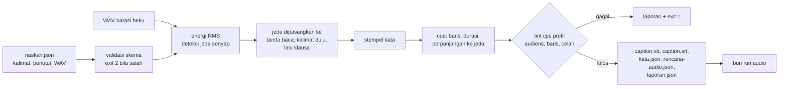
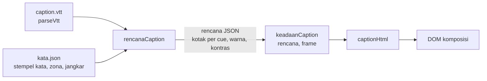

# Narasi dan caption: naskah.json

## Metadata

- Version: `v1.1.0`
- Last updated: `2026-11-07`
- Changeset: `Menambahkan bagian Mode dan posisi caption (lima mode, empat posisi, zona dan jangkar penutur, area aman 16:9 dan 9:16, kontras), kunci caption.mode/posisi, zonaCaption, jangkarPenutur di skema naskah, keluaran kata.json, templat demo (index.html, buat-props.mjs), uji, dan batasannya.`

`bun run narasi` mengubah naskah narasi (`naskah.json`) dan berkas WAV narasinya menjadi caption yang sinkron dengan ucapan: cue WebVTT dan SRT, stempel waktu tiap kata, dan rencana audio untuk [`bun run audio`](video-tertanam-audio.md#timeline-audio). Keputusannya tercatat di [log-keputusan.md](log-keputusan.md) (KP-036 sampai KP-039 sementara; nomor tetap diberikan saat merge).

Yang sudah ada: skema naskah, estimasi timing, cue dengan lint, rencana audio, mode dan posisi tampil caption di komposisi ([di bawah](#mode-dan-posisi-caption)), dan templat contoh. Yang belum ada: adaptor mesin TTS (F1/06C di [roadmap](roadmap.md)). Skema dirancang agar adaptor TTS tinggal mendaftarkan mesin baru (lihat [Mesin suara](#mesin-suara)).

## Alur



`bun run narasi` boleh bekerja dengan mesin eksternal dan menulis aset beku; **`bun run render` tidak pernah memanggil mesin suara atau alat eksternal**, ia hanya membaca berkas beku. Dengan begitu render tetap deterministik ([arsitektur.md](arsitektur.md#aturan-determinisme)).

## Mulai cepat

```bash
bun templates/narasi-contoh/buat-audio.mjs          # WAV contoh ke .cache/awvd/narasi-contoh
bun run narasi templates/narasi-contoh/naskah.json --out out/narasi
bun run audio out/narasi/rencana-audio.json --fps 30 --out out/narasi/campuran.wav
```

Hasil contoh: 5 cue, 632 frame (21,07 detik) pada 30 fps. Folder `out/` dan `.cache/` diabaikan git.

Kode keluar: `0` berhasil (peringatan boleh ada), `1` lint gagal atau galat proses (keluaran tetap ditulis bila memungkinkan, termasuk `laporan.json`), `2` naskah atau argumen tidak valid (daftar galat dicetak sekaligus). Flag: `--out DIR` (bawaan `out/narasi`) dan `--bantuan`.

## naskah.json

Contoh lengkap ada di `templates/narasi-contoh/naskah.json`. Kunci tak dikenal diperingatkan dan diabaikan.

| Kunci | Arti | Aturan dan bawaan |
| --- | --- | --- |
| `versi` | Versi skema | Wajib `1` |
| `fps` | Frame per detik komposisi | Bilangan bulat 1..120; bawaan 30 |
| `bahasa` | Bahasa narasi | Bawaan `id` |
| `klasifikasi` | `publik` atau `internal` | **Wajib.** `internal` menolak mesin suara yang ditandai daring |
| `ukuran` | `{ lebar, tinggi }` | Opsional. Tinggi lebih besar dari lebar (potret) membuat bawaan `maksKarakter` 28 |
| `audiens` | Daftar profil dari `data/audiens.json` | Bawaan `["umum"]`. Dipakai nilai `cps` yang paling ketat ([visual-audiens.md](visual-audiens.md#profil-audiens)) |
| `caption.maksKarakter` | Karakter maksimum per baris | 10..60; bawaan 42 (28 untuk potret) |
| `caption.maksBaris` | Baris maksimum per cue | 1..3; bawaan 2 |
| `caption.cps` | Batas karakter per detik | Bawaan: `cps` efektif profil audiens. Override 0..20; yang lebih longgar dari profil hanya diperingatkan |
| `caption.tahanMaks` | Paling lama caption bertahan sesudah ucapan demi kecepatan baca (detik) | 0..1,5; bawaan 0,5 |
| `caption.mode` | Mode tampil bawaan di komposisi | `pop-on`, `roll-up`, `paint-on`, `sorot-kata`, atau `satu-kata`. Tidak memengaruhi cue atau lint; hanya diteruskan ke `kata.json` ([Mode dan posisi](#mode-dan-posisi-caption)) |
| `caption.posisi` | Posisi bawaan | `bawah`, `atas`, `auto`, atau `dekat-penutur`; diteruskan ke `kata.json` |
| `suara.mesin` | Mesin suara | `berkas-beku` (bawaan, satu-satunya yang ada kini) |
| `suara.kalibrasi` | `{ awal, akhir }` detik | 0..0,3; bawaan `{ 0,1; 0,04 }`. Lihat [Kalibrasi](#kalibrasi) |
| `suara.jedaAwal` | Senyap di awal tiap adegan sebelum narasi | 0..5 detik; bawaan 0,3 |
| `suara.jedaKalimat` | Senyap antar-segmen di dalam adegan | 0..5 detik; bawaan 0,4 |
| `suara.jedaAdegan` | Senyap di akhir tiap adegan sesudah narasi | 0..5 detik; bawaan 0,5 |
| `penutur` | `{ id: { nama, italik, label } }` | Bawaan satu penutur `narator`. `label: true` menulis `[Nama]` di cue pertama giliran penutur itu (dihitung dalam batas karakter); `italik: true` membungkus cue dengan `<i>` |
| `adegan[]` | Daftar adegan | Wajib, tak kosong |
| `adegan[].id` | Id unik | Huruf, angka, `_`, `-` |
| `adegan[].berkas` | WAV untuk seluruh adegan | Relatif terhadap folder naskah |
| `adegan[].durasiMin` | Durasi adegan minimum (detik) | Adegan diperpanjang bila narasi lebih pendek |
| `adegan[].penutur` | Penutur bawaan adegan | Bawaan `narator` |
| `adegan[].posisi` | Posisi caption adegan (menimpa `caption.posisi`) | Salah satu dari empat posisi |
| `adegan[].zonaCaption[]` | Area penting yang tidak boleh tertutup caption | `{ area: "bawah"\|"atas", dari, sampai }`; `dari` bawaan 0, `sampai` (tidak termasuk) bawaan akhir adegan; frame relatif ke awal adegan, bilangan bulat |
| `adegan[].jangkarPenutur` | Titik pusat kotak caption untuk `dekat-penutur` | `{ x, y }` piksel pada `ukuran` naskah, di dalam bingkai |
| `adegan[].kalimat[]` | Teks, atau `{ teks, bacaan, penutur, berkas }` | Wajib, tak kosong |

Aturan teks:

- Hanya `bacaan ?? teks` yang dibacakan dan dianalisis. **Angka harus ditulis dengan huruf** atau diberi `bacaan` (estimasi tidak mengeja angka): `{ "teks": "Rp5.000", "bacaan": "lima ribu rupiah" }`. Caption memakai `teks`.
- Karakter `<` dan `>` ditolak (menghindari tag di keluaran).
- Setiap kalimat berakhir sebagai batas kalimat meski tanpa tanda baca penutup.

**Segmen.** Satu segmen = satu WAV. Ada dua cara memberi audio: `berkas` di adegan (satu segmen berisi semua kalimat adegan, id segmen sama dengan id adegan) atau `berkas` di **semua** kalimat adegan (satu segmen per kalimat, id `<adegan>-<nomor kalimat>`). Diberikan di adegan dan kalimat sekaligus, atau hanya sebagian kalimat, ditolak.

**Garis waktu.** Dalam frame bulat: adegan dimulai di akhir adegan sebelumnya; narasi pertama mulai `jedaAwal` kemudian; segmen berikutnya mulai `jedaKalimat` sesudah segmen sebelumnya selesai (durasi WAV dibulatkan ke atas); adegan berakhir `jedaAdegan` sesudah narasi terakhir (atau pada `durasiMin` bila lebih lama). Jumlah durasi adegan menjadi `durasiFrame` komposisi.

## Estimasi timing berjangkar jeda

Ucapan dari berkas beku tidak membawa stempel waktu kata, jadi awvd memperkirakannya tanpa dependensi dan tanpa jaringan (`scripts/narasi-selaras.mjs`):

1. **Energi dan jeda.** RMS per 10 ms (jendela 25 ms). Ambang bicara = yang terbesar dari -60 dBFS, puncak dikurangi 28 dB, dan lantai ditambah 10 dB (lantai relatif dilewati bila rentang dinamis kurang dari 10 dB, yaitu ucapan menerus). Senyap internal sepanjang minimal 120 ms adalah jeda; audio yang sepenuhnya senyap dilaporkan `gagal`.
2. **Bobot kata.** Tiap kata berbobot 0,05 s tetap, 0,115 s per suku kata, dan 0,022 s per huruf; jeda tanda baca berbobot 0,55 s (titik) dan 0,2 s (koma). Suku kata dihitung dari vokal (pendekatan bahasa Indonesia, bukan kamus).
3. **Jangkar.** Tanda baca dipasangkan ke jeda nyata dengan pemrograman dinamis monoton, kalimat dengan jeda terpanjang lebih dulu, baru klausa di dalam kalimat. Kata di antara dua jangkar dibagi proporsional pada "waktu bersuara" segmen itu (senyap yang tidak terpasang dikeluarkan dari sumbu). Jeda yang tak berpasangan (misal napas) dan tanda baca tanpa jeda (misal koma yang dibaca tanpa henti) dilewati tanpa galat.
4. **Jatuh ke proporsional.** Bila tidak ada jeda atau tanda baca yang bisa dijangkarkan, atau hasil tidak monoton, seluruh segmen dibagi proporsional murni.

`laporan.json` mencatat per segmen berapa tanda baca terjangkar dari berapa yang ada, dan `batasKalimat` mencatat apakah tiap batas kalimat (juga batas segmen dan adegan) jatuh di jeda. Batas kalimat yang tidak jatuh di jeda menjadi peringatan.

### Kalibrasi

Batas akustik (energi) tidak sama dengan batas artikulasi: onset suara terdeteksi lebih lambat dari awal artikulasi (penutupan plosif, frikatif lemah) dan akhir kata terdeteksi lebih awal. `suara.kalibrasi.awal` memajukan awal bicara dan akhir tiap jeda, `akhir` memundurkan akhir bicara dan awal tiap jeda. Bawaan `{ 0,1; 0,04 }` disetel pada TTS bersih (lihat [Batas bukti](#batas-bukti)); **kalibrasi per sumber audio** (suara rekaman manusia bisa berbeda) dan jangan dianggap universal.

## Cue dan lint

Pengelompokan (`scripts/narasi-cue.mjs`; baris dipecah oleh `pecahBaris` dari `runtime.js`):

- cue tidak melintasi pergantian adegan atau penutur;
- akhir kalimat menutup cue; koma menutup cue bila cue sudah sepanjang dua pertiga `maksKarakter`;
- cue tidak melebihi `maksBaris` x `maksKarakter` maupun 7 detik; sisa kalimat 1 sampai 2 kata tidak dibiarkan yatim (kata ikut dibawa ke cue berikut);
- cue mulai saat kata pertama diucapkan dan berakhir 0,2 detik sesudah kata terakhir. Bila kecepatan baca melebihi batas cps, tampil diperpanjang ke dalam jeda berikutnya sampai `tahanMaks`; bila durasi kurang dari 5/6 detik, diperpanjang bila ada ruang. Perpanjangan tidak pernah menimpa cue berikut (celah minimum 2 frame) atau melewati akhir adegan.

Caption **tidak dipercepat atau diperlambat** agar lolos: bila batas cps tetap terlampaui, lint melaporkan `gagal`, dan perbaikannya di naskah (ringkas teks) atau di kecepatan narasi (`pengaliKecepatanNarasi` profil audiens untuk mesin TTS).

| Tingkat | Pemeriksaan |
| --- | --- |
| `gagal` (exit 1) | cps cue melebihi batas profil audiens atau `caption.cps`; baris atau karakter melebihi batas; cue tumpang tindih atau celah kurang dari 2 frame; segmen audio senyap |
| `peringatan` | durasi cue di luar 5/6..7 detik (tanpa ruang untuk diperpanjang); cue yatim satu kata; batas kalimat atau segmen tidak jatuh di jeda; jumlah penanda mesin tidak sama dengan jumlah kata; `caption.cps` lebih longgar dari profil |

**Batas cps.** Batasnya adalah `cps` efektif profil audiens di `data/audiens.json` (profil yang paling ketat menang; umum 17, anak 13, lansia 14, low vision 13) kecuali `caption.cps` diisi. Dasar angkanya adalah Netflix Indonesian Timed Text Style Guide (subtitle dewasa 17 cps, anak 13; SDH dewasa 20, anak 17). Karena caption narasi verbatim setara SDH, batas dewasa boleh dilonggarkan sampai 20 lewat `caption.cps`, dengan peringatan.

## Keluaran

Semua di `--out` dan deterministik (tanpa cap waktu; angka dibulatkan ke milidetik).

| Berkas | Isi |
| --- | --- |
| `caption.vtt`, `caption.srt` | Cue pada frame bulat (waktu dari `frame / fps`). Italik penutur sebagai `<i>`; `&` di-escape di VTT. Terbaca `parseVtt`/`parseSrt` di [runtime](api-runtime.md) |
| `kata.json` | `{ versi, fps, sumber, durasiFrame, adegan[{id, mulaiFrame, durasiFrame}], kata[{teks, tampil, mulai, akhir, mulaiFrame, akhirFrame, adegan, kalimat, penutur, cue}] }`. Waktu absolut pada garis waktu komposisi; `cue` bernomor 1 dst. seperti di VTT; `sumber` adalah `estimasi`, `penanda-tts`, atau `campuran`. Masukan `rencanaCaption` di komposisi. Bila naskah memberi `caption.mode`/`caption.posisi`, `kata.json` memuat `caption: { mode, posisi }`; entri `adegan[]` memuat `posisi`, `zonaCaption` (diubah ke frame absolut dan dipotong di akhir adegan), dan `jangkarPenutur` hanya bila naskah memberikannya |
| `rencana-audio.json` | `{ versi, fps, durasiFrame, narasi[{id, berkas, mulai, sha256}] }`; jalur `berkas` relatif terhadap berkas rencana. Dibaca `bun run audio` tanpa perubahan (bidang `versi` dan `sha256` diabaikan) |
| `laporan.json` | Hash naskah, batas yang dipakai, ringkasan (cue, cps maks dan median), segmen (hash WAV, durasi, sumber waktu, jangkar), `batasKalimat`, tiap cue, `gagal`, `peringatan` |

Hash WAV dicatat agar perubahan audio terlihat di tinjauan PR. Verifikasi hash saat render belum ada (render tidak menyentuh keluaran ini).

## Mesin suara

Mesin adalah objek `{ daring, butuhBerkas, sintesis(segmen, konteks) }` yang didaftarkan lewat `daftarkanMesin(nama, deskriptor)` di `scripts/narasi.mjs`. `sintesis` mengembalikan `{ berkas, penanda? }`: jalur WAV dan, bila mesin memberikannya, penanda kata `[{ teks, mulai, durasi }]` (detik, relatif ke awal berkas). Penanda dipakai sebagai sumber waktu `penanda-tts` bila jumlahnya sama dengan jumlah kata; selain itu jatuh ke estimasi dengan peringatan. Mesin `daring: true` ditolak untuk `klasifikasi: "internal"` (konten internal tidak dikirim ke layanan daring; TTS daring hanya untuk konten publik).

Kini hanya `berkas-beku` yang terdaftar (WAV dari rekaman atau TTS yang dibekukan; lihat [Narasi dan TTS](video-tertanam-audio.md#narasi-dan-tts)). Memanggil mesin TTS sungguhan, cache berhash, dan pencatatan lisensi model adalah pekerjaan adaptor TTS (F1/06C). WAV hasil TTS daring tidak menghasilkan byte yang sama pada dua panggilan, jadi harus dibekukan dan di-hash, tidak disintesis ulang saat render.

## Mode dan posisi caption

Cue VTT/SRT dan `kata.json` dari `bun run narasi` ditampilkan di komposisi (burn-in) oleh tiga helper runtime ([api-runtime.md](api-runtime.md)): `rencanaCaption` menyusun rencana sekali, `keadaanCaption(rencana, frame)` menghitung apa yang terlihat pada satu frame, dan `captionHtml(keadaan)` menghasilkan HTML tanpa animasi CSS. Semuanya murni dari nomor frame, jadi deterministik; `render` tetap tidak memanggil alat eksternal.



```js
const rencana = rencanaCaption({
  cues: parseVtt(props.vtt), kata: props.kata, lebar: 1280, tinggi: 720, fps: 30,
  mode: "sorot-kata", posisi: "auto",
  zona: [{ area: "bawah", dari: 399, sampai: 632 }],            // pita nama di bawah selama a2
  jangkar: [{ x: 794, y: 331, dari: 399, sampai: 632 }],         // dipakai posisi "dekat-penutur"
});
// di dalam render(frame):
el.innerHTML = captionHtml(keadaanCaption(rencana, frame));
```

### Mode

| Mode | Perilaku | Kapan dipakai | Catatan bukti |
| --- | --- | --- | --- |
| `pop-on` (bawaan) | Blok teks muncul utuh di awal cue dan hilang di akhir | Formal, edukasi, SOP, dokumenter | Dasar pedoman Netflix, DCMP, dan 47 CFR 79; paling mudah diaudit cps dan baris |
| `roll-up` | Jendela dua baris; baris baru menggulir naik saat kata pertamanya mulai, baris lama keluar. Tidak pernah lebih dari dua baris stabil | Hanya untuk kompatibilitas atau cue tiga baris | Pada gulir, pemirsa lebih banyak menatap teks dan pemahaman lebih lemah (sumber sekunder W3C, belum terverifikasi) |
| `paint-on` | Huruf muncul bertahap menurut stempel kata; tata letak tetap (huruf belum tampil menempati ruangnya) | Efek ketik ringan | Tidak ada bukti manfaat; memaksa laju baca |
| `sorot-kata` | Kalimat penuh tampil sepanjang cue; kata yang sedang diucapkan diberi latar sorot, maju monoton, tanpa gerak posisi | Video sosial (opt-in) | Paling disukai untuk belajar bahasa tetapi dianggap terlalu mengganggu untuk tontonan sehari-hari (Weingärtner dkk. 2024, n = 49); kalimat penuh tetap terbaca tanpa sorot, jadi sorot hanya isyarat tambahan |
| `satu-kata` | Satu kata besar per saat, tetap sampai kata berikutnya mulai; label penutur tidak ditampilkan | Gaya sosial bertempo cepat | Pemahaman menurun pada laju tinggi dan kata tak dapat dibaca ulang; awvd tidak membatasi laju (ikut stempel kata) |

Tanpa stempel kata nyata (cue saja), waktu kata dibagi proporsional menurut karakter sepanjang cue. Ini estimasi kasar: `pop-on` tidak terpengaruh, tetapi sorot kata dan paint-on hanya sepresisi stempel kata ([Batas bukti](#batas-bukti): rata-rata galat 78 sampai 110 ms pada TTS bersih).

### Posisi

| Posisi | Perilaku |
| --- | --- |
| `bawah` (bawaan) | Tepi bawah kotak di tepi bawah area aman, di tengah |
| `atas` | Tepi atas kotak di tepi atas area aman, di tengah |
| `auto` | Bawah; naik ke atas bila ada zona yang beririsan dengan kotak bawah selama cue dan atas bebas; bila keduanya tertutup tetap bawah dengan peringatan |
| `dekat-penutur` | Pusat kotak di `jangkar` (titik yang ditentukan penulis), dijepit ke area aman. Tanpa jangkar yang cocok jatuh ke bawah dengan peringatan |

Aturan yang berlaku untuk semua posisi:

- **Keputusan per cue, bukan per frame.** Kotak tidak berpindah di tengah cue, jadi tidak melompat saat dibaca.
- **Zona** = area yang tidak boleh tertutup (pita nama, teks unggulan, wajah): `{ area: "bawah"|"atas" }` atau `{ kotak: { x, y, w, h } }`, dalam rentang frame `[dari, sampai)`. Cue yang beririsan waktu dengan zona dihitung. Posisi tetap yang bertabrakan dengan zona diperingatkan, bukan digeser diam-diam.
- **Jangkar penutur** dapat per penutur (`penutur`) dan per rentang frame. awvd tidak mendeteksi wajah atau penutur; jangkar ditentukan penulis (`adegan[].jangkarPenutur` di naskah). Bukti manfaat caption dekat penutur kecil dan terbelah (Kurzhals dkk. 2017, n = 40: 19 memilih dekat penutur, 21 memilih posisi tetap), jadi ini opsi eksplisit, bukan bawaan.
- **Area aman.** Lanskap memakai area aksi EBU R 95 (93%); potret (tinggi > lebar) memakai `areaAmanVertikal` (pada 1080x1920: atas 250, bawah 480, kiri 65, kanan 120 px). Kotak caption selalu di dalam area itu, termasuk saat jangkar di pojok bingkai. Angka zona platform vertikal berasal dari sumber sekunder; periksa terhadap templat platform saat produksi.
- **Ukuran dan baris.** Font = `min(batas lebar, max(minimum ukuranTeks "caption", 5,5% tinggi bingkai (lanskap) atau 3,8% (potret)))`. Batas lebar menjamin `maksKarakter` karakter (42; 28 pada potret) muat dengan taksiran 0,6 em per karakter. Angka 5,5%, 3,8%, padding, dan taksiran itu adalah keputusan desain awvd. Bila batas lebar menurunkan font di bawah minimum `ukuranTeks`, rencana memberi peringatan (mis. bingkai persegi 1:1).
- **Kontras.** Teks = `pilihTeksKontras(warna latar)`; kotak berlatar hitam alfa 0,75, sehingga kontras terburuk (di atas gambar putih) sekitar 10,4:1. Hasil rencana memuat `kontras` terburuk di atas gambar hitam maupun putih dan memperingatkan bila di bawah 4,5:1 (WCAG 2.2 SC 1.4.3); latar transparan tidak punya jaminan. Teks dan latar sorot kata dipilih serupa (teks hitam di kuning `#ffd400`, sekitar 14,7:1).
- **Roll-up** menggulir baris selama sekitar 0,12 detik dari nomor frame; baris yang masuk dan keluar dipotong di tepi kotak (`clip-path` vertikal), sehingga tidak keluar dari area aman.
- **Caption burn-in tidak dapat disetel pemirsa** (ukuran, warna, mode: 47 CFR 79.103(c)). Sediakan `caption.vtt` sebagai trek lunak (`--subtitle`) di samping burn-in bila aksesibilitas penting.

### Templat demo

`templates/narasi-contoh/index.html` menampilkan semua mode dan posisi pada naskah contoh: adegan a2 menandai `zonaCaption` bawah (pita nama digambar di sana) dan `jangkarPenutur` (siluet penutur fiktif), jadi `auto` menaikkan caption di a2 dan `dekat-penutur` memakai jangkarnya.

```bash
bun templates/narasi-contoh/buat-props.mjs --mode sorot-kata --posisi auto            # lanskap 1280x720
bun run render templates/narasi-contoh/index.html --props-file out/narasi-contoh/props.json --out out/caption.mp4
bun templates/narasi-contoh/buat-props.mjs --mode pop-on --posisi auto --ukuran potret --out out/p.json   # 1080x1920
bun run render templates/narasi-contoh/index.html --props-file out/p.json --still 450 --out out/p.png
```

`buat-props.mjs` membuat WAV contoh bila belum ada, menjalankan pipeline narasi, dan menulis props `{ lebar, tinggi, vtt, kata }`. Pada potret, `maksKarakter` mengikuti bawaan 28 dan `caption.cps` dilonggarkan ke 20 (batas SDH dewasa; cue lebih pendek membuat cps naik), dengan peringatan. Props opsional `mode`, `posisi`, `label` (false menyembunyikan label), dan `tampilArea` (true menggambar garis area aman).

Uji: `bun run uji:caption` ([scripts/uji-caption.mjs](../scripts/uji-caption.mjs)): tiap mode punya uji (jumlah baris, urutan, monoton, label penutur, tata letak tetap), posisi dan zona, jangkar, kontras, determinisme, area aman pada enam resolusi 16:9 dan 9:16 untuk semua kombinasi mode dan posisi, DOM nyata di Chromium (kotak, baris, dan kata di dalam area aman dan kotak pada templat), dan render still yang identik antar-render.

## Batas bukti

- **Ukuran akurasi** (riset awvd, bukan dari dokumen pihak lain): pada 276 kata dari lima klip TTS bersih (dua suara, dua naskah fiktif) dengan stempel penanda layanan TTS sebagai kebenaran dasar, galat absolut rata-rata waktu mulai kata: bagi-rata durasi berkas 539 ms; proporsional dengan deteksi bicara 478 ms; **berjangkar jeda 110 ms** tanpa kalibrasi dan **78 ms** dengan kalibrasi bawaan. Kebenaran dasar berasal dari layanan TTS, bukan anotasi manusia, dan terkuantisasi 12,5 ms; kalibrasi disetel pada data yang sama (in-sample).
- **Belum diuji:** suara manusia (jeda tak teratur, napas, derau), TTS selain satu vendor, mesin penyelaras lain (forced alignment). Estimasi cukup untuk lint cps dan pemecahan cue (cps maksimum berbeda paling banyak 1,7 dari kebenaran dasar pada data itu), tetapi bukan pengganti penyelaras untuk sorot kata per kata yang presisi; mode itu menunggu F1/06B dan sumber waktu yang lebih rapat.
- Batas 42 karakter per baris, dua baris, 5/6..7 detik, dan cps berasal dari pedoman Netflix Timed Text Style Guide (umum dan Indonesia); celah minimum 2 frame adalah usulan awvd, bukan angka Netflix. 28 karakter per baris untuk layar potret adalah hitungan kasar awvd, bukan standar. Caption bertahan sampai 0,5 detik sesudah ucapan mengikuti catatan DCMP bahwa pergeseran sampai 15 frame praktis tidak terasa; sinkron ucapan dan caption merujuk 47 CFR 79.1(j)(2)(ii) (berlaku bagi penyalur program televisi; penerapannya ke video web tidak diverifikasi).
- Uji repo (`bun run uji:narasi`) memakai audio sintetis (nada bergerak seperti ucapan dengan jeda yang diketahui), bukan ucapan manusia.

## Batasan

- Hanya WAV yang sudah ada (`berkas-beku`); tidak ada TTS, ASR, atau penyelaras eksternal.
- Satu bahasa per naskah; bobot suku kata dibuat untuk bahasa Indonesia. Angka dan singkatan harus dieja di `bacaan` atau `teks`.
- Satu penutur per kalimat; tidak ada caption dua penutur dalam satu cue dan tidak ada deteksi penutur.
- Mode dan posisi caption tidak mengubah cue, lint, atau VTT/SRT; keduanya hanya diteruskan ke `kata.json` untuk komposisi. `caption.mode` dan `caption.posisi` di naskah hanya bawaan: komposisi yang memanggil `rencanaCaption` yang memakainya.
- Lebar baris ditaksir (0,6 em per karakter), bukan diukur: font atau huruf yang jauh lebih lebar dari kalimat biasa memerlukan `lebarKarakter` lebih besar, kalau tidak baris bisa melewati kotak dan area aman. Uji DOM memeriksa font bawaan templat saja.
- Zona dan jangkar ditentukan penulis; awvd tidak mendeteksi teks, wajah, atau penutur di dalam gambar. Satu jangkar per adegan di naskah; array berentang waktu atau per penutur hanya tersedia lewat `rencanaCaption`.
- Sorot kata dan paint-on hanya sepresisi stempel kata; dengan estimasi berjangkar jeda galatnya sekitar 78 sampai 110 ms pada TTS bersih (belum diuji pada suara manusia).
- Warna per penutur dan ikon penanda bunyi belum ada.
- Lint cue memakai `maksKarakter` naskah; menampilkan VTT 16:9 pada bingkai 9:16 memecah ulang baris (`maksKarakter` 28) dan dapat melebihi `maksBaris` (peringatan di rencana). Untuk potret, jalankan `bun run narasi` dengan `ukuran` potret agar cue dibentuk untuk 28 karakter.
- Penanda mesin dan estimasi tidak dibandingkan satu sama lain untuk mendeteksi deviasi (riset awvd menyarankan peringatan bila rata-rata melebihi sekitar 100 ms); belum diimplementasi.

## Changelog

### 2026-11-07 - v1.1.0

- Menambahkan bagian Mode dan posisi caption (lima mode, empat posisi, zona, jangkar penutur, area aman 16:9 dan 9:16, kontras, templat demo, uji).
- Skema `naskah.json`: `caption.mode`, `caption.posisi`, `adegan[].posisi`, `adegan[].zonaCaption`, `adegan[].jangkarPenutur` dikenali dan divalidasi; `kata.json` meneruskannya. Batasan diperbarui.

### 2026-11-07 - v1.0.0

- Dokumen baru: skema `naskah.json`, `bun run narasi`, estimasi berjangkar jeda, cue VTT/SRT dengan lint cps profil audiens, rencana audio, keluaran, mesin suara pluggable, batas bukti, dan templat `narasi-contoh`.
