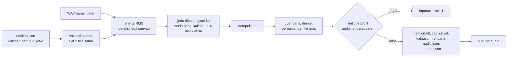
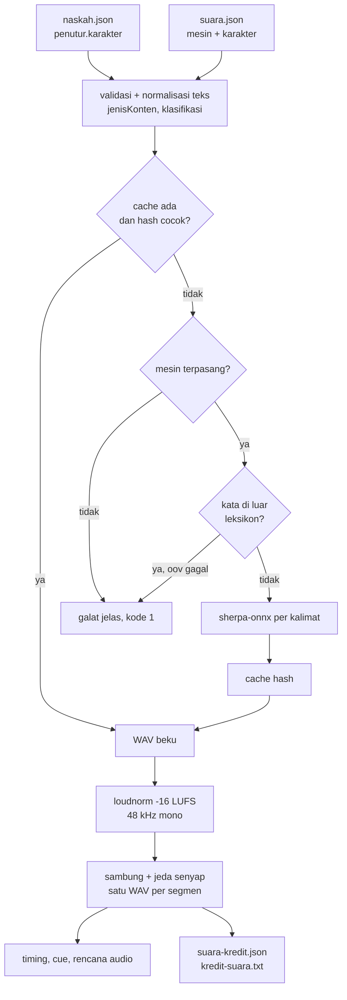
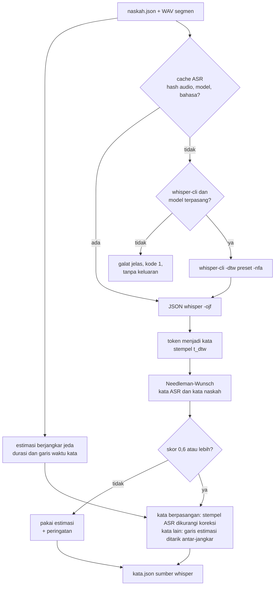
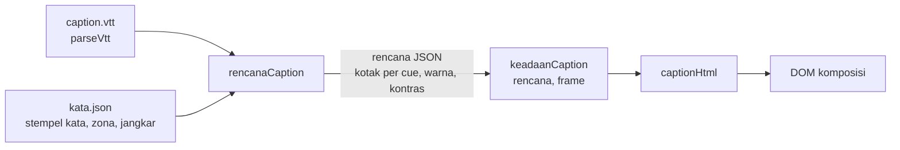

# Narasi dan caption: naskah.json

## Metadata

- Version: `v1.3.0`
- Last updated: `2026-11-07`
- Changeset: `Menambahkan bagian ASR lokal (whisper.cpp): adaptor opsional tidak dibundel; flag --selaras whisper (stempel kata ASR dipetakan ke kata naskah lewat penyelarasan teks, skor rendah jatuh ke estimasi) dan subperintah transkripsi (caption dari audio tanpa naskah, ditandai wajib ditinjau manusia); flag ASR, cache ASR, sumber waktu whisper di kata.json, blok asr di laporan.json, serta batas bukti terukur.`

`bun run narasi` mengubah naskah narasi (`naskah.json`) dan berkas WAV narasinya menjadi caption yang sinkron dengan ucapan: cue WebVTT dan SRT, stempel waktu tiap kata, dan rencana audio untuk [`bun run audio`](video-tertanam-audio.md#timeline-audio). Keputusannya tercatat di [log-keputusan.md](log-keputusan.md) (KP-036 sampai KP-039 sementara; nomor tetap diberikan saat merge).

Yang sudah ada: skema naskah, estimasi timing, cue dengan lint, rencana audio, mode dan posisi tampil caption di komposisi ([di bawah](#mode-dan-posisi-caption)), adaptor TTS lokal opsional lewat sherpa-onnx ([TTS lokal](#tts-lokal-sherpa-onnx): Supertonic untuk bahasa Indonesia, Kokoro untuk Inggris; tidak dibundel), dan templat contoh. Mesin suara lain dapat ditambahkan lewat registri (lihat [Mesin suara](#mesin-suara)). ASR lokal opsional lewat whisper.cpp ([ASR lokal](#asr-lokal-whispercpp); tidak dibundel) untuk penyelarasan kata yang lebih rapat dan untuk caption dari audio tanpa naskah.

## Alur



`bun run narasi` boleh bekerja dengan mesin eksternal dan menulis aset beku; **`bun run render` tidak pernah memanggil mesin suara atau alat eksternal**, ia hanya membaca berkas beku. Dengan begitu render tetap deterministik ([arsitektur.md](arsitektur.md#aturan-determinisme)).

## Mulai cepat

```bash
bun templates/narasi-contoh/buat-audio.mjs          # WAV contoh ke .cache/awvd/narasi-contoh
bun run narasi templates/narasi-contoh/naskah.json --out out/narasi
bun run audio out/narasi/rencana-audio.json --fps 30 --out out/narasi/campuran.wav
```

Hasil contoh: 5 cue, 632 frame (21,07 detik) pada 30 fps. Folder `out/` dan `.cache/` diabaikan git.

Kode keluar: `0` berhasil (peringatan boleh ada), `1` lint gagal atau galat proses (keluaran tetap ditulis bila memungkinkan, termasuk `laporan.json`; mesin TTS yang tidak terpasang atau gagal juga kode 1, dengan pesan, tanpa keluaran), `2` naskah atau argumen tidak valid (daftar galat dicetak sekaligus). Flag: `--out DIR` (bawaan `out/narasi`), `--cache DIR` dan `--sintesis-ulang` (hanya untuk mesin TTS; lihat [TTS lokal](#tts-lokal-sherpa-onnx)), `--selaras estimasi|whisper` dan flag ASR (`--whisper-bin`, `--whisper-model`, `--cache-asr`, `--asr-ulang`, `--koreksi-asr`; lihat [ASR lokal](#asr-lokal-whispercpp)), dan `--bantuan`. Subperintah `bun run narasi transkripsi <audio>` membuat caption dari audio tanpa naskah ([bagiannya](#caption-dari-audio-tanpa-naskah)); ASR yang diminta tetapi tidak terpasang juga berkode keluar `1`.

## naskah.json

Contoh lengkap ada di `templates/narasi-contoh/naskah.json`. Kunci tak dikenal diperingatkan dan diabaikan.

| Kunci | Arti | Aturan dan bawaan |
| --- | --- | --- |
| `versi` | Versi skema | Wajib `1` |
| `fps` | Frame per detik komposisi | Bilangan bulat 1..120; bawaan 30 |
| `bahasa` | Bahasa narasi | Bawaan `id` |
| `klasifikasi` | `publik` atau `internal` | **Wajib.** `internal` menolak mesin suara yang ditandai daring |
| `jenisKonten` | `umum`, `kesehatan`, atau `medis` | Bawaan `umum`. Dipakai mesin TTS untuk peringatan dan penolakan konten medis ([Konten medis](#konten-medis)) |
| `ukuran` | `{ lebar, tinggi }` | Opsional. Tinggi lebih besar dari lebar (potret) membuat bawaan `maksKarakter` 28 |
| `audiens` | Daftar profil dari `data/audiens.json` | Bawaan `["umum"]`. Dipakai nilai `cps` yang paling ketat ([visual-audiens.md](visual-audiens.md#profil-audiens)) |
| `caption.maksKarakter` | Karakter maksimum per baris | 10..60; bawaan 42 (28 untuk potret) |
| `caption.maksBaris` | Baris maksimum per cue | 1..3; bawaan 2 |
| `caption.cps` | Batas karakter per detik | Bawaan: `cps` efektif profil audiens. Override 0..20; yang lebih longgar dari profil hanya diperingatkan |
| `caption.tahanMaks` | Paling lama caption bertahan sesudah ucapan demi kecepatan baca (detik) | 0..1,5; bawaan 0,5 |
| `caption.mode` | Mode tampil bawaan di komposisi | `pop-on`, `roll-up`, `paint-on`, `sorot-kata`, atau `satu-kata`. Tidak memengaruhi cue atau lint; hanya diteruskan ke `kata.json` ([Mode dan posisi](#mode-dan-posisi-caption)) |
| `caption.posisi` | Posisi bawaan | `bawah`, `atas`, `auto`, atau `dekat-penutur`; diteruskan ke `kata.json` |
| `suara.mesin` | Mesin suara | `berkas-beku` (bawaan; WAV sudah jadi) atau `sherpa-onnx` (TTS lokal opsional) |
| `suara.konfigurasi` | Jalur `suara.json` (mesin dan karakter) | Hanya `sherpa-onnx`. Relatif terhadap folder naskah. Bawaan: `suara.json` di folder naskah bila ada, selain itu `data/suara.json` awvd |
| `suara.cache` | Folder cache WAV beku | Hanya `sherpa-onnx`. Relatif terhadap folder naskah. Bawaan `.cache/awvd/suara` (terhadap direktori kerja); `--cache` menimpanya |
| `suara.kalibrasi` | `{ awal, akhir }` detik | 0..0,3; bawaan `{ 0,1; 0,04 }`. Lihat [Kalibrasi](#kalibrasi) |
| `suara.jedaAwal` | Senyap di awal tiap adegan sebelum narasi | 0..5 detik; bawaan 0,3 |
| `suara.jedaKalimat` | Senyap antar-segmen di dalam adegan | 0..5 detik; bawaan 0,4 |
| `suara.jedaAdegan` | Senyap di akhir tiap adegan sesudah narasi | 0..5 detik; bawaan 0,5 |
| `penutur` | `{ id: { nama, italik, label, karakter } }` | Bawaan satu penutur `narator`. `label: true` menulis `[Nama]` di cue pertama giliran penutur itu (dihitung dalam batas karakter); `italik: true` membungkus cue dengan `<i>`; `karakter` = id karakter di `suara.json`, wajib untuk `sherpa-onnx` |
| `adegan[]` | Daftar adegan | Wajib, tak kosong |
| `adegan[].id` | Id unik | Huruf, angka, `_`, `-` |
| `adegan[].berkas` | WAV untuk seluruh adegan | Relatif terhadap folder naskah |
| `adegan[].durasiMin` | Durasi adegan minimum (detik) | Adegan diperpanjang bila narasi lebih pendek |
| `adegan[].penutur` | Penutur bawaan adegan | Bawaan `narator` |
| `adegan[].posisi` | Posisi caption adegan (menimpa `caption.posisi`) | Salah satu dari empat posisi |
| `adegan[].zonaCaption[]` | Area penting yang tidak boleh tertutup caption | `{ area: "bawah"\|"atas", dari, sampai }`; `dari` bawaan 0, `sampai` (tidak termasuk) bawaan akhir adegan; frame relatif ke awal adegan, bilangan bulat |
| `adegan[].jangkarPenutur` | Titik pusat kotak caption untuk `dekat-penutur` | `{ x, y }` piksel pada `ukuran` naskah, di dalam bingkai |
| `adegan[].kalimat[]` | Teks, atau `{ teks, bacaan, penutur, berkas }` | Wajib, tak kosong |

Aturan teks:

- Hanya `bacaan ?? teks` yang dibacakan dan dianalisis. **Angka harus ditulis dengan huruf** atau diberi `bacaan` (estimasi tidak mengeja angka): `{ "teks": "Rp5.000", "bacaan": "lima ribu rupiah" }`. Caption memakai `teks`. Pengecualian: dengan mesin `sherpa-onnx`, angka, tanggal, URL, dan singkatan dinormalkan otomatis menjadi `bacaan` ([normalisasi](#normalisasi-teks-indonesia)); `bacaan` yang ditulis sendiri tetap dipakai sebagai dasar dan ikut dinormalkan.
- Karakter `<` dan `>` ditolak (menghindari tag di keluaran).
- Setiap kalimat berakhir sebagai batas kalimat meski tanpa tanda baca penutup.

**Segmen.** Satu segmen = satu WAV. Ada dua cara memberi audio: `berkas` di adegan (satu segmen berisi semua kalimat adegan, id segmen sama dengan id adegan) atau `berkas` di **semua** kalimat adegan (satu segmen per kalimat, id `<adegan>-<nomor kalimat>`). Diberikan di adegan dan kalimat sekaligus, atau hanya sebagian kalimat, ditolak.

**Garis waktu.** Dalam frame bulat: adegan dimulai di akhir adegan sebelumnya; narasi pertama mulai `jedaAwal` kemudian; segmen berikutnya mulai `jedaKalimat` sesudah segmen sebelumnya selesai (durasi WAV dibulatkan ke atas); adegan berakhir `jedaAdegan` sesudah narasi terakhir (atau pada `durasiMin` bila lebih lama). Jumlah durasi adegan menjadi `durasiFrame` komposisi.

## Estimasi timing berjangkar jeda

Ucapan dari berkas beku tidak membawa stempel waktu kata, jadi awvd memperkirakannya tanpa dependensi dan tanpa jaringan (`scripts/narasi-selaras.mjs`):

1. **Energi dan jeda.** RMS per 10 ms (jendela 25 ms). Ambang bicara = yang terbesar dari -60 dBFS, puncak dikurangi 28 dB, dan lantai ditambah 10 dB (lantai relatif dilewati bila rentang dinamis kurang dari 10 dB, yaitu ucapan menerus). Senyap internal sepanjang minimal 120 ms adalah jeda; audio yang sepenuhnya senyap dilaporkan `gagal`.
2. **Bobot kata.** Tiap kata berbobot 0,05 s tetap, 0,115 s per suku kata, dan 0,022 s per huruf; jeda tanda baca berbobot 0,55 s (titik) dan 0,2 s (koma). Suku kata dihitung dari vokal (pendekatan bahasa Indonesia, bukan kamus).
3. **Jangkar.** Tanda baca dipasangkan ke jeda nyata dengan pemrograman dinamis monoton, kalimat dengan jeda terpanjang lebih dulu, baru klausa di dalam kalimat. Kata di antara dua jangkar dibagi proporsional pada "waktu bersuara" segmen itu (senyap yang tidak terpasang dikeluarkan dari sumbu). Jeda yang tak berpasangan (misal napas) dan tanda baca tanpa jeda (misal koma yang dibaca tanpa henti) dilewati tanpa galat.
4. **Jatuh ke proporsional.** Bila tidak ada jeda atau tanda baca yang bisa dijangkarkan, atau hasil tidak monoton, seluruh segmen dibagi proporsional murni.

`laporan.json` mencatat per segmen berapa tanda baca terjangkar dari berapa yang ada, dan `batasKalimat` mencatat apakah tiap batas kalimat (juga batas segmen dan adegan) jatuh di jeda. Batas kalimat yang tidak jatuh di jeda menjadi peringatan.

### Kalibrasi

Batas akustik (energi) tidak sama dengan batas artikulasi: onset suara terdeteksi lebih lambat dari awal artikulasi (penutupan plosif, frikatif lemah) dan akhir kata terdeteksi lebih awal. `suara.kalibrasi.awal` memajukan awal bicara dan akhir tiap jeda, `akhir` memundurkan akhir bicara dan awal tiap jeda. Bawaan `{ 0,1; 0,04 }` disetel pada TTS bersih (lihat [Batas bukti](#batas-bukti)); **kalibrasi per sumber audio** (suara rekaman manusia bisa berbeda) dan jangan dianggap universal.

## Cue dan lint

Pengelompokan (`scripts/narasi-cue.mjs`; baris dipecah oleh `pecahBaris` dari `runtime.js`):

- cue tidak melintasi pergantian adegan atau penutur;
- akhir kalimat menutup cue; koma menutup cue bila cue sudah sepanjang dua pertiga `maksKarakter`;
- cue tidak melebihi `maksBaris` x `maksKarakter` maupun 7 detik; sisa kalimat 1 sampai 2 kata tidak dibiarkan yatim (kata ikut dibawa ke cue berikut);
- cue mulai saat kata pertama diucapkan dan berakhir 0,2 detik sesudah kata terakhir. Bila kecepatan baca melebihi batas cps, tampil diperpanjang ke dalam jeda berikutnya sampai `tahanMaks`; bila durasi kurang dari 5/6 detik, diperpanjang bila ada ruang. Perpanjangan tidak pernah menimpa cue berikut (celah minimum 2 frame) atau melewati akhir adegan.

Caption **tidak dipercepat atau diperlambat** agar lolos: bila batas cps tetap terlampaui, lint melaporkan `gagal`, dan perbaikannya di naskah (ringkas teks) atau di kecepatan narasi (`pengaliKecepatanNarasi` profil audiens untuk mesin TTS).

| Tingkat | Pemeriksaan |
| --- | --- |
| `gagal` (exit 1) | cps cue melebihi batas profil audiens atau `caption.cps`; baris atau karakter melebihi batas; cue tumpang tindih atau celah kurang dari 2 frame; segmen audio senyap |
| `peringatan` | durasi cue di luar 5/6..7 detik (tanpa ruang untuk diperpanjang); cue yatim satu kata; batas kalimat atau segmen tidak jatuh di jeda; jumlah penanda mesin tidak sama dengan jumlah kata; `caption.cps` lebih longgar dari profil |

**Batas cps.** Batasnya adalah `cps` efektif profil audiens di `data/audiens.json` (profil yang paling ketat menang; umum 17, anak 13, lansia 14, low vision 13) kecuali `caption.cps` diisi. Dasar angkanya adalah Netflix Indonesian Timed Text Style Guide (subtitle dewasa 17 cps, anak 13; SDH dewasa 20, anak 17). Karena caption narasi verbatim setara SDH, batas dewasa boleh dilonggarkan sampai 20 lewat `caption.cps`, dengan peringatan.

## Keluaran

Semua di `--out` dan deterministik (tanpa cap waktu; angka dibulatkan ke milidetik).

| Berkas | Isi |
| --- | --- |
| `caption.vtt`, `caption.srt` | Cue pada frame bulat (waktu dari `frame / fps`). Italik penutur sebagai `<i>`; `&` di-escape di VTT. Terbaca `parseVtt`/`parseSrt` di [runtime](api-runtime.md) |
| `kata.json` | `{ versi, fps, sumber, durasiFrame, adegan[{id, mulaiFrame, durasiFrame}], kata[{teks, tampil, mulai, akhir, mulaiFrame, akhirFrame, adegan, kalimat, penutur, cue}] }`. Waktu absolut pada garis waktu komposisi; `cue` bernomor 1 dst. seperti di VTT; `sumber` adalah `estimasi`, `penanda-tts`, `whisper` (hanya dengan `--selaras whisper`), atau `campuran`. Masukan `rencanaCaption` di komposisi. Bila naskah memberi `caption.mode`/`caption.posisi`, `kata.json` memuat `caption: { mode, posisi }`; entri `adegan[]` memuat `posisi`, `zonaCaption` (diubah ke frame absolut dan dipotong di akhir adegan), dan `jangkarPenutur` hanya bila naskah memberikannya |
| `rencana-audio.json` | `{ versi, fps, durasiFrame, narasi[{id, berkas, mulai, sha256}] }`; jalur `berkas` relatif terhadap berkas rencana. Dibaca `bun run audio` tanpa perubahan (bidang `versi` dan `sha256` diabaikan) |
| `laporan.json` | Hash naskah, batas yang dipakai, ringkasan (cue, cps maks dan median), segmen (hash WAV, durasi, sumber waktu, jangkar), `batasKalimat`, tiap cue, `gagal`, `peringatan`; dengan TTS juga blok `suara` (mesin, karakter, jenis konten); dengan `--selaras whisper` blok `asr` (mesin, model, koreksi, skor penyelarasan per segmen) |
| `suara-kredit.json`, `kredit-suara.txt` | Hanya TTS: label dan kredit suara sintetis, lisensi dan syarat pakai mesin, hash WAV per kalimat ([Label suara sintetis](#label-suara-sintetis)) |

Hash WAV dicatat agar perubahan audio terlihat di tinjauan PR. Verifikasi hash saat render belum ada (render tidak menyentuh keluaran ini).

## Mesin suara

Mesin adalah objek `{ daring, butuhBerkas, sintesis(segmen, konteks) }` yang didaftarkan lewat `daftarkanMesin(nama, deskriptor)` di `scripts/narasi.mjs`. `sintesis` mengembalikan `{ berkas, penanda? }`: jalur WAV dan, bila mesin memberikannya, penanda kata `[{ teks, mulai, durasi }]` (detik, relatif ke awal berkas). Penanda dipakai sebagai sumber waktu `penanda-tts` bila jumlahnya sama dengan jumlah kata; selain itu jatuh ke estimasi dengan peringatan. Urutan sumber waktu per segmen: penanda mesin TTS, lalu whisper (bila `--selaras whisper` dan skor penyelarasan lolos), lalu estimasi berjangkar jeda. Mesin `daring: true` ditolak untuk `klasifikasi: "internal"` (konten internal tidak dikirim ke layanan daring; TTS daring hanya untuk konten publik).

Dua mesin terdaftar: `berkas-beku` (WAV dari rekaman atau TTS yang dibekukan; lihat [Narasi dan TTS](video-tertanam-audio.md#narasi-dan-tts)) dan `sherpa-onnx` (adaptor TTS lokal, `scripts/narasi-tts.mjs`; bagian berikut). WAV hasil TTS tidak menghasilkan byte yang sama pada dua panggilan, jadi harus dibekukan dan di-hash, tidak disintesis ulang saat render.

Selain `sintesis`, deskriptor boleh membawa dua hook yang dipakai adaptor TTS: `siapkan(naskahMentah, konteks)` saat validasi (memeriksa konfigurasi mesin, karakter, jenis konten, dan memberi fungsi `bacaan(teks, penutur)` yang menormalkan teks) dan `selesai({ naskah, segmen })` sesudah sintesis (menambah berkas keluaran dan baris info CLI). `sintesis` menerima `{ naskah, opsi, peringatan }` dan boleh mengembalikan `info` yang diteruskan ke `selesai`.

## TTS lokal (sherpa-onnx)

Adaptor opsional yang memanggil CLI [sherpa-onnx](https://github.com/k2-fsa/sherpa-onnx) (`sherpa-onnx-offline-tts`, Apache-2.0) dengan model **Supertonic 3** (bahasa Indonesia dan Inggris) dan **Kokoro v1.0** (Inggris). **awvd tidak membundel biner maupun model**; pengguna memasangnya sendiri, dan tanpa itu `bun run narasi` untuk mesin ini gagal dengan pesan, bukan crash (kecuali semua WAV-nya sudah ada di cache). Keputusannya tercatat di [log-keputusan.md](log-keputusan.md) (KP-048 sampai KP-051 sementara; nomor tetap diberikan saat merge). Keputusan pemilik 2026-11-07: TTS lokal Indonesia hanya adaptor opsional, label suara sintetis wajib, konten medis memakai rekaman manusia atau layanan daring.



### Memasang mesin

Unduh dari rilis resmi sherpa-onnx (periksa lisensi paket yang diunduh): biner CLI (paket "shared" untuk platform Anda) dan model Supertonic 3 int8 serta Kokoro multi-lang v1.0 dari rilis `tts-models`. Versi yang diuji awvd (2026-11-07, Linux x64, CPU): sherpa-onnx 2.0.1, `sherpa-onnx-supertonic-3-tts-int8-2026-05-11`, `kokoro-multi-lang-v1_0`. sherpa-onnx 2.x tidak lagi memakai espeak-ng, sehingga model Piper lama tidak dapat dijalankan dengannya.

```bash
export AWVD_SHERPA_BIN=$HOME/awvd-tts/sherpa-onnx/bin/sherpa-onnx-offline-tts
export AWVD_MODEL_SUPERTONIC3=$HOME/awvd-tts/models/sherpa-onnx-supertonic-3-tts-int8-2026-05-11
export AWVD_MODEL_KOKORO=$HOME/awvd-tts/models/kokoro-multi-lang-v1_0
bun run narasi naskah.json --out out/narasi
```

- Biner dicari berurutan: `AWVD_BIN_<ID MESIN>`, `AWVD_SHERPA_BIN`, kunci `biner` di mesin, lalu nama program (elemen pertama `perintah`) di `PATH`. Folder model: `AWVD_MODEL_<ID MESIN>` (id huruf besar, karakter selain huruf dan angka menjadi `_`) atau kunci `model` di mesin (relatif terhadap folder `suara.json`; `~/` diperluas).
- Bila di sebelah `bin/` ada folder `lib/` (paket "shared"), `LD_LIBRARY_PATH` diisi otomatis.
- Mesin dijalankan sebagai proses anak dengan larik argumen (tanpa shell); teks tidak pernah ditafsir ulang sebagai placeholder atau flag. `ffmpeg` wajib untuk normalisasi kenyaringan.
- Pesan bila belum terpasang menyebut apa yang kurang (biner, folder model, atau berkas model tertentu) dan menunjuk bagian ini.

### suara.json

`data/suara.json` adalah katalog bawaan; salin ke proyek sebagai `suara.json` di samping `naskah.json` (diambil otomatis) atau tunjuk lewat `suara.konfigurasi`. Divalidasi fail-closed (kode keluar 2 dengan daftar galat).

| Kunci | Arti |
| --- | --- |
| `versi` | Wajib `1` |
| `kenyaringanTargetLUFS`, `puncakMaksDBTP` | Target per kalimat; bawaan -16 LUFS dan -1,5 dBTP |
| `kamus` | `{ kata: bacaan }` untuk nama diri dan akronim khas proyek (cocok persis; dipakai normalisasi) |
| `mesin.<id>.perintah` | Larik argumen: nama program lalu argumen. Placeholder: `{teks}` dan `{keluaran}` (wajib), `{bahasa}`, `{speaker}`, `{kecepatan}`, `{panjangSkala}` (1/kecepatan, untuk Kokoro), `{langkah}`, `{thread}`, `{model}` |
| `mesin.<id>.versi`, `modelSha256` | Masuk kunci cache; ubah bila model atau mesin diganti. `modelSha256` opsional (hash yang Anda hitung sendiri) |
| `mesin.<id>.lisensiKode`, `lisensiBobot`, `sumber`, `syaratPakai`, `kredit` | Pencatatan lisensi; dikeluarkan ke `suara-kredit.json` |
| `mesin.<id>.larangMedis` | `true` bila bobotnya melarang nasihat medis (Supertonic); menolak `jenisKonten: "medis"` |
| `mesin.<id>.daring`, `deterministik` | `daring: true` ditolak untuk klasifikasi `internal`; `deterministik: true` memasukkan `thread` ke kunci cache |
| `mesin.<id>.leksikon`, `oov` | Berkas leksikon untuk pemeriksaan kata di luar leksikon; `oov` = `gagal` (bawaan) atau `peringatan` |
| `mesin.<id>.bahasa`, `langkah`, `thread`, `biner`, `model` | Bahasa yang didukung, langkah difusi (bawaan 5), jumlah thread (bawaan 4), dan lokasi |
| `karakter.<id>` | `nama`, `bahasa`, `mesin`, `speaker`, `kecepatan` (0,5 sampai 2; bawaan 1), `gaya`, `cocokUntuk`, `jeda.antarKalimatMs` (bawaan 400), `sumberSuara`, `orangNyata` |

`orangNyata` wajib diisi. `true` (suara meniru atau dilatih dari orang nyata) mewajibkan `izinBerkas` (rujukan izin tertulis pemilik suara) dan menghasilkan peringatan; karakter bawaan semuanya `false`. Mesin kustom (CLI lain yang menulis WAV) cukup didaftarkan dengan `perintah` baru.

### Karakter suara contoh

Nama fiktif; preset suara bukan suara orang tertentu. Pilihan sid dan kecepatan berasal dari riset awvd 2026-11-07 (deskripsi gaya resmi Supertonic dan kartu Kokoro). **Kualitas subjektif (kewajaran, aksen) belum dinilai**; dengarkan sebelum memilih.

| Bahasa | Karakter | Mesin dan speaker | Kecepatan | Gaya dan cocok untuk |
| --- | --- | --- | --- | --- |
| id | Sekar (P) | Supertonic sid 2 | 1,05 | penyiar jelas: formal, pengumuman, SOP |
| id | Bagas (L) | Supertonic sid 7 | 1,0 | berwibawa: presentasi, pesan pimpinan |
| id | Laras (P) | Supertonic sid 4 | 0,95 | lembut: edukasi, narasi hangat |
| id | Raka (L) | Supertonic sid 5 | 1,1 | ceria: promo, penjelasan bersemangat |
| id | Dewi (P) | Supertonic sid 1 | 1,1 | cerah dan muda: media sosial |
| id | Wira (L) | Supertonic sid 6 | 0,95 | berat dan serius: dokumenter |
| id | Nusa (P) | Supertonic sid 0 | 1,0 | tenang: panduan langkah |
| id | Arya (L) | Supertonic sid 8 | 1,0 | lembut dan ramah: onboarding |
| id | Tirta (L) | Supertonic sid 9 | 0,95 | hangat, bercerita |
| en | Claire (P), George (L) | Kokoro sid 21, 26 | 1,0 | Inggris: formal, narator dokumenter |
| en | Michael (L), Heart (P) | Kokoro sid 16, 3 | 1,0 | Amerika: edukasi, promo |
| en | Atlas (L), Vera (P) | Supertonic sid 6, 2 | 1,0 | berat serius, penyiar |

Satu naskah boleh memakai beberapa karakter dan bahasa (tiap penutur satu karakter). Laju bicara Supertonic pada kecepatan 1,0 terukur sekitar 121 kata per menit pada satu paragraf uji (riset awvd); bila lint cps `gagal`, ringkas teks atau turunkan kecepatan karakter.

### Normalisasi teks Indonesia

`scripts/normalisasi-id.mjs` (murni, tanpa jaringan) mengubah teks menjadi kata sebelum masuk mesin, karena tanggal, angka berformat, URL, surel, dan pasal terbaca kacau oleh mesin (uji putar-balik ASR riset awvd, 2026-11-07). Hasilnya menjadi `bacaan` kalimat (caption tetap `teks`) dan dicatat di `suara-kredit.json` (`teksDibacakan`) untuk audit.

| Masukan | Dibacakan |
| --- | --- |
| `12/03/2026` atau `2026-03-12` | dua belas Maret dua ribu dua puluh enam |
| `pukul 08.30 WIB` | pukul delapan lewat tiga puluh menit Waktu Indonesia Barat |
| `Rp1.500.000`, `Rp5 juta` | satu juta lima ratus ribu rupiah, lima juta rupiah |
| `Pasal 5 ayat (2) UU No. 27 Tahun 2022` | Pasal lima ayat dua Undang-Undang Nomor dua puluh tujuh Tahun dua ribu dua puluh dua |
| `12,5%`, `3,5 km`, `20 MB` | dua belas koma lima persen, tiga koma lima kilometer, dua puluh megabyte |
| `ke-3`, `5-10`, `-5` | ketiga, lima sampai sepuluh, minus lima |
| `0812-3456-7890`, angka 11 digit atau lebih | dieja per digit |
| `https://contoh.id/panduan/awal-1`, `info@contoh.id` | contoh titik id garis miring panduan garis miring awal strip satu; info at contoh titik id |
| `SOP`, `PDF`, `KTP` (daftar kecil akronim) | dieja per huruf: es o pe |
| `Jl.`, `No.`, `dr.`, `dll.`, `UU`, `WIB` | Jalan, Nomor, dokter, dan lain-lain, Undang-Undang, Waktu Indonesia Barat |

Batas: bukan kamus lengkap. Singkatan di luar daftar tidak ditebak (masukkan ke `kamus` atau tulis `bacaan`); "10.30" tanpa konteks (tanpa "pukul", zona, atau titik dua) dibaca sebagai desimal; angka tahun dibaca sebagai bilangan; tidak ada tata bahasa (mis. pengubahan "ke-1" selain menjadi "pertama"). Normalisasi Inggris hanya merapikan: angka dalam teks Inggris harus dieja (naskah menolaknya).

### Cache, pembekuan, dan kenyaringan

Keluaran Supertonic dan Kokoro tidak identik antar-run (riset awvd: bentuk gelombang berbeda dan, pada Kokoro, panjang sampel pun beda) dan CLI tidak punya opsi seed. Karena itu:

- Tiap **kalimat** disintesis sekali. Kunci cache = SHA-256 dari JSON kanonik `{ praprosesVersi, teks ternormalisasi, mesin, versi mesin, modelSha256, bahasa, speaker, kecepatan, langkah, perintah }` (plus `thread` bila mesin `deterministik`). Nama karakter tidak masuk kunci: suara yang sama memakai cache yang sama.
- Cache (`<hash>.wav` mentah dan `<hash>.json` catatan) dipakai ulang selama kunci sama; **SHA-256 WAV disahkan tiap dibaca** dan cache yang tidak cocok menggagalkan proses (bukan sintesis ulang diam-diam). Sintesis ulang hanya lewat `--sintesis-ulang` (suara berubah) atau menghapus berkas cache itu. Mesin tidak diperlukan bila semua kalimat ada di cache, sehingga CI atau mesin lain dapat membangun ulang caption dari cache yang dibekukan.
- **Cache harus dijaga seperti aset**: ia satu-satunya tempat WAV beku (tidak dapat dibuat ulang identik). Arahkan `suara.cache` ke folder yang dicadangkan atau dikelola proyek; bawaan `.cache/awvd/suara` diabaikan git. `rencana-audio.json`, `laporan.json`, dan `suara-kredit.json` mencatat SHA-256 WAV segmen dan WAV mentah tiap kalimat untuk tinjauan PR.
- Tiap kalimat dinormalkan kenyaringannya (`ffmpeg loudnorm` dua langkah, mode linear, -16 LUFS, puncak -1,5 dBTP) dan dikonversi ke 48 kHz mono PCM 16-bit, karena selisih antar-suara dapat mencapai sekitar 6 LU (riset awvd). Kalimat yang kenyaringannya tak terukur (terlalu pendek atau senyap) hanya diresampling dengan peringatan. `render.mjs` tetap menormalkan campuran akhir seperti biasa.
- Kalimat segmen (satu adegan atau satu kalimat bila tiap kalimat berberkas) disambung dengan jeda senyap `karakter.jeda.antarKalimatMs` (bawaan 400 ms) menjadi satu WAV (`segmen-<hash>.wav` di folder cache). Jeda itu terdeteksi estimasi timing sebagai batas kalimat sehingga stempel kata berjangkar jeda tetap berlaku. CLI sherpa-onnx tidak mengeluarkan penanda waktu kata, jadi sumber waktu tetap `estimasi`.

### Kata di luar leksikon (Kokoro)

sherpa-onnx 2.x memakai leksikon untuk G2P Kokoro dan **melewati kata di luar leksikon tanpa suara dan tanpa galat** (terbukti pada uji: "explains", "receives", "officers", "processed"). Mesin yang punya `leksikon` diperiksa sebelum sintesis: bila ada kata yang tidak ada di leksikon, proses gagal dengan daftar katanya (`oov: "gagal"`, bawaan) atau memperingatkan (`oov: "peringatan"`). Perbaikannya mengganti kata atau menambah entri ke berkas leksikon (`kata fonem...`) yang diberikan ke mesin lewat `--kokoro-lexicon` (daftar dipisah koma) dan `leksikon` di `suara.json`. Pemeriksaan hanya dilakukan saat sintesis, bukan saat cache dipakai.

### Label suara sintetis

**Setiap video bersuara TTS wajib berlabel suara sintetis.** Bagi Supertonic ini juga syarat lisensi bobotnya (OpenRAIL-M butir e: konten harus dinyatakan buatan mesin; lihat [lisensi-kepatuhan.md](lisensi-kepatuhan.md#model-tts-dan-openrail-m)); bagi mesin lain ia kebijakan awvd yang mengantisipasi regulasi dan menjaga kepercayaan. awvd tidak dapat memaksa tayangan, jadi yang disediakan adalah bahan label dan aturan pemakaiannya:

- Tiap `bun run narasi` ber-TTS menulis `kredit-suara.txt` dan `suara-kredit.json`: `label` (kalimat pernyataan), `kreditLayar` (mis. `Suara: Sekar (suara sintetis)`), `kreditMesin`, `deskripsi` (siap tempel), `metadata.comment`, dan lisensi serta `syaratPakai` tiap mesin. Bahasa label mengikuti `bahasa` naskah (`id` atau Inggris).
- Tampilkan `kreditLayar` di video: kredit akhir, atau teks kecil yang terbaca sepanjang video bila narasinya penting. Komposisi dapat membacanya lewat props (sama seperti `kreditAset`).
- Tempel `deskripsi` di deskripsi atau keterangan unggahan, dan tanam ke metadata MP4 setelah render (`render.mjs` tidak punya flag metadata): `ffmpeg -i video.mp4 -c copy -metadata comment="<deskripsi>" video-berlabel.mp4`.
- Label tidak dapat dimatikan untuk mesin `sherpa-onnx`. awvd belum memeriksa bahwa label benar-benar tertayang; itu bagian checklist proyek.
- Suara TTS generik bukan tiruan orang. Meniru orang nyata dilarang tanpa izin tertulis (`orangNyata` dan `izinBerkas`). Kewajiban pelabelan hukum lain (mis. UE AI Act Pasal 50 untuk tayangan di UE) belum diverifikasi dari sumber primer; minta tinjauan hukum bila relevan.

### Konten medis

Bobot Supertonic (OpenRAIL-M) melarang pemakaian untuk nasihat medis atau interpretasi hasil medis (butir l). Karena itu `jenisKonten` di naskah menentukan perlakuan:

| `jenisKonten` | Perilaku `sherpa-onnx` |
| --- | --- |
| `umum` (bawaan) | Bila teks memuat istilah yang tampak medis (obat, dosis, diagnosis, gejala, vaksin, dan sejenisnya) muncul **peringatan** agar jenis konten ditinjau |
| `kesehatan` (edukasi kesehatan umum) | Peringatan bila memakai bobot yang melarang nasihat medis: wilayah abu-abu, minta keputusan pemilik |
| `medis` (nasihat, dosis, interpretasi hasil, konten klinis) | **Ditolak** (kode keluar 2) untuk mesin dengan `larangMedis`; untuk mesin lain hanya peringatan bahwa suara sintetis tidak dianjurkan. Pakai rekaman manusia (`suara.mesin: "berkas-beku"`) atau layanan daring untuk konten publik, dan tinjau dengan tenaga kesehatan |

Daftar kata pemicu peringatan adalah heuristik kasar, bukan klasifikasi; penentu jenis konten tetap penulis naskah. Layanan daring tetap hanya untuk konten publik (aturan 5 AGENTS.md).

### Batas bukti TTS

- Uji repo (`bun run uji:narasi`) memakai mesin palsu (skrip yang menulis nada dengan fase acak, sehingga cache terbukti diperlukan). Uji integrasi dengan sherpa-onnx dan Supertonic sungguhan hanya jalan bila `AWVD_SHERPA_BIN` dan `AWVD_MODEL_SUPERTONIC3` diset; selain itu dilewati.
- Riset awvd 2026-11-07 (satu mesin CPU 20 thread, beban ikut berjalan): Supertonic sekitar 0,2 sampai 0,35 kali waktu nyata (paragraf 63 kata sekitar 10 sampai 13 detik, memori puncak sekitar 376 MB), Kokoro sekitar 0,4 sampai 0,9 (sekitar 593 MB). Putar-balik ASR kasar (Whisper-base, alat uji di luar awvd) pada kalimat Indonesia pendek: kesalahan 0 sampai 17 persen kata; ini ukuran antar-suara, bukan skor kualitas. Tidak ada MOS resmi untuk model-model ini yang dibaca.
- Keluaran akhir WAV segmen terukur -16,2 LUFS dan 48 kHz mono PCM 16-bit pada uji dengan mesin sungguhan.
- Belum diverifikasi: kewajaran suara secara subjektif, kinerja di GPU atau platform selain Linux x64, perilaku sherpa-onnx versi lain, dan teks lengkap lisensi OpenRAIL-M di luar butir yang dikutip di [lisensi-kepatuhan.md](lisensi-kepatuhan.md#model-tts-dan-openrail-m).

## ASR lokal (whisper.cpp)

Adaptor opsional yang memanggil CLI [whisper.cpp](https://github.com/ggml-org/whisper.cpp) (`whisper-cli`, MIT) dengan model GGML bobot Whisper (MIT; lihat [lisensi-kepatuhan.md](lisensi-kepatuhan.md#asr-lokal-whispercpp)). Dua kegunaan: **menyelaraskan** narasi per kata (`--selaras whisper`) dan **mentranskripsi** audio yang tidak punya naskah (`transkripsi`). **awvd tidak membundel biner maupun model**, dan `bun run render` tidak pernah memanggilnya; ASR hanya berjalan di `bun run narasi`, yang menulis aset beku. Keputusannya tercatat di [log-keputusan.md](log-keputusan.md) (KP-056 sampai KP-058).

**ASR ini lokal.** whisper.cpp berjalan di mesin Anda tanpa jaringan; audio tidak dikirim ke layanan daring. Karena itu ia boleh dipakai untuk naskah `klasifikasi: "internal"`, berbeda dari mesin TTS atau ASR daring yang ditolak untuk naskah internal (aturan 5 AGENTS.md). `laporan.json` mencatat `asr.lokal: true`.



### Memasang

Bangun whisper.cpp dari repositori resminya (cmake; tidak ada biner rilis untuk Linux di README-nya pada riset awvd) dan unduh model GGML dari repositori model whisper.cpp. Versi yang diuji awvd (2026-11-07, Linux x64, CPU): whisper.cpp commit `727d3e7` (2026-11-06) dan model `ggml-base-q5_1.bin` serta `ggml-small-q5_1.bin`.

```bash
export AWVD_WHISPER_BIN=$HOME/awvd-asr/whisper.cpp/build/bin/whisper-cli
export AWVD_WHISPER_MODEL=$HOME/awvd-asr/models/ggml-small-q5_1.bin
bun run narasi naskah.json --selaras whisper --out out/narasi
bun run narasi transkripsi rekaman.wav --out out/transkripsi
```

- Biner dicari berurutan: `--whisper-bin`, `AWVD_WHISPER_BIN`, lalu `whisper-cli` di `PATH`. Model: `--whisper-model` atau `AWVD_WHISPER_MODEL`; tidak ada bawaan. Folder biner (dan `../lib`) dimasukkan ke `LD_LIBRARY_PATH` agar pustaka bersama ditemukan.
- Mesin dijalankan sebagai proses anak dengan larik argumen (tanpa shell): `whisper-cli -m MODEL -f AUDIO -l BAHASA -ojf -of TEMP -np -t 4 -dtw PRESET -nfa`. `-ojf` (`--output-json-full`) memberi JSON per token; `-dtw` dengan `-nfa` (tanpa flash attention) menghitung stempel DTW per token (`t_dtw`, sentidetik). Bahasa mengikuti `bahasa` naskah (atau `--bahasa` pada transkripsi).
- Preset DTW diturunkan dari nama berkas model (`ggml-small-q5_1.bin` menjadi `small`; `tiny`, `base`, `small`, `medium` dengan atau tanpa `.en`, `large.v1` sampai `large.v3`, `large.v3.turbo`). Nama yang tak dikenal tidak memakai DTW dan diperingatkan (stempel token biasa jauh kurang presisi, lihat [batas bukti](#batas-bukti-asr)); `AWVD_WHISPER_DTW=<preset>` memaksa preset, `AWVD_WHISPER_DTW=tidak` mematikannya.
- File audio `.wav`, `.mp3`, `.ogg`, dan `.flac` dibaca langsung oleh whisper.cpp; format lain dikonversi `ffmpeg` ke WAV 16 kHz mono lebih dulu.
- Pesan bila belum terpasang menyebut apa yang kurang (biner, berkas model) dan menunjuk bagian ini. Proses gagal dengan kode `1` dan tanpa keluaran, bukan crash.
- Keluaran JSON dicache di `--cache-asr` (bawaan `.cache/awvd/asr`) berkunci SHA-256 dari audio, model (nama dan ukuran), bahasa, dan preset DTW; `--asr-ulang` mengabaikannya. Cache hanya turunan (whisper.cpp deterministik pada riset awvd: JSON identik antar dua jalan dan pada jumlah thread berbeda) dan boleh dihapus; ia tetap membutuhkan berkas model yang sama untuk dikenali.

### Penyelarasan narasi

`bun run narasi naskah.json --selaras whisper` menjalankan whisper.cpp pada WAV tiap segmen lalu memetakan stempel kata ASR ke kata naskah (`scripts/narasi-asr.mjs`):

1. **Token menjadi kata.** Token berawalan spasi memulai kata; token khusus (`[_BEG_]`, `[_TT_*]`) dibuang; tanda baca menempel ke kata sebelumnya. Waktu mulai kata = `t_dtw` token pertamanya (tanpa DTW: awal token).
2. **Penyelarasan teks.** Needleman-Wunsch pada kata ternormalisasi (huruf kecil, tanpa tanda baca dan diakritik). Dua kata dianggap sama bila kemiripannya (1 dikurangi jarak Levenshtein per panjang) minimal 0,6, sehingga salah eja ASR ("sukupnya" menjadi "secukupnya") tetap berpasangan; kata ASR berupa angka murni ("20") dieja dulu (`terbilang`) dan hasilnya berbagi rentang waktunya. Kata tambahan di ASR dan kata naskah yang hilang tidak merusak urutan.
3. **Skor.** `skor` = jumlah kemiripan pasangan dibagi jumlah kata naskah. Bila `skor` di bawah 0,6, hasil ASR **tidak dipakai**: segmen itu memakai estimasi berjangkar jeda dan `bun run narasi` memberi peringatan (kode keluar tetap tidak berubah). `laporan.json` (`asr.segmen[]`) mencatat skor, jumlah kata berpasangan, dan alasan.
4. **Stempel.** Kata berpasangan memakai stempel ASR dikurangi **koreksi** `--koreksi-asr` (bawaan 0,23 detik, hanya untuk stempel DTW; lihat batas bukti). Kata naskah yang tak berpasangan diisi dengan menarik garis waktu estimasi secara linear di antara dua jangkar ASR terdekat (di tepi digeser mengikuti jangkar), jadi tidak melompat dan tetap monoton. Akhir kata = yang lebih kecil antara awal kata berikut dan awal ditambah durasi estimasinya.
5. **Hasil.** `kata.json` bersumber `whisper` (atau `campuran` bila sebagian segmen jatuh ke estimasi) dan dipakai `rencanaCaption` seperti biasa: mode `sorot-kata` dan `paint-on` mengikuti stempel hasil ASR ([Mode](#mode)). Cue, lint, VTT/SRT, dan rencana audio dibangun dari stempel yang sama.

Teks caption tetap teks naskah, bukan teks ASR: ASR hanya memberi **waktu**. Penanda kata mesin TTS yang jumlahnya cocok tetap didahulukan atas whisper (waktunya berasal dari sintesis yang sama dengan audionya).

### Caption dari audio tanpa naskah

```bash
bun run narasi transkripsi rekaman.wav --out out/transkripsi [--bahasa id] [--fps 30] [--audiens umum]
```

whisper.cpp mentranskripsi `rekaman.wav` (atau `.mp3`, `.ogg`, `.flac`, dan format lain lewat ffmpeg); kata ASR dikelompokkan menjadi cue dengan aturan yang sama dengan [cue dan lint](#cue-dan-lint) (batas cps profil `--audiens`), dan stempel kata memakai koreksi yang sama. Keluaran di `--out` (bawaan `out/transkripsi`): `caption.vtt`, `caption.srt`, `kata.json` (satu adegan `transkripsi`, tiap kata membawa `keyakinan` = rata-rata probabilitas token ASR), `laporan.json`, dan `PERLU-TINJAUAN.txt`.

**Semua keluaran ditandai "hasil ASR, wajib ditinjau manusia"**, dan bukan caption siap tayang:

- `caption.vtt` memuat blok `NOTE` dengan kalimat itu tepat di bawah header (SRT tidak punya komentar, jadi tandanya ada di berkas pendamping);
- `kata.json` dan `laporan.json` memuat `tinjauan: { status: "belum-ditinjau", pesan: "hasil ASR, wajib ditinjau manusia" }`; `sumber` adalah `whisper`;
- `PERLU-TINJAUAN.txt` menjelaskan risikonya (salah dengar, kata hilang, kata karangan pada derau atau musik, nama diri, istilah, dan angka paling rawan);
- CLI mencetak `PERHATIAN: hasil ASR, wajib ditinjau manusia` di stderr; `laporan.json` mendaftar kata berkeyakinan di bawah 0,5 (`ragu`) sebagai titik awal tinjauan.

Lint cps pada transkripsi bersifat **saran**: temuan yang pada narasi berstatus `gagal` hanya dilaporkan sebagai peringatan (tidak ada naskah yang dapat dipersingkat, dan ucapan nyata tidak dipercepat atau diperlambat), sehingga kode keluar `0`. Audio senyap dan ASR yang tidak menemukan kata ditolak (kode `1`, tanpa keluaran). Alur peninjauan manusia (menyunting teks cue dan menghapus `PERLU-TINJAUAN.txt` hanya setelah selesai) adalah tanggung jawab proyek; awvd belum memeriksanya.

### Batas bukti ASR

Ukuran akurasi berikut dari riset awvd 2026-11-07 dan dihitung ulang dengan implementasi ini pada **data yang sama dengan [riset estimasi](#batas-bukti)**: 276 kata dari lima klip TTS bersih (dua suara, dua naskah fiktif, satu klip cepat), model `ggml-base-q5_1` dan `ggml-small-q5_1` dengan `-dtw`, kebenaran dasar = penanda layanan TTS (terkuantisasi 12,5 ms). Galat absolut rata-rata waktu mulai kata:

| Metode | MAE | median | p90 | maks | kata berpasangan (eksak) |
| --- | --- | --- | --- | --- | --- |
| Estimasi berjangkar jeda, kalibrasi bawaan | 78 ms | 60 | 178 | 291 | (semua) |
| whisper small + DTW, tanpa koreksi | 228 ms | 210 | 317 | 517 | 263 dari 276 (256) |
| whisper small + DTW, koreksi 0,23 s (bawaan) | 50 ms | 40 | 100 | 287 | sama |
| whisper base + DTW, tanpa koreksi | 237 ms | 220 | 335 | 725 | 251 dari 276 (236) |
| whisper base + DTW, koreksi 0,23 s (bawaan) | 61 ms | 46 | 120 | 495 | sama |

Galat waktu akhir kata (small, koreksi bawaan): MAE 62 ms, p90 131 ms. Skor penyelarasan terendah 0,77 (base) dan 0,82 (small); sisa 5 sampai 9 persen kata naskah tak berpasangan dan diisi interpolasi estimasi.

- **Koreksi 0,23 s disetel pada data yang sama (in-sample).** Stempel DTW mentah terbaca konsisten sekitar 0,23 s terlambat pada kedua model dan kelima klip; angka itu belum diuji pada suara manusia, model lain, atau versi whisper.cpp lain. Ukur ulang dan atur `--koreksi-asr` untuk sumber audio Anda; tanpa itu hasil mentah (MAE sekitar 230 ms) lebih buruk daripada estimasi.
- Stempel token biasa tanpa DTW (`-ml 1`) tidak layak untuk caption (MAE sekitar 500 ms pada riset); koreksi tidak diterapkan padanya.
- Whisper adalah pengenalan ucapan, bukan *forced alignment*: pada audio TTS bersih 5 sampai 9 persen kata naskah tidak berpasangan. Pada ucapan manusia, derau, musik latar, atau logat kuat, angka itu belum diukur dan bisa jauh lebih buruk; skor di bawah 0,6 jatuh ke estimasi dengan peringatan.
- Belum diuji: suara manusia, model selain base dan small q5_1, GPU, platform selain Linux x64, bahasa selain Indonesia, dan akurasi kata hasil transkripsi (WER). Riset awvd mengukur WER terhadap naskah pada audio TTS bersih sebesar 13 sampai 19 persen (base) dan 7 sampai 19 persen (small); ini bukan angka untuk ucapan manusia.
- Waktu proses (riset awvd, 20 inti CPU): base 3,6 sampai 7,7 detik dan small 10,6 sampai 15,4 detik untuk audio 25 sampai 33 detik; proses ulang dari cache hampir seketika.
- Uji repo (`bun run uji:narasi`) memakai whisper palsu (skrip yang mengeluarkan JSON `-ojf` contoh). Uji integrasi dengan whisper.cpp sungguhan hanya jalan bila `AWVD_WHISPER_BIN`, `AWVD_WHISPER_MODEL`, dan `AWVD_UJI_ASR_AUDIO` (audio ucapan) diset; selain itu dilewati.

## Mode dan posisi caption

Cue VTT/SRT dan `kata.json` dari `bun run narasi` ditampilkan di komposisi (burn-in) oleh tiga helper runtime ([api-runtime.md](api-runtime.md)): `rencanaCaption` menyusun rencana sekali, `keadaanCaption(rencana, frame)` menghitung apa yang terlihat pada satu frame, dan `captionHtml(keadaan)` menghasilkan HTML tanpa animasi CSS. Semuanya murni dari nomor frame, jadi deterministik; `render` tetap tidak memanggil alat eksternal.



```js
const rencana = rencanaCaption({
  cues: parseVtt(props.vtt), kata: props.kata, lebar: 1280, tinggi: 720, fps: 30,
  mode: "sorot-kata", posisi: "auto",
  zona: [{ area: "bawah", dari: 399, sampai: 632 }],            // pita nama di bawah selama a2
  jangkar: [{ x: 794, y: 331, dari: 399, sampai: 632 }],         // dipakai posisi "dekat-penutur"
});
// di dalam render(frame):
el.innerHTML = captionHtml(keadaanCaption(rencana, frame));
```

### Mode

| Mode | Perilaku | Kapan dipakai | Catatan bukti |
| --- | --- | --- | --- |
| `pop-on` (bawaan) | Blok teks muncul utuh di awal cue dan hilang di akhir | Formal, edukasi, SOP, dokumenter | Dasar pedoman Netflix, DCMP, dan 47 CFR 79; paling mudah diaudit cps dan baris |
| `roll-up` | Jendela dua baris; baris baru menggulir naik saat kata pertamanya mulai, baris lama keluar. Tidak pernah lebih dari dua baris stabil | Hanya untuk kompatibilitas atau cue tiga baris | Pada gulir, pemirsa lebih banyak menatap teks dan pemahaman lebih lemah (sumber sekunder W3C, belum terverifikasi) |
| `paint-on` | Huruf muncul bertahap menurut stempel kata; tata letak tetap (huruf belum tampil menempati ruangnya) | Efek ketik ringan | Tidak ada bukti manfaat; memaksa laju baca |
| `sorot-kata` | Kalimat penuh tampil sepanjang cue; kata yang sedang diucapkan diberi latar sorot, maju monoton, tanpa gerak posisi | Video sosial (opt-in) | Paling disukai untuk belajar bahasa tetapi dianggap terlalu mengganggu untuk tontonan sehari-hari (Weingärtner dkk. 2024, n = 49); kalimat penuh tetap terbaca tanpa sorot, jadi sorot hanya isyarat tambahan |
| `satu-kata` | Satu kata besar per saat, tetap sampai kata berikutnya mulai; label penutur tidak ditampilkan | Gaya sosial bertempo cepat | Pemahaman menurun pada laju tinggi dan kata tak dapat dibaca ulang; awvd tidak membatasi laju (ikut stempel kata) |

Tanpa stempel kata nyata (cue saja), waktu kata dibagi proporsional menurut karakter sepanjang cue. Ini estimasi kasar: `pop-on` tidak terpengaruh, tetapi sorot kata dan paint-on hanya sepresisi stempel kata ([Batas bukti](#batas-bukti): rata-rata galat 78 sampai 110 ms pada TTS bersih).

### Posisi

| Posisi | Perilaku |
| --- | --- |
| `bawah` (bawaan) | Tepi bawah kotak di tepi bawah area aman, di tengah |
| `atas` | Tepi atas kotak di tepi atas area aman, di tengah |
| `auto` | Bawah; naik ke atas bila ada zona yang beririsan dengan kotak bawah selama cue dan atas bebas; bila keduanya tertutup tetap bawah dengan peringatan |
| `dekat-penutur` | Pusat kotak di `jangkar` (titik yang ditentukan penulis), dijepit ke area aman. Tanpa jangkar yang cocok jatuh ke bawah dengan peringatan |

Aturan yang berlaku untuk semua posisi:

- **Keputusan per cue, bukan per frame.** Kotak tidak berpindah di tengah cue, jadi tidak melompat saat dibaca.
- **Zona** = area yang tidak boleh tertutup (pita nama, teks unggulan, wajah): `{ area: "bawah"|"atas" }` atau `{ kotak: { x, y, w, h } }`, dalam rentang frame `[dari, sampai)`. Cue yang beririsan waktu dengan zona dihitung. Posisi tetap yang bertabrakan dengan zona diperingatkan, bukan digeser diam-diam.
- **Jangkar penutur** dapat per penutur (`penutur`) dan per rentang frame. awvd tidak mendeteksi wajah atau penutur; jangkar ditentukan penulis (`adegan[].jangkarPenutur` di naskah). Bukti manfaat caption dekat penutur kecil dan terbelah (Kurzhals dkk. 2017, n = 40: 19 memilih dekat penutur, 21 memilih posisi tetap), jadi ini opsi eksplisit, bukan bawaan.
- **Area aman.** Lanskap memakai area aksi EBU R 95 (93%); potret (tinggi > lebar) memakai `areaAmanVertikal` (pada 1080x1920: atas 250, bawah 480, kiri 65, kanan 120 px). Kotak caption selalu di dalam area itu, termasuk saat jangkar di pojok bingkai. Angka zona platform vertikal berasal dari sumber sekunder; periksa terhadap templat platform saat produksi.
- **Ukuran dan baris.** Font = `min(batas lebar, max(minimum ukuranTeks "caption", 5,5% tinggi bingkai (lanskap) atau 3,8% (potret)))`. Batas lebar menjamin `maksKarakter` karakter (42; 28 pada potret) muat dengan taksiran 0,6 em per karakter. Angka 5,5%, 3,8%, padding, dan taksiran itu adalah keputusan desain awvd. Bila batas lebar menurunkan font di bawah minimum `ukuranTeks`, rencana memberi peringatan (mis. bingkai persegi 1:1).
- **Kontras.** Teks = `pilihTeksKontras(warna latar)`; kotak berlatar hitam alfa 0,75, sehingga kontras terburuk (di atas gambar putih) sekitar 10,4:1. Hasil rencana memuat `kontras` terburuk di atas gambar hitam maupun putih dan memperingatkan bila di bawah 4,5:1 (WCAG 2.2 SC 1.4.3); latar transparan tidak punya jaminan. Teks dan latar sorot kata dipilih serupa (teks hitam di kuning `#ffd400`, sekitar 14,7:1).
- **Roll-up** menggulir baris selama sekitar 0,12 detik dari nomor frame; baris yang masuk dan keluar dipotong di tepi kotak (`clip-path` vertikal), sehingga tidak keluar dari area aman.
- **Caption burn-in tidak dapat disetel pemirsa** (ukuran, warna, mode: 47 CFR 79.103(c)). Sediakan `caption.vtt` sebagai trek lunak (`--subtitle`) di samping burn-in bila aksesibilitas penting.

### Templat demo

`templates/narasi-contoh/index.html` menampilkan semua mode dan posisi pada naskah contoh: adegan a2 menandai `zonaCaption` bawah (pita nama digambar di sana) dan `jangkarPenutur` (siluet penutur fiktif), jadi `auto` menaikkan caption di a2 dan `dekat-penutur` memakai jangkarnya.

```bash
bun templates/narasi-contoh/buat-props.mjs --mode sorot-kata --posisi auto            # lanskap 1280x720
bun run render templates/narasi-contoh/index.html --props-file out/narasi-contoh/props.json --out out/caption.mp4
bun templates/narasi-contoh/buat-props.mjs --mode pop-on --posisi auto --ukuran potret --out out/p.json   # 1080x1920
bun run render templates/narasi-contoh/index.html --props-file out/p.json --still 450 --out out/p.png
```

`buat-props.mjs` membuat WAV contoh bila belum ada, menjalankan pipeline narasi, dan menulis props `{ lebar, tinggi, vtt, kata }`. Pada potret, `maksKarakter` mengikuti bawaan 28 dan `caption.cps` dilonggarkan ke 20 (batas SDH dewasa; cue lebih pendek membuat cps naik), dengan peringatan. Props opsional `mode`, `posisi`, `label` (false menyembunyikan label), dan `tampilArea` (true menggambar garis area aman).

Uji: `bun run uji:caption` ([scripts/uji-caption.mjs](../scripts/uji-caption.mjs)): tiap mode punya uji (jumlah baris, urutan, monoton, label penutur, tata letak tetap), posisi dan zona, jangkar, kontras, determinisme, area aman pada enam resolusi 16:9 dan 9:16 untuk semua kombinasi mode dan posisi, DOM nyata di Chromium (kotak, baris, dan kata di dalam area aman dan kotak pada templat), dan render still yang identik antar-render.

## Batas bukti

- **Ukuran akurasi** (riset awvd, bukan dari dokumen pihak lain): pada 276 kata dari lima klip TTS bersih (dua suara, dua naskah fiktif) dengan stempel penanda layanan TTS sebagai kebenaran dasar, galat absolut rata-rata waktu mulai kata: bagi-rata durasi berkas 539 ms; proporsional dengan deteksi bicara 478 ms; **berjangkar jeda 110 ms** tanpa kalibrasi dan **78 ms** dengan kalibrasi bawaan. Kebenaran dasar berasal dari layanan TTS, bukan anotasi manusia, dan terkuantisasi 12,5 ms; kalibrasi disetel pada data yang sama (in-sample).
- **Belum diuji:** suara manusia (jeda tak teratur, napas, derau), TTS selain satu vendor, mesin penyelaras lain (forced alignment). Estimasi cukup untuk lint cps dan pemecahan cue (cps maksimum berbeda paling banyak 1,7 dari kebenaran dasar pada data itu), tetapi bukan pengganti penyelaras untuk sorot kata per kata yang presisi; mode itu menunggu F1/06B dan sumber waktu yang lebih rapat.
- Batas 42 karakter per baris, dua baris, 5/6..7 detik, dan cps berasal dari pedoman Netflix Timed Text Style Guide (umum dan Indonesia); celah minimum 2 frame adalah usulan awvd, bukan angka Netflix. 28 karakter per baris untuk layar potret adalah hitungan kasar awvd, bukan standar. Caption bertahan sampai 0,5 detik sesudah ucapan mengikuti catatan DCMP bahwa pergeseran sampai 15 frame praktis tidak terasa; sinkron ucapan dan caption merujuk 47 CFR 79.1(j)(2)(ii) (berlaku bagi penyalur program televisi; penerapannya ke video web tidak diverifikasi).
- Uji repo (`bun run uji:narasi`) memakai audio sintetis (nada bergerak seperti ucapan dengan jeda yang diketahui), bukan ucapan manusia.

## Batasan

- Mesin suara: WAV yang sudah ada (`berkas-beku`) atau TTS lokal opsional (`sherpa-onnx`, tidak dibundel); tidak ada mesin TTS daring bawaan. Timing kata TTS tetap estimasi (CLI tidak memberi penanda kata) kecuali `--selaras whisper`. ASR hanya whisper.cpp lokal opsional (tidak dibundel); tidak ada ASR daring dan tidak ada penyelaras paksa lain (WhisperX, MFA).
- ASR: koreksi stempel DTW (0,23 s) disetel pada TTS bersih dan belum diuji pada suara manusia; hasil transkripsi selalu butuh tinjauan manusia; satu bahasa per berkas; tidak ada deteksi penutur (transkripsi memakai satu penutur `narator`); whisper dapat mengarang kata pada senyap, derau, atau musik.
- Satu bahasa per naskah untuk caption dan estimasi; bobot suku kata dibuat untuk bahasa Indonesia. Tanpa TTS, angka dan singkatan harus dieja di `bacaan` atau `teks`; dengan TTS, hanya yang tercakup [normalisasi](#normalisasi-teks-indonesia) yang otomatis.
- TTS: keluaran tidak deterministik (WAV beku di cache, bukan dibuat ulang), tidak ada kontrol pitch, emosi, atau jeda bawaan, kata di luar leksikon Kokoro digagalkan, dan label suara sintetis serta pembatasan konten medis bergantung pada kepatuhan proyek.
- Satu penutur per kalimat; tidak ada caption dua penutur dalam satu cue dan tidak ada deteksi penutur.
- Mode dan posisi caption tidak mengubah cue, lint, atau VTT/SRT; keduanya hanya diteruskan ke `kata.json` untuk komposisi. `caption.mode` dan `caption.posisi` di naskah hanya bawaan: komposisi yang memanggil `rencanaCaption` yang memakainya.
- Lebar baris ditaksir (0,6 em per karakter), bukan diukur: font atau huruf yang jauh lebih lebar dari kalimat biasa memerlukan `lebarKarakter` lebih besar, kalau tidak baris bisa melewati kotak dan area aman. Uji DOM memeriksa font bawaan templat saja.
- Zona dan jangkar ditentukan penulis; awvd tidak mendeteksi teks, wajah, atau penutur di dalam gambar. Satu jangkar per adegan di naskah; array berentang waktu atau per penutur hanya tersedia lewat `rencanaCaption`.
- Sorot kata dan paint-on hanya sepresisi stempel kata; dengan estimasi berjangkar jeda galatnya sekitar 78 sampai 110 ms pada TTS bersih (belum diuji pada suara manusia), dan dengan `--selaras whisper` sekitar 50 sampai 60 ms setelah koreksi in-sample ([batas bukti ASR](#batas-bukti-asr)).
- Warna per penutur dan ikon penanda bunyi belum ada.
- Lint cue memakai `maksKarakter` naskah; menampilkan VTT 16:9 pada bingkai 9:16 memecah ulang baris (`maksKarakter` 28) dan dapat melebihi `maksBaris` (peringatan di rencana). Untuk potret, jalankan `bun run narasi` dengan `ukuran` potret agar cue dibentuk untuk 28 karakter.
- Penanda mesin, whisper, dan estimasi tidak dibandingkan satu sama lain untuk mendeteksi deviasi (riset awvd menyarankan peringatan bila rata-rata melebihi sekitar 100 ms); belum diimplementasi. Satu-satunya pelindung terhadap ASR yang meleset adalah skor penyelarasan teks.

## Changelog

### 2026-11-07 - v1.3.0

- Bagian ASR lokal (whisper.cpp): adaptor opsional yang tidak dibundel; `--selaras whisper` (stempel kata ASR dipetakan ke kata naskah lewat Needleman-Wunsch, interpolasi dari estimasi untuk kata tak berpasangan, skor di bawah 0,6 jatuh ke estimasi dengan peringatan) dan subperintah `transkripsi` (caption dari audio tanpa naskah, ditandai wajib ditinjau manusia); flag `--whisper-bin`, `--whisper-model`, `--cache-asr`, `--asr-ulang`, `--koreksi-asr`; cache ASR; sumber waktu `whisper` di `kata.json` dan blok `asr` di `laporan.json`; batas bukti terukur (in-sample).
- Batasan dan batas bukti diperbarui (ASR opsional ada; tidak ada ASR daring).

### 2026-11-07 - v1.2.0

- Bagian TTS lokal (sherpa-onnx): adaptor opsional yang tidak dibundel (Supertonic 3 untuk Indonesia, Kokoro untuk Inggris), `suara.json` beserta karakter contoh, normalisasi teks Indonesia, cache WAV beku berhash dengan loudnorm, pemeriksaan kata di luar leksikon, label suara sintetis (`suara-kredit.json`, `kredit-suara.txt`), dan peringatan atau penolakan konten medis.
- Kunci naskah baru `jenisKonten`, `suara.konfigurasi`, `suara.cache`, `penutur.<id>.karakter`; flag `--cache` dan `--sintesis-ulang`; hook `siapkan` dan `selesai` pada mesin suara.

### 2026-11-07 - v1.1.0

- Menambahkan bagian Mode dan posisi caption (lima mode, empat posisi, zona, jangkar penutur, area aman 16:9 dan 9:16, kontras, templat demo, uji).
- Skema `naskah.json`: `caption.mode`, `caption.posisi`, `adegan[].posisi`, `adegan[].zonaCaption`, `adegan[].jangkarPenutur` dikenali dan divalidasi; `kata.json` meneruskannya. Batasan diperbarui.

### 2026-11-07 - v1.0.0

- Dokumen baru: skema `naskah.json`, `bun run narasi`, estimasi berjangkar jeda, cue VTT/SRT dengan lint cps profil audiens, rencana audio, keluaran, mesin suara pluggable, batas bukti, dan templat `narasi-contoh`.
