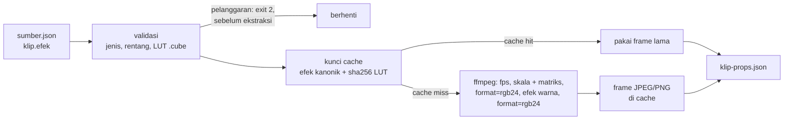

# Olah klip: efek saat ekstraksi

## Metadata

- Version: `v1.0.0`
- Last updated: `2026-11-07`
- Changeset: `Dokumen baru: blok efek klip di sumber.json (jenis lut, warna, keseimbangan), rantai filter ffmpeg di tahap ekstraksi, kunci cache yang memperhitungkan efek, LUT identitas, dan titik perluasan untuk jenis efek berikutnya.`

`scripts/klip.mjs` dapat mengolah klip **sekali, saat ekstraksi frame**, lewat blok `efek` di `sumber.json`. Frame yang sampai ke komposisi sudah berefek, jadi komposisi tetap menggambar frame ke-n klip sebagai fungsi murni dari nomor frame (`klipGambar`) tanpa tahu efeknya. Tidak ada grading per frame di Chromium. Manifest, lisensi, cache, dan pemakaian klip di komposisi ada di [video-tertanam-audio.md](video-tertanam-audio.md); dokumen ini hanya mengurai efek. Keputusan di baliknya ada di [log-keputusan.md](log-keputusan.md).



## Skema `efek`

`klip[].efek` adalah array objek; setiap objek punya `jenis` dan parameter jenis itu. Urutan array adalah urutan penerapan. Kunci yang tidak dikenal, jenis yang tidak dikenal, nilai di luar rentang, dan lebih dari 16 butir ditolak dengan kode keluar `2` sebelum ffmpeg berjalan, dengan pesan yang menyebut klip, nomor butir, dan jenisnya (contoh: `klip "k1": efek[0] (warna): "saturasi" harus angka 0..4`). Klip tanpa `efek` diekstrak persis seperti sebelumnya, termasuk kunci cache-nya.

```json
{
  "id": "hangat", "sumber": "pola-uji", "lebar": 480, "tinggi": 270, "dari": 0, "panjang": 2,
  "efek": [
    { "jenis": "lut", "berkas": "lut/hangat.cube", "interpolasi": "tetrahedral" },
    { "jenis": "warna", "kontras": 1.1, "saturasi": 0.8 },
    { "jenis": "keseimbangan", "bayangan": [0, 0, 0.06], "sorotan": [0.05, 0, -0.03] }
  ]
}
```

| Jenis | Parameter | Filter ffmpeg |
| --- | --- | --- |
| `lut` | `berkas` (jalur `.cube`, relatif terhadap folder manifest; wajib), `interpolasi` (`nearest`, `trilinear`, `tetrahedral` bawaan, `pyramid`, `prism`), `sha256` (opsional; bila diisi harus cocok dengan isi berkas) | `lut3d` |
| `warna` | `kecerahan` -1..1 (bawaan 0), `kontras` 0..4 (bawaan 1), `saturasi` 0..4 (bawaan 1; 0 = abu-abu), `gamma` 0.1..10 (bawaan 1; di atas 1 mencerahkan tengah). Sedikitnya satu parameter wajib. | `lutrgb` dan `colorchannelmixer` |
| `keseimbangan` | `bayangan`, `tengah`, `sorotan`: masing-masing `[merah, hijau, biru]` berisi tiga angka -1..1; `jagaTerang` (boolean, mempertahankan kecerahan). Sedikitnya satu dari tiga wajib. | `colorbalance` |

**`lut`.** Hanya LUT 3D format `.cube` (Adobe/Resolve). Berkas diurai dan diperiksa sebelum ekstraksi dengan sikap yang sama seperti ffmpeg (fail-closed): `LUT_3D_SIZE` wajib dan 2..256, jumlah baris data harus tepat `ukuran^3`, baris data harus tiga bilangan, `DOMAIN_MIN` dan `DOMAIN_MAX` diterima, LUT 1D dan kata kunci lain ditolak. Urutan data: merah paling cepat berubah. Interpolasi `tetrahedral` adalah bawaan ffmpeg dan yang paling setia pada sumbu abu-abu; `trilinear` dipakai bila hasil bit-eksak untuk LUT identitas dibutuhkan (lihat di bawah). Berkas LUT disalin ke folder kerja ekstraksi dan dihapus lagi, sehingga jalur dengan spasi atau karakter khusus filter ffmpeg aman tanpa escape.

**`warna`.** Rumusnya ditulis eksplisit, bukan perilaku internal `eq` (lihat KP-035): nilai kanal `x` (0..1, ruang sRGB/BT.709 ber-gamma) menjadi `clip((x^(1/gamma) - 0.5) * kontras + 0.5 + kecerahan, 0, 1)`; saturasi `s` mencampur tiap kanal dengan luma Rec. 709 (`0.2126 R + 0.7152 G + 0.0722 B`): `kanal' = s * kanal + (1 - s) * luma`. Dengan `s = 0` ketiga kanal sama persis (abu-abu murni sebelum kompresi JPEG).

**`keseimbangan`.** Bobot bayangan, tengah, dan sorotan berasal dari `colorbalance` ffmpeg dan tidak simetris: pada gradasi abu-abu ffmpeg 6.1 `tengah: [0.5, 0, 0]` mengubah nilai 80 (dari 255) tetapi tidak 10, 128, 200, atau 250, sedangkan `sorotan` mengubah nilai 80, 128, 200, dan 250 (tidak 10). Lihat dulu hasilnya pada frame sebelum memilih angka.

Efek yang semua parameternya netral (mis. `warna` dengan `kecerahan: 0`, `kontras: 1`, `saturasi: 1`, `gamma: 1`, atau `keseimbangan` dengan semua nol) dibuang dari rantai dan dari kunci cache, sehingga klipnya sama persis dengan klip tanpa efek.

## Rantai ekstraksi dan urutan

Rantai filter ffmpeg untuk satu klip: `fps` (dan koreksi SAR bila perlu), `scale` ke ukuran klip dengan matriks dan rentang warna eksplisit (lihat Warna di [video-tertanam-audio.md](video-tertanam-audio.md#scriptsklipmjs)), `format=rgb24`, lalu bila ada efek: `format=gbrp`, filter efek berurutan, `format=rgb24`. Efek diterapkan **setelah penskalaan**, pada frame ukuran akhir dalam RGB 8 bit ber-gamma (konversi `rgb24` dan `gbrp` tanpa kehilangan), sehingga LUT melihat nilai yang sama dengan yang akan ditampilkan. Audio klip (`audio.wav`) tidak diolah.

Dalam satu tahap, urutan efek mengikuti urutan array (urutan penting: LUT lalu koreksi berbeda dengan koreksi lalu LUT). Saat ini hanya ada satu tahap, `warna`.

## Cache

Kunci cache menambahkan `efek` ke kunci lama: daftar efek kanonik (parameter berisi nilai bawaan yang sudah terisi, tanpa efek netral) dan, untuk `lut`, **sha256 isi berkas LUT** dan interpolasi. Akibatnya:

- manifest yang sama menghasilkan cache hit dan tidak menjalankan ffmpeg;
- mengubah parameter, urutan, atau **isi LUT** (walau jalurnya sama) menghasilkan kunci baru; folder cache lama dibiarkan (seperti perubahan fps);
- memindahkan proyek ke jalur lain tidak mengubah kunci, karena jalur mutlak tidak ikut dihash;
- klip tanpa efek tidak berubah kuncinya, jadi cache lama tetap berlaku.

`meta.json` di folder cache memuat daftar `efek` kanonik dan `framesSha256` seluruh frame; baris log `klip "id": ...` menyebut efek yang dipakai (`efek lut+warna`).

## LUT identitas dan ketepatan

LUT identitas (setiap warna dipetakan ke dirinya) adalah uji kebenaran rantai. Hasil terukur (ffmpeg 6.1, klip uji 480x270):

| Interpolasi | Hasil dibanding klip tanpa LUT |
| --- | --- |
| `trilinear` | Identik byte demi byte: `framesSha256` sama untuk JPEG maupun PNG. |
| `tetrahedral` (bawaan) | Hampir identik, bukan bit-eksak: ffmpeg membulatkan hasil float sehingga sebagian kecil piksel meleset satu level; PSNR 82,6 dB pada PNG dan sekitar 65 dB setelah JPEG (galat satu level ikut terkuantisasi ulang). |

Uji `scripts/uji-klip.mjs` menegakkan keduanya. LUT nyata bukan identitas, jadi pilih interpolasi berdasarkan mutu (`tetrahedral`), bukan berdasarkan uji identitas.

## Lisensi dan atribusi

- LUT adalah aset: LUT dari paket komersial atau pihak ketiga tunduk pada lisensinya (banyak paket melarang redistribusi berkas `.cube`). Jangan meng-commit LUT yang lisensinya tidak mengizinkan; catat sumber dan lisensinya di `ASET.md` repo proyek (AGENTS.md §Lisensi dan Aset). LUT contoh di `templates/klip-tertanam/lut/` dibangkitkan skrip buatan sendiri dan milik proyek (CC0-1.0).
- Koreksi warna adalah modifikasi atas karya sumber. Untuk sumber berlisensi CC, sebutkan di `perubahan` sumber (mis. "diberi koreksi warna"); atribusi TASL memakai teks itu apa adanya.

## Batasan

- Hanya RGB 8 bit; sumber 10 bit didekode lalu diturunkan ke 8 bit di tahap penskalaan yang sudah ada. Sumber HDR tetap ditolak.
- LUT dianggap berlaku pada RGB BT.709 hasil dekode (ruang tampil). LUT yang dirancang untuk masukan log (konversi log ke Rec. 709) hanya benar bila sumbernya memang log; hal ini belum diverifikasi dengan footage log nyata.
- Tidak ada grading per frame atau keyframe efek; efek konstan sepanjang klip. Jadwal tampil klip tetap milik komposisi.
- Kunci cache memuat versi ffmpeg; mengganti versi ffmpeg mengekstrak ulang.

## Menambah jenis efek

Jenis efek berikutnya (mis. yang tercatat di [roadmap.md](roadmap.md) fase F3) didaftarkan di registri `EFEK` pada `scripts/klip.mjs` tanpa mengubah skema: satu entri berisi `tahap`, `kunci` (kunci manifest yang sah), `periksa` (validasi, pesan galat), `kanonik` (bentuk untuk kunci cache; `null` bila netral), dan `saring` (filter ffmpeg dan berkas yang perlu disalin). Efek yang butuh tahap lain, misalnya sebelum penskalaan atau yang menghasilkan alfa (membutuhkan format PNG), menambah satu entri di `TAHAP` dan satu slot di `argsEkstrak`; efek yang sudah ada tidak berubah.

## Templat

[`templates/klip-tertanam/sumber-warna.json`](../templates/klip-tertanam/sumber-warna.json) memuat tiga klip dari satu sumber: `asli`, `hangat` (LUT), dan `kusam` (warna dan keseimbangan). LUT contoh `lut/identitas.cube` dan `lut/hangat.cube` dibangkitkan `templates/klip-tertanam/buat-lut.mjs` (keluaran deterministik; uji memastikan berkas yang di-commit sama dengan keluaran skrip).

```bash
bun scripts/klip.mjs templates/klip-tertanam/sumber-warna.json --fps 30 --out .cache/awvd/klip-warna
bun templates/klip-tertanam/buat-lut.mjs .cache/awvd/lut   # membangkitkan ulang LUT contoh
```

## Changelog

### 2026-11-07 - v1.0.0

- Dokumen baru: skema `klip[].efek`, jenis `lut`, `warna`, `keseimbangan`, rantai ekstraksi, kunci cache, LUT identitas, lisensi LUT, batasan, dan titik perluasan.
