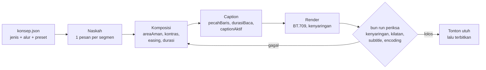

# Pedoman produksi video berbasis riset

## Metadata

- Version: `v1.0.0`
- Last updated: `2026-11-07`
- Changeset: `Baseline pedoman produksi: temuan literatur dan standar (pembelajaran multimedia, keterlibatan, caption, kenyaringan, area aman, kontras, kilatan, gerak, encoding) dipetakan ke fitur awvd yang sudah ada, dengan checklist komposisi dan bagian Rencana.`

Pedoman ini merangkum literatur ilmiah dan standar industri untuk video penjelasan, panduan, dan promo pendek berbasis motion graphics. Setiap butir diberi tingkat bukti dan dipetakan ke fitur awvd yang **sudah ada** (helper runtime, flag renderer, `bun run periksa`, SOP, klip dan audio, konsep), sehingga bisa diterapkan langsung di komposisi. Fitur yang belum ada hanya disebut di bagian [Rencana](#rencana), tanpa janji tanggal.

Tingkat bukti: **[meta-analisis]**, **[riset empiris]**, **[standar]**, **[pedoman industri]**, **[praktik]** (tanpa bukti ilmiah kuat). Angka yang belum diverifikasi dari sumber primer ditandai *belum terverifikasi*. Riset dikumpulkan 2026-11-07. Skema tingkat bukti pada preset jenis video (`bukti`, `standar`, `pedoman-industri`, `keputusan-desain`) dijelaskan di [konsep-jenis-alur.md](konsep-jenis-alur.md#tingkat-bukti).

## 1. Isi dan struktur

| Temuan | Bukti | Penerapan di awvd |
| --- | --- | --- |
| Video penjelasan: median keterlibatan paling banyak sekitar 6 menit, berapa pun panjang videonya. Pecah materi panjang menjadi seri. | [riset empiris] Guo, Kim & Rubin 2014; Brame 2016 | Rencanakan `durationInFrames` per video <= 6 menit (10.800 frame pada 30 fps). `bun run periksa --jenis penjelasan` memberi `PERINGATAN` bila lebih dari 6 menit; dengan `--konsep`, ambangnya durasi maks preset jenis (mis. 360 s untuk `edukasi`) |
| Segmenting: satu ide per segmen. Signaling: sorot elemen yang dibicarakan. Coherence: buang dekorasi dan suara tanpa makna. Spatial dan temporal contiguity: teks dekat objeknya dan muncul bersamaan dengan narasinya. | [meta-analisis] Noetel dkk. 2022; Mayer 2021; Moreno & Mayer 2000 | `urutan()` per segmen, `berjenjang()` untuk stagger satu ide per ketukan; template SOP menyorot langkah aktif dan meredupkan yang lain |
| Pre-training (kenalkan istilah sebelum dipakai) dan gaya bahasa percakapan ("kamu/kita"). | [meta-analisis] Mayer 2021 | Naskah di `props`; template SOP memuat adegan dasar hukum dan daftar pelaksana sebagai pra-latihan istilah. Efek gaya percakapan belum diuji untuk bahasa Indonesia |
| Redundancy dan modality tidak terdukung khusus untuk video. Jangan dijadikan aturan keras. | [tinjauan sistematis] Fyfield dkk. 2022 | - |
| Hook di awal, satu CTA di akhir. | [pedoman industri] Google ABCD; tidak ada bukti ilmiah untuk "3 detik pertama" | Buka dengan masalah atau hasil, bukan logo panjang; `konsep.json` memuat field `cta` dan brief menandai kolom yang belum diisi |
| Rule of thirds: bukti lemah dan bertentangan. | [praktik] | Opsional; konsistensi tata letak lebih penting |

## 2. Caption dan subtitle

| Temuan | Bukti | Penerapan di awvd |
| --- | --- | --- |
| Caption wajib untuk audio prarekam: ucapan, pembicara, dan bunyi bermakna. | [standar] WCAG 2.2 SC 1.2.2 (A) | `--subtitle` (trek lunak) dan burn-in lewat `captionAktif()` |
| Caption memperbaiki pemahaman, atensi, dan memori. | [tinjauan, meta-analisis] Gernsbacher 2015; Montero Perez dkk. 2013 | Sediakan sidecar `.vtt` dan versi burn-in untuk media sosial (`caption.burnIn` di `konsep.json`) |
| Maksimal 42 karakter per baris dan 2 baris. Untuk bahasa Indonesia: 17 cps untuk subtitle dan 20 cps untuk SDH (caption untuk tuli dan sulit dengar). Durasi cue 5/6 s sampai 7 s. | [pedoman industri] Netflix Timed Text Style Guide (bahasa Indonesia); [riset empiris] Szarkowska & Gerber-Moron 2018, Kruger dkk. 2022 | `pecahBaris()`, `durasiBaca()` (bawaan 17 cps, sesuai batas subtitle); `bun run periksa --subtitle` dengan `--cps 20` untuk SDH |
| Anjuran TikTok "5-10 kata per detik" untuk teks layar bertabrakan dengan batas cps caption. | [pedoman industri] TikTok for Business | Perlakukan teks hook sebagai judul pendek, bukan caption ucapan; preset `sosial` memakai 20 cps (keputusan menunggu konfirmasi pemilik, [log-keputusan.md](log-keputusan.md)) |

## 3. Visual

| Temuan | Bukti | Penerapan di awvd |
| --- | --- | --- |
| Graphics safe 90% (margin 5% per sisi), action safe 93% (margin 3,5%). | [standar] EBU R 95 v1.1 (2017) | `areaAman(width, height)` |
| Kontras teks >= 4,5:1, atau >= 3:1 untuk teks besar (>= 24 px, atau >= 18,5 px tebal), termasuk teks di atas gambar. | [standar] WCAG 2.2 SC 1.4.3 (AA) | `kontras()`, `pilihTeksKontras()`; preset jenis tidak boleh menurunkan kontras minimum di bawah 4,5:1; template SOP memeriksa semua pasangan warna saat dimuat |
| Maksimal 3 kilatan per detik (perubahan luminans >= 10% dengan sisi gelap < 0,80); kilatan merah jenuh dihitung terpisah. | [standar] WCAG 2.2 SC 2.3.1 (A) | Pemeriksa kilatan di `bun run periksa` (penyaringan konservatif, bukan sertifikasi PEAT atau Harding) |
| Ukuran teks minimum relatif tinggi frame. | *belum terverifikasi*; praktik 4-6% tinggi frame untuk subtitle | Uji di layar ponsel |

## 4. Gerak

| Temuan | Bukti | Penerapan di awvd |
| --- | --- | --- |
| Durasi animasi 100-500 ms; masuk sedikit lebih lama dari keluar; ease-out untuk masuk, ease-in untuk keluar; hindari gerak linear. | [pedoman industri] NN/g (Laubheimer 2020) | `durasi.masuk`, `durasi.keluar`, `ms()` |
| Token durasi 50-1000 ms dan kurva easing standar. | [pedoman industri] Material Design 3 | `durasi.*`, `easing.standar`, `easing.perlambat`, `easing.percepat`, `easing.ditekankanMasuk`, `easing.ditekankanKeluar` |
| Slow in/out, anticipation, follow-through, timing. | [praktik, kanonik] Thomas & Johnston 1981; Lasseter 1987 | `pegas()` untuk overshoot alami |
| Transisi bertahap (staging) membantu mengikuti perubahan; animasi menimbulkan beban transien. | [riset empiris] Heer & Robertson 2007 | Satu perubahan pada satu waktu (`berjenjang()`); teks harus diam selama dibaca |
| Angka UI diambil dari antarmuka interaktif; penerapannya di video adalah ekstrapolasi. Transisi besar 400-800 ms adalah pilihan gaya. | [praktik] | - |
| Pan dan zoom foto diam (Ken Burns): tidak ada bukti eksperimen bahwa efek ini memengaruhi pemahaman atau atensi. | [praktik] | `kenBurns()`; gaya estetika, parameter zoom 1,0 ke 1,1-1,3 dengan gerak lambat |

## 5. Audio

| Temuan | Bukti | Penerapan di awvd |
| --- | --- | --- |
| Siaran: -23 LUFS (+-1 LU), true peak <= -1 dBTP, diukur sesuai ITU-R BS.1770. | [standar] EBU R 128 (2023) | `--kenyaringan siaran`; `bun run periksa --kenyaringan siaran` |
| Streaming: -14 s.d. -20 LUFS; konten bicara sekitar -16 s.d. -18 LUFS. | [pedoman industri] AES TD1004 dan TD1008 (dibaca lewat ringkasan sekunder) | `--kenyaringan web` (-16 LUFS, TP -1,5 dBTP), bawaan bila ada `--audio` |
| Narasi di atas musik: kepuasan memuncak sekitar +8,5 dB selisih dialog terhadap latar. Tidak ada standar selisih ducking. | [riset empiris] Sugimoto 2026; Ricketts dkk. 2026 | `scripts/audio.mjs`: musik bawaan 12 dB di bawah ucapan (`levelDb`, rentang -20..-8), usulan rekayasa dan bukan standar |
| Ucapan simultan saling mengganggu; tidak ada standar siaran terverifikasi yang melarang audio tumpang tindih. | [riset empiris, bukti tidak langsung] Salame & Baddeley 1982; Brungart 2001 (hanya sampai metadata) | Pemegang suara eksklusif di `audio.mjs`: klip `bergantian` atau `campur` dengan audio klip turun 12 dB selama narasi ([video-tertanam-audio.md](video-tertanam-audio.md#timeline-audio)) |

## 6. Encoding

| Temuan | Bukti | Penerapan di awvd |
| --- | --- | --- |
| H.264 High, 4:2:0, GOP tertutup setengah fps, B-frame 2, faststart, BT.709, AAC-LC 48 kHz stereo 384 kbps. Bitrate SDR 30 fps: 5 Mbps (720p), 8 Mbps (1080p). | [pedoman industri] YouTube Help 1722171 | Bawaan renderer (BT.709 ditandai dan dikonversi eksplisit); diperiksa `bun run periksa` ([cli.md](cli.md#encode-video)) |
| CRF 18-20 cukup untuk motion graphics datar. | [praktik] | `--crf` (bawaan 18) |
| 30 fps cukup untuk teks dan grafis; 60 fps menggandakan biaya render tanpa bukti manfaat. | [praktik] | `fps: 30` |

## 7. Konsep dan persetujuan

| Temuan | Bukti | Penerapan di awvd |
| --- | --- | --- |
| Urutan tahap produksi (pra-produksi sampai evaluasi) adalah konvensi stabil; jumlah gate, ronde review, dan penyetuju adalah keputusan desain tanpa bukti empiris yang membandingkan alur. | [praktik] | 5 alur di `data/alur-produksi.json`; `bun run konsep` menegakkan gate, hash artefak, dan tanggal persetujuan |
| Sebagian besar atribut preset jenis video bukan hasil riset (pada 2026-11-07: 6 `bukti`, 16 `standar`, 80 `pedoman-industri`, 171 `keputusan-desain` dari 273 nilai). | [praktik] | Perlakukan preset sebagai titik awal; ubah lewat `override` dengan alasan ([konsep-jenis-alur.md](konsep-jenis-alur.md)) |
| Angka dalam format Indonesia (titik ribuan, koma desimal, `Rp1.500.000` tanpa spasi). | [standar kebahasaan, sumber sekunder] EYD Edisi V (Badan Bahasa, 2022) | `angka()`, `persen()`, `rupiah()` |

## Checklist sebelum terbit

- [ ] Satu pesan utama; satu ide per segmen; video penjelasan <= 6 menit.
- [ ] Istilah kunci dikenalkan sebelum dipakai; bahasa percakapan.
- [ ] Teks dan grafis penting berada di dalam `areaAman().grafis`.
- [ ] Kontras teks >= 4,5:1 (teks besar >= 3:1) terhadap latar efektif.
- [ ] Teks layar hanya kata kunci, dekat objeknya, muncul bersamaan dengan narasi; elemen yang dibicarakan disorot.
- [ ] Transisi 200-500 ms; ease-out untuk masuk; teks diam selama dibaca.
- [ ] Caption lengkap: <= 42 karakter per baris, <= 2 baris, <= 17 cps (subtitle) atau <= 20 cps (SDH), durasi 5/6-7 s.
- [ ] Musik sekitar 8-12 dB di bawah narasi; tanpa suara dekoratif.
- [ ] `bun run periksa` lolos: kenyaringan sesuai target, tidak ada kilatan > 3 per detik, subtitle sesuai batas, encoding BT.709.
- [ ] Bila ada klip tertanam: atribusi tampil di layar dan di deskripsi (`atribusi.txt`), dan lisensi sumber divalidasi `klip.mjs`.
- [ ] Ditonton utuh di layar kecil dengan suara mati dan dengan suara nyala.

## Rencana

Belum ada di awvd, sedang dalam pengerjaan atau pertimbangan, **tanpa janji tanggal**. Butir di bawah tidak boleh diperlakukan sebagai fitur yang tersedia.

- Caption yang sinkron dengan narasi rekaman atau TTS (saat ini caption dihitung dari teks, atau dibuat manual sebagai `.vtt`/`.srt`).
- Pustaka transisi antaradegan.
- Manajemen aset (pencatatan sumber, lisensi, dan pemakaian aset lintas template; saat ini hanya `templates/<nama>/ASET.md` dan atribusi klip).
- Profil audiens yang menurunkan pilihan gaya, bahasa, dan aksesibilitas.

## Rujukan

- Brame, C. J. (2016). Effective educational videos: Principles and guidelines for maximizing student learning from video content. *CBE-Life Sciences Education*, 15(4), es6. DOI 10.1187/cbe.16-03-0125
- Brungart, D. S. (2001). Informational and energetic masking effects in the perception of two simultaneous talkers. *Journal of the Acoustical Society of America*, 109(3). Hanya dibaca sampai metadata.
- EBU (2017). R 95 v1.1: Safe areas for 16:9 television production.
- EBU (2023). R 128: Loudness normalisation and permitted maximum level of audio signals.
- Fyfield, M., Henderson, M., Phillips, M. (2022). Improving instructional video design: A systematic review. *Australasian Journal of Educational Technology*, 38(3), 150-178. DOI 10.14742/ajet.7296
- Gernsbacher, M. A. (2015). Video captions benefit everyone. *Policy Insights from the Behavioral and Brain Sciences*, 2(1), 195-202. DOI 10.1177/2372732215602130
- Google. YouTube Help: Recommended upload encoding settings. https://support.google.com/youtube/answer/1722171
- Guo, P. J., Kim, J., Rubin, R. (2014). How video production affects student engagement: An empirical study of MOOC videos. *Proc. L@S '14*. DOI 10.1145/2556325.2566239
- Heer, J., Robertson, G. (2007). Animated transitions in statistical data graphics. *IEEE TVCG*, 13(6), 1240-1247. DOI 10.1109/TVCG.2007.70539
- Kruger, J.-L., Wisniewska, N., Liao, S. (2022). Why subtitle speed matters. *Applied Psycholinguistics*, 43(1), 211-236. DOI 10.1017/S0142716421000503
- Lasseter, J. (1987). Principles of traditional animation applied to 3D computer animation. *ACM SIGGRAPH Computer Graphics*, 21(4), 35-44. DOI 10.1145/37402.37407
- Laubheimer, P. (2020). Executing UX animations: Duration and motion characteristics. Nielsen Norman Group.
- Mayer, R. E. (2021). Evidence-based principles for how to design effective instructional videos. *Journal of Applied Research in Memory and Cognition*, 10(2), 229-240. DOI 10.1016/j.jarmac.2021.03.007
- Montero Perez, M., Van Den Noortgate, W., Desmet, P. (2013). Captioned video for L2 listening and vocabulary learning: A meta-analysis. *System*, 41(3), 720-739. DOI 10.1016/j.system.2013.07.013
- Moreno, R., Mayer, R. E. (2000). A coherence effect in multimedia learning. *Journal of Educational Psychology*, 92(1), 117-125. DOI 10.1037/0022-0663.92.1.117
- Netflix Partner Help Center. Timed Text Style Guide (bahasa Inggris dan Indonesia); Subtitle Timing Guidelines.
- Noetel, M., Griffith, S., Delaney, O., Harris, N. R. dkk. (2022). Multimedia design for learning: An overview of reviews with meta-meta-analysis. *Review of Educational Research*, 92(3), 413-454. DOI 10.3102/00346543211052329
- Ricketts, T. A. dkk. (2026). How speaker configuration of recorded media affects subjective ratings for listeners with and without hearing loss. *Journal of Speech, Language, and Hearing Research*, 69(8), 3963-3976. DOI 10.1044/2026_JSLHR-25-00127
- Salame, P., Baddeley, A. (1982). Disruption of short-term memory by unattended speech. *Journal of Verbal Learning and Verbal Behavior*, 21(2). Hanya dibaca sampai metadata.
- Sugimoto, T. (2026). Reconciling dialogue intelligibility with overall listening satisfaction. *JAES*, 74(9), 636-646. DOI 10.17743/jaes.2026.0295
- Szarkowska, A., Gerber-Moron, O. (2018). Viewers can keep up with fast subtitles. *PLOS ONE*, 13(6), e0199331. DOI 10.1371/journal.pone.0199331
- Thomas, F., Johnston, O. (1981). *The Illusion of Life: Disney Animation*. Abbeville Press.
- W3C (2023). WCAG 2.2: SC 1.2.2, 1.4.3, 2.3.1.

## Kesenjangan

- Ukuran teks minimum relatif tinggi frame, kecepatan gerak teks dalam px/detik, dan durasi optimal video promo belum punya sumber primer.
- AES TD1004/TD1008 dibaca lewat ringkasan sekunder; BBC Subtitle Guidelines, SMPTE ST 2046-1, dan teks ITU-R BS.1770/BT.709 belum dibaca langsung.
- Rumusan batas cps (17 cps subtitle dan 20 cps SDH untuk bahasa Indonesia) di dokumen ini lebih baru daripada rumusan di [api-runtime.md](api-runtime.md) (`durasiBaca`), [pemeriksaan-mutu.md](pemeriksaan-mutu.md) (`--cps`), [konsep-jenis-alur.md](konsep-jenis-alur.md) dan `data/jenis-video.json`, yang masih menyebut "dewasa 20 cps, anak 17 cps". Angka bawaan kode (17) dan preset tidak berubah; penyelarasan teks tersebut menunggu PR terpisah.

## Changelog

### 2026-11-07 - v1.0.0

- Baseline pedoman produksi, disusun dari draf riset 2026-11-07 dan disesuaikan dengan kondisi nyata repo: penerapan dipetakan ke helper runtime, `--kenyaringan`, `bun run periksa`, SOP, klip dan audio, serta konsep yang sudah ada.
- Batas cps bahasa Indonesia dikoreksi: 17 cps subtitle dan 20 cps SDH (sebelumnya ditulis dewasa 20 dan anak 17).
- Menambahkan bagian Konsep dan persetujuan serta bagian Rencana (caption sinkron narasi, transisi, aset, profil audiens; belum ada, tanpa janji tanggal).
