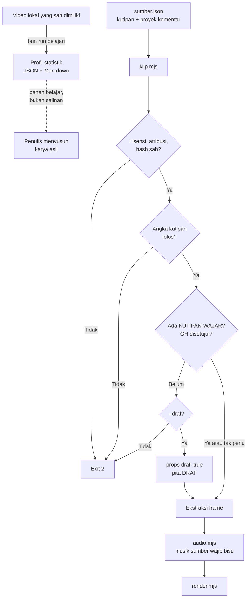

# Mempelajari gaya video dan video reaction (kutipan wajar)

## Metadata

- Version: `v1.0.0`
- Last updated: `2026-11-07`
- Changeset: `Dokumen baru: bun run pelajari (statistik gaya dari video lokal), kebijakan kutipan wajar (scripts/kutipan.mjs: batas durasi, proporsi, komentar aktif, audio musik), gerbang hukum GH dengan tanda draf, lisensi KUTIPAN-WAJAR, templat reaction, batas yang boleh dan tidak boleh, dan dasar hukum ringkas.`

**Dokumen ini bukan nasihat hukum.** Angka di dokumen ini adalah kebijakan internal awvd yang disetujui pemilik (2026-11-07), bukan batas yang ditetapkan undang-undang atau pengadilan. Peninjauan oleh ahli hukum hak cipta di yurisdiksi tayang tetap diperlukan sebelum menayangkan video yang memuat karya orang lain, terutama untuk penggunaan komersial, orang yang dapat dikenali, dan musik.

Dua kemampuan yang berdekatan tetapi berbeda:

- `bun run pelajari`: membaca satu video **lokal yang sah dimiliki** dan menghasilkan statistik gaya (ritme potongan, palet, kenyaringan, pola struktur) sebagai bahan belajar. Ia tidak menyalin isi.
- Kebijakan kutipan wajar: syarat terukur untuk video reaction, ulasan, dan kritik yang memuat klip karya lain, diperiksa `klip.mjs` dan `audio.mjs` **sebelum** ekstraksi dan sebelum Chromium diluncurkan, ditambah gerbang tinjauan hukum `GH`.

Keputusan di baliknya: [log-keputusan.md](log-keputusan.md) (KP-029 dan KP-030). Fitur klip dan audio dasar: [video-tertanam-audio.md](video-tertanam-audio.md).



## Apa yang boleh dan tidak

| Boleh | Tidak boleh dan tidak akan disediakan awvd |
| --- | --- |
| Berkas lokal milik sendiri, izin tertulis pemegang hak, rilis pemegang hak, lisensi terbuka (CC BY, CC BY-SA, CC0), stok berlisensi, arsip publik, dengan manifest `sumber.json` | Pengunduh dari platform mana pun (YouTube, TikTok, Facebook, Instagram, X, dan sejenisnya) atau pembungkus alat sejenis |
| Statistik gaya dari berkas yang sah dimiliki (durasi, ritme potongan, palet, kenyaringan, pola struktur) | Perekam layar atau penangkap stream pemutaran platform; penangkap iframe pemutar tersemat |
| Kutipan singkat untuk kritik, ulasan, pendidikan, penelitian, atau berita aktual, dengan komentar asli yang dominan dan sumber disebut lengkap | Pemintas DRM, enkripsi, atau sarana kontrol teknologi lain (UU 28/2014 Pasal 52) |
| Menandai hasil sebagai draf (`--draf`) selama peninjauan hukum belum selesai | Penghapus watermark atau pengaburan atribusi (UU 28/2014 Pasal 7 ayat 3) |
| Memperketat angka kebijakan di proyek | Fitur pengelak pencocokan otomatis platform (flip, ubah pitch atau kecepatan untuk menyamarkan) |
| | Pengenalan wajah, kloning suara orang nyata, deepfake |
| | Alat yang menyalin naskah, karakter, musik, atau gaya grafis khas dari sumber |
| | Melonggarkan angka kebijakan tanpa catatan izin tertulis |

Ketentuan layanan platform umumnya melarang pengunduhan dan akses otomatis di luar fitur resmi platform; itu lapis yang terpisah dari hukum hak cipta. Kutipan wajar menjawab pertanyaan "apakah penggunaan boleh", bukan "apakah mengambil berkasnya boleh". Karena awvd tidak dapat memverifikasi cara sebuah berkas diperoleh, ia hanya mencatat pernyataan pengguna dan menolak nilai yang jelas melanggar. Tanggung jawab tetap pada pengguna dan peninjau hukum.

## `bun run pelajari`

```text
bun scripts/pelajari.mjs <video-lokal> --sumber-sah <cara> [--out profil.json] [--out profil.md]
     [--json] [--tanggal YYYY-MM-DD] [--ambang-cut 10]
```

| Flag | Keterangan |
| --- | --- |
| `--sumber-sah` | Wajib. `milik-sendiri`, `izin-tertulis`, `rilis-pemegang-hak`, `lisensi-terbuka`, `stok-berbayar`, atau `arsip-publik`. Ini pernyataan pengguna yang dicatat di profil; awvd tidak dapat memverifikasinya. `unduh-platform`, `rekam-layar-platform`, `rip-stream`, URL sebagai masukan, atau nilai lain: kode keluar `2`. |
| `--out F` | Tulis profil; ekstensi `.json` untuk JSON dan `.md` untuk laporan Markdown (boleh diulang). Tanpa `--out`, laporan Markdown dicetak ke stdout (atau JSON dengan `--json`). |
| `--tanggal D` | Tanggal analisis `YYYY-MM-DD`. Tanpa flag ini nilainya `null`: awvd tidak memakai jam sistem agar hasil deterministik. |
| `--ambang-cut N` | Ambang skor deteksi adegan `scdet`, 1 sampai 100 (bawaan 10). Belum dikalibrasi untuk konten nyata. |

Kode keluar: `0` berhasil, `2` argumen tidak valid atau ditolak, `1` galat ffmpeg.

Yang dihitung (ffprobe dan ffmpeg, tanpa dependensi baru, tanpa berkas sementara):

| Bagian profil | Isi |
| --- | --- |
| `sumber` | `sha256`, `ukuranByte`, `caraPerolehan` (pernyataan), `tanggalAnalisis`. Tidak ada nama berkas. |
| `teknis` | Durasi, dimensi, rasio, fps, ada atau tidaknya audio. |
| `potong` | Deteksi adegan `scdet`: jumlah adegan, durasi tiap adegan, rata-rata, median, persentil 90, terpendek, terpanjang, potong per menit, kurva ritme (potong per sepersepuluh durasi), rata-rata paruh pertama dan kedua. |
| `visual` | Palet dominan: 64 bin warna (4 level per kanal) dari bingkai yang diperkecil dan dicuplik 2 fps, disimpan hanya sebagai statistik hex dan persen. |
| `audio` | Kenyaringan terpadu (LUFS), LRA, true peak, proporsi senyap. "Ada musik atau tidak" bernilai `"manual"` karena tidak dapat ditentukan andal tanpa klasifikasi. |
| `struktur` | Potong di 3 detik pertama (indikator hook), potong di 10% akhir (indikator penutup), tempo (`cepat` bila median di bawah 2 detik, `sedang` sampai 5 detik, `lambat` di atasnya), `indikatif: true` (bukan deteksi isi). |
| `pola`, `peringatan`, `catatan` | Kalimat ringkas hasil angka, peringatan (pernyataan perolehan tidak diverifikasi, ambang belum dikalibrasi, sampel kecil), dan catatan batas. |

Laporan Markdown menambahkan daftar **Dilarang disalin** (naskah dan kalimat khas, karakter dan maskot, musik dan efek suara, urutan visual yang meniru adegan tertentu, gaya grafis khas, logo dan merek, bagian paling penting dan khas karya) dan **cek orisinalitas oleh manusia** (apakah urutan adegan identik, apakah ada kalimat yang sama, apakah warna atau tipografi menyerupai merek, apa elemen pembedamu).

Dasar: ide, metode, dan struktur umum tidak dilindungi hak cipta (UU 28/2014 Pasal 41 huruf b); ekspresi konkret tetap dilindungi. Analisis tetap membutuhkan akses ke berkas, sedangkan Pasal 49 (penggandaan sementara) sempit dan hukum tidak membahas analisis teknis nonekspresif secara eksplisit. Karena itu fitur ini hanya menerima berkas yang sah dimiliki dan tidak menyimpan frame, audio, atau teks. Kelayakannya perlu ditinjau ahli hukum bila dipakai di luar berkas milik sendiri.

## Kebijakan kutipan wajar

Cakupan: setiap sumber di `sumber.json` yang berlisensi `KUTIPAN-WAJAR` atau yang memuat blok `kutipan` (sumber CC yang memuat blok itu diperiksa secara sukarela, seperti di templat reaction). `KUTIPAN-WAJAR` **bukan lisensi**: ia menandai klaim pengecualian hak cipta (UU 28/2014 Pasal 44, fair use, fair dealing) yang wajib punya blok `kutipan` dan gerbang hukum GH.

### Angka bawaan

Disetujui pemilik 2026-11-07. Proyek boleh memperketat; melonggarkan butuh `proyek.kebijakanKutipan.catatanIzinTertulis` (teks atau nama berkas bukti izin) dan tetap memberi peringatan.

| Ukuran | Bawaan | Kunci `proyek.kebijakanKutipan` |
| --- | --- | --- |
| Panjang tiap klip kutipan | maksimum 15 detik (peringatan di atas 10 detik) | `klipMaksDetik` |
| Total kutipan per sumber | maksimum 45 detik atau 15% durasi sumber, mana yang lebih kecil | `sumberMaksDetik`, `sumberMaksPersen` |
| Total kutipan terhadap durasi video baru | maksimum 25% | `videoMaksPersen` |
| Komentar atau narasi asli aktif selama kutipan | minimum 90% dari durasi kutipan (agregat; tiap klip minimal satu elemen komentar) | `komentarMinPersen` |
| Klip bersambung tanpa jeda | total tidak melebihi batas per klip | (ikut `klipMaksDetik`) |
| Musik dibahas | maksimum 10 detik | `musikDibahasMaksDetik` |
| Audio musik sumber | dibisukan secara bawaan | (aturan di `audio.mjs`) |

Pelanggaran angka dan isi tidak dapat dilewati, termasuk dengan `--draf`; hanya gerbang GH yang bisa ditunda.

### Kunci manifest

Contoh lengkap yang dapat dijalankan: [`templates/reaction/sumber.json`](../templates/reaction/sumber.json). Kunci selain yang di [video-tertanam-audio.md](video-tertanam-audio.md#manifest-sumberjson):

| Tempat | Kunci |
| --- | --- |
| `proyek` | `durasiVideoDetik` (wajib bila ada sumber dalam cakupan); `komentar[]`: `{ mulai, akhir, jenis }` dalam detik pada timeline video, `jenis` `narasi`, `caption`, atau `anotasi`; `kebijakanKutipan`; `iklan` (`true` menolak `KUTIPAN-WAJAR` mutlak); `gerbangHukum`. |
| `klip[]` | `mulaiVideo`: detik pada timeline video tempat klip tampil (wajib untuk klip kutipan, untuk menghitung komentar yang menutupinya). |
| `sumber[]` | Untuk `KUTIPAN-WAJAR`: `caraPerolehan` (`milik-sendiri`, `izin-tertulis`, `rilis-pemegang-hak`, `lisensi-terbuka`, `stok-berbayar`, `arsip-publik`, `berkas-sah-pengguna` dengan `buktiPerolehan`), `tanggalAkses`. `unduh-platform`, `rekam-layar-platform`, `rip-stream`, dan nilai kosong ditolak. |
| `sumber[].kutipan` | `tujuan` (`kritik`, `ulasan`, `pendidikan`, `penelitian`, `berita-aktual`; hiburan dan promosi ditolak), `isiAudio` (`musik` bawaan, `ucapan`, `tanpa`), `musikDibahas`, `menyasarKarya` (harus `true`), `bukanBagianKhas` (harus `true`), `perubahanMakna` (harus `false`), `orangDikenali` dan `izinPotret` (`tertulis-ada`) atau `kepentinganPublik` dengan GH disetujui, `sintetis`. |

Aturan tambahan: `proyek.tujuan` `komersial` dengan `KUTIPAN-WAJAR` hanya lolos bila `gerbangHukum` disetujui dengan `komersialDitinjau: true` dan `catatan` peninjau; `iklan: true` ditolak. `sintetis` pada orang yang dapat dikenali ditolak (deepfake).

### Audio

`klip.mjs` menulis `kutipan: { isiAudio, musikDibahas }` ke tiap klip di `klip-props.json`, dan `audio.mjs --klip-props` memakainya: klip dengan `isiAudio` `musik` (bawaan) wajib mode `bisu`, kecuali `musikDibahas` `true` dengan rentang paling lama 10 detik. Klip `ucapan` memakai aturan bergantian dan campur yang sudah ada ([video-tertanam-audio.md](video-tertanam-audio.md#timeline-audio)). Musik terdengar tetap berisiko dicocokkan otomatis oleh platform dan menyentuh hak terkait fonogram.

## Gerbang hukum GH

Berlaku bila ada sumber `KUTIPAN-WAJAR`. Status ada di manifest:

```json
"gerbangHukum": {
  "status": "disetujui", "oleh": "KP", "tanggal": "2026-11-07",
  "berkas": "memo-hukum.md", "hash": "<64 digit heksadesimal>"
}
```

| Keadaan | `bun run klip` |
| --- | --- |
| Tanpa `gerbangHukum`, status `menunggu`, data tidak lengkap, atau hash tidak cocok | Render final ditolak: kode keluar `2` sebelum ekstraksi. |
| Sama, dengan `--draf` | Lolos dengan peringatan `DRAF`; `klip-props.json` dan `props-gabungan.json` memuat `"draf": true` dan `atribusi.txt` diberi baris DRAF. Komposisi wajib menampilkan tanda draf bila `props.draf` `true` (templat reaction menampilkan pita merah). Hasil draf tidak boleh dipublikasikan. |
| `disetujui`, lengkap, hash cocok | Lolos tanpa tanda draf. |

Hash dihitung `bun run kutipan -- hash sumber.json`: SHA-256 dari isi manifest (kecuali `gerbangHukum`, dalam bentuk kanonis) digabung SHA-256 berkas memo. Mengubah satu karakter di manifest atau memo membatalkan persetujuan; perubahan berarti hash baru dan pengesahan ulang. awvd tidak membaca isi memo dan tidak menilai kualitasnya; GH hanya mencatat bahwa peninjauan terjadi dan oleh siapa. Memo peninjau seyogianya memuat tujuan, penimbangan empat faktor (atau Pasal 44), konfirmasi cara perolehan, orang yang dikenali, musik, yurisdiksi tayang, dan nama peninjau. Gerbang ini dimodelkan di manifest karena `render.mjs` tidak berubah; penegakannya ada di langkah `klip.mjs`, sebelum render.

## `bun run kutipan`

```text
bun scripts/kutipan.mjs periksa <sumber.json>   periksa angka kebijakan (durasi sumber lewat ffprobe)
bun scripts/kutipan.mjs hash <sumber.json>      cetak hash gerbang hukum GH
```

`periksa` tidak mengekstrak dan tidak memeriksa lisensi atau hash berkas (itu tugas `klip.mjs`); ia mencetak ringkasan seperti `kutipan: 3 klip, 11.00 s = 22.92% dari video 48.00 s (maks 25%); komentar aktif 100.00% (min 90%); per sumber: ...` dan melaporkan GH yang belum disetujui sebagai peringatan. Kode keluar `0` lolos, `2` pelanggaran atau argumen salah.

## Templat `reaction`

[`templates/reaction/`](../templates/reaction/): video reaction 1280x720, 30 fps, 48 detik. Komentar asli adalah layar utama (teks besar sepanjang video), tiga klip kutipan kecil (4, 4, dan 3 detik = 22,9% video) tampil di sudut dengan kredit TASL, kredit akhir, dan tanda draf bila `props.draf`. Karya yang dikutip adalah dua klip `.mkv` buatan proyek (CC0 dan CC BY, 64 detik, ffmpeg lavfi; lihat [ASET.md](../templates/reaction/ASET.md)). Audio: narasi nada sinus, klip `k1` campur (ducking 12 dB), `k2` bisu (musik), `k3` bergantian. Catatan analisis transformatif per proyek: [KUTIPAN-WAJAR.md](../templates/reaction/KUTIPAN-WAJAR.md).

```bash
bun templates/reaction/buat-audio.mjs                         # narasi dan musik nada ke .cache/awvd/reaction
bun scripts/klip.mjs templates/reaction/sumber.json --fps 30 \
  --out .cache/awvd/klip-reaction --gabung templates/reaction/props.json
bun scripts/audio.mjs templates/reaction/rencana-audio.json --fps 30 \
  --klip-props .cache/awvd/klip-reaction/klip-props.json --out .cache/awvd/reaction.wav
bun scripts/render.mjs templates/reaction/index.html \
  --props-file .cache/awvd/klip-reaction/props-gabungan.json \
  --audio .cache/awvd/reaction.wav --out out/reaction.mp4
```

Jadwal klip ada di tiga tempat (`mulaiVideo` di `sumber.json`, `rencana-audio.json`, dan `props.json`) dan teks komentar di dua (`proyek.komentar` dan `props.json`); `scripts/uji-pelajari.mjs` memastikan semuanya sama. Templat memakai sumber buatan sendiri (CC0 dan CC BY) dan menerapkan kebijakan kutipan secara sukarela; untuk karya pihak ketiga ganti lisensi sumber menjadi `KUTIPAN-WAJAR`, isi `caraPerolehan`, `tanggalAkses`, dan gerbang GH.

## Dasar hukum ringkas

Ringkasan dari riset 2026-11-07; angka di atas **bukan** bagian dari dasar ini. Teks tidak semuanya dibaca dari sumber primer sehingga perlu dicocokkan sebelum dipakai di dokumen formal.

- **UU 28/2014 tentang Hak Cipta.** Pasal 41 huruf b: ide, prosedur, sistem, metode, konsep, prinsip, temuan, atau data tidak dilindungi (dasar `pelajari`). Pasal 43 huruf d: pembuatan dan penyebarluasan konten melalui media TIK yang bersifat tidak komersial dan/atau menguntungkan pencipta atau pihak terkait, atau pencipta tidak keberatan; redaksinya longgar dan tafsirnya belum jelas, jadi tidak dijadikan dasar tunggal. Pasal 44 ayat 1 huruf a: penggunaan seluruh atau sebagian yang substansial untuk pendidikan, penelitian, penulisan karya ilmiah, penyusunan laporan, penulisan kritik atau tinjauan suatu masalah tidak dianggap pelanggaran bila sumbernya disebut lengkap dan tidak merugikan kepentingan yang wajar pencipta; undang-undang tidak menetapkan batas angka, dan Penjelasannya menyebut "sebagian yang substansial" sebagai bagian yang paling penting dan khas. Hak moral (Pasal 5 ayat 1 huruf e, distorsi dan modifikasi yang merugikan kehormatan), informasi manajemen hak cipta (Pasal 7 ayat 3), larangan penggunaan komersial tanpa izin (Pasal 9 ayat 3), dan larangan merusak sarana kontrol teknologi (Pasal 52) menjadi dasar beberapa larangan di atas. Tindak pidana hak cipta adalah delik aduan (Pasal 120). Tidak ditemukan putusan Indonesia yang menerapkan Pasal 44 pada video reaction.
- **Fair use, 17 U.S.C. §107.** Empat faktor: tujuan dan sifat penggunaan (termasuk komersial atau tidak), sifat karya, jumlah dan substansialitas bagian yang dipakai, dan pengaruh terhadap pasar. Putusan acuan: Campbell v. Acuff-Rose (1994) dan Andy Warhol Foundation v. Goldsmith (2023), yang menekankan bahwa komentar harus menyasar karya yang dikutip; Hosseinzadeh v. Klein (S.D.N.Y. 2017), video reaksi dengan komentar yang menyertai klip dinilai fair use pada fakta kasus itu, dengan catatan putusan sempit. Reaksi tanpa komentar nyata tidak terlindungi. Angka detik di awvd tidak berasal dari putusan mana pun.
- **Konvensi Bern Pasal 10 ayat 1:** kutipan dari karya yang sah diumumkan boleh bila sesuai praktik yang wajar dan tidak melebihi yang dibenarkan tujuannya; Pasal 10 ayat 3: sumber dan nama pencipta disebut.
- **Ketentuan layanan platform.** YouTube (Permissions and Restrictions: dilarang mengakses atau mengunduh di luar fitur layanan dan akses otomatis; kebijakan API melarang menyimpan salinan audiovisual), TikTok (ToS §5: dilarang salinan tanpa izin dan skrip otomatis), dan Meta (Facebook Pasal 3.2: dilarang akses atau pengumpulan data otomatis) membatasi pengambilan berkas. Larangan serupa pada X dilaporkan sumber sekunder. Jalur resmi remix (Shorts remix, Stitch, Duet, Remix Reels) terjadi di dalam platform dan tidak dapat dipakai awvd, yang merender MP4 di luar platform. Hubungan antara ketentuan platform dan lisensi CC atau pengecualian hak cipta belum diputuskan pengadilan yang ditemukan; sikap awvd konservatif: tidak mengambil berkas dari platform walau berlabel CC.
- **Hak potret dan data pribadi.** UU 28/2014 Pasal 12 (potret untuk reklame komersial) dan UU 27/2022 tentang Pelindungan Data Pribadi; penerapannya pada frame video belum jelas.
- **Kebijakan monetisasi platform** (konten yang dipakai ulang tanpa tambahan asli bermakna tidak dapat dimonetisasi walau berizin) di luar penegakan hak cipta, sehingga syarat komentar dominan juga melayani itu.

Belum terverifikasi atau wajib ahli hukum: hubungan ketentuan platform dengan lisensi CC dan dengan pengecualian hak cipta; tafsir Pasal 43 huruf d dan Pasal 44 pada konten video; status kutipan wajar untuk penggunaan komersial atau monetisasi di Indonesia; hak potret dan UU PDP pada frame video; kelayakan analisis stilistik atas berkas yang sah dimiliki mengingat Pasal 49 sempit; kepatuhan lintas yurisdiksi; kebijakan gerbang GH dan isi memo.

## Batasan

- awvd tidak dapat memverifikasi cara berkas diperoleh, kepemilikan hak, atau kebenaran pernyataan di manifest.
- Deteksi adegan `scdet` dan ambangnya diuji pada klip sintetis, belum pada konten nyata (kilat, transisi cepat, kamera goyang). Palet, tempo, dan struktur bersifat indikatif. Kepadatan teks dan posisi caption tidak diukur.
- Komentar aktif dihitung dari `proyek.komentar` yang ditulis pembuat, bukan diukur dari komposisi atau audio; kesesuaiannya dengan video sebenarnya adalah tanggung jawab pembuat (templat diuji konsistensinya, proyek lain tidak).
- Gerbang GH memeriksa hash dan kelengkapan, bukan isi atau kualitas memo; tanda draf hanya tampil bila komposisi memakainya.
- Tidak ada pemeriksa pasca-render yang membandingkan kutipan dengan manifest; pemeriksaan terjadi sebelum render.
- Durasi sumber berasal dari ffprobe; `kutipan.durasiSumberDetik` di manifest hanya cadangan bila ffprobe tidak memberi durasi.

## Changelog

### 2026-11-07 - v1.0.0

- Dokumen baru: `bun run pelajari`, kebijakan kutipan wajar (angka disetujui pemilik), gerbang hukum GH dan tanda draf, lisensi `KUTIPAN-WAJAR`, templat `reaction`, batas yang boleh dan tidak boleh, dasar hukum ringkas dengan catatan bukan nasihat hukum.
