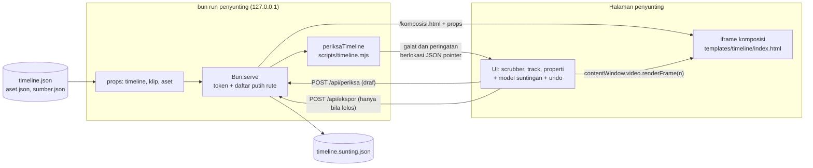
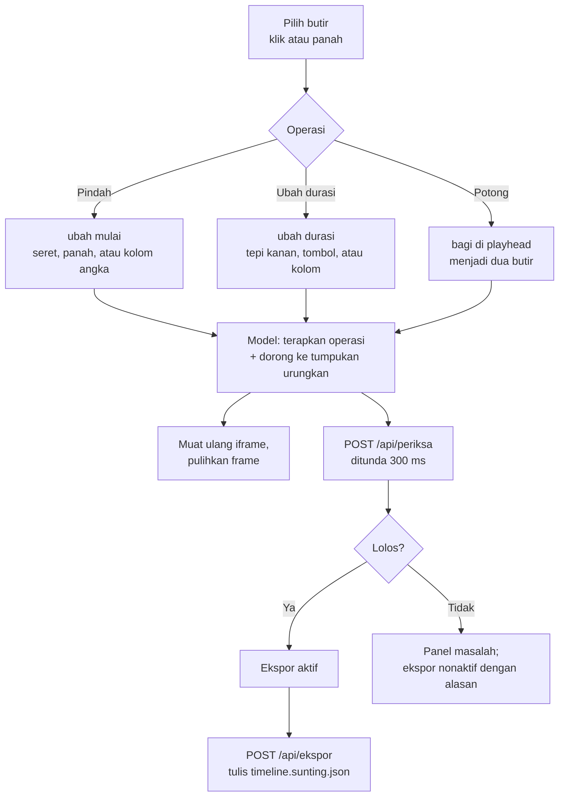
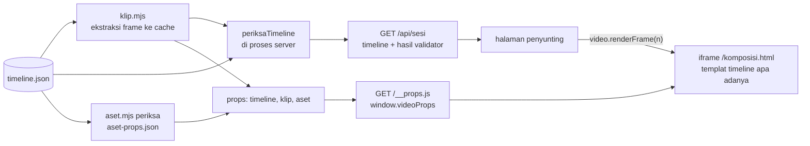
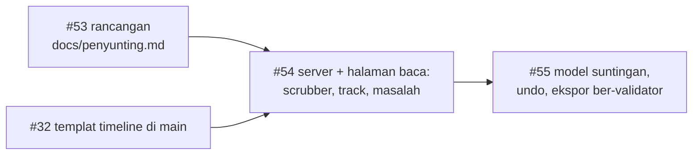

# Rancangan penyunting pratinjau lokal (F6)

## Metadata

- Version: `v1.1.0`
- Last updated: `2026-11-08`
- Changeset: `Issue #54 diimplementasikan: bagian Kondisi nyata (#54) mendokumentasikan perintah bun run penyunting, server Bun.serve berpengerasan, halaman baca-saja (scrubber, grid track, properti, masalah), hasil uji piksel identik dengan render --still, aksesibilitas yang diterapkan, dan sembilan penyimpangan dari rancangan beserta alasannya. Sebelumnya: dokumen baru rancangan penyunting pratinjau lokal F6 (issue #53).`

> **Status: #54 (tampilan baca-saja) sudah diimplementasikan; #55 (penyuntingan dan ekspor) belum.** Bagian [Kondisi nyata (#54)](#kondisi-nyata-54) menggambarkan kode yang ada di repo. Bagian lain (arsitektur, antarmuka, alur penyuntingan, #55) tetap rancangan yang disetujui pemilik pada 2026-11-08 (issue #53); penyimpangan #54 dari rancangan dicatat di [Penyimpangan dari rancangan (#54)](#penyimpangan-dari-rancangan-54).

Dasar rancangan ini adalah [timeline.md](timeline.md) (format dan validator), [arsitektur.md](arsitektur.md#protokol-windowvideo-dan-renderframe) (protokol `window.video` dan `renderFrame`), [api-runtime.md](api-runtime.md#mode-url) (mode URL), dan [aksesibilitas.md](aksesibilitas.md). Ketergantungan: templat render `templates/timeline/` dan penjadwal `scripts/timeline.js` (issue #32) harus sudah di `main` sebelum #54 dimulai.

## Tujuan dan non-tujuan

**Tujuan.** Alat bantu visual untuk menyusun `timeline.json`: melihat susunan track dan butir, menggeser scrubber ke frame mana pun dan melihat frame itu persis seperti hasil render, melakukan tiga penyuntingan dasar (pindah, potong, ubah durasi), lalu mengekspor `timeline.json` yang **lolos validator**. Penyunting adalah pelengkap kode dan berkas JSON, bukan penggantinya.

**Non-tujuan** (v1):

| Bukan tujuan | Alasan |
| --- | --- |
| NLE penuh (efek, keyframe visual, kurva, multi-seleksi, magnet, ripple) | Ruang lingkup tak terbatas; `timeline.json` tetap bisa disunting tangan untuk hal itu |
| Layanan daring, akun, kolaborasi, penyimpanan awan | Repo ini alat lokal; konten tidak keluar mesin (AGENTS.md aturan 5) |
| Menambah butir atau track baru, mengganti media | Butuh pemilih aset dan sumber, memicu pemuatan ulang klip (ekstraksi ffmpeg) |
| Memutar audio atau menampilkan gelombang | Templat render belum merender audio; audio dirakit `audio.mjs` |
| Mengubah skema, aturan validator, atau protokol runtime | Penyunting hanya konsumen; validator tetap sumber tunggal |
| Dependensi baru (framework UI, bundler, pustaka validasi) | Halaman memakai JavaScript, HTML, dan CSS biasa; `playwright-core` yang sudah ada dipakai untuk uji |

## Arsitektur

Pilihan inti: **server lokal kecil (`Bun.serve`) yang melayani halaman penyunting dan memanggil `periksaTimeline` dari `scripts/timeline.mjs` langsung di proses yang sama.** Browser tidak punya validator sendiri.



### Memuat timeline

1. `bun run penyunting <timeline.json>` membaca berkas, lalu menjalankan langkah yang sama dengan `templates/timeline/siapkan.mjs` (`klip`, `timeline periksa --klip-props`, `aset periksa`) sekali di awal. Hasilnya `klip-props.json`, `aset-props.json`, dan konteks manifest (`muatKonteks`) disimpan di memori server. Penyunting v1 tidak menambah media, jadi semuanya tidak berubah selama sesi.
2. Timeline yang sudah ditolak validator tetap bisa dibuka (agar galatnya bisa diperbaiki di penyunting), tetapi pembukaan awal menampilkan galat di panel masalah dan frame ditampilkan bila `renderFrame` mampu.
3. Server menyimpan **satu** salinan kerja timeline (draf) di memori; browser mengirim perubahan sebagai timeline penuh (batas 5 MB seperti `BATAS_BERKAS_BYTE`), bukan tambalan, supaya tidak ada dua model yang bisa menyimpang.

### Menampilkan frame (deterministik)

Frame **tidak digambar ulang oleh penyunting**; penyunting hanya memanggil protokol yang sama dengan renderer.

- Server melayani `templates/timeline/index.html` apa adanya di rute `/komposisi.html`, dengan satu tag `<script src="/__props.js?v=<hash>">` disisipkan di `<head>` yang menetapkan `window.videoProps = { timeline, klip, aset, akarAset }` sebelum skrip templat berjalan. Ini setara dengan suntikan `window.videoProps` oleh `render.mjs`; templat **tidak diubah** dan tidak perlu mode URL baru (`?props=` tidak dipakai karena batas panjang URL).
- `akarAset` dan jalur frame klip yang di `siapkan.mjs` berupa URL `file://` dipetakan server ke rute `/media/aset/...` dan `/media/klip/...` yang hanya melayani isi folder manifest. #54 memverifikasi bahwa `jalurFrameKlip` dan `asetGambar` bekerja dengan awalan `http://127.0.0.1:<port>/media/...`; bila templat mengandaikan `file://` secara kaku, itu dicatat sebagai temuan dan diselesaikan lewat props, bukan lewat salinan templat.
- Penyunting menunggu `iframe.contentWindow.video` siap, lalu memanggil `await video.renderFrame(n)` untuk `n` bulat di `0..durationInFrames-1` (protokol berurutan: permintaan yang menumpuk saat scrubbing digabung, hanya yang terbaru dijalankan, seperti `pasangPratinjau` di runtime). Setelah timeline disunting, iframe dimuat ulang dengan `v` baru dan frame yang sama dipulihkan.
- Pratinjau 100% memasang iframe pada `width` x `height` komposisi tanpa transformasi. Mode "muat ke panel" memakai `transform: scale()` hanya untuk tampilan; rasternya bukan hasil render, jadi hanya mode 100% yang diklaim identik.
- Pemutaran memakai `requestAnimationFrame` dan `performance.now` **hanya di kerangka penyunting** (sama dengan `pasangPratinjau`); yang digambar tetap fungsi murni dari nomor frame, jadi aturan determinisme komposisi tidak dilanggar.

**Definisi "sama dengan render"** untuk uji: pada mode 100%, tangkapan elemen iframe untuk frame N sama piksel demi piksel dengan `bun scripts/render.mjs templates/timeline/index.html --props-file ... --still N`, dengan peramban, viewport, dan skala yang sama. Bila ternyata raster bisa berbeda di antara dua proses (pemanasan dua frame pertama, lihat arsitektur.md), uji memakai cadangan: bandingkan `outerHTML` terserialisasi komposisi setelah `renderFrame(N)` di sesi penyunting dengan sesi `render-sesi.mjs`. Keduanya dicoba di #54 dan yang dipakai dicatat di dokumen ini.

### Di mana validasi terjadi

Satu-satunya validator adalah `periksaTimeline` (skema `data/skema-timeline.json` ditambah aturan R01-R17 dan W01-W09). Ia memakai `node:fs`, ffprobe, dan manifest nyata, jadi **tidak bisa dan tidak boleh disalin ke browser**: salinan akan menyimpang dari validator (alasan yang sama dengan pilihan "validator ditulis tangan, skema dibaca langsung" di timeline.md).

| Opsi | Kelebihan | Kekurangan | Penilaian |
| --- | --- | --- | --- |
| **A. Server lokal `Bun.serve`** memanggil `periksaTimeline` | Sumber tunggal terjamin; umpan balik berlokasi saat menyunting; manifest dan ffprobe dibaca sekali; tanpa dependensi (Bun bawaan); pola sama dengan CLI lain | Ada proses yang mendengarkan port (perlu pengerasan); satu perintah tambahan | **Direkomendasikan** |
| B. Ekspor lalu jalankan `bun run timeline periksa` manual | Tanpa server; permukaan serangan nol | Galat baru diketahui setelah ekspor; pengguna harus menerjemahkan JSON pointer sendiri; AC "ekspor lolos validator" tidak dijamin oleh alat | Dipertahankan sebagai jalur cadangan (tombol unduh) |
| C. Menyalin validator ke JavaScript browser | Tanpa server | Dua sumber kebenaran; tak bisa ffprobe dan manifest; melanggar prinsip fail-closed | Ditolak |
| D. Halaman statis plus File System Access API | Tanpa server | Hanya Chromium; validasi tetap tak ada; izin berkas per sesi | Ditolak |

**Keamanan server (wajib, uji otomatis):**

- Mengikat `127.0.0.1` saja (bukan `0.0.0.0`); port 0 (acak) bawaan, `--port` opsional.
- Token acak per sesi (`crypto.getRandomValues`, 128 bit) di URL yang dicetak CLI dan di header `X-Awvd-Token`; semua `POST` dan rute data menolak tanpa token (403). Pemeriksaan `Host` (hanya `127.0.0.1:<port>` dan `localhost:<port>`) dan `Origin` (harus sama) menahan DNS rebinding dan CSRF dari halaman lain di peramban yang sama.
- Rute daftar putih: halaman penyunting, `scripts/runtime.js`, `transisi.js`, `timeline.js`, `templates/timeline/index.html`, `/media/aset|klip/` (hanya folder manifest, `..` dan tautan simbolik keluar folder ditolak), `/api/*`. Rute lain 404; tidak ada daftar direktori.
- Header `Content-Security-Policy: default-src 'self'; img-src 'self' data: blob:; media-src 'self' blob:; style-src 'self' 'unsafe-inline'; connect-src 'self'; frame-ancestors 'self'` (gaya inline dibutuhkan templat). Tidak ada permintaan jaringan keluar dari halaman penyunting.
- Penulisan berkas: hanya ke satu jalur yang ditentukan CLI. Bawaan **tidak menimpa** sumber: ekspor menulis `<nama>.sunting.json` di folder yang sama; `--timpa` mengizinkan menimpa dan dibuat eksplisit. Ekspor menolak (422) bila validator menggagalkan timeline, sehingga berkas keluaran selalu lolos. Penulisan atomik (tulis ke berkas sementara lalu `rename`).
- Tanpa data nyata: contoh dan uji memakai `templates/timeline-contoh/` (data fiktif).

## Antarmuka

### Wireframe

```text
+----------------------------------------------------------------------------------+
| awvd penyunting  timeline-contoh/timeline.json   [Urungkan][Ulangi]  [Ekspor]    |
| Status: Lolos validator (0 galat, 2 peringatan)     (region aria-live=polite)    |
+--------------------------------------------+-------------------------------------+
| PRATINJAU  (iframe komposisi, 1280x720)    | PROPERTI  butir "adegan-2"          |
|                                            |  Jenis      video                   |
|        [ frame 75 ]                        |  Mulai      [  75 ] frame           |
|                                            |  Durasi     [  80 ] frame           |
|                                            |  Akhir      155 (hanya baca)        |
|  Tampilan: (o) 100%  ( ) Muat ke panel     |  Transisi   pudarMelalui 15 frame   |
+--------------------------------------------+  [Potong di playhead]               |
| [Putar] [|<][<][>][>|]  Frame [ 75 ] 2,50 s|  [Geser -1][Geser +1]               |
| scrubber: |====o--------------------|     |  [Durasi -1][Durasi +1]             |
+--------------------------------------------+-------------------------------------+
| TRACK                          0    1s    2s    3s    4s    ...   [Zum -][Zum +]  |
| t-latar  (video)    [adegan-1======][adegan-2=====][adegan-3====]                |
| t-logo   (overlay)       [logo======================]                           |
| t-teks-1 (teks)        [judul===][subjudul====]                                  |
| t-narasi (audio)  [narasi======================]                                 |
| t-musik  (audio)  [musik==================================]    ^ playhead (75)  |
+----------------------------------------------------------------------------------+
| MASALAH (galat dan peringatan; tiap baris menaruh fokus ke butir terkait)        |
|  galat [R04] /track/3/butir/1  tumpang tindih 100 frame dengan "judul" ...       |
+----------------------------------------------------------------------------------+
```

Tata letak sempit (lebar < 720 px): panel menumpuk vertikal (pratinjau, scrubber, properti, track, masalah); area track bergulir horizontal.

### Komponen

| Komponen | Perilaku |
| --- | --- |
| Scrubber | `input type="range"` natif (min 0, max `durationInFrames - 1`, step 1) berlabel "Posisi frame", ditambah kolom angka "Frame" dan tombol lompat (awal, mundur 1, maju 1, akhir) dan lompat ke penanda. Natif dipilih karena semantik, papan ketik, dan pembaca layar gratis. |
| Daftar track | Satu baris per track menurut urutan di JSON (lapisan atas ditampilkan di atas; indeks 0 paling bawah). Kolom kiri: nama, jenis, status `aktif`. Butir digambar sebagai kotak dengan posisi dan lebar proporsional frame; transisi tampak sebagai irisan tumpang tindih. Hanya butir dalam jendela terlihat yang dibuat di DOM. |
| Panel properti | Bidang angka untuk `mulai` dan `durasi` (alternatif non-seret), jenis, transisi (hanya baca di v1), tombol operasi. Hanya bidang yang disentuh operasi dasar yang bisa diubah. |
| Panel masalah | Daftar `{ kode, lok, pesan }` dari validator; `lok` (JSON pointer) diterjemahkan ke butir sehingga klik atau Enter menaruh fokus ke butir itu. |
| Status | Satu region `aria-live="polite"` mengumumkan hasil validasi, operasi, urungkan, dan ekspor. |

### Alur penyuntingan



**Prinsip: sunting longgar, ekspor ketat.** Keadaan antara boleh melanggar aturan (butir tumpang tindih sementara) agar penyuntingan tidak terasa menolak; validator dijalankan di tiap perubahan dan hasilnya tampil. Ekspor hanya aktif dan hanya diterima server bila `lolos`. Peringatan tidak menghalangi, tetapi tombol "Ekspor ketat" (`--ketat`) tersedia bila ada peringatan.

Operasi dasar (model murni di `scripts/penyunting-model.js`, tanpa DOM, bisa diuji di Bun):

| Operasi | Aturan |
| --- | --- |
| `pindah(id, mulaiBaru)` | Mengubah `mulai`, dijepit ke `0..proyek.durasi - durasi`. Bila butir punya `transisi`, `transisi.durasi` disetel ulang ke tumpang tindih baru dengan butir sebelumnya (aturan R05); tumpang tindih 0 menghapus `transisi` dan menyampaikan pemberitahuan (dapat diurungkan). |
| `ubahDurasi(id, durasiBaru, sisi)` | Sisi kanan: ubah `durasi`. Sisi kiri: `mulai` maju dan `durasi` berkurang sama banyak; untuk butir `video`, `dari` maju sama banyak hanya bila `waktu` identitas, jika tidak operasi sisi kiri dinonaktifkan. Sinkronisasi `transisi` seperti `pindah`. Keyframe dengan `pada >= durasi` dibiarkan agar R07 yang melaporkannya. |
| `potong(id, frame)` | Membagi butir di `frame` (`mulai < frame < akhir`) menjadi dua; butir kedua berid `<id>-b` (dan `-c`, dst. bila bentrok) dan tanpa `transisi`; butir pertama mempertahankan `transisi` masuknya. Untuk `video`, `dari` butir kedua = `dari + (frame - mulai)`. **v1 hanya untuk butir tanpa `waktu`, `properti`, `animasi`, `kenBurns`**, dan bukan butir `audio` (R10: narasi tidak dipotong); selain itu tombol dinonaktifkan dengan alasan tertulis (`aria-describedby`), karena membagi keyframe dan peta waktu butuh keputusan desain tersendiri. |

Urungkan: tumpukan snapshot `structuredClone` timeline (maks 100 langkah, tumpukan ulangi terpisah), tanpa tambalan agar sederhana dan tahan galat. Satu seretan atau satu rangkaian ketikan di kolom angka menjadi **satu** langkah. Memuat ulang halaman memulai dari timeline di server (draf server), tumpukan urungkan tidak bertahan (batasan v1).

Batas ukuran: validasi per perubahan memakai `konteks` yang di-cache, jadi mahal hanya di langkah pertama. Rancangan diuji dengan `templates/timeline-contoh/` dan timeline sintetis 500 butir; batas yang lebih besar (skema mengizinkan 64 track dan 2000 butir per track) tidak dijanjikan.

## Aksesibilitas

Sasaran: WCAG 2.2 level AA untuk antarmuka penyunting (kerangka, bukan isi video; isi video diatur [aksesibilitas.md](aksesibilitas.md) dan validator). Ini sasaran rancangan; **klaim kepatuhan hanya bila uji manual dan otomatis di bawah dilaksanakan**, dan awvd tidak menyatakan sertifikasi.

**Papan ketik dan fokus**

| Kebutuhan | Rancangan |
| --- | --- |
| Semua fungsi dapat dilakukan dengan papan ketik (SC 2.1.1) dan tanpa gerakan seret (SC 2.5.7) | Setiap operasi punya jalur non-seret: kolom angka dan tombol di panel properti plus pintasan di bawah. Seret dengan penunjuk adalah tambahan. |
| Tanpa jebakan fokus (SC 2.1.2); urutan fokus logis (SC 2.4.3) | Urutan tab: bilah atas, pratinjau (kontrol), scrubber, track, properti, masalah. `Esc` meninggalkan mode sunting butir. |
| Fokus terlihat dan tidak tertutup (SC 2.4.7, 2.4.11) | Garis fokus 3 px dengan kontras >= 3:1 terhadap latar sekitarnya; panel lengket tidak menutup elemen terfokus (`scroll-margin`). |
| Pintasan karakter tunggal (SC 2.1.4) | Pintasan hanya aktif saat fokus di dalam widget track atau scrubber (bukan global); pintasan global memakai modifier (`Ctrl+Z`, `Ctrl+Shift+Z`, `Ctrl+S` untuk ekspor). Daftar pintasan ada di dialog bantuan yang bisa dibuka dengan tombol. |

Pintasan dalam widget track (pola grid APG: baris = track, sel = butir, tabindex berpindah):

| Tombol | Fungsi |
| --- | --- |
| Kiri atau Kanan | Butir sebelumnya atau berikutnya di track yang sama |
| Atas atau Bawah | Track di atas atau di bawah, butir yang paling dekat waktunya |
| `Home` atau `End` | Butir pertama atau terakhir di track |
| `Enter` atau `F2` | Masuk mode sunting butir (diumumkan: "Mode sunting, panah menggeser 1 frame") |
| Kiri atau Kanan (mode sunting) | Pindah 1 frame; dengan `Shift` 1 detik |
| `Alt+Kiri` atau `Alt+Kanan` (mode sunting) | Ubah durasi sisi kanan 1 frame; dengan `Shift` 1 detik |
| `S` | Potong di playhead (hanya bila diperbolehkan) |
| `Esc` | Keluar mode sunting (perubahan tetap, dapat diurungkan) |
| `Spasi` pada scrubber | Putar atau jeda |

**Semantik dan ARIA.** Landmark: `header`, `main` (pratinjau dan track), `aside` (properti), `region` berlabel (masalah). Scrubber natif berlabel "Posisi frame" dengan `aria-valuetext` "frame 75, 2,50 detik". Track memakai `role="grid"` dengan `aria-label`, tiap baris `role="row"` berisi `role="rowheader"` (nama dan jenis track) dan sel butir `role="gridcell"` yang punya nama aksesibel "adegan-2, video, mulai frame 75, durasi 80 frame, bertransisi pudarMelalui" dan `aria-selected`. Hasil operasi, urungkan, validasi, dan ekspor diumumkan lewat `aria-live="polite"` (SC 4.1.3); galat validasi yang memblokir ekspor memakai `role="alert"`. Tombol yang dinonaktifkan karena aturan (mis. potong) memakai `aria-disabled` dan teks alasan. Iframe komposisi berjudul ("Pratinjau frame 75"); isinya sudah memberi `aria-label` pada kanvas klip.

**Visual**

- Kontras teks >= 4,5:1 dan komponen UI dan batas fokus >= 3:1 (SC 1.4.3, 1.4.11) untuk tema terang dan gelap; token warna didefinisikan sekali di CSS dan **dihitung di uji** dengan `kontras` dari `runtime.js`. Dukungan `forced-colors` (batas butir memakai `CanvasText`/`Highlight`).
- Informasi tidak hanya lewat warna (SC 1.4.1): jenis butir dibedakan oleh label teks dan pola/ikon, galat vs peringatan oleh kata dan ikon; butir terpilih memakai garis tebal selain warna.
- Ukuran target >= 24 x 24 px CSS (SC 2.5.8); gagang tepi durasi 24 px lebar dengan alternatif tombol.
- Reflow pada lebar 320 px (SC 1.4.10) dan zum teks 200%: panel menumpuk; hanya area track yang bergulir dua arah (pengecualian untuk konten data dua dimensi) dan penggulirnya dapat difokuskan dan dioperasikan papan ketik. Tidak ada tooltip yang hanya muncul saat hover.
- Zum timeline (+/-) mengubah piksel per frame; bawaan menampilkan seluruh durasi.

**Gerak dan kilatan.** Penyunting sendiri tidak memakai animasi atau transisi CSS (`prefers-reduced-motion` dihormati: tanpa gulir halus, kepala putar tidak beranimasi). Pemutaran **tidak otomatis**; bawaan jeda. Kilatan dalam isi video dibatasi validator (R06, R14, W06); penyunting tidak menambah kilatan, dan sebelum memutar ia menampilkan peringatan bila validator memberi W06. Profil `kurangiGerak` timeline tidak diubah penyunting; tampilannya sama dengan render.

**Bahasa dan pesan.** `lang="id"`; pesan galat memuat apa yang salah, lokasinya, dan cara memperbaikinya bila validator memberi tahu (SC 3.3.1, 3.3.3).

## Kondisi nyata (#54)

Tampilan baca-saja: scrubber, daftar track, panel properti dan masalah, serta frame pratinjau yang sama dengan hasil render. Tidak ada penyuntingan dan tidak ada penulisan berkas (kecuali cache klip dan aset); semua metode selain `GET` ditolak dengan 405. Penyuntingan dan ekspor adalah #55.

### Perintah

```bash
bun run penyunting templates/timeline-contoh/timeline.json [--port N] [--buka] [--draf] [--cache DIR]
```

| Opsi | Arti |
| --- | --- |
| `<timeline.json>` | wajib, tepat satu |
| `--port N` | port tetap; bawaan `0` (acak) |
| `--buka` | membuka URL di peramban bawaan (`xdg-open`, `open`, atau `start`) |
| `--draf` | seperti `timeline periksa --draf`; diteruskan juga ke `klip.mjs` |
| `--cache DIR` | folder cache frame klip dan props aset; bawaan `.cache/awvd/penyunting` (di `.gitignore`) |
| `--help` | pemakaian |

Keluaran: ringkasan (`N track, M butir, F frame @ fps`), status validator, lalu `penyunting: http://127.0.0.1:<port>/?token=<32 heksadesimal>`. Kode keluar: `0` berhenti normal (`Ctrl+C` atau `SIGTERM`); `2` berkas hilang, lebih dari 5 MB, bukan JSON, argumen atau port tidak valid; `1` galat tak terduga. Timeline yang hanya ditolak validator tetap dibuka (galat tampil di panel masalah); kegagalan langkah klip atau aset dicatat sebagai masalah muat (`MUAT`) dan tidak menghentikan server.

Implementasi: `scripts/penyunting.mjs` (CLI dan server; fungsi `muatSesi` dan `mulaiServer`), `scripts/penyunting/index.html`, `penyunting.js`, `penyunting.css`, dan `scripts/uji-penyunting.mjs`. Tanpa dependensi baru.

### Pemuatan



Langkah klip dan aset sama dengan `templates/timeline/siapkan.mjs` (proses terpisah, tanpa Chromium); validasi memanggil `periksaTimeline` (satu-satunya validator) langsung di proses server. Hasil props disimpan di memori. Jalur media di props dipetakan dari `file://` ke `/media/klip` dan `/media/aset` (relatif terhadap satu asal), sehingga templat dilayani **tanpa diubah**: server hanya menyisipkan satu tag `<script src="/__props.js?v=<hash>">` setelah `<head>`.

### Rute dan pengerasan

Urutan pemeriksaan tiap permintaan: `Host` (hanya `127.0.0.1:<port>` dan `localhost:<port>`), `Sec-Fetch-Site` (tolak `cross-site`), `Origin` (harus sama), token, metode, lalu rute. Gagal di tiga pertama atau token: 403; metode bukan `GET`: 405; rute atau media tak dikenal: 404.

| Rute | Isi |
| --- | --- |
| `/` | `scripts/penyunting/index.html`; juga memasang cookie sesi |
| `/penyunting.js`, `/penyunting.css` | berkas halaman |
| `/scripts/runtime.js`, `transisi.js`, `timeline.js` | skrip yang dimuat templat |
| `/komposisi.html` | `templates/timeline/index.html` ditambah satu tag props |
| `/__props.js` | `window.videoProps = { timeline, klip, aset, akarAset }` |
| `/api/sesi` | `{ versi, berkas, draf, timeline, validasi, masalahMuat }` |
| `/media/aset/<jalur>` | hanya `jalur` yang tercantum di `aset-props.json` (bukan audio) |
| `/media/klip/<folder>/<nomor>.jpg` atau `.png` | hanya folder klip hasil ekstraksi sesi ini |

- **Token.** 128 bit acak per sesi (`randomBytes(16)`), dibandingkan dengan `timingSafeEqual`. Diterima lewat header `X-Awvd-Token`, parameter `?token=`, atau cookie `awvd_token` (`HttpOnly; SameSite=Strict`) yang dipasang oleh halaman pertama supaya subsumber iframe (skrip dan gambar, yang tidak bisa membawa header) tetap terotentikasi.
- **Media.** Segmen jalur didekode per segmen; segmen `..`, `.`, kosong, atau berisi garis miring, garis miring terbalik, atau NUL ditolak. Berkas harus ada di daftar putih, berupa berkas reguler, dan hasil `realpath` harus tetap di dalam folder dasarnya (tautan simbolik keluar folder ditolak, 404). Respons media memakai `Content-Security-Policy: default-src 'none'; sandbox`.
- **CSP.** Halaman penyunting: `default-src 'self'; img-src 'self' data: blob:; media-src 'self' blob:; style-src 'self' 'unsafe-inline'; connect-src 'self'; frame-ancestors 'self'; base-uri 'none'; form-action 'none'; object-src 'none'` (tanpa `script-src` longgar). Komposisi: sama, ditambah `script-src 'self'` dan hash `sha256` setiap `<script>` inline templat (dihitung dari berkas templat), tanpa `unsafe-inline` untuk skrip. Semua respons: `Cache-Control: no-store`, `X-Content-Type-Options: nosniff`, `Referrer-Policy: no-referrer`, `Cross-Origin-Resource-Policy: same-origin` (respons media: CSP `sandbox`).
- Hanya mendengarkan `127.0.0.1` (`hostname` eksplisit); diuji lewat `/proc/net/tcp` dan percobaan sambung ke alamat antarmuka non-loopback.
- Cookie tidak terisolasi per port: proses lain di `127.0.0.1` pada port berbeda ikut menerimanya bila peramban mengirimnya. Risiko ini diterima untuk alat lokal satu pengguna; token hanya melindungi satu server dan satu sesi.

### Halaman

| Bagian | Perilaku |
| --- | --- |
| Pratinjau | iframe `/komposisi.html` pada ukuran komposisi (mode **100%**, identik dengan render) atau diskalakan `transform: scale()` (mode **Muat ke panel**, hanya tampilan). Area pratinjau bergulir sendiri dan dapat difokuskan. Permintaan frame yang menumpuk digabung: hanya yang terbaru dijalankan. Setelah `renderFrame(n)` selesai, font yang belum termuat ditunggu (jaring pengaman yang sama dengan `ambil` di `render-sesi.mjs`); baru kemudian atribut `data-frame-tampil` iframe diisi `n`. |
| Scrubber | `input type="range"` natif berlabel "Posisi frame" (`min` 0, `max` durasi-1, `step` 1, `aria-valuetext` "frame 75, 2,50 detik"); panah, `Home`, `End` bawaan peramban; `PageUp`/`PageDown` = 10 frame; `Spasi` = putar/jeda; kolom angka "Frame" (nilai luar jangkauan dijepit dan diumumkan); tombol Awal, Mundur 1, Maju 1, Akhir; pemilih penanda dari `timeline.penanda`. |
| Pemutaran | `requestAnimationFrame` dan `performance.now` hanya di kerangka halaman; bawaan jeda; berhenti di frame terakhir. Bila validator memberi W06 (kilatan), tombol Putar pertama hanya mengumumkan peringatan; tekan lagi untuk tetap memutar. Tanpa audio. |
| Track | `role="grid"`: satu baris per track (indeks terbesar di atas), `rowheader` berisi nama, jenis, dan "(nonaktif)"; sel butir `role="gridcell"` dengan posisi dan lebar sebanding frame (minimum 24 px), glif jenis (V G W T K A) dan gaya garis berbeda per jenis; butir yang bertumpuk dipisah ke sublajur dan irisan transisi diarsir. Penggaris waktu, penanda, playhead, zum 100% sampai 3200% (klik penggaris menaruh playhead). |
| Properti | Hanya baca: id, jenis, track, mulai, durasi, akhir, transisi, klip/aset/warna/isi, jumlah masalah terkait, tombol "Ke awal butir". |
| Masalah | Galat, masalah muat, dan peringatan dengan kode, lokasi JSON pointer, dan pesan (paling banyak 200 baris); baris yang menunjuk ke butir berupa tombol yang menaruh fokus ke butir itu. Jumlah ada di judul. |
| Status | Satu `aria-live="polite"`: hasil validator saat dibuka, pengumuman jepit, penanda, zum, jeda; `role="alert"` bila sesi tidak dapat dimuat. Galat pratinjau memakai `role="alert"`. |

Timeline yang ditolak validator tetap digambar defensif (bentuk salah diabaikan, bukan melempar). Bila templat menolaknya (mis. transisi tak sesuai tumpang tindih), iframe tidak punya `window.video`: halaman menampilkan "Pratinjau tidak tersedia" dan galat berlokasi tetap tampil di panel masalah.

Pintasan papan ketik di widget track (tanpa mode sunting):

| Tombol | Fungsi |
| --- | --- |
| Kiri, Kanan | Butir sebelumnya atau berikutnya di track yang sama (menurut waktu mulai) |
| Atas, Bawah | Track di atas atau di bawah (melewati track kosong), butir yang waktu mulainya paling dekat |
| `Home`, `End` | Butir pertama atau terakhir di track |
| `Enter` | Pilih butir dan pindahkan playhead ke awal butir (diumumkan) |

Fokus menyeleksi butir (`aria-selected`) dan memperbarui panel properti. Tepat satu sel punya `tabindex="0"` (roving). `F2`, `S`, dan `Alt`+panah adalah mode sunting di #55.

### Frame sama dengan render

Definisi: pada mode 100%, tangkapan elemen iframe untuk frame N sama **piksel demi piksel** dengan `bun scripts/render.mjs templates/timeline/index.html --props-file <props siapkan> --still N`, dengan peramban, viewport halaman 1920 x 1300, dan skala 1 yang sama. Uji `(j)` memeriksa tujuh frame (82 dan 147 di dalam transisi `pudarMelalui` dan `celup`, 260 di tepi butir `pip-beku`, 350 tanpa kanvas klip, 390 awal kredit, 420 teks kredit penuh, 449 frame terakhir), dengan pemanasan dua frame sebelumnya seperti `JUMLAH_PEMANASAN` di `render-sesi.mjs`, dan membandingkan MD5 piksel hasil dekode ffmpeg. Hasil: semua identik. Cadangan `outerHTML` **tidak dipakai** karena raster terbukti identik.

Temuan penting: tanpa CSS khusus, iframe **tidak** identik. Frame tanpa kanvas klip (350 ke atas) berbeda 1 tingkat warna pada gradien logo (sekitar 2.000 piksel) dan sampai 45 tingkat pada tepi huruf teks kredit (antialiasing berbeda), sedangkan frame berkanvas identik. Dugaan penyebabnya adalah perbedaan penempatan lapisan komposit antara dokumen yang dibuka sendirian dan subframe. `will-change: opacity` pada `#komposisi` (lapisan sendiri tanpa transformasi) membuat semua frame uji identik; `will-change: transform` dan `translateZ(0)` tidak cukup. Kestabilan ini bergantung pada versi Chromium, sehingga uji `(j)` adalah penjaganya: bila gagal setelah pembaruan Chromium, perbaiki CSS iframe, jangan melonggarkan uji.

### Aksesibilitas yang diterapkan

Sasaran WCAG 2.2 AA untuk kerangka penyunting (bukan isi video). Yang dilaksanakan dan diuji otomatis di `scripts/uji-penyunting.mjs`: nama aksesibel semua kontrol interaktif (pohon aksesibilitas CDP), landmark `banner`, `main`, `complementary`, `region`, dan `status`, `lang="id"`, scrubber dan grid sesuai tabel di atas, urutan tab (pratinjau, scrubber, track; grid satu perhentian), tanpa pintasan karakter global (SC 2.1.4), sasaran minimal 24 px (SC 2.5.8), kontras token terang dan gelap dihitung dengan `kontras` runtime (teks minimal 4,5:1; komponen UI, batas, dan fokus minimal 3:1; SC 1.4.3 dan 1.4.11), jenis butir tidak hanya lewat warna (glif dan gaya garis, SC 1.4.1), reflow 320 px tanpa gulir horizontal halaman dengan area track dan pratinjau yang bergulir sendiri dan dapat difokuskan (SC 1.4.10), tanpa animasi atau transisi CSS, dan `forced-colors` ditangani di CSS (belum diuji otomatis). **Belum dilakukan:** uji manual dengan pembaca layar, uji zum teks 200% di peramban sebenarnya (hanya dicakup uji lebar 160 px), dan jalur non-seret untuk penyuntingan (SC 2.5.7; relevan di #55). Tidak ada klaim kepatuhan atau sertifikasi.

### Pengujian

`bun run uji:penyunting` (juga bagian `bun run uji` dan CI) menjalankan 17 uji dalam sekitar 15 detik: CLI dan kode keluar; pengerasan server (tanpa token, token salah, `Host`/`Origin`/`Sec-Fetch-Site` asing lewat soket mentah, metode, rute, `..`, tautan simbolik keluar folder untuk frame klip dan aset); header CSP; kesesuaian DOM dengan `Timeline.rencana`; scrubber dan papan ketik; pemutaran dan zum; widget track; pohon aksesibilitas; tujuh frame piksel identik dengan `render.mjs --still`; timeline ditolak validator (galat berlokasi, klik masalah memfokuskan butir); `--draf`; timeline sintetis 500 butir (dibuka sekitar 100 ms); reflow 320 px; kontras token dan tema gelap; larangan animasi CSS, `Date.now`, dan `Math.random`; serta, selama seluruh sesi, tidak ada permintaan jaringan non-lokal dan tidak ada galat konsol atau halaman. Memakai `playwright-core` dan `cariBrowser` yang sudah ada.

### Penyimpangan dari rancangan (#54)

| # | Rancangan | Kenyataan | Alasan |
| --- | --- | --- | --- |
| 1 | Token di URL dan header | Ditambah cookie sesi `HttpOnly; SameSite=Strict` dan pemeriksaan `Sec-Fetch-Site` | Subsumber iframe (skrip templat, gambar klip, font) tidak dapat membawa header atau parameter token |
| 2 | CSP `default-src 'self'` untuk semua | Komposisi memakai `script-src 'self'` plus hash sha256 skrip inline templat | Templat (tidak diubah) memakai `<script>` inline; hash lebih ketat daripada `unsafe-inline` |
| 3 | `/media/aset` melayani isi folder manifest | Hanya berkas yang tercantum di `aset-props.json` (bukan audio) | Lebih sempit; folder manifest berisi `timeline.json`, `sumber.json`, dan klip mentah |
| 4 | `akarAset` berawalan `http://127.0.0.1:<port>/media/...` | Awalan relatif `/media/aset` dan `/media/klip` | Satu asal, tanpa menyuntik port; `jalurFrameKlip`, `asetGambar`, dan `pasangFont` bekerja tanpa mengubah templat (diverifikasi, uji `(c)` dan `(j)`) |
| 5 | Iframe identik dengan render | Identik hanya dengan `will-change: opacity` pada iframe | Lihat [Frame sama dengan render](#frame-sama-dengan-render) |
| 6 | Hanya butir dalam jendela terlihat dibuat di DOM | Semua butir dibuat; tanpa virtualisasi | Roving tabindex dan navigasi papan ketik butuh sel ada; 500 butir dibuka sekitar 100 ms. Batas skema (64 track x 2000 butir) tetap tidak dijanjikan. |
| 7 | Konteks validasi di-cache | `periksaTimeline` dipanggil sekali di awal tanpa cache konteks | Tidak ada penyuntingan di #54; cache diperlukan di #55 |
| 8 | Urutan track "menurut urutan di JSON" | Indeks terbesar di atas (lapisan atas di atas); wireframe di atas hanya ilustrasi | Sesuai kalimat "lapisan atas ditampilkan di atas" |
| 9 | `Enter` atau `F2` masuk mode sunting | `Enter` memindahkan playhead ke awal butir; `F2` belum dipakai | Mode sunting adalah #55 |

Opsi CLI `--cache` dan `--help` ditambahkan (tidak ada di rancangan). Butir yang sangat pendek (di bawah 24 px) saling menumpuk secara visual pada zum 100% sehingga klik penunjuk bisa mengenai tetangganya; papan ketik dan zum tidak terdampak.

## Pemecahan pekerjaan

Urutan: **#53 (dokumen ini) -> #54 -> #55**, berurutan (tidak paralel: keduanya menyentuh `scripts/penyunting*` dan dokumen yang sama). Bila #54 membesar, pecah server dan halaman menjadi dua PR tanpa mengubah AC akhir.



### #54 scrubber dan daftar track (M) - selesai

Status: selesai; kondisi nyatanya di [Kondisi nyata (#54)](#kondisi-nyata-54). Teks di bawah adalah rancangan asli (daftar Acceptance Criteria dipertahankan sebagai jejak; keduanya dipenuhi oleh uji `(a)` sampai `(z)` di `scripts/uji-penyunting.mjs`, dengan penyimpangan yang tercatat).

Isi: `scripts/penyunting.mjs` (CLI `bun run penyunting <timeline.json> [--port N] [--buka] [--draf]`, server, token, daftar putih rute, pemuatan seperti siapkan), `scripts/penyunting/` (halaman `index.html`, `penyunting.js`, `penyunting.css`), skrip `penyunting` di `package.json`, dan `scripts/uji-penyunting.mjs` ditambahkan ke `bun run uji` dan CI. Tanpa penyuntingan: hanya baca, plus panel masalah dari validator.

Acceptance Criteria yang dipertajam (dapat diuji):

1. `bun run penyunting templates/timeline-contoh/timeline.json` mencetak URL `http://127.0.0.1:<port>/?token=...` dan hanya mendengarkan `127.0.0.1`.
2. Server menolak: tanpa token (403), `Host` atau `Origin` asing (403), `..` atau tautan simbolik keluar folder media (404), rute di luar daftar putih (404). Diuji dengan `fetch` langsung.
3. Halaman menampilkan semua track dan butir contoh dengan jumlah dan posisi sesuai `timeline.json` (dibandingkan dengan keluaran `Timeline.rencana`).
4. Scrubber: panah, `Home`, `End`, `PageUp`/`PageDown` (10 frame), kolom angka, dan tombol lompat menggeser frame; nilai di luar jangkauan dijepit; label dan `aria-valuetext` benar.
5. **Frame yang ditampilkan sama dengan render**: untuk minimal tiga frame (satu di dalam transisi, satu di tepi butir, satu di akhir), tangkapan iframe mode 100% sama dengan `render.mjs --still N` menurut definisi di atas (piksel identik, atau cadangan `outerHTML` bila raster antarproses terbukti tidak stabil; keputusan dicatat di dokumen).
6. Navigasi papan ketik penuh di widget track sesuai tabel pintasan (tanpa mode sunting), fokus terlihat, urutan tab benar; semua kontrol interaktif punya nama aksesibel (diuji dengan menelusuri pohon aksesibilitas Playwright).
7. Pemuatan timeline yang ditolak validator tetap membuka halaman dan menampilkan galat berlokasi; `--draf` meneruskan perilaku `timeline periksa --draf`.
8. Tidak ada permintaan jaringan non-lokal selama sesi (dicatat di uji lewat `page.route`) dan tidak ada galat konsol.
9. Kontras token warna lolos ambang pada tema terang dan gelap (hitung dengan `kontras`); tampilan 320 px tanpa gulir horizontal halaman.

Uji otomatis: `scripts/uji-penyunting.mjs` memakai `playwright-core` dan `cariBrowser` (`scripts/browser.js`) seperti `uji.mjs`, menjalankan server pada port 0 sebagai subproses, tanpa dependensi baru. Dokumen yang diperbarui: `docs/penyunting.md` (bagian "Rancangan" menjadi kondisi nyata), `docs/cli.md` (perintah baru) atau bagian CLI di dokumen ini, `docs/aksesibilitas.md` (baris penyunting), README bagian Perintah utama dan Struktur repo, `CHANGELOG.md`.

### #55 penyuntingan dasar dan ekspor (M)

Isi: `scripts/penyunting-model.js` (UMD murni: `pindah`, `ubahDurasi`, `potong`, tumpukan urungkan), mode sunting di UI, `POST /api/periksa` dan `POST /api/ekspor`, tombol Ekspor dan Ekspor ketat.

Acceptance Criteria yang dipertajam:

1. Uji model (Bun, tanpa browser): tiap operasi pada tiga contoh (video bertransisi, teks, audio) menghasilkan timeline yang diharapkan; `pindah` dan `ubahDurasi` menyinkronkan `transisi.durasi` ke tumpang tindih (R05); `potong` menolak butir `audio`, `waktu`, `properti`, `animasi`, `kenBurns`; mengurungkan lalu mengulangi mengembalikan timeline byte-identik; model tidak bermutasi masukan.
2. Properti berbasis acak: untuk deretan operasi acak ber-seed (`acak(seed)`, bukan `Math.random`), model tidak pernah menghasilkan id ganda (R01) dan tidak pernah menghasilkan butir di luar `0..proyek.durasi` (R03).
3. E2E: pindahkan `adegan-3`, ubah durasi `judul`, dan potong satu butir `warna` hanya dengan papan ketik; ekspor; berkas `timeline.sunting.json` lolos `bun run timeline periksa ... --ketat` dengan kode keluar 0 (diuji dengan proses terpisah, bukan hanya fungsi).
4. Penyuntingan yang menghasilkan pelanggaran (mis. dua butir tumpang tindih tanpa transisi) memunculkan galat berlokasi di panel masalah, tombol Ekspor nonaktif dengan alasan, dan `POST /api/ekspor` langsung (tanpa UI) dibalas 422 serta tidak menulis berkas.
5. Ekspor tidak menimpa sumber tanpa `--timpa`; penulisan atomik; berkas keluaran berformat sama dengan sumber (indentasi 2, akhir baris baru).
6. Urungkan dan ulangi lewat papan ketik dan tombol, diumumkan di region live; satu seretan atau satu rangkaian ketikan = satu langkah.
7. Setiap operasi tersedia tanpa seret (SC 2.5.7) dan tanpa pintasan karakter global (SC 2.1.4); uji menjalankan seluruh alur E2E hanya dengan `page.keyboard`.
8. Frame di pratinjau setelah penyuntingan sama dengan `render.mjs --still N` dari timeline hasil ekspor (membuktikan penyunting dan render memakai jadwal yang sama).

Dokumen yang diperbarui: `docs/penyunting.md`, `docs/timeline.md` (alur penyuntingan), `docs/aksesibilitas.md`, README (perintah dan struktur), `docs/roadmap.md` (paritas "Penyunting visual"), `docs/log-keputusan.md`, `CHANGELOG.md`.

## Risiko dan keputusan untuk pemilik

Risiko terkelola dalam rancangan: raster iframe berbeda dari render (dua definisi uji, hanya 100% yang diklaim), serangan ke server lokal (token, `Host`/`Origin`, rute daftar putih, CSP, bawaan tidak menimpa), keluaran tidak valid (ekspor hanya bila validator lolos), jumlah butir sangat besar (virtualisasi, batas yang diuji dicatat), dan templat `file://` kaku (diverifikasi di #54).

Tiga keputusan, semuanya **disetujui pemilik sesuai rekomendasi pada 2026-11-08** (dicatat di [log-keputusan.md](log-keputusan.md)):

| # | Keputusan | Rekomendasi | Alasan |
| --- | --- | --- | --- |
| 1 | Validasi lewat **server lokal `Bun.serve`** (opsi A) atau hanya ekspor lalu `timeline periksa` (opsi B) | **A**, B sebagai cadangan unduh | Sumber tunggal validator dan umpan balik berlokasi; biaya: satu proses yang mendengarkan `127.0.0.1` dengan pengerasan di atas |
| 2 | Kebijakan penulisan berkas oleh server | Bawaan menulis `<nama>.sunting.json`, `--timpa` eksplisit untuk menimpa sumber, ekspor hanya bila lolos | Mencegah kehilangan sumber dan keluaran tak valid; pilihan lain (unduh peramban saja) kehilangan jaminan "lolos validator" |
| 3 | Lingkup v1: tanpa menambah butir atau media, `potong` terbatas pada butir sederhana, tanpa audio dan tanpa tumpukan urungkan lintas muat ulang | **Setuju** | Menjaga #54 dan #55 tetap ukuran M; yang lain tetap bisa lewat penyuntingan JSON dan diusulkan sebagai issue lanjutan |

## Batasan rancangan

- Bagian rancangan #55 belum diverifikasi dengan prototipe. Untuk #54: perilaku `jalurFrameKlip` dan raster iframe sudah diuji (lihat [Kondisi nyata (#54)](#kondisi-nyata-54)); kestabilan raster bergantung pada versi Chromium.
- Kepatuhan WCAG 2.2 AA adalah sasaran; penerapan penuh butuh uji manual dengan pembaca layar yang tidak tercakup uji otomatis repo.
- Pemutaran di penyunting tidak menyertakan audio dan kecepatannya bergantung pada kinerja perangkat; ia bukan pengganti hasil render.

## Changelog

### 2026-11-08 - v1.1.0

- #54 diimplementasikan: bagian Kondisi nyata (perintah, pemuatan, rute dan pengerasan, halaman, frame sama dengan render, aksesibilitas yang diterapkan, pengujian) dan tabel sembilan penyimpangan dari rancangan; status dokumen diperbarui.

### 2026-11-08 - v1.0.0

- Dokumen baru: rancangan penyunting pratinjau lokal F6 (issue #53); tiga keputusan (server lokal `Bun.serve`, keluaran `<nama>.sunting.json` dengan `--timpa` eksplisit, lingkup v1) disetujui pemilik.
