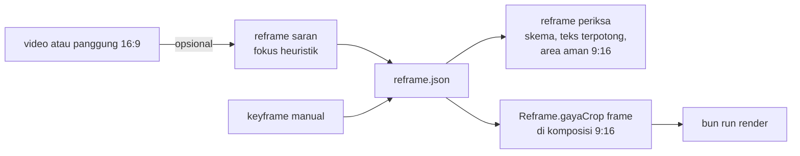

# Reframe 16:9 ke 9:16

## Metadata

- Version: `v1.0.0`
- Last updated: `2026-11-08`
- Changeset: `Dokumen baru: helper window.Reframe (crop berkeyframe deterministik), skema reframe.json, bun run reframe periksa dan saran (saran fokus heuristik opsional, tanpa model), templat reframe-contoh, batas bukti.`

Reframe mengubah komposisi atau klip 16:9 menjadi bingkai 9:16 dengan jendela crop yang bergerak mengikuti titik fokus. Titik fokus ditulis manusia sebagai keyframe (sumber kebenaran, deterministik dari nomor frame); `bun run reframe saran` hanya menyarankan keyframe awal dari video lokal dan selalu ditinjau manusia. Tidak ada pelacakan objek, tidak ada model, dan tidak ada dependensi baru. Ringkasan perintah ada di [cli.md](cli.md#perintah-lain); teks tetap di area aman memakai `areaAmanVertikal` dari [api-runtime.md](api-runtime.md).

## Alur



## Skema `reframe.json` (versi 1)

```json
{
  "versi": 1,
  "sumber": { "lebar": 1920, "tinggi": 1080 },
  "keluar": { "lebar": 1080, "tinggi": 1920 },
  "fps": 30,
  "keyframe": [
    { "frame": 0, "fokus": [0.5, 0.5] },
    { "frame": 60, "fokus": [0.5, 0.5], "easing": "masukKeluarCubic" },
    { "frame": 120, "fokus": [0.78, 0.5], "zoom": 1 }
  ],
  "teksSumber": [{ "x": 700, "y": 380, "w": 520, "h": 90, "dari": 0, "sampai": 60, "catatan": "papan judul sumber" }],
  "teksKeluar": [{ "x": 100, "y": 300, "w": 800, "h": 140, "catatan": "judul" }]
}
```

| Kunci | Aturan |
| --- | --- |
| `sumber`, `keluar` | `{lebar, tinggi}` positif (piksel). |
| `keyframe[].frame` | Bilangan bulat >= 0, naik tegas. Sebelum keyframe pertama dan setelah yang terakhir, nilai ditahan. |
| `keyframe[].fokus` | `[x, y]` dalam 0..1 dari lebar dan tinggi sumber; pusat jendela crop. |
| `keyframe[].zoom` | 1..8 (bawaan 1). Jendela dibagi `zoom`. |
| `keyframe[].easing` | Berlaku pada segmen yang dimulai di keyframe itu: `linear` (bawaan), `masukKeluarCubic`, `keluarCubic`, `tahan` (nilai ditahan sampai tepat di keyframe berikut). |
| `teksSumber` | Kotak teks atau subjek di piksel sumber yang tidak boleh terpotong; `dari`..`sampai` (frame, bawaan seluruh rentang). |
| `teksKeluar` | Kotak teks di bingkai keluaran yang harus berada di area aman 9:16. |

Geometri: jendela crop pada zoom 1 adalah persegi panjang berasio `keluar` terbesar yang muat di sumber (16:9 ke 9:16: setinggi sumber, selebar 607,5 px pada 1920x1080). Pusatnya titik fokus, lalu digeser agar tidak keluar dari sumber, jadi fokus 0 atau 1 menempel ke tepi.

## Helper komposisi `window.Reframe`

Dimuat dengan `<script src=".../scripts/reframe.js">` (mandiri, tidak butuh `runtime.js`). Semua fungsi murni dari nomor frame dan data.

| API | Keterangan |
| --- | --- |
| `kotakCrop(opsi, frame)` | `{x, y, w, h, skala, fokus, zoom}` dalam piksel sumber (dibulatkan 0,001). Melempar galat bila skema tidak valid. Frame boleh pecahan. |
| `gayaCrop(opsi, frame)` | `{width, height, transformOrigin, transform}` untuk elemen berukuran sumber di dalam pembungkus berukuran keluar (`position: relative; overflow: hidden`); elemen `position: absolute; left: 0; top: 0`. Dihitung dari nilai tak dibulatkan. |
| `periksaReframe(opsi, {durasi})` | `{ok, galat[], peringatan[]}`: skema, dan setiap kotak `teksSumber` utuh di dalam crop pada setiap frame rentangnya (galat menyebut frame pertama yang memotong). Peringatan: keyframe melewati `durasi`, sumber dan keluar berasio sama. |
| `periksaAreaAman(kotak[], aman)` | `{ok, luar[]}`; `aman` wajib, mis. `areaAmanVertikal(1080, 1920)` (65, 250, 895 x 1190). |

Contoh (lihat `templates/reframe-contoh/index.html`):

```js
Object.assign(panggung.style, Reframe.gayaCrop(data, frame)); // panggung 1920x1080 di dalam bingkai 1080x1920
```

Interpolasi keyframe dipasang lokal di `reframe.js` (minimal, tanpa bergantung pada `runtime.js`); bila helper keyframe bersama kelak ada di runtime, `reframe.js` dapat dialihkan ke sana tanpa mengubah skema.

## `bun run reframe`

```text
bun run reframe periksa <reframe.json> [--durasi N] [--json]
bun run reframe saran <video> [--keluar 1080x1920] [--fps 30] [--out reframe.json]
```

`periksa` menjalankan `periksaReframe` ditambah pemeriksaan `teksKeluar` terhadap `areaAmanVertikal` dan versi skema. Kode keluar `0` lolos, `2` tidak valid atau argumen salah (berkas tidak ada, URL, bukan JSON, `--durasi` < 1, subperintah tak dikenal). Tidak menulis berkas.

`saran` (opsional) menulis `reframe.json` berisi keyframe saran dan peringatan "wajib ditinjau manusia"; kode keluar `0` berhasil, `2` argumen salah, `1` galat alat atau berkas (ffmpeg atau ffprobe tidak terpasang, bukan video). Fail-closed: tanpa alat, tidak ada berkas keluaran yang ditulis.

Metode saran (heuristik, tanpa model): ffmpeg menurunkan video ke 96 px keabuan pada 5 sampel per detik. Bobot piksel = (selisih terhadap sampel sebelumnya di atas 8, dikali 4) + gradien lokal; fokus = titik berat bobot (tengah bila total bobot < 50), dihaluskan median 5 sampel, lalu disederhanakan menjadi keyframe linear baru setiap fokus bergeser > 0,04 dari keyframe terakhir. Angka ada di `PARAMETER_SARAN` (`scripts/reframe.mjs`) dan merupakan keputusan desain, bukan standar. Keluaran identik antarjalan pada berkas dan versi ffmpeg yang sama.

### Deteksi berbasis model: ditunda

Deteksi wajah atau objek (mis. detektor ber-model) tidak dibundel dan tidak ada adaptornya. Alasan: heuristik di atas cukup untuk saran awal tanpa dependensi, lisensi model harus ditinjau per model sebelum dipakai, dan pelacakan objek penuh di luar cakupan issue. Bila kelak ditambahkan, ia harus berjalan lokal, berlisensi permisif (MIT, Apache-2.0, BSD, ISC) dan lisensi bobot modelnya ikut diperiksa, tidak dibundel, tidak wajib untuk uji, dan gagal tertutup dengan pesan jelas bila belum terpasang (pola yang sama dengan ASR whisper.cpp di [narasi-caption.md](narasi-caption.md#asr-lokal-whispercpp)).

## Teks dan area aman

- Teks yang dibakar di sumber (papan judul, lower third) dicatat di `teksSumber`; `periksa` menolak keyframe yang memotongnya.
- Teks yang ditambahkan di bingkai 9:16 dicatat di `teksKeluar` dan harus berada di dalam `areaAmanVertikal` (menghindari zona antarmuka Reels, Shorts, dan TikTok; angka zonanya belum diverifikasi dari spesifikasi resmi, lihat [api-runtime.md](api-runtime.md)). Caption memakai `areaCaption` dan mode di [narasi-caption.md](narasi-caption.md#mode-dan-posisi-caption).
- Gerak crop adalah gerak kamera: pan panjang yang cepat dapat mengganggu penonton peka gerak. Untuk profil `kurangiGerak` pakai keyframe dengan `easing: "tahan"` atau zoom tetap (lihat [aksesibilitas.md](aksesibilitas.md)).

## Templat `reframe-contoh`

`templates/reframe-contoh/` merender panggung 16:9 buatan sendiri (gradien dan satu bola fiktif) ke 1080x1920, 30 fps, 150 frame: papan judul sumber tetap utuh pada frame 0..60, lalu crop menggeser ke subjek yang bergerak ke kanan; teks keluaran berada di area aman. `reframe.json` adalah sumber data dan `reframe-data.js` salinannya (uji menolak salinan yang basi). Tidak ada aset pihak ketiga ([ASET.md](../templates/reframe-contoh/ASET.md)).

## Uji dan batasan

`bun run uji:reframe` (ikut `bun run uji`): geometri crop dan penjepit tepi, interpolasi (linear, easing, tahan, di luar rentang, akses acak), `gayaCrop` memetakan tepi crop ke tepi bingkai, validasi skema, teks sumber terpotong dan area aman, templat di Chromium (subjek tetap di tengah, teks di area aman), CLI (kode keluar), dan saran pada video sintetis ffmpeg (kotak bergerak dan diam, determinisme, fail-closed tanpa ffmpeg).

Batas bukti: saran hanya diuji pada kotak putih di latar hitam. Video nyata (wajah, latar ramai, potongan adegan, pergantian subjek) belum diuji, dan heuristik cenderung tertarik ke latar berdetail tinggi. Satu jendela crop tidak dapat mengikuti dua subjek berjauhan. Keyframe pada potongan adegan harus ditulis manusia (`easing: "tahan"` agar tidak meluncur antar-adegan).

## Changelog

### 2026-11-08 - v1.0.0

- Dokumen baru: skema `reframe.json`, `window.Reframe`, `bun run reframe periksa` dan `saran`, templat `reframe-contoh`, keputusan menunda deteksi berbasis model.
