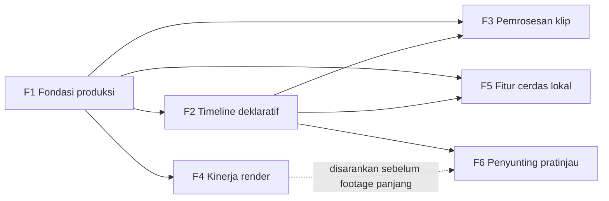

# Roadmap awvd

## Metadata

- Version: `v1.18.0`
- Last updated: `2026-11-08`
- Changeset: `F2 selesai: dokumen penutup F2/07 (#36, docs/timeline.md v1.3.0) menutup semua sub-issue F2; status F2 menjadi selesai. Sebelumnya: Speed ramp dengan audio atempo (F3/05) selesai: paritas trim, speed, reverse, freeze mencakup audio speed konstan dan ramp; status F3 selesai. Sebelumnya: F6 berstatus berjalan: rancangan penyunting pratinjau (F6/01, #53) disetujui pemilik; paritas penyunting visual merujuk penyunting.md. Sebelumnya: Paritas timeline multitrack berstatus ada (templat render generik F2/03 dan rencana audio F2/05 selesai); status F2 berjalan.`

## Visi

awvd menjadi alat produksi video terprogram yang **setara penyunting video konsumen** (misalnya CapCut) untuk video penjelasan, edukasi, promosi, SOP, data, dan reaction, **dengan metode repo ini**:

- deterministik, frame demi frame;
- dapat ditinjau sebagai kode;
- Bun-only;
- patuh lisensi;
- diperiksa mutunya secara otomatis.

Yang **tidak** dikejar:

- **Penyuntingan real-time.** awvd menggambar setiap frame dengan Chromium, jadi tidak bisa secepat penyunting yang merender langsung saat menyunting.
- **Pustaka musik dan stiker berlisensi komersial.** Mengelolanya butuh lisensi dari pemegang hak dan tidak sesuai peran awvd sebagai upstream.
- **Layanan cloud dan aplikasi ponsel.** awvd tetap alat CLI lokal.

## Prinsip

- **Bukan janji tanggal.** Fase berurutan menurut ketergantungan; tanggal milestone, bila ada, hanya indikatif.
- **Fase selesai ditentukan kriteria keluar**, bukan oleh nol issue terbuka.
- **Angka kemajuan dibaca dari GitHub**, tidak diketik di dokumen ini:

  ```bash
  gh api repos/ahliweb/awvd/milestones --jq '.[] | "\(.title): \(.closed_issues)/\(.open_issues + .closed_issues)"'
  ```

- **Satu issue, satu PR.** Setiap issue berformat Context, Goal, Scope, Steps, Acceptance Criteria, Definition of Done, Dependensi, References, Size (ukuran S/M; L dipecah). PR menutup issue dengan `Closes #n`.
- **Fitur cerdas dan mesin pihak ketiga bersifat opsional dan tidak dibundel** (keputusan pemilik untuk TTS, 2026-11-07). Model dengan lisensi membatasi dicatat syaratnya di dokumen fitur.
- Roadmap ditinjau setiap kali milestone selesai.

## Fase

Status memakai `rencana | berjalan | selesai | ditunda | dibatalkan`.

| Fase | Milestone | Tujuan | Kriteria keluar | Status | Epik |
| --- | --- | --- | --- | --- | --- |
| F1 | F1 Fondasi produksi | Melengkapi alat produksi dasar | Pemeriksa visual, transisi, aset (P0–P1 dan helper runtime), reaction dan kutipan wajar, serta narasi (caption sinkron voice over, adaptor TTS opsional) ter-merge dengan uji dan dokumen; bug determinisme `--skala` diperbaiki | berjalan | [#17](https://github.com/ahliweb/awvd/issues/17) |
| F2 | F2 Timeline deklaratif | Mengubah "tulis kode per video" menjadi "isi `timeline.json`" yang dirender templat generik | Format `timeline.json` (track video/audio/teks/overlay; klip in, out, speed, reverse, freeze; keyframe; transisi) tervalidasi dan dirender templat generik; contoh dan uji determinisme lolos | selesai | [#29](https://github.com/ahliweb/awvd/issues/29) |
| F3 | F3 Pemrosesan klip | Olah klip di tahap ekstraksi dengan cache | `klip.mjs` mendukung LUT/filter warna, chroma key, stabilisasi, peredam bising, dan speed ramp; uji lolos | selesai | [#37](https://github.com/ahliweb/awvd/issues/37) |
| F4 | F4 Kinerja render | Render footage panjang dalam waktu layak | Render lewat segmen dengan MP4 byte-identik untuk jumlah pekerja berapa pun dan tangkapan PNG per frame identik dengan tangkapan serial (KP-068); percepatan terukur dan didokumentasikan | berjalan | [#43](https://github.com/ahliweb/awvd/issues/43) |
| F5 | F5 Fitur cerdas lokal | Fitur cerdas lokal yang opsional | ASR whisper.cpp opsional, deteksi ketukan, reframe, dan hapus latar opsional dengan model berlisensi permisif yang tidak dibundel; masing-masing beruji dan terdokumentasi | rencana | [#47](https://github.com/ahliweb/awvd/issues/47) |
| F6 | F6 Penyunting pratinjau | Alat bantu visual penyusun timeline | Halaman pratinjau lokal dengan scrubber dan daftar track yang mengekspor `timeline.json`; uji E2E Playwright lolos | berjalan (rancangan F6/01 disetujui, [penyunting.md](penyunting.md)) | [#52](https://github.com/ahliweb/awvd/issues/52) |



F3 boleh dimulai untuk butir yang tidak bergantung pada timeline (LUT, chroma key, peredam bising). Speed ramp (F3/05) memakai pemetaan frame F2/04 dan sudah selesai. F4 tidak bergantung pada F2 dan boleh berjalan paralel.

## Paritas fitur

Peta kesiapan awvd terhadap kelompok fitur penyunting video konsumen. Status mengikuti kondisi `main`.

| Kelompok fitur | Status di `main` | Fase atau issue |
| --- | --- | --- | --- | --- | --- |
| Teks, judul, animasi teks | ada | — |
| Transisi dan animasi elemen | ada ([transisi-animasi.md](transisi-animasi.md)) | F1/02 (selesai) |
| Grafik data, tabel, angka, rupiah | ada ([api-runtime.md](api-runtime.md)) | — |
| SOP dan diagram alir | ada ([sop.md](sop.md)) | — |
| Gambar, Ken Burns | ada | — |
| Logo, ikon, aset berlisensi | ada: CLI aset dan helper runtime ([aset.md](aset.md#helper-runtime)); uji-tayang per frame dan Lottie belum | F1/03 (selesai), F1/04 (selesai) |
| Video di dalam video | ada ([video-tertanam-audio.md](video-tertanam-audio.md)) | — |
| Reaction dan kutipan wajar | ada ([pelajari-reaction.md](pelajari-reaction.md)) | F1/05 (selesai) |
| Pemeriksa visual dan profil audiens | ada ([visual-audiens.md](visual-audiens.md)) | F1/01 (selesai) |
| Caption sinkron voice over | sebagian: naskah, estimasi timing, cue VTT/SRT, rencana audio, serta mode dan posisi tampil caption ada ([narasi-caption.md](narasi-caption.md)); adaptor TTS belum | F1/06A (selesai), F1/06B (selesai), F1/06C |
| Text-to-speech | ada sebagai adaptor opsional yang tidak dibundel ([narasi-caption.md](narasi-caption.md#tts-lokal-sherpa-onnx)); layanan daring dan suara kustom belum | F1/06C (selesai) |
| Ducking, fade, kenyaringan | ada | — |
| QC kenyaringan, kilatan, subtitle | ada ([pemeriksaan-mutu.md](pemeriksaan-mutu.md)) | — |
| Timeline multitrack | ada: format `timeline.json`, validator `bun run timeline periksa`, templat render generik `templates/timeline/` (track video, overlay, teks, transisi), dan rencana audio turunan `bun run audio -- --timeline` ([timeline.md](timeline.md)) | F2/02, F2/03, F2/05, F2/07 (selesai) |
| Trim, speed, reverse, freeze | ada sebagai helper pemetaan frame ([api-runtime.md](api-runtime.md#pemetaan-waktu-klip); `petaWaktuKlip`, `frameSumber`, ramp kecepatan); audio speed konstan dan ramp diregangkan dengan `atempo` sinkron dengan frame (0,5 sampai 4x; [video-tertanam-audio.md](video-tertanam-audio.md#audio-klip-ber-speed-atempo)); reverse dan freeze tanpa audio (bisu); tanpa interpolasi gerak | F2/04, F3/05 (selesai) |
| Keyframe generik | ada (`keyframe`) | F2/06 |
| Filter dan LUT warna | ada ([olah-klip.md](olah-klip.md)) | F3/01 (selesai) |
| Chroma key | ada ([olah-klip.md](olah-klip.md); `kunciWarna`, keluaran PNG beralfa) | F3/02 (selesai) |
| Stabilisasi | ada ([olah-klip.md](olah-klip.md); `stabil`: vidstab, cadangan deshake) | F3/03 (selesai) |
| Peredam bising, pengubah suara | ada ([video-tertanam-audio.md](video-tertanam-audio.md#olah-suara-per-trek)); `arnndn` butuh model milik pengguna | F3/04 (selesai) |
| Render cepat untuk footage panjang | ada: render paralel per segmen `--paralel N` (sekitar 2,6x dengan 4 pekerja pada klip 480 frame; [cli.md](cli.md#render-paralel-dan-segmen)); cache segmen hasil render belum | F4/01 (selesai), F4/02 (selesai), F4/03 |
| Caption otomatis dari audio (ASR) | ada sebagai adaptor opsional yang tidak dibundel ([narasi-caption.md](narasi-caption.md#asr-lokal-whispercpp)): whisper.cpp lokal untuk caption dari audio tanpa naskah (wajib ditinjau manusia) dan stempel kata narasi; belum diuji pada suara manusia | F5/01 (selesai) |
| Sinkron ketukan musik | sebagian: deteksi ketukan dan tempo tetap dari audio lokal ke `ketukan.json` dengan helper komposisi ada ([ketukan.md](ketukan.md)); diuji pada sinyal sintetis, musik nyata dan tempo berubah belum diuji | F5/02 (selesai) |
| Reframe 16:9 ke 9:16 | sebagian: crop berkeyframe manual deterministik dengan validasi teks terpotong dan area aman 9:16 (`window.Reframe`, `bun run reframe`) dan saran fokus heuristik tanpa model ([reframe.md](reframe.md)); diuji pada video sintetis, pelacakan wajah atau objek belum | F5/03 (selesai) |
| Hapus latar tanpa layar hijau | belum | F5/04 |
| Penyunting visual | belum (ada mode `?preview`; rancangan disetujui di [penyunting.md](penyunting.md), implementasi #54 dan #55) | F6 |

## Label dan milestone

- **Milestone:** satu per fase (`F1` sampai `F6`). Deskripsinya memuat kriteria keluar.
- **Label:** setiap issue punya tepat satu label dari masing-masing kelompok berikut:
  - `jenis:` (`feat`, `fix`, `docs`, `test`, `ci`, `chore`, `refactor`, `riset`);
  - `prioritas:` (`P0` sampai `P3`);
  - `ukuran:` (`S`, `M`).

  Label pelengkap:
  - `area:` (`runtime`, `render`, `audio`, `klip`, `aset`, `transisi`, `konsep`, `sop`, `periksa`, `timeline`, `narasi`, `cerdas`);
  - `status:diblokir` dan `status:perlu-keputusan`;
  - `epik` untuk issue induk per fase.
- **Judul:** `[F<n>/<SEQ>] <jenis>: <ringkasan>`. Sub-issue ditautkan ke epiknya sebagai sub-issue GitHub.
- **Formulir issue** ada di [`.github/ISSUE_TEMPLATE/`](../.github/ISSUE_TEMPLATE/): tugas, bug, riset, dan epik.

## Changelog

### 2026-11-08 - v1.18.0

- Status F2 menjadi selesai: dokumen penutup F2/07 (#36) selesai, sehingga F2/01 sampai F2/07 tertutup; paritas "Timeline multitrack" merujuk F2/07.

### 2026-11-08 - v1.17.0

- Paritas "Trim, speed, reverse, freeze": audio speed konstan dan ramp diregangkan dengan `atempo` (F3/05); reverse dan freeze tetap tanpa audio.
- Status F3 menjadi selesai (F3/01 sampai F3/05); catatan urutan F3/05 diperbarui.

### 2026-11-08 - v1.16.0

- Status F6 menjadi berjalan: rancangan penyunting pratinjau F6/01 (#53) selesai dan disetujui pemilik (KP-074 sampai KP-076); paritas "Penyunting visual" merujuk [penyunting.md](penyunting.md).

### 2026-11-08 - v1.15.0

- Paritas "Timeline multitrack": ada (templat render generik `templates/timeline/`, F2/03 selesai, bersama validator dan rencana audio).
- Status F2 menjadi berjalan; sisa F2/06 sudah selesai, tinggal dokumen penutup F2/07.

### 2026-11-08 - v1.14.0

- Kriteria keluar F4 diganti: "framemd5 identik terhadap render serial" menjadi MP4 byte-identik untuk jumlah pekerja berapa pun dan tangkapan PNG per frame identik dengan tangkapan serial (keputusan pemilik KP-068); status F4 berjalan.
- Paritas "Render cepat untuk footage panjang": ada (render paralel per segmen, F4/01 dan F4/02 selesai); cache segmen menyusul (F4/03).

### 2026-11-08 - v1.13.0

- Paritas "Timeline multitrack": rencana audio turunan dari `timeline.json` ada (`bun run audio -- --timeline`, F2/05 selesai).

### 2026-11-08 - v1.12.0

- Paritas: reframe 16:9 ke 9:16 berstatus sebagian (crop berkeyframe manual deterministik dan saran fokus heuristik tanpa model, F5/03).

### 2026-11-08 - v1.11.0

- Paritas: keyframe generik berstatus ada (`keyframe` dengan easing per segmen, F2/06).

### 2026-11-07 - v1.10.0

- Paritas "Timeline multitrack" diubah menjadi sebagian (format, validator, dan contoh `timeline.json` ada, F2/02; render menyusul, F2/03).

### 2026-11-07 - v1.9.0

- Paritas "Caption otomatis dari audio (ASR)" diubah menjadi ada (adaptor whisper.cpp lokal opsional, F5/01).

### 2026-11-07 - v1.8.0

- Paritas "Sinkron ketukan musik" diubah menjadi sebagian (deteksi ketukan F5/02; tempo tetap, bukti hanya sinyal sintetis).

### 2026-11-07 - v1.7.0

- Paritas "Trim, speed, reverse, freeze" diubah menjadi ada (helper pemetaan frame, F2/04).

### 2026-11-07 - v1.6.0

- Paritas "Text-to-speech" diubah menjadi ada (adaptor TTS lokal opsional, F1/06C).

### 2026-11-07 - v1.5.0

- Tabel paritas: caption sinkron voice over memuat mode dan posisi tampil caption (F1/06B selesai).

### 2026-11-07 - v1.4.0

- Tabel paritas: chroma key (F3/02) dan stabilisasi (F3/03) menjadi ada.

### 2026-11-07 - v1.3.0

- Tabel paritas: peredam bising dan pengubah suara menjadi ada (F3/04: `bersih` dan `suara` di rencana audio).

### 2026-11-07 - v1.2.0

- Tabel paritas: caption sinkron voice over menjadi sebagian (F1/06A selesai).

### 2026-11-07 - v1.1.0

- Paritas "Filter dan LUT warna" diubah menjadi ada (F3/01: `klip[].efek` jenis `lut`, `warna`, `keseimbangan`).

### 2026-11-07 - v1.0.1

- Baris paritas Logo, ikon, aset berlisensi: helper runtime aset ada (F1/04 selesai); uji-tayang per frame dan Lottie belum.

### 2026-11-07 - v1.0.0

- Baseline roadmap enam fase, tabel paritas fitur, label dan milestone, dipetakan ke epik #17, #29, #37, #43, #47, #52.
