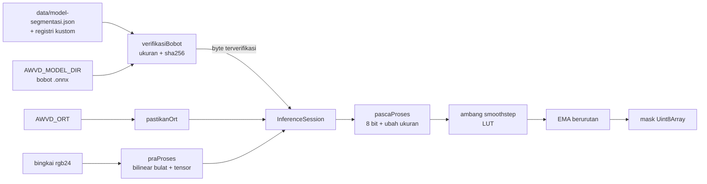
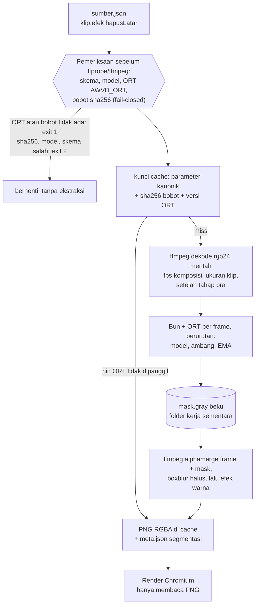

# Segmentasi dan hapus latar lokal

## Metadata

- Version: `v1.2.0`
- Last updated: `2026-11-08`
- Changeset: `Efek klip hapusLatar diimplementasikan (#89): rancangan integrasi menjadi bagian Efek klip hapusLatar (kondisi nyata: skema, urutan pra-ekstraksi, mask beku mask.gray, alphamerge, kunci cache, fail-closed sebelum ffmpeg, laporan di meta.json, uji dengan ORT palsu di CI dan ORT sungguhan lokal), penyimpangan dari rancangan dicatat; status dokumen dan pemecahan pekerjaan diperbarui. Sebelumnya: Modul segmentasi diimplementasikan (#88): bagian Modul segmentasi-lib.js dan sha256 kanonik registri.`

> **Status: modul segmentasi ([#88](https://github.com/ahliweb/awvd/issues/88)) dan efek klip `hapusLatar` ([#89](https://github.com/ahliweb/awvd/issues/89)) sudah ada.** Dokumen ini berasal dari riset issue #51, yang rekomendasinya disetujui pemilik pada 2026-11-08. Yang nyata di repo: `scripts/segmentasi-lib.js`, registri `data/model-segmentasi.json`, pemeriksa `bun run segmentasi`, efek `hapusLatar` di `scripts/klip.mjs`, dan uji `bun run uji:segmentasi` serta `bun run uji:klip`; bagian [Modul `segmentasi-lib.js`](#modul-segmentasi-libjs) dan [Efek klip `hapusLatar`](#efek-klip-hapuslatar) menjelaskannya. `onnxruntime-node` bukan dependensi repo. **Kualitas mask pada orang nyata belum diukur** (hanya uji sintetis; lihat [Batas bukti](#batas-bukti)). Ini bukan nasihat hukum.

Tujuan: menghapus latar dari klip tertanam (subjek orang di depan kamera) tanpa layar hijau, sepenuhnya lokal, dengan model berlisensi permisif yang **tidak dibundel**. Fitur ini mengisi baris "Hapus latar tanpa layar hijau" di [roadmap.md](roadmap.md) (F5/04 riset, F5/05 dan F5/06 implementasi). Dasarnya [olah-klip.md](olah-klip.md) (efek klip, kunci cache), [video-tertanam-audio.md](video-tertanam-audio.md) (klip), dan [lisensi-kepatuhan.md](lisensi-kepatuhan.md).

## Batas bukti

Riset dijalankan pada 2026-11-08 di satu mesin (Linux 6.8, 20 inti logis, 31 GB RAM, Bun 1.x, `onnxruntime-node` 1.31.1 CPU, ffmpeg 6.1.1). Yang perlu dibaca dengan hati-hati:

- **Semua angka kinerja dan determinisme memakai bingkai sintetis** (gradasi, elips "orang", derau PRNG), karena tidak ada rekaman orang berlisensi di mesin ini dan aturan repo melarang data nyata di awvd.
- **Beban mesin tinggi saat uji** (load average 20,5 / 12,8 / 10,1 pada 20 inti). Angka milidetik adalah batas atas yang bising, bukan angka terbaik.
- **Satu mesin, satu CPU, satu OS.** Antar-CPU (AVX2 vs AVX-512), antar-versi ORT, antar-OS, dan model int8 atau fp16 untuk determinisme tidak diuji.
- **Kualitas visual dan stabilitas temporal pada orang nyata tidak diukur** (tepi rambut, tangan, banyak orang, cahaya buruk, kedip antar-frame). Klaim kualitas di tabel inventaris berasal dari dokumentasi resmi masing-masing model, bukan dari pengukuran di sini.
- Tidak diuji: `onnxruntime-web` (WASM) di Bun atau Chromium, filter `dnn_processing` ffmpeg (build di mesin uji tanpa backend dnn), serta RVM, IS-Net, PP-HumanSeg, dan SAM 2.

Bukti kualitas pada footage nyata hanya mungkin diperoleh di repo proyek yang punya footage berizin ([arsitektur.md](arsitektur.md#peran-repo-upstream), AGENTS.md aturan 11). awvd cukup memuat uji sintetis (skema, fail-closed, determinisme) dan mencatat batas ini apa adanya, seperti ASR di [narasi-caption.md](narasi-caption.md#asr-lokal-whispercpp).

## Inventaris kandidat

Lisensi dibaca dari sumber resmi pada 2026-11-08. Lisensi **bobot** sering hanya dinyatakan lewat README repo; data latih punya syarat sendiri dan tidak dikaji menyeluruh. Lisensi dicatat dari sumber asli penulis, bukan dari label mirror (lihat [Keamanan](#keamanan-dan-sumber-bobot)).

| Kandidat | Lisensi kode | Lisensi bobot | Sumber resmi | Putusan |
| --- | --- | --- | --- | --- |
| MediaPipe Selfie Segmentation (Google; 256x256, varian landscape 144x256) | Apache-2.0 | Apache-2.0 (kartu model resmi, 6 Mei 2021: "Licensed under Apache License, Version 2.0") | <https://github.com/google-ai-edge/mediapipe>; kartu model <https://storage.googleapis.com/mediapipe-assets/Model%20Card%20MediaPipe%20Selfie%20Segmentation.pdf> | **Didukung (registri bawaan).** Cepat, mask kasar. Data latih dataset privat Google (risiko sisa rendah, dicatat) |
| MODNet (portrait matting tanpa trimap) | Apache-2.0 | Apache-2.0 (README: "The code, models, and demos in this repository (excluding GIF files under the folder `doc/gif`) are released under the Apache License 2.0") | <https://github.com/ZHKKKe/MODNet> | **Didukung (registri bawaan).** Alfa lunak untuk potret. Data latih tidak dikaji; risiko sisa diterima pemilik |
| BiRefNet (general, lite, portrait, matting) | MIT | MIT | <https://github.com/ZhengPeng7/BiRefNet> | **Tidak didukung.** Lisensi permisif tetapi sekitar 10 detik per bingkai di CPU; tidak praktis untuk video. Data latih DIS5K punya Terms of Use sendiri |
| RobustVideoMatting (RVM) | **GPL-3.0** | Ikut GPL-3.0 | <https://github.com/PeterL1n/RobustVideoMatting> | **Ditolak.** Copyleft. Satu mirror ONNX berlabel `apache-2.0` keliru; label itu tidak boleh dipercaya |
| BRIA RMBG 1.4 dan 2.0 | n/a | Lisensi "other"; rembg menyebut perlu perjanjian berbayar untuk komersial | <https://github.com/danielgatis/rembg> | **Ditolak.** |
| YOLOv8/11-seg (keluarga YOLO-seg) | AGPL-3.0 | AGPL-3.0 | n/a | **Ditolak.** Copyleft kuat. Tidak diuji |
| U2-Net / U2-Netp | Apache-2.0 | Apache-2.0 menurut repo; varian `u2net_human_seg` dilatih dari Supervisely Person Dataset (lisensi dataset tidak dikaji) | <https://github.com/xuebinqin/U-2-Net> | Cadangan, tidak didukung. Saliency umum, tepi kasar, tidak unggul atas MODNet |
| IS-Net / DIS | Apache-2.0 | Tidak dinyatakan terpisah; DIS5K punya Terms of Use sendiri | <https://github.com/xuebinqin/DIS> | Tidak diuji. Lisensi bobot ambigu |
| PP-HumanSeg | Apache-2.0 | Tidak ada pernyataan terpisah (diasumsikan ikut repo; tidak terverifikasi); ONNX hanya lewat konversi sendiri | <https://github.com/PaddlePaddle/PaddleSeg/tree/release/2.10/contrib/PP-HumanSeg> | Tidak diuji. |
| SAM 2 / 2.1 | Apache-2.0 | Apache-2.0 | <https://github.com/facebookresearch/sam2> | Di luar lingkup hapus-latar otomatis (berbasis prompt). Tidak diuji |
| rembg (pembungkus Python) | MIT | Per model ("Model weights carry their own licenses") | <https://github.com/danielgatis/rembg> | Bukan dependensi. Hanya sumber ONNX; model bawaannya (bria) ditolak |
| MobileSAM, EdgeSAM | MobileSAM Apache-2.0; EdgeSAM tidak terverifikasi | Tidak dikaji | n/a | Tidak dikaji |

Tidak ada kandidat permisif yang rekuren/temporal selain RVM (GPL). Karena itu stabilitas temporal harus datang dari pasca-proses deterministik milik awvd ([Pelicinan temporal](#pelicinan-temporal-dan-determinisme)).

### Pilihan runtime

| Opsi | Kelebihan | Kekurangan | Putusan |
| --- | --- | --- | --- |
| **A. `onnxruntime-node` di Bun, opsional** | Diuji berjalan di Bun tanpa Node; MIT; satu runtime untuk semua model ONNX; versi dapat dikunci | Native 294 MB (46 MB untuk linux x64) dan rantai 17 paket (semua permisif); dukungan napi Bun bukan jaminan resmi ORT; versi ORT memengaruhi bit hasil | **Dipilih**, sebagai dependensi opsional di luar `dependencies` inti |
| B. Program eksternal | Tanpa dependensi di `package.json` | Tidak ada CLI ONNX generik; Python bukan bagian toolchain Bun-only | Tidak |
| C. `onnxruntime-web` (WASM) | Tanpa biner native | Belum diuji, lebih lambat, bertentangan dengan aturan "render tidak memanggil model" | Tidak |
| D. ffmpeg `dnn_processing` | Tanpa dependensi baru | Build umum tanpa backend dnn | Tidak |

`bun add onnxruntime-node` memunculkan peringatan "Blocked 1 postinstall"; postinstall itu hanya mengunduh CUDA dan aman diabaikan untuk CPU. Jangan menjalankan `bun pm trust` tanpa perlu.

## Hasil uji CPU

Metode: bingkai sintetis 1280x720 deterministik; pra-proses bilinear JS murni (RGB ke tensor NCHW float); inferensi ORT; pasca-proses bilinear JS murni ke mask 8 bit 720p; hash SHA-256 mask. Median dari N bingkai setelah satu pemanasan. Pra dan pasca-proses di JS belum dioptimasi (sekitar 20 sampai 35 ms pada 720p, tidak bergantung model). Skrip uji hanya ada di area kerja sementara dan tidak masuk repo.

| Model, input | Inferensi median ms/bingkai (thread bawaan) | 1 thread | 4 thread | Hash identik antar-run |
| --- | --- | --- | --- | --- |
| MediaPipe selfie 256x256 (fp32) | 2,7 | 3,9 | 2,6 | ya |
| MediaPipe selfie landscape 256x144 | 2,1 | tidak diuji | tidak diuji | ya |
| MODNet fp32 512x288 | 78,6 | 505 | 135 | ya |
| MODNet fp32 896x512 | 288 | 764 | 357 | ya |
| MODNet int8 896x512 | 490 (lebih lambat dari fp32 di CPU ini) | tidak diuji | tidak diuji | ya |
| U2-Netp 320x320 | 160 | 570 | tidak diuji | ya |
| BiRefNet_lite fp32 1024x1024 | 9.953 (hanya 3 bingkai) | tidak diuji | tidak diuji | ya |

Perkiraan klip 10 detik 30 fps (300 bingkai), hanya inferensi, pada mesin dan beban di atas: MediaPipe sekitar 1 detik; MODNet 512x288 sekitar 25 sampai 60 detik; MODNet 896x512 sekitar 85 sampai 230 detik (1 thread sekitar 3,8 menit); BiRefNet_lite sekitar 50 menit.

**Determinisme yang diukur:** hash mask identik antara run pertama dan kedua dalam satu proses, antar-proses, dan antar-jumlah thread (1, 4, bawaan) untuk MODNet 512x288, MODNet 896x512, MediaPipe selfie, dan U2-Netp. **Belum diuji:** antar-CPU, antar-versi ORT, antar-OS, int8/fp16. Karena mask dibekukan ke cache dan render tidak memanggil model, risiko ini dikendalikan lewat kunci cache yang memuat versi ORT dan sha256 model.

## Rekomendasi

1. **Runtime:** `onnxruntime-node` opsional, ditunjuk lewat `AWVD_ORT`, tidak masuk `dependencies` inti. Tanpa ORT, fitur gagal tertutup (kode keluar 1 dengan pesan jelas), tidak ada efek diam-diam.
2. **Model registri bawaan:** MediaPipe Selfie Segmentation (`selfie`: pratinjau dan subjek dekat) dan MODNet (`modnet`: kualitas). Model lain hanya lewat registri kustom atas tanggung jawab pemakai, seperti `suara.json` kustom di [narasi-caption.md](narasi-caption.md).
3. **Pemisahan tahap:** pembuatan mask (boleh memanggil ORT) terpisah dari render (hanya membaca PNG, tidak pernah memanggil model), persis seperti narasi/TTS.
4. **Temporal:** EMA alfa deterministik milik awvd; model tanpa temporal tetap per-bingkai.

Skor kriteria AGENTS.md aturan 8 untuk opsi ini:

| Kriteria | Penilaian |
| --- | --- |
| Keamanan | Sedang: parser model; mitigasi sha256 terkunci dan fail-closed |
| Performa | MediaPipe praktis; MODNet 0,1 sampai 0,3 detik per bingkai di CPU |
| Perawatan | Sedang: satu tahap klip, satu modul `segmentasi-lib.js`, satu registri model |
| Skalabilitas | Mask beku dapat diparalel per segmen; paralel antar-klip aman (cache) |
| Aksesibilitas | Tidak berdampak langsung; kontras subjek dan latar baru perlu dicek `periksa` |
| Kompatibilitas | Hanya Linux x64 yang diuji dan dijamin |
| Kompleksitas operasional | Naik: ORT 294 MB bila dipasang, unduh bobot manual, sha256 |
| Jangka panjang | Registri memudahkan penggantian model; risiko perubahan lisensi bobot dicatat dengan tanggal dan sha256 |
| SEO, UI/UX | Tidak berlaku |

## Modul `segmentasi-lib.js`

Kondisi nyata setelah #88. Modul untuk tahap pembuatan aset beku; render tidak memanggilnya. Dipakai efek klip `hapusLatar` ([#89](https://github.com/ahliweb/awvd/issues/89), bagian [Efek klip `hapusLatar`](#efek-klip-hapuslatar)).

**Konfigurasi runtime** (lewat env atau argumen, bukan manifest):

| Env | Arti |
| --- | --- |
| `AWVD_ORT` | Jalur folder paket `onnxruntime-node` (atau berkas masuknya). Dimuat dinamis dengan `createRequire`; **kode di jalur itu dijalankan**, jadi tunjuk hanya paket yang Anda pasang sendiri. Tanpa itu `GalatSegmentasi` berpesan jelas dan tidak ada keluaran. |
| `AWVD_MODEL_DIR` | Folder bobot; berkas dicari dengan nama `berkas` dari registri (`selfie-segmentation.onnx`, `modnet.onnx`). Argumen `jalur` eksplisit di API menang atas env ini. |
| `AWVD_REGISTRI_SEGMENTASI` | Jalur registri kustom pemakai (opsional). |

**Memasang ORT dan bobot (manual, di luar repo).** Pasang `onnxruntime-node` di folder terpisah (`bun add onnxruntime-node`; peringatan "Blocked 1 postinstall" aman diabaikan untuk CPU), lalu `export AWVD_ORT=<folder>/node_modules/onnxruntime-node`. Unduh bobot dari tautan di tabel sha256 di atas (atau lihat tautan dan hash lewat `bun run segmentasi daftar`), simpan dengan nama berkas registri di satu folder, lalu `export AWVD_MODEL_DIR=<folder>`. Awvd tidak mengunduh dan tidak membundel apa pun. `bun run segmentasi periksa --model modnet` memastikan ORT termuat, ukuran dan sha256 cocok, dan sesi dapat dibuat.

**Registri** `data/model-segmentasi.json` (skema 1, ketat; kunci tak dikenal ditolak): `selfie` dan `modnet`, masing-masing dengan `sha256`, `ukuranByte`, `tanggalSha256`, `lisensiKode` dan `lisensiBobot` (Apache-2.0, dari sumber asli penulis, bukan label mirror), `sumberAsli`, `dasarLisensi`, `unduh` (URL konversi komunitas terkunci ke revisi commit; `labelLisensiMirror` hanya catatan), `masukan` (`tetap: [w, h]` untuk selfie; `dinamis` untuk MODNet: kelipatan 32, 64 sampai 2048, sisi panjang bawaan 512; `bagi` dan `kurang` untuk normalisasi `nilai / bagi - kurang`), dan nama tensor. Pemvalidasi menolak model registri tanpa sha256 atau ukuran, lisensi di luar daftar permisif (`Apache-2.0`, `MIT`, `BSD-2-Clause`, `BSD-3-Clause`, `ISC`), URL non-https, dan nama berkas dengan pemisah jalur. Registri kustom memakai skema yang sama dengan sha256, ukuran, dan sumber tidak wajib (peringatan), tidak boleh memakai id bawaan, dan lisensi non-permisif hanya diperingatkan.

**Kebijakan sha256.**

| Kasus | Hasil |
| --- | --- |
| Model registri bawaan: ukuran atau sha256 salah, atau berkas tidak ada | Ditolak (fail-closed); bobot tidak pernah sampai ke ORT. Kode `ukuran-salah` atau `sha256-salah` (keluar 2), `bobot-tidak-ada` (keluar 1). |
| Model kustom tanpa sha256 | Berjalan dengan **peringatan** (hash terhitung dicantumkan agar dapat dikunci). |
| Model kustom dengan sha256 terdeklarasi yang tidak cocok | **Ditolak.** Sedikit lebih ketat dari "hanya peringatan": hash yang dideklarasikan tetapi tidak cocok berarti berkas bukan yang dimaksud pemakai. |

Berkas dibaca sekali ke memori, di-hash, lalu byte yang sama diberikan ke ORT (tidak ada celah antara pemeriksaan dan pemakaian). Batas ukuran bobot 512 MiB.

**Pra-proses dan pasca-proses.** Semua perubahan ukuran memakai interpolasi bilinear titik-tengah-piksel dengan bobot titik tetap 16 bit dan aritmetika bilangan bulat (tepat dalam double), jadi identik di semua mesin. Pra-proses: rgb24 diperkecil ke ukuran masukan model, lalu tensor float32 planar NCHW dengan `nilai / bagi - kurang` (selfie `/255`; MODNet `/127,5 - 1`). Ukuran masukan MODNet bawaan mengikuti rasio bingkai dengan sisi panjang 512 (1280x720 menjadi 512x288); `ukuranInput` dapat berupa `[w, h]` atau sisi panjang. Pasca-proses: keluaran probabilitas 0..1 dijepit dan dikuantisasi ke 8 bit di resolusi model (NaN dan tak hingga menjadi 0; bila semuanya tak hingga, ditolak), lalu diperbesar ke ukuran bingkai dengan fungsi bilinear yang sama.

**Ambang dan EMA.** `ambang: [rendah, tinggi]` menerapkan smoothstep lewat tabel 256 entri (hanya `+ - * /`); bawaan identitas. `ema` adalah bobot bingkai baru (0 sampai 1; bawaan 1 = tanpa pelicinan): keadaan disimpan sebagai bilangan bulat dengan pecahan 8 bit sehingga konvergen tepat ke 0 dan 255 dan identik di semua mesin. Urutan per bingkai: mentah, ambang, EMA. Mask bingkai n bergantung pada bingkai 0..n-1: berikan **berurutan dari satu proses**, panggil `ulangEma()` pada pergantian adegan, dan jangan paralelkan antar-bingkai (paralel antar-klip atau antar-segmen yang masing-masing berawal dari bingkai pertama aman). Erosi, feather, dan mode "tahan" dari rancangan belum diimplementasikan.

**API ringkas** (`scripts/segmentasi-lib.js`): `buatSegmenter({ model, jalur?, env?, registriKustom?, thread?, ukuranInput?, ambang?, ema?, peringatan? })` mengembalikan `{ info, segmentasi(rgb, lebar, tinggi), mentah(...), ulangEma(), tutup() }`; `info` memuat `model`, `sha256`, `versiOrt`, `lisensiKode`, `lisensiBobot`, `thread`, `ema`, dan `lokal: true` (bahan kunci cache dan blok `segmentasi` di `meta.json` klip, #89). Fungsi pendukung yang diekspor: `muatRegistri`, `validasiRegistri`, `cariBobot`, `verifikasiBobot`, `pastikanOrt`, `ukuranMasukan`, `praProses`, `pascaProses`, `ubahUkuran`, `buatLut`, `buatEma`. Galat berupa `GalatSegmentasi` dengan `kode` stabil dan `keluar` (1 = lingkungan: ORT atau bobot tidak ada, ORT gagal; 2 = validasi: registri, sha256, ukuran, opsi, model tak cocok). `bun run segmentasi periksa|daftar` membungkusnya untuk pemakai (kode keluar 0, 1, 2; tanpa keluaran standar saat gagal).

**Uji** (`bun run uji:segmentasi`, ikut `bun run uji` dan CI tanpa ORT): skema registri dan penolakan registri cacat; fail-closed (ORT tidak ada, bobot tidak ada, ukuran atau sha256 salah, kustom); ORT palsu (modul CJS kecil) yang membuktikan bobot yang ditolak tidak pernah sampai ke `InferenceSession.create` dan menguji jalur sesi; ubah ukuran, pra/pasca-proses, ambang, dan EMA dengan nilai acuan; CLI (kode keluar). Bila `AWVD_ORT` diset, uji tambahan memakai model ONNX mini buatan skrip uji (ReduceMean, protobuf ditulis tangan tanpa dependensi) sebagai model kustom: nilai mask dibandingkan dengan acuan JS dan hasilnya identik antar-run dan antar-thread (1 dan 4), termasuk urutan EMA; bila `AWVD_MODEL_DIR` memuat bobot registri, selfie dan modnet ikut diuji (sha256 diverifikasi, mask tidak seragam, identik antar-run dan antar-thread). Selain itu uji tersebut dilewati dengan pesan `LEWATI`. Semua data sintetis.

**Hasil uji lokal dengan ORT sungguhan (2026-11-08; satu mesin, Linux x64, Bun 1.4.4, `onnxruntime-node` 1.31.1, CPU 20 inti logis, bobot registri terverifikasi sha256).** Bingkai sintetis 1280x720 (gradasi, elips, derau bersemai), 5 bingkai, `ema` 0.6 dan `ambang` [0.1, 0.9]; hash SHA-256 seluruh mask: `selfie` `8993d16cebec4483` dan `modnet` `54d2d7ea0b6ab6a6` (16 heksa pertama) **identik** pada thread bawaan, 1, dan 4, dan antar dua proses terpisah. Waktu per bingkai termasuk pra/pasca-proses JS pada beban rendah: selfie sekitar 12 sampai 19 ms; MODNet 512x288 sekitar 71 ms (thread bawaan), 222 sampai 226 ms (1 thread), 79 sampai 85 ms (4 thread). Batas bukti tidak berubah dari [Batas bukti](#batas-bukti): bingkai sintetis, satu mesin, tidak diuji antar-CPU, antar-versi ORT, antar-OS, dan int8/fp16, dan **kualitas mask pada orang nyata tidak diukur**.

## Efek klip `hapusLatar`

Kondisi nyata setelah [#89](https://github.com/ahliweb/awvd/issues/89), diimplementasikan di `scripts/klip.mjs` di atas modul segmentasi ([#88](https://github.com/ahliweb/awvd/issues/88)). Rinci pemakaian ada di [olah-klip.md](olah-klip.md#skema-efek); bagian ini mencatat desain dan penyimpangannya dari rancangan awal.

1. **Pemeriksaan awal** (`siapkanSegmentasi`, sebelum ffprobe dan ffmpeg): skema efek, registri model (bawaan dan `AWVD_REGISTRI_SEGMENTASI`), model dikenal, `ukuranInput` cocok model, ORT termuat dari `AWVD_ORT`, bobot di `AWVD_MODEL_DIR` cocok ukuran dan sha256. Model, ukuran masukan, atau skema salah dan sha256 salah berhenti dengan kode keluar `2`; ORT atau bobot tidak ada, atau ORT gagal dimuat, berhenti dengan kode keluar `1`; semuanya dengan pesan jelas dan tanpa folder hasil. ORT dan bobot diperlukan juga pada cache hit karena kunci cache memuat sha256 bobot dan versi ORT; cache hit tidak membuat sesi dan tidak menjalankan inferensi.
2. **Pra-ekstraksi** (cache miss): ffmpeg mendekode klip ke `rgb24` mentah lewat pipa pada fps komposisi, **pada ukuran klip**, setelah tahap `pra` (mis. `stabil`) dan penskalaan dengan matriks warna (frame yang sama dengan yang akan di-cache). Bun memanggil `buatSegmenter` dan `segmentasi` per frame, berurutan dari satu proses (EMA), lalu menulis mask 8 bit ke `mask.gray` di folder kerja.
3. **Penggabungan alfa**: ffmpeg kedua membaca klip (rantai yang sama) dan `mask.gray` (`-f rawvideo -pixel_format gray -video_size WxH -framerate fps`) sebagai masukan kedua; `halus` memberi `boxblur` pada mask; `alphamerge` memasangnya sebagai alfa sebelum efek warna. Keluaran PNG RGBA seperti `kunciWarna`. Kontrak `EFEK` (`scripts/klip.mjs`) diperluas kecil: `saring` boleh mengembalikan `alfaDari` (masukan tambahan; preseden: berkas pembantu vidstab), dan dua efek beralfa pada satu klip ditolak. Jumlah frame mask harus sama dengan jumlah frame hasil; bila tidak, ekstraksi gagal dan tidak ada yang di-cache.
4. **Skema efek** (kanonik, ketat): `{ jenis: "hapusLatar", model, ukuranInput?, halus?, ambang?, ema? }` dengan `tahap: "alfa"`, `maks: 1`, `alfa: true` (otomatis `png`; `jpg` eksplisit ditolak seperti `kunciWarna`), tidak boleh digabung dengan `kunciWarna`. `halus` bilangan bulat 0..32 (radius feather dalam piksel klip, bawaan 0).
5. **Konfigurasi runtime lewat env, bukan manifest**, agar manifest portabel: `AWVD_ORT`, `AWVD_MODEL_DIR`, `AWVD_REGISTRI_SEGMENTASI`.
6. **Lisensi dan laporan:** bobot tidak didistribusikan; pemakai mencatat lisensi bobot di `ASET.md` repo proyek (pola whisper.cpp). `meta.json` klip (dan satu baris log) mencatat `model`, `sha256` bobot, `versiOrt`, `lisensiKode` dan `lisensiBobot` dari registri, `kustom`, dan `lokal: true`.

**Penyimpangan dari rancangan awal** (KP-100 sampai KP-103 di [log-keputusan.md](log-keputusan.md)):

| Rancangan awal | Kondisi nyata | Alasan |
| --- | --- | --- |
| Flag `--model-segmentasi <id>=<jalur>` | Tidak dibuat; hanya env | `klip.mjs` tidak punya flag per model, dan env sudah memetakan model ke folder lewat nama berkas registri |
| Manifest boleh memuat `sha256` bobot yang diharapkan | Tidak ada; sha256 diverifikasi terhadap registri dan masuk kunci cache | Dua sumber kebenaran hash membuka celah beda; model kustom yang butuh kunci menulis sha256 di registri kustomnya |
| Mask ditulis sebagai urutan PNG ke cache | Mask beku `mask.gray` (gray 8 bit mentah) di folder kerja sementara; yang di-cache adalah PNG RGBA hasil `alphamerge` | Tanpa encoder PNG tambahan; mask menjadi alfa di PNG yang dibaca render, jadi render tetap tidak memanggil model. Biayanya `lebar x tinggi` byte per frame sementara |
| `halus` tidak dirinci | Feather `boxblur` pada mask, 0..32 piksel | Erosi dan mode "tahan" tetap belum ada |
| Kunci memuat sha256 sumber, fps, rentang | Sudah ada di kunci klip; efek menambah parameter kanonik, sha256 bobot, versi ORT, dan hash spesifikasi masukan model | Kunci klip tanpa efek tidak berubah |
| Mask dari frame sumber | Mask dari frame ukuran klip (setelah `pra` dan skala) | Mask dan warna berasal dari piksel yang sama; memori mask dibatasi ukuran klip |

**Uji.** `bun run uji:klip` (ikut `bun run uji` dan CI **tanpa ORT**; uji `(u)` sampai `(u5)`): skema dan penolakan (jpg eksplisit, gabungan dengan `kunciWarna`, batas ukuran), fail-closed (ORT tidak ada, bobot tidak ada, ukuran atau sha256 salah, model tidak dikenal, `ukuranInput` salah; folder hasil tidak dibuat dan ORT tidak dipanggil), dan jalur penuh dengan **ORT palsu** (model palsu yang memberi mask sama dengan kanal merah masukan): PNG RGBA, alfa sama dengan kanal merah frame yang sama di setiap piksel setiap frame (membuktikan mask dan frame sinkron, juga untuk `dari` dan `panjang`), RGB tidak berubah dibanding klip tanpa efek, dua run identik, cache hit tanpa membuat sesi ORT, dan kunci berubah menurut sha256 bobot, versi ORT, dan parameter. Bila `AWVD_ORT` dan `AWVD_MODEL_DIR` diset, `(u5)` menjalankan model sungguhan pada klip sintetis (RGBA, dua run identik, hit cache); selain itu dilewati dengan pesan `LEWATI`. **Kualitas mask pada orang nyata tidak diukur.**

### Pelicinan temporal dan determinisme

- Semua model permisif bekerja per bingkai sehingga mask dapat berkedip. Mitigasi: perataan eksponensial alfa antar-bingkai dengan urutan tetap (bingkai n memakai bingkai n-1 yang sudah dibekukan), ambang halus (smoothstep), dan feather kecil (`halus`, `boxblur` pada mask); erosi dan mode "tahan" untuk bingkai rapuh belum diimplementasikan. **Manfaatnya belum dibuktikan pada footage nyata**; uji di awvd hanya sintetis, dan bukti kualitas diharapkan datang dari repo proyek berizin lalu kembali sebagai perbaikan generik atau catatan batas.
- Pasca-proses memakai aritmetika bilangan bulat atau urutan tetap (bukan hasil kernel yang bergantung thread) agar identik lintas mesin; ini syarat uji.
- Render mempertahankan determinisme ([arsitektur.md](arsitektur.md#aturan-determinisme)) karena hanya membaca PNG beku.

## Keamanan dan sumber bobot

- **Model sebagai data tak tepercaya.** Berkas `.onnx` adalah grafik, bukan kode, tetapi parser ORT pernah memiliki CVE. ORT berjalan di proses `klip` yang sama dengan akses sistem berkas, jadi sha256 yang dikunci dan jalur absolut yang diverifikasi wajib.
- **sha256 wajib dan fail-closed untuk model registri**: bobot yang hash-nya tidak cocok dengan registri ditolak sebelum dimuat ke ORT. Untuk model kustom (registri buatan pemakai) hash hanya menghasilkan peringatan, dan tanggung jawab lisensi serta keamanannya di pemakai.
- **Sumber bobot.** Dokumentasi boleh menunjuk mirror ONNX komunitas Hugging Face, yaitu `Xenova/modnet` dan `onnx-community/mediapipe_selfie_segmentation`, sebagai konversi komunitas (bukan rilis resmi penulis). Lisensi model **dicatat dari sumber asli penulis**, bukan dari label mirror: contoh nyata, satu mirror RVM berlabel `apache-2.0` padahal kodenya GPL-3.0. Registri awvd harus membaca lisensi dari sumber asli.
- **sha256 kanonik registri** (dihitung sendiri pada 2026-11-08). Bobot diunduh dari URL mirror yang terkunci ke revisi commit (tabel di bawah) ke folder kosong khusus, diperlakukan sebagai data tak tepercaya, lalu sha256-nya dihitung dengan `sha256sum`; berkas **tidak** di-commit ke repo. Ini hash **berkas konversi komunitas**, bukan hash rilis resmi penulis: bobot asli MODNet ada di Google Drive dan tidak dapat diverifikasi otomatis, dan MediaPipe merilis `.tflite`, bukan ONNX. Hash ini yang dikunci di `data/model-segmentasi.json`; berkas dan hash yang sama dengan hasil uji riset #51 menunjukkan unduhan konsisten antar-sesi.

  | Model registri | Berkas (`AWVD_MODEL_DIR`) | Ukuran (byte) | sha256 | Sumber unduh (revisi terkunci) |
  | --- | --- | --- | --- | --- |
  | `selfie` | `selfie-segmentation.onnx` | 462352 | `3241ac4ad8aa35bdaf33946776db29f7c283a413aa0b0dacb9483594b4531aad` | `onnx-community/mediapipe_selfie_segmentation` `onnx/model.onnx` @ `be49485c8e027524be38591817fc5cd31bd9d00e` |
  | `modnet` | `modnet.onnx` | 25888640 | `07c308cf0fc7e6e8b2065a12ed7fc07e1de8febb7dc7839d7b7f15dd66584df9` | `Xenova/modnet` `onnx/model.onnx` @ `fa2fa546052fba4c08921230a26cc69a333fca12` |

  Varian `onnx-community/mediapipe_selfie_segmentation_landscape` (sha256 uji riset `7a0adcfdb1715d3b0ff0f61486d8a181c33f4a208343a5abfccbc6540e872d24`) **tidak** masuk registri bawaan; pemakai yang menginginkannya memakai registri kustom.

- **Lokal penuh.** Bingkai sumber tidak keluar dari mesin, sehingga aturan 5 AGENTS.md (TTS daring hanya untuk konten publik) tidak berlaku dan fitur boleh dipakai untuk konten internal. Mengunduh bobot adalah langkah manual pemakai.

## Data pribadi

Segmentasi memproses gambar orang. Biometrik tidak diekstrak, tetapi gambar orang dapat berupa data pribadi. Ketentuan "Foto orang" di [lisensi-kepatuhan.md](lisensi-kepatuhan.md#aset-matriks-lisensi-ringkas) (izin atau hak potret, UU 28/2014 Pasal 12 dan UU 27/2022) tetap berlaku, dan penegakannya ada di repo proyek yang memegang footage. Repo ini tidak memuat rekaman orang nyata ataupun data nyata (AGENTS.md aturan 4).

## Platform

Hanya **Linux x64** yang diuji, dan hanya itu yang dijamin untuk fitur ini. macOS, Windows, dan ARM dinyatakan tidak diuji (paket ORT memuat biner untuk platform itu, tetapi tidak dijalankan).

## Keputusan pemilik

Keputusan pemilik disetujui pada 2026-11-08; rincinya di [log-keputusan.md](log-keputusan.md) (KP-079 sampai KP-082). Keputusan implementasi: KP-095 sampai KP-098 (#88) dan KP-100 sampai KP-103 (#89).

| Keputusan | Isi | KP |
| --- | --- | --- |
| Runtime | `onnxruntime-node` opsional lewat `AWVD_ORT`, tidak masuk `dependencies` inti | KP-079 |
| Model | Registri bawaan MediaPipe Selfie Segmentation dan MODNet (Apache-2.0); BiRefNet tidak didukung; RVM (GPL-3.0), BRIA RMBG, dan model AGPL ditolak | KP-080 |
| Sumber dan hash | Mirror ONNX komunitas boleh ditunjuk; sha256 wajib fail-closed untuk model registri dan peringatan untuk model kustom; lisensi dari sumber asli | KP-081 |
| Temporal, bukti, platform | EMA temporal deterministik ikut fitur; uji awvd hanya sintetis dengan batas bukti dicatat jujur; jaminan hanya Linux x64 | KP-082 |
| Implementasi efek klip (#89) | Mask pada frame ukuran klip, mask beku `mask.gray` lalu `alphamerge`, hanya env, fail-closed sebelum ffprobe (1 lingkungan, 2 validasi), `halus` sebagai feather, uji dengan ORT palsu di CI | KP-100 sampai KP-103 |

## Pemecahan pekerjaan

| Issue | Isi | Status |
| --- | --- | --- |
| [#51](https://github.com/ahliweb/awvd/issues/51) | Riset (dokumen ini) | selesai dengan PR dokumen ini |
| [#88](https://github.com/ahliweb/awvd/issues/88) | F5/05: modul segmentasi (`scripts/segmentasi-lib.js`, registri model bersha256, EMA) | selesai dengan PR modul ini |
| [#89](https://github.com/ahliweb/awvd/issues/89) | F5/06: efek klip `hapusLatar` (skema, masukan tambahan, pra-ekstraksi, cache, `alphamerge`) | selesai dengan PR efek ini |

Bukti kualitas pada footage berizin dikerjakan di repo proyek, bukan di awvd.

## Changelog

### 2026-11-08 - v1.2.0

- Efek klip `hapusLatar` diimplementasikan (#89): "Rancangan integrasi" menjadi bagian "Efek klip `hapusLatar`" (kondisi nyata, tabel penyimpangan dari rancangan, uji); status dokumen, rujukan modul, dan pemecahan pekerjaan diperbarui.

### 2026-11-08 - v1.1.0

- Modul segmentasi diimplementasikan (#88): bagian Modul `segmentasi-lib.js`, sha256 kanonik registri dengan sumber dan tanggal (menggantikan "hash yang diuji"), status dokumen, dan pemecahan pekerjaan diperbarui; efek klip `hapusLatar` (#89) tetap rancangan.

### 2026-11-08 - v1.0.0

- Dokumen baru: hasil riset #51, rancangan hapus latar lokal yang disetujui pemilik, belum diimplementasikan (#88, #89).
