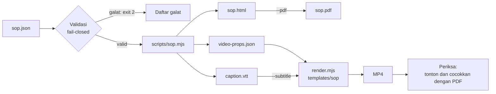

# SOP sebagai bahan video

## Metadata

- Version: `v1.0.0`
- Last updated: `2026-11-07`
- Changeset: `Dokumen baru dipindah dari README v1.10.0: scripts/sop.mjs, skema sop.json, validasi, dokumen cetak PermenPAN-RB 35/2012, video dan caption, serta keputusan desain.`

`scripts/sop.mjs` mengubah satu berkas data `sop.json` menjadi dokumen SOP cetak (HTML dan PDF) **dan** bahan video (props, jadwal, caption) dari sumber yang sama, sehingga dokumen dan video tidak bisa saling menyimpang. Format dokumen mengikuti Lampiran Peraturan Menteri PAN-RB Nomor 35 Tahun 2012 tentang Pedoman Penyusunan Standar Operasional Prosedur Administrasi Pemerintahan (SOP AP): identitas, matriks diagram alir bercabang dengan kolom pelaksana, mutu baku, dan lembar pengesahan.



**Catatan penting.** SOP nyata milik instansi disimpan di **repo proyek** instansi itu, bukan di awvd ([arsitektur.md](arsitektur.md#peran-repo-upstream), AGENTS.md aturan 11). awvd hanya memuat generator, template, dan contoh fiktif di [`templates/sop/`](../templates/sop/).

## Perintah

```bash
bun run sop templates/sop/sop.json --out out/sop --pdf
bun run render templates/sop/index.html --props-file out/sop/video-props.json \
  --subtitle out/sop/caption.vtt --out out/sop.mp4
```

```text
bun scripts/sop.mjs <sop.json> --out DIR [--pdf] [--fps 30] [--cps 17] [--wpm 140]
    [--jeda-segmen 2] [--langkah-per-halaman 10] [--browser PATH]
```

| Flag | Bawaan | Keterangan |
| --- | --- | --- |
| `--out DIR` | wajib | Folder keluaran (dibuat otomatis): `sop.html`, `video-props.json`, `caption.vtt`, dan `sop.pdf` bila `--pdf`. |
| `--pdf` | mati | Cetak `sop.pdf` (A4 landscape, `printBackground`, bertag) lewat Chromium yang sama dengan `render.mjs` (aturan pencarian browser sama; fungsinya diduplikasi di `sop.mjs`, utang teknis agar perilaku `render.mjs` tidak berubah). |
| `--fps N` | `30` | Frame per detik jadwal video dan caption (bilangan bulat 1..120). Template dirancang untuk 30. |
| `--cps N` | `17` | Batas karakter per detik caption (5..40). Caption tidak pernah melampauinya. |
| `--wpm N` | `140` | Laju narasi (kata per menit, 60..300) untuk memperkirakan durasi narasi bila belum ada audio. Bawaan 140 ada di rentang 130-150 yang dianjurkan riset prosedural, tetapi itu titik awal yang dapat dikonfigurasi, bukan temuan tervalidasi untuk bahasa Indonesia; uji dengan penutur asli. |
| `--jeda-segmen S` | `2` | Jeda (detik, 2..5) setelah langkah penutup tiap subtugas (van der Meij dan van der Meij 2013: jeda 2-5 detik antar subtugas). |
| `--langkah-per-halaman N` | `10` | Batas langkah per halaman cetak (3..40). Lebih banyak dipecah ke beberapa halaman dengan segilima penghubung. **Keputusan desain**: peraturan tidak menetapkan batas ini. |
| `--browser PATH` | otomatis | Jalur Chromium untuk `--pdf`. |

Kode keluar: `0` berhasil, `2` data atau argumen tidak valid (daftar galat dicetak ke stderr, tidak ada keluaran yang dibuat), `1` galat saat membuat PDF. Peringatan lunak dicetak ke stderr sebagai `peringatan: ...` dan tidak mengubah kode keluar.

## Skema `sop.json`

Kunci yang tidak dikenal ditolak (mencegah salah ketik yang diam-diam diabaikan). Tanggal berformat `YYYY-MM-DD`. Teks tidak boleh kosong dan tidak boleh memuat karakter kontrol (termasuk baris baru).

| Kunci | Isi |
| --- | --- |
| `identitas` | `{ judul, nomor, unit, logo?, tanggalPembuatan, tanggalRevisi?, tanggalEfektif, disahkanOleh }`. `unit` = nama instansi atau unit kerja. `logo` = berkas gambar (png, jpg, svg, webp; maks 256 KB) relatif terhadap `sop.json`, disematkan ke HTML. `disahkanOleh` = `{ jabatan, nama?, nip?, fiktif? }`. Tanggal revisi kosong ditampilkan `-`. |
| `dasarHukum`, `kualifikasiPelaksana`, `keterkaitan`, `peralatan`, `peringatan`, `pencatatan` | Larik teks, minimal satu butir (tulis "Tidak ada" bila memang tidak ada). Bersama `identitas`, ini 13 unsur identitas menurut Lampiran II.C.2.a. |
| `pelaksana` | `[{ id, nama }]`, id unik. Hanya registrasi: **urutan kolom pelaksana dihitung otomatis** dari kemunculan pertama dalam sekuen kegiatan (Lampiran II.B.2.c), bukan dari urutan larik ini. |
| `prosedur` | `[{ kode, judul, tujuan, langkah }]`; `kode` unik. |
| `prosedur[].langkah` | `[{ no, aktivitas, pelaksana, jenis, kelengkapan, waktu, output, keterangan?, ya?, tidak?, narasi? }]`. `no` berurutan 1..n. `jenis`: `mulai`, `proses`, `keputusan`, `selesai`. `pelaksana` = id terdaftar. `ya`/`tidak` = nomor langkah tujuan, wajib dan hanya untuk `keputusan`. `narasi` = teks narasi video; bila kosong disusun otomatis. |
| `pengesahan` | `{ ditetapkanDi, tanggal, penandatangan: [{ peran, jabatan, nama?, nip?, fiktif? }] }`. |
| `fiktif` | `true` di akar atau pada objek tertentu menandai data sebagai fiktif (lihat larangan data pribadi). |

Contoh lengkap: [`templates/sop/sop.json`](../templates/sop/sop.json).

## Validasi

Fail-closed: satu galat saja menghentikan proses (exit 2) dan semua galat dicetak dengan jalurnya, mis. `prosedur[0].langkah[2].ya: menuju langkah 99 yang tidak ada (langkah 1..7)`.

- Galat: field wajib kosong atau salah tipe; kunci tidak dikenal; tanggal tidak valid; id pelaksana duplikat; kode prosedur duplikat; nomor langkah tidak unik atau tidak berurutan; pelaksana tidak terdaftar; langkah pertama bukan `mulai` dan terakhir bukan `selesai`; `mulai` selain di langkah pertama; keputusan tanpa `ya` dan `tidak`, atau menuju langkah yang tidak ada, ke dirinya sendiri, atau sama; `ya`/`tidak` pada langkah bukan keputusan; waktu kosong; karakter kontrol; langkah yang tidak terjangkau dari langkah 1.
- Data pribadi: pola NIK (16 digit), NIP (18 digit, juga berspasi), nomor telepon, dan surel di seluruh berkas menggagalkan validasi, kecuali objek pemuatnya (atau induknya) bertanda `"fiktif": true`. Pemindai ini heuristik dan bisa memberi positif palsu. Contoh dan props wajib tetap data fiktif (AGENTS.md aturan 4; UU 27/2022).
- Peringatan (tidak menghentikan): kegiatan berawalan nama pelaksana (Lampiran II.B.2.c menetapkan kegiatan ditulis kata kerja aktif tanpa subjek; pelaksana hanya di kolom pelaksana) dan pelaksana terdaftar yang tidak dipakai.

## Dokumen cetak

`sop.html` adalah dokumen mandiri (tanpa skrip, `lang="id"`, teks di-escape) berukuran A4 landscape lewat `@page`:

1. **Halaman identitas**: kop (instansi dan logo, nomor, tanggal pembuatan, revisi, efektif, pengesahan dengan ruang tanda tangan dan stempel, nama SOP), grid 2 kolom kali 3 baris (dasar hukum, kualifikasi pelaksana, keterkaitan, peralatan, peringatan, pencatatan), dan daftar prosedur.
2. **Per prosedur**: matriks dengan kolom No, Kegiatan, satu kolom per pelaksana (swimlane), Mutu Baku (Kelengkapan, Waktu, Output), dan Keterangan.
3. **Lembar penetapan dan pengesahan**.

Simbol hanya lima, sesuai Lampiran II.B.2.b: kapsul (mulai dan selesai), kotak (proses), belah ketupat (keputusan), anak panah (arah, dengan cabang berlabel Ya dan Tidak), dan **segilima** (penghubung antar halaman). Tidak ada lingkaran penghubung dalam satu halaman. Simbol polos berisi nomor langkah; uraian kegiatan ada di kolom Kegiatan, dan cabang keputusan juga ditulis sebagai teks di kolom Keterangan (tidak hanya dalam gambar). Kolom pelaksana mengikuti urutan kemunculan dalam sekuen kegiatan, sehingga langkah pertama selalu di kolom paling kiri.

Garis alir digambar sebagai SVG per baris tabel (tinggi baris diperkirakan dari panjang teks, lalu dicek terhadap hasil tata letak saat `--pdf`; ketidaksesuaian dilaporkan sebagai `peringatan: tata letak ...`). Perutean garis dikerjakan `scripts/sop-alir.js`, modul yang sama dipakai template video. Prosedur yang lebih panjang dari `--langkah-per-halaman` dibagi seimbang; garis yang melintasi halaman diwakili segilima bernomor huruf (A, B, ...) di baris tambahan akhir halaman ("Lanjut ke langkah n") dan awal halaman berikutnya ("Sambungan dari langkah m").

**PDF.** `--pdf` menghasilkan PDF bertag dengan outline, bahasa `id`, dan judul dokumen; tabel memakai `th scope` dan SVG diberi label. Dokumen ini **tidak mengklaim PDF/UA**: kepatuhan PDF/UA belum divalidasi (mis. dengan veraPDF). Uji hanya memeriksa keberadaan struktur tag, `/Lang`, dan `/Title`.

## Video dan caption

`video-props.json` memuat identitas ringkas, daftar pelaksana, struktur prosedur (untuk menggambar diagram), `adegan`, `caption`, dan `durationInFrames` total. Adegan berurutan: judul, dasar hukum (maksimal 3 butir dan daftar pelaksana, sebagai pra-latihan istilah), lalu per prosedur satu adegan tujuan dan satu adegan per langkah, dan penutup (ringkasan dan peringatan).

- **Jadwal deterministik.** Narasi tiap adegan dipecah menjadi cue; durasi cue adalah yang lebih lama antara waktu baca `durasiBaca` pada `--cps` dan waktu narasi `kata / --wpm`, dibulatkan ke atas ke frame, dijepit 5/6 sampai 7 detik. Durasi adegan = jumlah durasi cue (minimal 2 detik per langkah, 3 detik adegan lain, 4 detik penutup) + jeda 0,5 detik. Tanpa audio, `--wpm` adalah perkiraan; setelah ada rekaman narasi, sesuaikan jadwal.
- **Segmen.** Langkah tiap prosedur dikelompokkan menjadi subtugas 3-5 aksi (7 langkah menjadi 4 + 3); langkah penutup subtugas diberi tambahan jeda `--jeda-segmen`.
- **Narasi otomatis** bila `narasi` kosong: `<Pelaksana> <aktivitas>. Hasilnya: <output>.`; untuk keputusan: `<Pelaksana> memeriksa: <aktivitas> Jika ya, lanjut ke langkah n; jika tidak, kembali ke langkah m.` Narasi boleh menyebut pelaksana sebagai subjek; kolom Kegiatan tidak.
- **Caption.** Tiap cue memuat paling banyak 2 baris dan 42 karakter per baris (`pecahBaris`), tidak melampaui `--cps`, berdurasi 5/6 sampai 7 detik, berbatas frame, tidak tumpang tindih, dan gabungan cue sama dengan gabungan narasi. `caption.vtt` untuk `--subtitle`; template juga membakar caption ke frame di area aman bawah (`captionAktif`).
- **Template** [`templates/sop/index.html`](../templates/sop/index.html) (1280x720, 30 fps): membaca `window.videoProps` yang disuntik renderer sebelum skrip berjalan (`durationInFrames` diambil darinya; tanpa props tampil layar petunjuk). Diagram swimlane dibangun bertahap, langkah aktif disorot dan langkah lain diredupkan (signaling), panel menampilkan kegiatan, pelaksana, waktu, output, dan kelengkapan. Semua pasangan warna teks diperiksa dengan `kontras()` minimal 4,5:1 saat dimuat; transisi memakai `easing.standar`/`easing.perlambat` dan `ms(durasi.masuk)`; tanpa CSS animation.
- **Cabang Ya/Tidak** di video (label, urutan penelusuran) adalah **inferensi desain**: belum ada riset empiris langsung tentang penyajian keputusan di video prosedural. Perlakukan sebagai hipotesis yang diuji lewat uji coba pengguna.

## Keputusan desain (bukan aturan regulasi)

Lampiran 35/2012 tidak mengatur: batas langkah per halaman (`--langkah-per-halaman`, bawaan 10), jumlah kolom pelaksana per halaman, ukuran kertas dan huruf, pelabelan penghubung antar halaman (dipakai huruf A, B, ...), kecepatan narasi, dan panjang jeda. Semua itu keputusan awvd yang dapat diubah.

Uji: `bun run uji:sop` (validasi, dokumen, props, caption, PDF, perutean, render still template). Dasar format: PermenPAN-RB 35/2012 (masih berlaku; Lampiran II.B dan II.C).

## Changelog

### 2026-11-07 - v1.0.0

- Dokumen baru, dipindah dari README v1.10.0 (§SOP sebagai bahan video); isi dipertahankan, rujukan silang diperbarui.
