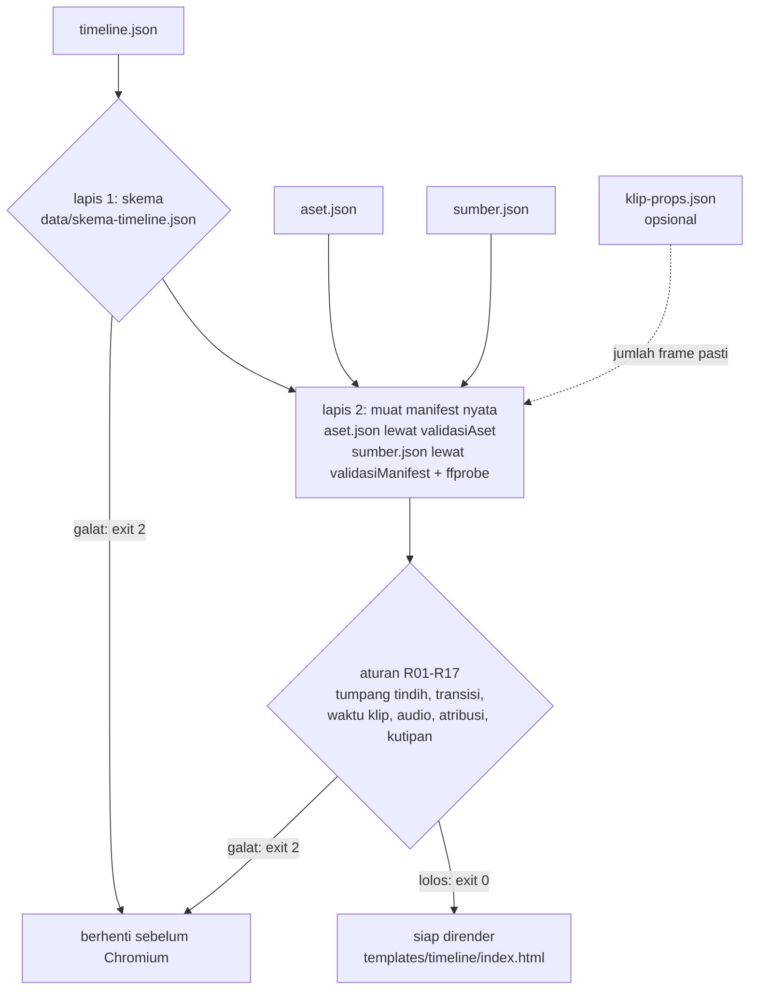
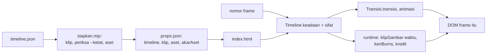

# Timeline deklaratif: `timeline.json` dan validatornya

## Metadata

- Version: `v1.1.0`
- Last updated: `2026-11-08`
- Changeset: `Templat render generik templates/timeline (issue #32): penjadwal scripts/timeline.js, perakit props siapkan.mjs, bagian Templat render dan Rencana audio, uji uji-templat-timeline; status dan Batasan diperbarui (keyframe properti #35 dan rencana audio #34 sudah ada; dokumen penutup F2 #36 menyusul).`

`timeline.json` adalah rencana video yang bisa ditinjau sebagai data: daftar track berisi butir (klip video, gambar, warna, teks, kredit, audio) dengan posisi absolut dalam frame. Dokumen ini menjelaskan format dan validatornya, `bun run timeline periksa`, yang menolak timeline yang salah **sebelum Chromium diluncurkan**, dengan pola yang sama seperti `aset.json` dan `sumber.json`.

> **Status.** Yang ada: skema, validator, dan contoh (issue #31), helper pemetaan waktu klip di `runtime.js` (#33) yang dipakai validator, keyframe properti generik di `runtime.js` (#35), rencana audio (#34), dan templat render generik `templates/timeline/` dengan penjadwal `scripts/timeline.js` (#32). Rencana audio turunan dibuat lewat `bun run audio -- --timeline` (#34, bagian Rencana audio). **Menyusul:** dokumen penutup F2 (#36).

## Alur



## Ringkasan format

Waktu adalah **frame bilangan bulat** pada `proyek.fps` bulat; rentang butir setengah terbuka `[mulai, mulai + durasi)`. Urutan `track[]` adalah urutan lapisan visual (indeks 0 paling bawah); track audio tidak berlapis. Butir merujuk media **hanya lewat id** di `aset.json` dan `sumber.json`; timeline tidak memuat jalur berkas, URL, hash, atau lisensi.

```json
{
  "$schema": "../../data/skema-timeline.json",
  "skema": 1,
  "proyek": { "lebar": 1280, "tinggi": 720, "fps": 30, "durasi": 450, "jenisVideo": "promo" },
  "manifes": { "aset": "aset.json", "sumber": "sumber.json" },
  "track": [
    { "id": "t-latar", "jenis": "video", "butir": [
      { "id": "adegan-1", "jenis": "video", "klip": "k1", "mulai": 0, "durasi": 90, "audio": { "mode": "bergantian" } },
      { "id": "adegan-2", "jenis": "video", "klip": "k2", "mulai": 75, "durasi": 80,
        "waktu": { "kecepatan": 1.5 }, "audio": { "mode": "bisu" }, "kreditLayar": true,
        "transisi": { "jenis": "pudarMelalui", "durasi": 15 } }
    ] }
  ]
}
```

Potongan di atas dari [`templates/timeline-contoh/timeline.json`](../templates/timeline-contoh/timeline.json) (contoh lengkap: tujuh track, dua transisi, speed, reverse, freeze, logo, teks, narasi, dan musik berducking). `adegan-2` mulai di frame 75 sedangkan `adegan-1` berakhir di frame 90, jadi tumpang tindihnya 15 frame, sama dengan `transisi.durasi`.

| Bidang | Isi |
| --- | --- |
| `skema` | Wajib `1`. Versi lain ditolak (validator menolak versi yang tak dikenalnya, tidak menebak). |
| `proyek` | `lebar`, `tinggi`, `fps` (bulat 1..120), `durasi` (total frame, maks 1.000.000); opsional `judul`, `jenisVideo` (13 jenis preset), `profil` (`standar` atau `kurangiGerak`), `latar`. |
| `manifes` | `aset`, `sumber`, `konsep`: jalur relatif ke folder `timeline.json`, tanpa `..`, jalur mutlak, atau skema URL. |
| `audio` | `fadeMs` (100..300), `ucapanLufs`, `ketatCampur`. |
| `penanda` | Daftar `{ id, pada, label }` (maks 500). |
| `track[]` | `{ id, jenis, butir[] }`; `jenis` = `video`, `overlay`, `teks`, `audio`; opsional `nama`, `aktif` (false = dilewati tetapi tetap divalidasi), `gainDb` (khusus audio). Maks 64 track dan 2000 butir per track. |

Butir (`jenis`) dan track yang menerimanya:

| Butir | Track | Isi utama |
| --- | --- | --- |
| `video` | `video`, `overlay` | `klip` (id di `sumber.json`), `dari`, `waktu`, `audio`, `kreditLayar`, `transisi` (hanya track `video`) |
| `gambar` | `video`, `overlay` | `aset` (gambar, logo, ikon, atau svg), `kenBurns`, `kreditLayar`, `transisi` (hanya track `video`) |
| `warna` | `video`, `overlay` | `warna`, `transisi` (hanya track `video`) |
| `teks` | `teks` | `isi`, `peran` (`judul`, `subjudul`, `isi`, `caption`, `keterangan`, `anotasi`, `kredit`), `gaya` |
| `kredit` | `teks` | `gaya`; teks atribusi diturunkan dari manifest (dirender templat) |
| `audio` | `audio` | `aset` (peran `musik` atau `narasi` diambil dari `aset.json`), `dari`, `gainDb`, `ducking` |

Bidang visual bersama: `tata` (`x`, `y`, `lebar`, `tinggi`, `fit` dalam piksel komposisi), `properti` (keyframe `x`, `y`, `skala`, `rotasi`, `opasitas`; angka tetap atau array `{ pada, nilai, easing? }` minimal dua titik), dan `animasi` (`masuk`, `keluar`, `penekanan`). Bidang apa pun di luar daftar ditolak.

Skema lengkap adalah [`data/skema-timeline.json`](../data/skema-timeline.json) (JSON Schema 2020-12). Pakai sebagai `$schema` agar penyunting memberi saran dan galat; validator membacanya **langsung**, jadi skema dan validator tidak bisa menyimpang.

## Validasi: `bun run timeline periksa`

```bash
bun run timeline periksa templates/timeline-contoh/timeline.json
bun run timeline periksa timeline.json --klip-props .cache/awvd/klip/klip-props.json --ketat
```

| Flag | Fungsi |
| --- | --- |
| `[timeline.json]` | Berkas yang diperiksa (bawaan `timeline.json`). |
| `--klip-props F` | `klip-props.json` hasil `bun run klip`: jumlah frame klip yang **pasti**. Tanpa ini jumlahnya diperkirakan dari `panjang` x fps (atau durasi sumber), dan perkiraan itu diberi peringatan bila `panjang` tidak ada. Render dan CI sebaiknya selalu memberinya. |
| `--ketat` | Peringatan dijadikan galat. |
| `--json` | Keluaran `{ lolos, galat[], peringatan[], ringkasan, turunan }` (galat dan peringatan berupa `{ kode, lok, pesan }`). |
| `--draf` | Gerbang hukum GH yang belum disetujui menjadi peringatan (hasil bukan untuk publikasi), sama dengan `bun run klip --draf`. |

Kode keluar: `0` lolos; **`2`** timeline atau argumen tidak valid (galat skema, galat aturan, manifest cacat, berkas tidak ditemukan, JSON rusak); `1` galat tak terduga. Semua pelanggaran dikumpulkan sekaligus; lokasinya adalah [JSON pointer](https://www.rfc-editor.org/rfc/rfc6901) ke bidang bermasalah:

```text
salah.json: 7 track, 11 butir, 1 transisi, 450 frame @ 30 fps (15.00 s)
  galat [R02] /track/2/butir/0/aset: aset "logo-hantu" tidak tercatat di aset.json (aset[].id)
  galat [R05] /track/0/butir/1/transisi/durasi: transisi.durasi (10) harus sama dengan tumpang tindih dengan "adegan-1" (15 frame; mulai 75, akhir butir sebelumnya 90)
  galat [R04] /track/3/butir/1: tumpang tindih 100 frame dengan "judul" di track "t-teks-1" tanpa transisi (butir yang bertumpuk wajib punya transisi.durasi = 100)
GAGAL: 3 galat
```

Galat skema berkode `SKEMA` dan menghentikan pemeriksaan (aturan lintas-bidang mengandaikan bentuk yang sah). Galat dari manifest yang dirujuk berkode `R02` dengan lokasi nama berkas manifest (misalnya `aset.json`). Validator tidak menulis berkas apa pun; keluaran turunan: rencana audio lewat `audio.mjs` (bagian Rencana audio); `--gabung` belum ada.

### Rujukan manifest nyata

`manifes.aset` dan `manifes.sumber` dimuat sungguhan, bukan ringkasan: `aset.json` lewat `validasiAset` (lisensi, hash, atribusi, resolusi, merek logo, ffprobe audio) dan `sumber.json` lewat `validasiManifest` (lisensi, hash, atribusi) ditambah ffprobe untuk durasi dan ada tidaknya audio tiap sumber yang dirujuk klip. Manifest cacat berarti timeline ditolak (R02). Butir yang merujuk id yang tidak tercatat, berjenis salah (misalnya butir gambar ke aset audio), atau (untuk audio) aset tanpa `audio.peran` ditolak. Butir yang merujuk media tanpa `manifes` yang bersangkutan juga ditolak, karena tidak ada yang bisa diverifikasi.

### Aturan lintas-bidang

Galat (kode keluar 2):

| Kode | Aturan |
| --- | --- |
| R01 | `id` track unik; `id` butir dan penanda unik di seluruh timeline |
| R02 | rujukan `klip`, `aset`, dan `gaya.font` tercatat di manifest dan berjenis yang sesuai; placeholder `[isi]` ditolak; manifest cacat atau `jenisVideo` yang berbeda dari `aset.json` ditolak |
| R03 | `mulai + durasi <= proyek.durasi`; penanda di dalam durasi |
| R04 | dua butir di satu track tidak boleh tumpang tindih kecuali oleh transisi sah; maksimal dua butir di satu titik waktu |
| R05 | `transisi.durasi` sama dengan tumpang tindih dengan butir sebelumnya, tidak melebihi durasi kedua butir, tidak di bawah minimum jenis (`durasiTransisi`), tidak ada di butir pertama, opsi transisi dapat dibangun `transisi.js`, dua jendela transisi satu track tidak bertumpuk |
| R06 | satu transisi aktif per frame di seluruh timeline (id filter SVG `transisi.js` bersifat global) |
| R07 | keyframe: `pada` naik tegas dan kurang dari `durasi`; `easing` dilarang di titik terakhir |
| R08 | `waktu`: kecepatan maksimal 3 desimal; `bekukan` dan `balik` tidak digabung; frame klip yang dibaca (`dari` + offset terbesar) kurang dari jumlah frame klip kecuali `habis` bukan `tolak` |
| R09 | audio klip: bukan `bisu` hanya bila waktu identitas (tanpa speed, reverse, freeze) dan klip beraudio; musik sumber kutipan wajib `bisu` (kecuali `musikDibahas`) |
| R10 | audio: narasi tidak dipotong (`dari` 0, `durasi` = `ceil(durasi berkas x fps)`); satu butir musik, mulai di frame 0, tidak membaca melebihi berkas; `ducking` hanya musik; peran `efek` belum didukung |
| R11 | pemegang suara: dua narasi, narasi dan klip `bergantian`, dan dua klip bersuara tidak boleh tumpang tindih (audio butir keluar berakhir di awal transisi); narasi dan klip `campur` = peringatan W05, galat bila `audio.ketatCampur` |
| R12 | atribusi: sumber CC BY atau aset dengan `atribusiTampil` `akhir` mewajibkan butir `kredit`; `atribusiTampil` `layar` mewajibkan `kreditLayar: true` |
| R13 | logo: lebar tampil efektif (kotak, `fit`, `properti.skala`) tidak di bawah `ukuranMinPx`; `rotasi` dan distorsi dilarang bila `larangan` pedoman merek memuatnya |
| R14 | `Transisi.periksaKilatan` tanpa galat (WCAG 2.3.1; pertahanan berlapis, praktis tak terjangkau karena R06 dan durasi minimum jenis berkilat) |
| R15 | `animasi.masuk.durasi + keluar.durasi <= durasi`; jendela `penekanan` di dalam butir |
| R16 | `kenBurns` tidak bersama `properti.x`/`y`/`skala` |
| R17 | kebijakan kutipan dari durasi tampil (lihat bagian berikutnya), gerbang hukum GH, dan konflik dengan nilai manual di `sumber.json` |

Peringatan (tidak memengaruhi kode keluar kecuali `--ketat`):

| Kode | Arti |
| --- | --- |
| W01 | ukuran teks di bawah minimum `ukuranTeks` untuk perannya (konteks `ponselLanskap`) |
| W02 | kotak teks di luar area aman grafis (EBU R 95) |
| W03 | lebih dari empat butir video tampil bersamaan (ambang belum terukur; beban render naik) |
| W04 | frame akhir tanpa butir visual |
| W05 | narasi di atas klip bermode `campur` |
| W06 | tiga kilatan dalam satu detik (tanpa margin) |
| W07 | jenis transisi diganti oleh `jenisVideo` atau profil (`kurangiGerak`) |
| W08 | jumlah frame klip tidak diketahui (batas pembacaan tidak diperiksa); musik kutipan yang dibahas diperiksa saat rakit audio |
| W09 | peringatan dari manifest dan kebijakan kutipan, diteruskan apa adanya |

Kontras teks terhadap latar belum diperiksa (latar dinamis).

### Pemetaan waktu klip (permil)

Butir `video` punya `dari` (frame klip tempat mulai membaca, bawaan 0) dan `durasi` (frame timeline); frame keluar tidak disimpan, ia diturunkan. Semua aritmetika kecepatan memakai bilangan bulat permil agar tak ada galat floating-point di batas lantai (`Math.floor(100 * 0.29)` bernilai 28, benarnya 29):

- Konstan: `offset(f) = lantai(f x S / 1000)`, `S = permil(kecepatan)`.
- Ramp (`kecepatan` berupa keyframe): `posisi(0) = 0`, `posisi(f+1) = posisi(f) + v(f)`, `offset(f) = lantai(posisi(f) / 1000)`; kecepatan harus > 0 di tiap frame (easing yang overshoot hingga ≤ 0 ditolak).
- Reverse (`balik`): deret maju dibalik, jadi himpunan frame sama dan hanya urutannya berbalik.
- Freeze (`bekukan`): `offset(f) = 0` selama seluruh durasi; tidak digabung dengan `balik`.

Frame klip yang dibaca adalah `dari + offset(f)` dan harus kurang dari jumlah frame klip, kecuali `waktu.habis` adalah `tahan` atau `ulang`. Tabel ramp dihitung per butir dari frame 0 tanpa keadaan antar-frame, sehingga render rentang (`--dari`) atau paralel kelak memberi indeks yang sama. Validator tidak punya rumus sendiri: `petaWaktu` dan batas R08 di `scripts/timeline.mjs` memanggil `petaWaktuKlip` dan `frameSumber` dari `scripts/runtime.js` ([api-runtime.md](api-runtime.md#pemetaan-waktu-klip), KP-052), sehingga bidang `waktu` di skema dan objek `waktu` runtime bermakna sama dan templat render (`scripts/timeline.js`, `opsiKlip`) meneruskan `waktu` dari `timeline.json` ke runtime apa adanya. Perbedaannya hanya penyaringan: skema membatasi `kecepatan` ke 0,1 sampai 10 (runtime menerima sampai 1000), memakai easing bernama dan bezier (runtime juga menerima fungsi), dan R07 menolak keyframe `pada >= durasi` butir (runtime membiarkannya). `scripts/uji-timeline.mjs` (m) menjaga kesetaraan hasilnya.

### Kebijakan kutipan dihitung dari timeline

Timeline adalah sumber tunggal jadwal, jadi untuk sumber yang dalam cakupan kutipan (lisensi `KUTIPAN-WAJAR` atau memuat blok `kutipan`) validator **menurunkan** durasi video (`proyek.durasi / fps`), jendela komentar (butir narasi, serta teks berperan `caption` dan `anotasi`), serta posisi dan panjang tiap kutipan (durasi tampil butir, bukan jendela ekstraksi klip), lalu menjalankan `periksaKutipan` dari `kutipan.mjs` atas hasilnya: batas per klip, per sumber, proporsi terhadap video, komentar aktif, kutipan beruntun, dan isi blok. Gerbang hukum GH dinilai pada `sumber.json` apa adanya (hash mengikat manifest dan memo).

Bidang manual di `sumber.json` (`proyek.durasiVideoDetik`, `proyek.komentar`, `klip[].mulaiVideo`) tidak diperlukan; bila ada dan **bertentangan** dengan timeline, hasilnya galat R17, sehingga dua sumber kebenaran tidak bisa diam-diam berbeda. Catatan: `bun run klip` sendiri masih menuntut bidang manual itu untuk sumber dalam cakupan kutipan; integrasinya menyusul bersama rencana audio (#34).

## Templat render

`templates/timeline/index.html` merender `timeline.json` apa pun (skema 1) menjadi MP4: track `video`, `overlay`, dan `teks` berlapis menurut urutan track (indeks 0 paling bawah), dengan transisi antar butir. Kode dibagi tiga supaya jadwal tidak diduplikasi:

| Bagian | Tugas |
| --- | --- |
| `scripts/timeline.js` (`window.Timeline`) | Murni dan tanpa DOM: `rencana` (indeks butir dan transisi masuk), `keadaan(rencana, frame)` (butir tampil, peran `diam`/`keluar`/`masuk`, gaya lapisan luar), `sifat` (kotak `tata`, keyframe `properti`, animasi masuk, keluar, penekanan, Ken Burns), `opsiKlip`, `teksKredit`, `teksKreditLayar`. Dapat dimuat lewat `require()` untuk uji tanpa browser. |
| `runtime.js` dan `transisi.js` | Sumber tunggal aritmetika: `klipGambar` dengan `waktu`/`dari`/`durasi` (trim, speed, ramp, reverse, freeze), `kenBurns`, `keyframe`, `ukuranTeks`, `kreditKlip`, `kreditAset`; `Transisi.transisi`, `animasi`, `animasiTeks`, `terapkan` dan profil `kurangiGerak`. Tidak ada rumus waktu klip di `timeline.js`. |
| `templates/timeline/index.html` | Menempelkan hasil ke DOM per nomor frame; tidak ada CSS animation atau transition, `Date.now()`, atau `Math.random()`. |



Pemakaian:

```bash
bun templates/timeline/siapkan.mjs templates/timeline-contoh/timeline.json --out .cache/awvd/timeline
bun scripts/render.mjs templates/timeline/index.html --props-file .cache/awvd/timeline/props.json --out out/timeline.mp4
# rentang atau satu frame (acak-akses, hasil sama dengan render penuh):
bun scripts/render.mjs templates/timeline/index.html --props-file .cache/awvd/timeline/props.json --dari 70 --sampai 95 --out out/transisi.mp4
```

`siapkan.mjs` hanya menjalankan CLI yang ada, berurutan dan berhenti di galat pertama (kode keluar 2): `bun run klip` pada fps timeline, `bun run timeline periksa --klip-props --ketat` (jumlah frame klip pasti; timeline yang ditolak validator tidak pernah sampai ke Chromium), lalu `bun run aset periksa`, dan menulis `props.json` = `{ timeline, klip, aset, akarAset }` (`akarAset` = URL `file://` folder `aset.json`). `--draf` diteruskan ke `klip` dan validator. Tanpa `props.timeline` templat berhenti dengan pesan galat berisi perintah ini; ukuran, fps, dan durasi video diambil dari `proyek` timeline.

Perilaku yang perlu diketahui:

- **Lapisan.** Tiap track visual punya pembungkus (`z-index` = indeks track + 1). Di dalamnya tiap butir punya lapisan luar (diatur transisi: `keluar` di bawah `masuk`, filter SVG, `clip-path`) dan lapisan dalam (kotak `tata`, `properti`, animasi). Overlay dan wadah transisi dipasang pada track yang bertransisi saja; track lain dibersihkan tiap frame.
- **Transisi.** Jendela transisi = tumpang tindih butir (aturan R05), dihitung `Transisi.transisi(frame, { ...transisi, mulai, durasi, profil, jenisVideo })` sama dengan validator, sehingga penggantian jenis oleh `jenisVideo` dan profil (W07) terjadi juga saat render. Butir bertata (kotak lebih kecil dari bingkai) diberi `tembus: true`. `wadah.background` solid dari transisi tertentu menutup track di bawahnya; transisi dipakai di track video terbawah.
- **Klip.** `waktu` dari timeline diteruskan apa adanya (`opsiKlip` menghasilkan `{ waktu, dari, durasi }` untuk `klipGambar`), digambar ke `<canvas>` seperti `klip-tertanam`. `fit` bawaan `cover`.
- **Properti keyframe.** `x`, `y` (translasi px), `skala`, `rotasi` (derajat), `opasitas`; `pada` = frame lokal butir, nilai ditahan sebelum dan sesudah titik ujung. Nilainya dihitung `keyframe` runtime.js (#35, easing per segmen); transform disusun `translate`, `rotate`, `scale`, lalu transform animasi, opasitas dikalikan.
- **Animasi.** `masuk`, `keluar`, dan `penekanan` lewat `Transisi.animasi`; `keluar` dihitung sebagai kebalikan fungsi tampak yang sama pada `durasi - keluar.durasi` (durasi bawaan jenis bila tak ditulis). `masuk.mode` (`huruf`/`kata`) pada butir teks memindahkan animasi masuk ke tiap huruf atau kata lewat `animasiTeks`.
- **Teks dan kredit.** Tanpa `tata`, teks dan kredit memakai area aman grafis (EBU R 95). Ukuran bawaan dari `ukuranTeks` menurut `peran`. `gaya.font` memuat aset font lewat `pasangFont`. Butir `kredit` berisi satu baris TASL lengkap per sumber klip yang dipakai (urutan kemunculan) dan atribusi aset `layar`/`akhir` dari `aset.json`. `kreditLayar: true` menampilkan atribusi ringkas di area aksi selama butir tampil.
- **Profil `kurangiGerak`.** Ditangani `transisi.js` untuk transisi dan animasi (jenis gerak besar menjadi `pudar`). Tambahan di templat: Ken Burns ditahan di `dari` (pola "kamera mati"). `properti` yang ditulis penulis tidak diubah.
- **Determinisme.** `keadaan` dan `sifat` murni dari timeline dan frame (tanpa keadaan antar-frame), diuji tidak bergantung urutan pemanggilan; render rentang diuji dua kali dengan `framemd5` identik (`bun run uji:templat-timeline`).
- **Belum dirender.** Track `audio`, `penanda`, `manifes.konsep`, dan `proyek.judul`. Suara dirakit terpisah oleh `audio.mjs` (bagian Rencana audio) lalu dimasukkan ke video lewat `render.mjs --audio`.

### Rencana audio

Rencana audio diturunkan dari timeline oleh `audio.mjs`, bukan oleh subcommand `timeline`:

```bash
bun run audio -- --timeline timeline.json --klip-props klip-props.json --out campuran.wav [--rencana-keluar rencana-audio.json]
```

Track audio (peran `narasi` dan `musik`, `gainDb` track dan butir, `ducking`) dan `audio.mode` butir video dipetakan ke rencana. Timeline diperiksa penuh lebih dulu seperti `timeline periksa`; satu galat saja berarti tidak ada audio yang dirakit (exit 2). Rincian pemetaan, aturan transisi, kode galat A01-A04, dan batas (musik sepanjang video, tanpa olah suara) ada di [video-tertanam-audio.md](video-tertanam-audio.md#rencana-dari-timelinejson).

## Contoh

[`templates/timeline-contoh/`](../templates/timeline-contoh/), contoh yang juga dirender templat di atas, berisi `timeline.json` (multitrack), `timeline-sederhana.json` (warna, logo, dua teks), `aset.json`, `sumber.json`, dan media kecil buatan sendiri (catatan di [ASET.md](../templates/timeline-contoh/ASET.md)). Semua contoh lolos tanpa peringatan:

```bash
bun run timeline periksa templates/timeline-contoh/timeline.json
bun run timeline periksa templates/timeline-contoh/timeline-sederhana.json
# jumlah frame klip yang pasti (ekstraksi dengan ffmpeg, tanpa Chromium):
bun run klip templates/timeline-contoh/sumber.json --fps 30 --out .cache/awvd/timeline-contoh
bun run timeline periksa templates/timeline-contoh/timeline.json --klip-props .cache/awvd/timeline-contoh/klip-props.json
```

## Keputusan

Diambil pemilik pada 2026-11-07 setelah riset #30; alasan dan rujukan PR di [log-keputusan.md](log-keputusan.md).

1. **Waktu = frame bilangan bulat pada fps bulat.** Tanpa pembulatan, sama dengan `renderFrame(n)`; fps pecahan (29,97) ditunda ke skema 2.
2. **Transisi = tumpang tindih dua butir di track video**, panjangnya sama dengan `transisi.durasi`; hanya satu transisi aktif per frame.
3. **`timeline.json` = sumber tunggal jadwal.** Rencana audio, mulai klip, durasi, dan kebijakan kutipan diturunkan darinya; audio klip bawaannya bisu (`audio.mode` tidak ditulis = `bisu`).
4. **OpenTimelineIO bukan format asli.** Konverter opsional masuk backlog setelah F6.

Dua pilihan implementasi yang menyertainya: validator ditulis tangan tanpa dependensi dengan skema JSON sebagai kontrak yang dibaca langsung (Ajv akan menambah dependensi runtime dan memberi pesan tak berlokasi), dan bidang tak dikenal ditolak (fail-closed, berbeda dengan OpenTimelineIO yang mengabaikannya) karena bidang yang diabaikan dapat meloloskan atribusi atau lisensi yang tak diperiksa.

## Batasan

- Templat tidak merender audio (rencana dan campuran audio ada di `audio.mjs`, bagian Rencana audio). Helper waktu klip (#33) dipakai validator dan templat; keyframe properti (#35, `keyframe` di `runtime.js`) dipakai templat.
- Templat: hanya `video`, `overlay`, `teks`; satu transisi aktif per frame; `wadah.background` solid dari beberapa transisi menutup track di bawahnya; tanpa pembungkus per track untuk efek antar-track; kecepatan render belum diukur (contoh 450 frame sekitar 18 detik pada mesin pengembangan, bukan patokan).
- fps pecahan, `efek` tingkat butir, rantai transisi, komposisi bersarang, audio `efek`, ducking dan fade per butir, serta transisi bersamaan adalah kandidat skema 2.
- `profil` `lansia` dan `anak` ditolak karena menskalakan durasi transisi.
- Musik: satu butir, mulai di frame 0 (`audio.mjs` belum mendukung offset musik).
- Angka batas (64 track, 2000 butir per track, 256 keyframe, 500 penanda, 1.000.000 frame, berkas 5 MB, ambang W03) adalah keputusan desain, belum diukur.
- Jumlah frame klip tanpa `--klip-props` adalah perkiraan; ffprobe dibutuhkan untuk manifest berisi video, audio, atau gambar raster.
- Validator memeriksa kelengkapan catatan dan kepatuhan aturan teknis; ia tidak menjamin pemakaian yang sah secara hukum, dan kebijakan kutipan bukan nasihat hukum.

## Changelog

### 2026-11-08 - v1.1.0

- Templat render generik `templates/timeline/` (issue #32): `scripts/timeline.js` (penjadwal murni), `siapkan.mjs` (perakit props), bagian Templat render, diagram, dan `bun run uji:templat-timeline`; bagian Rencana audio (#34, `bun run audio -- --timeline`); status, alur, dan Batasan diperbarui (keyframe properti #35 dan rencana audio #34 sudah ada; dokumen penutup F2 #36 menyusul).

### 2026-11-07 - v1.0.1

- Pemetaan waktu klip validator memakai `petaWaktuKlip` dan `frameSumber` dari `runtime.js` (issue #33) sebagai sumber tunggal, dengan uji kesetaraan di `scripts/uji-timeline.mjs`; status, bagian Pemetaan waktu klip, dan Batasan tidak lagi menyebut helper runtime sebagai "menyusul".

### 2026-11-07 - v1.0.0

- Dokumen baru: format `timeline.json` skema 1, `bun run timeline periksa`, aturan R01-R17 dan W01-W09, pemetaan waktu klip permil, kebijakan kutipan turunan, contoh `templates/timeline-contoh`, dan keputusan pemilik. Render, rencana audio, dan helper runtime ditandai menyusul.
