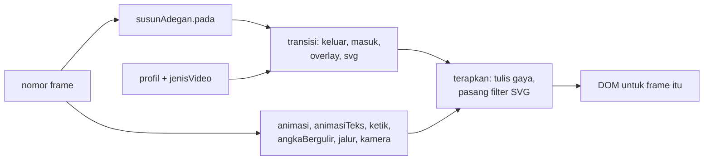

# Transisi dan animasi elemen

## Metadata

- Version: `v1.1.0`
- Last updated: `2026-11-07`
- Changeset: `Preset jenis video dan profil gerak kini terhubung ke konsep.json (brief, keluaran preset, kurangiGerak lewat props); susunAdegan menerapkan pengali durasi profil sekali (isu #63, #28).`

Referensi modul `scripts/transisi.js`, yang menyediakan `window.Transisi`: transisi antar adegan, animasi masuk/keluar/penekanan elemen, dan helper gerak. Modul ini mandiri dan terpisah dari `scripts/runtime.js` ([api-runtime.md](api-runtime.md)); runtime tetap kecil dan komposisi memuat modul ini hanya bila perlu. Galeri semua jenis ada di `templates/transisi-galeri/`. Aturan determinisme yang mendasarinya ada di [arsitektur.md](arsitektur.md#aturan-determinisme).

## Pemakaian

Muat setelah `runtime.js`:

```html
<script src="../../scripts/runtime.js"></script>
<script src="../../scripts/transisi.js"></script>
```

Contoh dua adegan dengan transisi `pudarMelalui` (jenis video `formal`, jadi efek berbiaya tinggi mati). `susunAdegan` menghitung tumpang-tindih dan `pada(frame)` mengembalikan gaya setiap adegan:

```html
<div id="layar" style="position:relative;width:1280px;height:720px;overflow:hidden;background:#111;font:96px system-ui;color:#fff">
  <div id="a0" style="position:absolute;inset:0;background:#1e3a8a">Satu</div>
  <div id="a1" style="position:absolute;inset:0;background:#0f766e">Dua</div>
  <div id="ov" style="position:absolute;inset:0;z-index:10"></div>
</div>
<script>
  const Tr = window.Transisi;
  const susun = Tr.susunAdegan(
    [{ durasi: 60 }, { durasi: 60, transisi: { jenis: "pudarMelalui", warna: "#111827" } }],
    { fps: 30, jenisVideo: "formal" });
  const el = [document.getElementById("a0"), document.getElementById("a1")];
  defineVideo({
    width: 1280, height: 720, fps: 30, durationInFrames: susun.total,
    render(frame) {
      const s = susun.pada(frame);
      Tr.terapkan({ wadah: s.wadah, overlay: s.overlay, svg: s.svg },
        { wadah: document.getElementById("layar"), overlay: document.getElementById("ov") });
      s.adegan.forEach((a, i) => Tr.terapkan({ keluar: a.gaya }, { keluar: el[i] }));
    },
  });
</script>
```

Fungsi tingkat rendah dapat dipakai langsung tanpa `susunAdegan`: `Tr.transisi(frame, { jenis, mulai, durasi })` mengembalikan gaya lapisan `keluar` dan `masuk`, `overlay`, dan `svg`; `Tr.animasi(frame, { jenis, mulai, durasi })` mengembalikan objek gaya CSS untuk satu elemen. Semuanya fungsi murni dari nomor frame. Contoh lengkap ada di `templates/transisi-galeri/index.html`.



Konvensi lapisan: adegan masuk di atas (`zIndex` 2), keluar di bawah (1), overlay `zIndex` 10. Adegan dianggap **opak** (latar penuh); beri `tembus: true` bila adegan transparan. Setiap lapisan selalu menerima kumpulan properti lengkap, dan di luar jendela transisi keadaannya dipaksa ke identitas, sehingga tidak ada transform, clip, atau filter yang tersisa.

## API `window.Transisi`

| Fungsi | Keterangan |
| --- | --- |
| `transisi(frame, opsi)` | Transisi antar adegan. Opsi umum: `jenis` (nama, array untuk rantai), `mulai`, `durasi` (frame) atau `durasiMs`, `easing`, `arah` (`kiri`/`kanan`/`atas`/`bawah`), `warna`, `intensitas`, `seed`, `lebar`/`tinggi`, `profil`, `jenisVideo`, `paksaEfekBerat`, `fps`, `tembus`. Opsi khusus jenis: `lembut`, `sudut`, `jumlah`, `bentuk`, `mode`, `pusat`, `paralaks`, `rasioKeluar`, `warna2`. Hasil: `{ keluar, masuk, wadah, overlay[], svg, tampil, progres, progresEase, durasi, jenisEfektif, aktif, selesai, peringatan[] }`. |
| `animasi(frame, opsi)` | Gaya CSS satu elemen: `jenis`, `mulai`, `durasi`/`durasiMs`, `easing`, `arah`, `jarak`, `stagger`, `indeks`, `keluarMulai`, `keluarDurasi`, `intensitas`, `profil`, dan opsi khusus jenis (`skalaAwal`, `blur`, `warna`, `tebal`, `ulang`, `siklus`). Animasi masuk memakai easing perlambat, keluar memakai percepat. |
| `animasiTeks(frame, teks, opsi)` | Pecah teks per `huruf` atau `kata` (`mode`) dan beri `stagger`; mengembalikan `[{ teks, spasi, gaya }]`. Spasi tidak dihitung dalam indeks. |
| `ketik(frame, teks, { mulai, cps, fps })` | Mesin tik: `{ teks, jumlah, selesai, kursor }`; kursor berkedip 1 Hz (tidak berkilat terang). |
| `angkaBergulir(frame, { dari, ke, mulai, durasi, desimal, awalan, akhiran })` | Penghitung; format id-ID (`12.847`, `3,5 %`) ditulis manual tanpa ICU. |
| `jalur(frame, { titik, mulai, durasi, easing, orientasi })` | Gerak sepanjang bezier kubik multi-segmen (`1+3n` titik) dengan kecepatan konstan lewat tabel panjang busur. |
| `sekunder(frame, opsi, { jeda, easing })` | Aksi sekunder (follow-through): anak mengikuti induk dengan jeda dan easing pegas lembut. |
| `kamera(frame, { dari, ke, ... })` | Zoom/pan/Ken Burns; memberi `peringatan[]` bila laju zoom > 15 %/detik atau pan > 25 % lebar/detik (ambang keputusan desain). |
| `paralaks(frame, { lapisan, gerak, ... })` | Lapisan berkedalaman 0..1; hanya aktif bila profil mengizinkan. |
| `bersama(frame, { dari, ke, mode, busur, ... })` | Elemen bersama (container transform): kotak `{ x, y, w, h, r }` berubah via properti layout (teks tidak terdistorsi); isi lama memudar keluar, isi baru masuk (`mode` `melalui` atau `silang`). |
| `susunAdegan(daftar, { fps, lebar, tinggi, profil, jenisVideo })` | `daftar = [{ durasi, transisi? }]`. Mengembalikan `{ total, peta[], pada(frame) }`; `peta[i]` memuat `mulai`, `durasi`, `overlap`, `tunggal` (frame adegan tampil sendirian). Pengali durasi profil diterapkan sekali, saat menghitung `overlap`; `pada(frame).transisi.durasi` selalu sama dengan `peta[i].overlap`, sehingga `progres` frame terakhir tumpang-tindih bernilai `(overlap - 1) / overlap` dan adegan masuk tuntas (progres 1) di frame berikutnya, sama untuk semua profil. |
| `terapkan(hasil, { keluar, masuk, wadah, overlay })` | Menulis gaya ke DOM, memasang atau menghapus node `<filter>` SVG per frame, dan mengelola `div` overlay. |
| `grain(kanvas, frame, { seed, hidup, tahan, kekuatan, jenisVideo })` | Butiran film di `<canvas>` kecil (mis. 320x180, `image-rendering: pixelated`). Bawaan `hidup: 0` (diam). |
| `periksaKilatan(daftarTransisi, fps)` | Pemeriksa kilatan tingkat rencana: `{ ok, galat[], peringatan[], kilatan }`. |
| `daftarTransisi(nama, fn, meta)`, `daftarAnimasi(nama, fn, meta)` | Registri jenis kustom (lihat Kustomisasi). |
| `gabungGaya(...gaya)` | Menggabungkan gaya berantai. |
| `easing`, `profil` | Tabel kurva dan profil bawaan. |
| `presetJenisVideo(jenis, peran, audiens)`, `efekBerat(jenisVideo)` | Preset per jenis video dan status efek berat. |
| `katalog()` | Daftar semua jenis beserta metadata (makna, durasi, risiko, biaya, sumber). |
| `durasiTransisi(opsi)`, `pecahTeks(teks, mode)`, `acak3(seed, k, j)` | Pembantu. |

Nama global tidak dibuat (tidak ada alias), supaya tidak bentrok dengan `easing`, `fade`, dan `pegas` milik runtime.

## Katalog transisi

Durasi bawaan pada 30 fps (frame dalam kurung). "GB" = gerak besar (diganti `pudar` oleh `kurangiGerak`); "K" = dihitung sebagai calon kilatan WCAG 2.3.1 oleh `periksaKilatan`. Kolom Bukti: **M** = angka dari pola Material (pedoman industri), **B** = konvensi penyuntingan film (buku teks), **P** = praktik tanpa bukti empiris. Tidak ada jenis yang diklaim "lebih efektif" dari yang lain (lihat Keterbatasan bukti).

| Jenis | Makna | Kapan dipakai | Durasi | Risiko | Biaya | Bukti |
| --- | --- | --- | --- | --- | --- | --- |
| `potong` | Pergantian instan; kontinuitas | Bawaan aman untuk semua jenis; terutama dokumenter, formal, panduan | 0 | rendah | rendah | B |
| `pudar` | Lapisan baru memudar di atas lapisan lama; waktu berlalu, hubungan antar gambar | Formal, dokumenter, edukasi, testimoni, data | 500 ms (15) | rendah | sedang | B |
| `celup` | Memudar ke warna lalu ke adegan baru; akhir bab, penutup (K) | Dokumenter, formal, testimoni, PSA, penutup | 700 ms (21) | rendah | rendah | B |
| `pudarMelalui` | Lama memudar (35 % pertama), baru muncul dengan skala 0,92 ke 1; antar destinasi tanpa hubungan kuat | Formal, edukasi, panduan, produk, data, internal | 450 ms (14) | rendah | sedang | M |
| `pudarBlur` | Dissolve dengan blur sampai 14 px; kenangan, fokus lembut (GB) | Kreatif, dokumenter, testimoni | 600 ms (18) | sedang | sedang | P |
| `geser` | Adegan baru menutup lama dari satu sisi; topik atau tempat baru; paralaks opsional (GB) | Promo, sosial, produk, acara, edukasi | 450 ms (14) | sedang | rendah | M, P |
| `dorong` | Kedua adegan bergeser bersama; perpindahan tempat berurutan; `rasioKeluar` < 1 = paralaks (GB) | Promo, sosial, produk, edukasi, panduan | 450 ms (14) | sedang | rendah | M |
| `tumpuk` | Baru meluncur di atas, lama mengecil 6 % dan menggelap 35 %; hierarki dan kedalaman (GB) | Produk, panduan, promo, edukasi | 500 ms (15) | sedang | rendah | M |
| `sapu` | Tepi menyapu; arah atau `sudut` bebas; tepi keras atau lembut (`lembut`) (GB) | Promo, sosial, produk, acara, kreatif | 500 ms (15) | sedang | rendah | B, P |
| `belah` | Lapisan lama terbelah dari tengah (barn door); pengungkapan, pembuka acara (GB) | Acara, promo, kreatif | 600 ms (18) | sedang | rendah | P |
| `kisi` | Jalusi `jumlah` lajur; ritme grafis (GB) | Promo, data, kreatif, produk | 600 ms (18) | sedang | rendah | P |
| `iris` | Lingkaran membuka (`mode: "tutup"` menutup) dari titik `pusat`; fokus ke satu titik (GB) | Kreatif, promo, acara, sosial, edukasi | 600 ms (18) | sedang | rendah | B, P |
| `bentuk` | Berlian, segienam, bintang, atau kotak (`bentuk`) membesar dari pusat (GB) | Kreatif, promo, acara, sosial | 600 ms (18) | sedang | rendah | P |
| `zoom` | Lama membesar sambil memudar, baru mengendap; energi, menyelam ke detail (GB) | Promo, sosial, acara, kreatif | 450 ms (14) | tinggi | rendah | P |
| `cambuk` | Geser cepat dengan blur arah (filter SVG); energi tinggi (GB) | Promo, sosial, acara, kreatif | 300 ms (9) | tinggi | sedang | P |
| `halaman` | Lembar dibalik (`rotateY` 0..180 dengan bayangan; tanpa lengkung kertas) (GB) | Kreatif, acara, dokumenter | 900 ms (27) | tinggi | sedang | P |
| `balik` | Dua sisi satu kartu; sebelum/sesudah, mitos/fakta (GB) | Edukasi, kreatif, promo | 700 ms (21) | tinggi | rendah | P |
| `gangguan` | Glitch: pita horizontal terdisplasi dan kanal RGB bergeser; pembaruan 15 Hz, luminans global tidak diubah (GB) | Promo, sosial, kreatif, acara | 400 ms (12), minimum 300 ms | sedang | **tinggi** | P |
| `kebocoran` | Light leak: gradien hangat mode `screen` naik-turun sin^2; nostalgia (K) | Kreatif, dokumenter, acara, testimoni | 800 ms (24), minimum 700 ms | sedang | sedang | P |
| `kilat` | Overlay putih puncak maksimal 50 %, satu kilatan (K) | Promo, sosial, acara | 450 ms (14), minimum 400 ms | tinggi | rendah | P |
| `tirai` | Panel warna merek menutup layar, pergantian tersembunyi, panel keluar; `warna2` untuk panel kedua (GB, K) | Promo, sosial, acara, produk, kreatif | 700 ms (21) | sedang | rendah | P |

Catatan makna:

- **Potong dan kontinuitas.** Potongan yang mengikuti konvensi kontinuitas sering tidak disadari penonton, terutama bila narasi atau audio berlanjut; dissolve bukan syarat kontinuitas melainkan penanda. Dissolve, fade, dan wipe yang kasatmata berfungsi sebagai penanda batas bagian, jadi pasangkan dengan batas semantik nyata (bagian baru) dan jangan dipakai dekoratif di dalam satu ide.
- **Match cut** tidak dijadikan jenis sendiri: cukup `potong` dengan elemen yang sama di kedua adegan, atau `bersama` dengan durasi 1-6 frame.
- **Pola Material** yang dipadankan: fade through = `pudarMelalui`; shared axis x/y/z = `geser`/`dorong`/`tumpuk`; container transform = `bersama`.
- Aturan pilih (turunan, keputusan desain): satu keluarga transisi per video; transisi mengikuti batas semantik (antar adegan dalam satu bagian = `potong`/`pudar`/`pudarMelalui`, antar bagian = transisi kasatmata, akhir bab = `celup`); arah gerak konsisten (maju = kiri, mundur = kanan); durasi adegan sendirian (`peta[i].tunggal`) harus cukup untuk membaca teksnya (`durasiBaca` di runtime), karena transisi tidak boleh memakan waktu baca. Jenis ekspresif (`gangguan`, `kebocoran`, `halaman`, `zoom`, `cambuk`, `kilat`) tidak untuk formal, internal, panduan, edukasi, atau PSA, kecuali pemilik meminta.

## Katalog animasi elemen

Model: satu fungsi tampak `v` (0 tersembunyi .. 1 tampil penuh, boleh lebih dari 1 saat overshoot) sehingga masuk dan keluar adalah arah berlawanan dari fungsi yang sama. Penekanan (`denyut`, `getar`, `kilatSorot`) bersifat siklik pada jendela `[mulai, mulai+durasi]` dan di luar jendela tidak meninggalkan sisa. Stagger: frame lokal elemen ke-`indeks` = `frame - mulai - indeks * stagger`.

| Jenis | Efek | Durasi | GB | Kapan dipakai |
| --- | --- | --- | --- | --- |
| `pudar` | Opasitas | 300 ms | tidak | Paling aman; pengganti semua animasi GB saat `kurangiGerak` |
| `geser` | Translate dan opasitas; `arah` = arah gerak, `jarak` bawaan 40 px | 400 ms | ya | Teks dan kartu masuk; jarak kecil (20-60 px) cukup |
| `skala` | Scale dari `skalaAwal` (0,8) ke 1 dan opasitas | 400 ms | ya | Penekanan masuk; padukan `easing: "pegas"` untuk overshoot |
| `kabur` | Blur-in sampai `blur` px (bawaan 12) | 500 ms | ya | Fokus lembut; filter blur mahal di render |
| `tirai` | Mask reveal `clip-path inset`, elemen tidak bergerak | 500 ms | tidak | Menyingkap teks atau gambar |
| `gambarGaris` | Draw-on stroke SVG (`stroke-dasharray: 1`, `dashoffset` 1..0; wajib `pathLength="1"`) | 800 ms | tidak | Garis tren, tanda centang, diagram alur |
| `sorot` | Highlight spidol di belakang teks inline | 500 ms | tidak | Menandai kata penting |
| `garisBawah` | Garis bawah digambar kiri ke kanan | 450 ms | tidak | Menandai kata penting |
| `mantul` | Translate, skala, opasitas dengan easing `pegas` (overshoot, follow-through) | 600 ms | ya | Kinetic typography per huruf atau kata |
| `tumbuh` | Batang tumbuh (`scaleY`/`scaleX`) dari dasar sesuai `arah` | 700 ms | ya | Grafik batang; pakai `stagger` 4-6 frame |
| `denyut` | Pulse skala ringan `1 + 0,06 * intensitas * sin(pi p)` | 600 ms | tidak | Penekanan |
| `getar` | Shake translateX meredam, maksimum sekitar 6 px | 500 ms | ya | Penekanan; mati saat `kurangiGerak` |
| `kilatSorot` | Cincin `box-shadow` memudar (luminans rendah, bukan kilatan) | 700 ms | tidak | Menyorot tombol atau angka |

Makna harus dikaitkan dengan isi: batang tumbuh = nilai, garis digambar = tren. Animasi dekoratif tanpa fungsi tidak otomatis membantu pemahaman, dan studi tentang detail yang menarik tetapi tak relevan (seductive details) menunjukkan arah merugikan bagi retensi; satu perubahan per tahap lebih mudah diikuti daripada semua properti sekaligus.

## Kustomisasi

- **Registri.** `daftarTransisi(nama, (pe, p, ctx) => ({ keluar, masuk, wadah, overlay, svg, tampil }), meta)` dan `daftarAnimasi(nama, (v, ctx) => gaya, meta)`. `pe` = progres ber-easing, `p` = progres linear, `ctx` memuat `w`, `h`, `arah`, `warna`, `intensitas`, `seed`, `frame`, `durasi`, `ease`, dan opsi lain. Metadata (`durMs`, `durMinMs`, `easing`, `gerakBesar`, `kilat`, `biaya`, `risiko`, `makna`, `cocok`, `sumber`) otomatis ikut aturan `kurangiGerak`, `periksaKilatan`, dan `efekBerat`. Fungsi kustom wajib murni (tanpa `Date.now()`, `Math.random()`, atau CSS animation/transition).
- **Rantai.** `jenis` boleh array, mis. `["geser", "kebocoran"]` atau `[{ jenis: "zoom" }, { jenis: "gangguan", seed: 3 }]` dengan parameter per anak. `transform` dan `filter` disambung berurutan, `opacity` dikalikan (dua `pudar` berantai memberi fade kuadrat), `clipPath`/`maskImage` yang terakhir bukan `none` menang. Urutan adegan dengan transisi berbeda memakai `susunAdegan`.
- **Easing.** Nama bawaan `linear`, `standar`, `percepat`, `perlambat`, `ditekankan`, `ditekankanKeluar`, `masukKeluar`, `kuat`, `keluarCubic`, `masukKeluarCubic`, `pegas`, `pegasLembut`; bezier `[x1, y1, x2, y2]`; fungsi `t -> t`; atau `easing.pegasEasing({ osilasi, redaman })`. Tabel kurva di modul ini ditulis sendiri dan terpisah dari `easing` runtime (koefisien bezier Material diduplikasi demi kemandirian).
- **Profil audiens** (`profil`): `standar`; `lansia` (durasi 1,5x, tanpa paralaks, jarak 0,6x, intensitas 0,7x, menghindari `gangguan`, `cambuk`, `kilat`, `kebocoran`, `halaman`, `balik`, `zoom`, `pudarBlur`); `anak` (durasi 1,25x, intensitas 0,85x, menghindari `gangguan` dan `kilat`); `kurangiGerak` (lihat Aksesibilitas). Semua angka profil adalah keputusan desain, bukan hasil riset. Profil dapat berupa objek kustom. **Panjang total video berubah menurut profil** (galeri: 1189 frame standar, 1015 `lansia`, 1224 `kurangiGerak`), jadi subtitle dan narasi harus disinkronkan dari `peta` `susunAdegan`, bukan angka tetap.
- **Preset per jenis video.** `presetJenisVideo(jenis, peran, audiens)` dengan `peran` `antarAdegan`, `antarBagian`, `pembuka`, atau `penutup`, mis. formal: `pudar` 300 ms antar adegan, `pudarMelalui` 500 ms antar bagian, `celup` 700 ms penutup; promo: `dorong` 250 ms antar adegan, `tirai` 500 ms antar bagian. Seluruh nilai preset adalah keputusan desain (selaras `data/jenis-video.json`). Preset ini dibaca langsung oleh `scripts/konsep.mjs`: `bun run konsep -- brief` menampilkannya (beserta jenis dan durasi efektif setelah profil) dan `bun run konsep -- preset` menyuntikkannya sebagai props `profil` dan `transisi`; profil gerak diturunkan dari `kurangiGerak` dan `audiens.profil` di `konsep.json` ([konsep-jenis-alur.md](konsep-jenis-alur.md#transisi-dan-gerak)).
- **Efek berat.** Jenis `gangguan` dan grain hidup berbiaya tinggi (lihat Biaya kompresi). `efekBerat(jenisVideo)` bernilai `true` hanya untuk `kreatif`, `promo`, `sosial`, dan `acara`. Bila opsi `jenisVideo` diberikan dan jenis itu tidak mengizinkan, `transisi` mengganti `gangguan` dengan `pudar` (dengan `peringatan`) dan `grain` menurunkan `hidup` menjadi diam. `paksaEfekBerat: true` menimpa. Tanpa opsi `jenisVideo`, tidak ada pemblokiran. `grain` bawaan diam (`hidup: 0`).

## Aksesibilitas

Dasar yang berlaku langsung untuk video pra-rekam ialah **WCAG 2.2 SC 2.3.1 Three Flashes or Below Threshold**: tidak lebih dari tiga kilatan dalam satu detik. SC 2.3.3 Animation from Interactions (AAA) secara normatif hanya untuk animasi yang dipicu interaksi pengguna, dan SC 2.2.2 mengatur animasi otomatis; keduanya tidak menjadi kewajiban normatif untuk MP4. Karena itu opsi `kurangiGerak` adalah **praktik terbaik** untuk penonton yang peka gerak (vestibular), bukan klaim kepatuhan. Pola yang diikuti adalah `prefers-reduced-motion: reduce` (Media Queries Level 5).

| Aturan | Dasar | Pemeriksaan |
| --- | --- | --- |
| Maksimal 3 kilatan per detik; jenis berkilat (`celup`, `kebocoran`, `kilat`, `tirai`) dihitung 1 kilatan | WCAG 2.3.1 | `periksaKilatan` (rencana) dan `bun run periksa` (video) |
| Durasi minimum jenis berkilat: `kilat` 400 ms, `kebocoran` 700 ms, `gangguan` 300 ms | Keputusan desain di atas 2.3.1 | `bun run uji:transisi` |
| `kilat` puncak alfa maksimal 50 %; `kebocoran` berbentuk sin^2 dan tidak merah jenuh (R/(R+G+B) < 0,8) | Definisi flash merah WCAG 2.3.1 | Kilatan merah di `bun run periksa` |
| `gangguan`: pembaruan 15 Hz, luminans global tidak diubah, seed ber-PRNG | WCAG 2.3.1; praktik | Render intensitas 3 pada riset awal tetap lolos `periksa` (bukan jaminan) |
| `kurangiGerak`: semua jenis GB dan berkilat (kecuali `celup`) diganti `pudar`; `pudarMelalui` tanpa skala; `kamera`, `paralaks`, dan `getar` mati; `bersama` linear | WCAG 2.3.3 (blur dan zoom dihitung gerak), pola `prefers-reduced-motion` | `bun run uji:transisi` |
| Paralaks hanya bila diminta dan profil mengizinkan | WCAG 2.3.3 (contoh parallax) | `bun run uji:transisi` |
| Laju kamera: peringatan bila zoom > 15 %/detik atau pan > 25 % lebar/detik | Keputusan desain | `bun run uji:transisi` |
| Gerak bukan satu-satunya pembawa informasi; teks tetap terbaca di akhir transisi | Apple HIG "Make motion optional"; `durasiBaca` | `peta[i].tunggal` tersedia; **pemeriksa otomatis belum ada** |

`bun run periksa` dan `periksaKilatan` adalah penyaringan konservatif, **bukan sertifikasi** PEAT/Harding ([pemeriksaan-mutu.md](pemeriksaan-mutu.md#kilatan-fotosensitif), KP-005). `periksaKilatan` hanya menghitung jenis yang ditandai berkilat; ia tidak melihat piksel.

Pemakaian `kurangiGerak` di CLI: renderer belum punya flag khusus; berikan lewat props (`--props '{"profil":"kurangiGerak"}'`) dan komposisi membacanya, seperti galeri. Dari konsep: setel `kurangiGerak: true` di `konsep.json`, jalankan `bun run konsep -- preset konsep.json > preset.json`, lalu `--props-file preset.json`; hasilnya identik dengan `--props` eksplisit di atas (diuji di `bun run uji:transisi`, uji p).

## Biaya kompresi dan render

Terukur pada riset awal: dua adegan "foto sintetis" 1280x720, transisi 30 frame, `render.mjs --dari 30 --sampai 59`, pengaturan encode bawaan, dua kali per kasus. Waktu termasuk start-up browser sekitar 2 detik. **Satu mesin, konten sintetis; bandingkan secara relatif, jangan ekstrapolasi angka mutlak.**

| Kasus | Ukuran terhadap `potong` |
| --- | --- |
| `potong` (dasar) | 1,00 |
| `pudar` | 2,08 |
| `pudarBlur` | 2,62 |
| `cambuk` | 2,08 |
| `gangguan` | 5,35 |
| `kebocoran` | 2,60 |
| `dorong` | 1,52 |
| `iris` (tepi lembut) | 1,42 |
| `halaman` | 2,37 |
| grain diam | 1,16 |
| grain berubah tiap frame | 7,46 |

Temuan: ongkos bitrate dominan datang dari derau dan detail temporal (grain hidup, glitch), bukan dari gerak halus; dissolve dua lapisan padat paling lambat dirender; grain diam hampir gratis tetapi tidak terasa sebagai "film". Pada CRF tetap, derau dan dissolve memakan anggaran bit, sehingga untuk jenis sosial dan promo yang dikompres ulang platform, hindari grain hidup. Kolom Biaya di katalog: `tinggi` hanya untuk yang terukur lebih dari 3x (`gangguan`, grain hidup); label lain adalah perkiraan.

## Determinisme

- Semua fungsi murni dari nomor frame; nilai acak memakai `acak3(seed, k, j)` (mulberry32 satu-tembak dengan hash tiga masukan), sehingga hasil tidak bergantung urutan pemanggilan atau lompatan frame (`--dari`, `--still`). Atribusi mulberry32 dipertahankan.
- Efek piksel pada konten DOM (blur arah, glitch, RGB split) memakai **filter SVG** (`feTurbulence`, `feDisplacementMap`, `feColorMatrix`, `feOffset`, `feGaussianBlur`); `<canvas>` tidak dapat membaca piksel DOM, jadi hanya dipakai untuk lapisan generatif (grain). Node `<filter>` dipasang ulang tiap frame oleh `terapkan`.
- Transform dibulatkan 2 desimal px dan skala 4 desimal. Teks yang di-`scale()` dirasterisasi ulang dengan antialias berbeda tiap frame (tetap deterministik, tetapi bisa tampak bergetar); untuk perubahan ukuran kontainer pakai `bersama` (properti layout).
- `bun run uji:transisi` merender rentang galeri yang memuat `gangguan` dua kali dan menegaskan `framemd5` identik.

## Keterbatasan dan hal yang belum terverifikasi

- **Bukti empiris tentang pilihan transisi sangat terbatas.** Tidak ada riset yang dibaca yang membandingkan potong, dissolve, wipe, dan push pada video penjelasan atau motion graphics. Makna di katalog adalah konvensi penyuntingan (buku teks) dan petunjuk dari riset kognisi film naratif (edit blindness; segmentasi peristiwa), bukan "terbukti lebih baik". Tidak ada durasi transisi optimum untuk video pasif; Material dan NN/g berasal dari antarmuka interaktif.
- Angka profil `lansia` dan `anak`, ambang laju kamera, durasi minimum jenis berkilat, dan seluruh durasi bawaan non-Material adalah **keputusan desain**.
- Klaim vestibular untuk zoom dan parallax bersandar pada WCAG 2.3.3 (dibaca langsung) dan tulisan praktisi (hanya dari ringkasan); tidak ada riset klinis yang dibaca.
- Lolos `periksa` tidak menjamin aman bagi semua penonton fotosensitif.
- Determinisme hanya diuji pada satu mesin dan satu build Chromium; lintas mesin belum diuji. `render.mjs --skala` di bawah 1 sebelumnya tidak deterministik (isu #26) dan kini deterministik pada `templates/contoh-dasar` (uji regresi di `bun run uji`); uji determinisme transisi tetap memakai skala 1. Fidelitas filter SVG pada `--skala` selain 1, `backdrop-filter`, `will-change`, dan rasio 9:16 (lebar/tinggi parametrik tetapi tidak dirender) belum diuji.
- `gangguan` meninggalkan jalur piksel berwarna di tepi kiri dan kanan bila adegan tidak terpotong `overflow: hidden`; `halaman` tanpa lengkung kertas; `bentuk` terbuka cepat karena easing `ditekankan`.
- Pemeriksa otomatis `tunggal >= durasiBaca` belum ada. Pemetaan `audiens.profil` ke profil gerak dan preset per jenis video adalah keputusan desain; `kurangiGerak` dari konsep menggantikan (bukan menambah) pengali durasi `lansia`/`anak`, dan komposisi yang tidak membaca `props.profil` mengabaikannya.
- Angka kompresi di atas hanya indikasi relatif.

## Sumber

Tingkat bukti: [standar], [pedoman industri], [riset empiris], [buku teks], [praktik], [keputusan desain].

- [standar] W3C. WCAG 2.2, Understanding SC 2.3.1 Three Flashes or Below Threshold; Understanding SC 2.3.3 Animation from Interactions; SC 2.2.2 Pause, Stop, Hide. W3C. Media Queries Level 5, `prefers-reduced-motion`.
- [pedoman industri] Material Components for Android: dokumentasi Motion (easing, token durasi, pola container transform, shared axis, fade through, fade) dan sumber `MaterialFadeThrough`, `FadeThroughProvider`, `MaterialSharedAxis`, `MaterialFade`, `MaterialContainerTransform` (Apache License 2.0, Google LLC). **Hanya angka yang dipakai sebagai nilai** (ambang fade through 35 %, skala awal 0,92, durasi 450 ms, token durasi, kurva bezier standard dan emphasized); tidak ada kode yang disalin. Apple Human Interface Guidelines, Motion ("add motion purposefully", "make motion optional").
- [riset empiris] Smith & Henderson (2008), Edit blindness, Journal of Eye Movement Research 2(2). Smith (2012), The attentional theory of cinematic continuity, Projections 6(1). Magliano & Zacks (2011), The impact of continuity editing in narrative film on event segmentation, Cognitive Science 35(8). Cutting (2014), Event segmentation and seven types of narrative discontinuity in popular movies, Acta Psychologica 149 (hanya lewat ringkasan sekunder). Tversky, Morrison & Betrancourt (2002), Animation: can it facilitate?, Int. J. Human-Computer Studies 57(4). Heer & Robertson (2007), Animated transitions in statistical data graphics, IEEE TVCG 13(6). Harp & Mayer (1998), How seductive details do their damage, J. Educational Psychology 90(3); Rey (2012), meta-analisis efek seductive detail, Educational Research Review 7(3) (besaran efek tidak dibaca ulang).
- [buku teks] Murch (2001), In the Blink of an Eye; Dancyger, The Technique of Film and Video Editing; Bordwell & Thompson, Film Art. Isi bab dan halaman tidak diverifikasi; konfirmasi sebelum dikutip dalam dokumen formal.
- [pedoman industri, hanya dari ringkasan] Head (2015), Designing safer web animation for motion sensitivity, A List Apart; Head (2020), Designing with reduced motion for motion sensitivities, Smashing Magazine.
- [praktik], [keputusan desain] Jenis tanpa rujukan di katalog, seluruh angka profil dan preset, ambang kamera, dan durasi minimum jenis berkilat.

## Changelog

### 2026-11-07 - v1.1.0

- Integrasi dengan `konsep.json` (isu #28): `presetJenisVideo` dibaca oleh `konsep.mjs` untuk brief dan keluaran `preset`; profil `kurangiGerak` dapat dipilih dari konsep lewat props tanpa mengubah komposisi atau `render.mjs`. `transisi.js` tidak berubah untuk ini (hanya koreksi v1.0.2).

### 2026-11-07 - v1.0.2

- Koreksi `susunAdegan`: pada profil `lansia` (1,5x) dan `anak` (1,25x) pengali durasi diterapkan dua kali (sekali ke `overlap`, sekali lagi di `transisi` yang dipanggil `pada`), sehingga transisi `pudar` pada dua adegan 60 frame memakai durasi 35 frame di overlap 23 frame dan adegan masuk muncul mendadak. Kini durasi transisi sama dengan `overlap` (opsi internal `durasiAkhir`); `transisi()` dan `durasiTransisi()` tingkat rendah tidak berubah (isu #63).

### 2026-11-07 - v1.0.1

- Koreksi catatan keterbatasan `--skala` setelah perbaikan renderer.

### 2026-11-07 - v1.0.0

- Dokumen baru untuk modul `scripts/transisi.js` (`window.Transisi`): API, katalog 21 transisi dan 13 animasi, kustomisasi, profil dan `kurangiGerak`, efek berat, aksesibilitas, biaya kompresi, determinisme, keterbatasan bukti, dan sumber.
