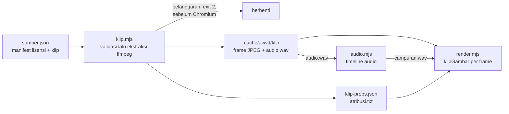
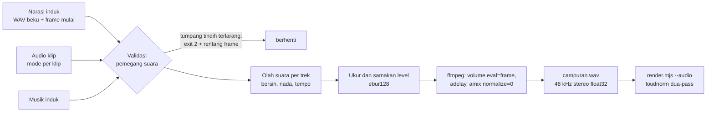
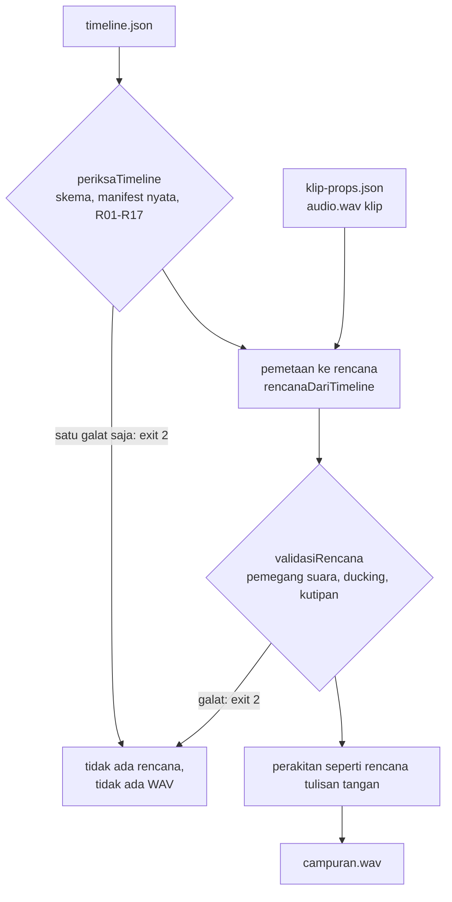
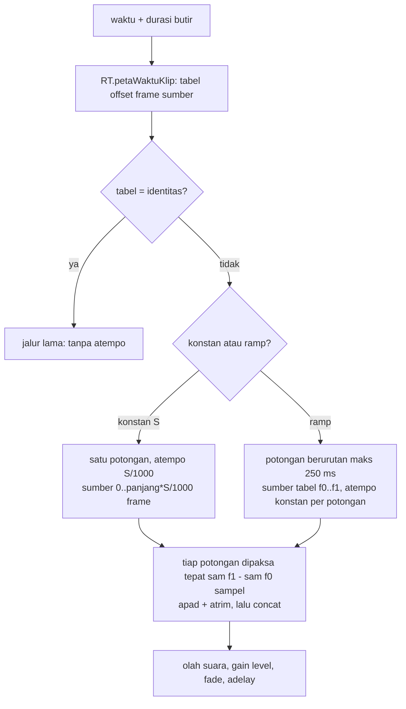

# Video di dalam video dan timeline audio

## Metadata

- Version: `v1.11.0`
- Last updated: `2026-11-08`
- Changeset: `Tabel klip[] dan Cache: efek hapusLatar (#89, hapus latar lokal tanpa layar hijau; PNG otomatis, jpg ditolak, tidak digabung dengan kunciWarna), kunci cache memuat sha256 bobot dan versi ORT, laporan segmentasi di meta.json. Sebelumnya: klip.mjs: ringkasan cache hit/miss, flag --verifikasi dan --bersihkan, batas cache dinyatakan eksplisit (#46, sebagian).`

Dua fitur yang saling terkait: `scripts/klip.mjs` menyediakan frame klip dan `scripts/audio.mjs` menata audionya. Keputusan di baliknya tercatat di [log-keputusan.md](log-keputusan.md) (KP-011 sampai KP-014); kewajiban lisensi pengguna ada di [lisensi-kepatuhan.md](lisensi-kepatuhan.md). Kutipan dari karya orang lain untuk video reaction dan ulasan (kebijakan angka, gerbang hukum, templat) ada di [pelajari-reaction.md](pelajari-reaction.md). Efek klip (stabilisasi, chroma key, hapus latar lokal tanpa layar hijau, LUT `.cube`, kecerahan, kontras, saturasi, gamma, keseimbangan warna) yang diterapkan saat ekstraksi ada di [olah-klip.md](olah-klip.md). Peredam bising dan pengubah nada/tempo suara ada di [§Olah suara per trek](#olah-suara-per-trek).

## Video di dalam video

Klip (video lain) dapat tampil di dalam komposisi sebagai PiP atau split-screen **tanpa elemen `<video>`**. Setiap frame klip dibuat ulang sesuai metode awvd: `scripts/klip.mjs` meminta ffmpeg mengekstrak frame pada fps komposisi (satu gambar per nomor frame) ke cache, lalu komposisi menggambar frame ke-n klip sebagai fungsi murni dari nomor frame (`klipGambar`). Tidak ada seek saat render.



### Aturan sumber

Hanya sumber yang lisensinya mengizinkan penggunaan dengan menyebut sumber. Validasi berjalan di `klip.mjs` sebelum ekstraksi dan sebelum Chromium diluncurkan; semua pelanggaran dilaporkan sekaligus dengan kode keluar `2`.

| Lisensi (kode di manifest) | Status |
| --- | --- |
| `CC-BY-x.y` | Diizinkan dengan atribusi. |
| `CC-BY-SA-x.y` | Diizinkan bila `proyek.lisensiKeluaran` adalah `CC-BY-SA-x.y` dengan versi sama atau lebih baru daripada sumber; kalau tidak, ditolak. |
| `CC-BY-NC-x.y`, `CC-BY-NC-SA-x.y` | Hanya bila `proyek.tujuan` adalah `nonkomersial` (NC-SA juga butuh `lisensiKeluaran` `CC-BY-NC-SA-x.y`). Campuran BY-SA dan BY-NC-SA ditolak (tak ada satu lisensi keluaran yang memenuhi keduanya). |
| `CC0-1.0`, `PDM-1.0` | Diizinkan; atribusi tetap dicatat. |
| `STOK:<penyedia>` | Diizinkan bila `bukti` (berkas atau URL lisensi tertulis dari penyedia) diisi. |
| `KUTIPAN-WAJAR` | Bukan lisensi, melainkan klaim pengecualian hak cipta (kritik, ulasan, pendidikan, penelitian, berita aktual). Wajib blok `kutipan` di sumber, lolos kebijakan kutipan (batas durasi, proporsi, komentar aktif), dan gerbang hukum `GH` disetujui; tanpa GH render final ditolak (atau bertanda draf dengan `--draf`). Rincian: [pelajari-reaction.md](pelajari-reaction.md#kebijakan-kutipan-wajar). |
| `...-ND-...` | Selalu ditolak: ND tidak mengizinkan adaptasi, dan frame klip dibuat ulang (di-resample, dipotong, ditimpa elemen komposisi). |
| kosong atau tak dikenal | Ditolak. |

Pemeriksaan lain: `judul`, `pencipta`, `sumberUrl`, dan `perubahan` wajib terisi (judul dan pencipta boleh dikosongkan hanya dengan `tanpaJudul: true` atau `penciptaAnonim: true`); `sha256` wajib cocok dengan isi berkas; `proyek.tujuan` wajib `komersial` atau `nonkomersial`; klip wajib merujuk sumber yang ada.

Catatan hukum, bukan nasihat hukum: tafsir ShareAlike untuk video gabungan (adaptasi atau kumpulan) belum terverifikasi dari sumber primer, sehingga awvd bersikap konservatif: klip BY-SA diperlakukan sebagai Adapted Material dan seluruh keluaran harus dilisensikan BY-SA (atau kompatibel). "Komersial" tidak didefinisikan oleh CC; kasus batas diserahkan ke pemilik proyek. Lisensi CC tidak mencakup hak pihak ketiga yang melekat pada isi klip (wajah orang, merek, musik di dalam klip).

### Manifest `sumber.json`

Jalur `berkas` dan `bukti` relatif terhadap folder manifest. Contoh lengkap: [`templates/klip-tertanam/sumber.json`](../templates/klip-tertanam/sumber.json).

```json
{
  "proyek": { "tujuan": "nonkomersial", "lisensiKeluaran": "CC-BY-SA-4.0" },
  "sumber": [{
    "id": "wawancara-1",
    "berkas": "aset/wawancara-1.mp4",
    "sha256": "<64 digit heksadesimal>",
    "judul": "Wawancara 1",
    "pencipta": "Nama Pencipta",
    "sumberUrl": "https://contoh.example/wawancara-1",
    "lisensi": "CC-BY-SA-4.0",
    "perubahan": "dipotong 00:12-00:20; diperkecil; dibuat ulang per frame"
  }],
  "klip": [{ "id": "k1", "sumber": "wawancara-1", "lebar": 480, "tinggi": 270, "dari": 12, "panjang": 8 }]
}
```

| Bagian | Kunci |
| --- | --- |
| `proyek` | `tujuan` (wajib), `lisensiKeluaran` (wajib bila ada sumber ShareAlike). |
| `sumber[]` | `id`, `berkas`, `sha256`, `judul` (atau `tanpaJudul`), `pencipta` (atau `penciptaAnonim`), `sumberUrl` (URL asli, jangan dipendekkan), `lisensi` (kode beserta versi), `perubahan`, opsional `urlLisensi` (bawaan dari kode lisensi) dan `bukti` (wajib untuk `STOK:`). |
| `klip[]` | `id`, `sumber`, `lebar` dan `tinggi` (piksel, ukuran tampil dikali skala render; rasio berbeda dari sumber memberi peringatan), `dari` dan `panjang` (detik; bawaan 0 dan sampai akhir), `format` (`jpg` bawaan, atau `png` lossless untuk tangkapan layar dan grafik; klip dengan efek beralfa `kunciWarna` atau `hapusLatar` otomatis `png` dan menolak `jpg`), `kualitas` (JPEG `q:v` 1..31, bawaan 2). Satu sumber boleh dipakai beberapa klip. `efek` (opsional): array efek (stabilisasi, chroma key, hapus latar lokal `hapusLatar`, warna) yang diterapkan saat ekstraksi, rinci di [olah-klip.md](olah-klip.md); `hapusLatar` butuh `AWVD_ORT` dan `AWVD_MODEL_DIR` (kode keluar 1 bila tidak ada, 2 bila sha256 atau skema salah, sebelum ekstraksi), tidak boleh digabung dengan `kunciWarna`, dan membekukan mask ke PNG RGBA sehingga render tidak memanggil model. |

### `scripts/klip.mjs`

```text
bun scripts/klip.mjs <sumber.json> --fps N [--out .cache/awvd/klip] [--gabung props.json] [--paksa] [--verifikasi] [--bersihkan] [--draf]
```

| Flag | Keterangan |
| --- | --- |
| `--fps N` | Wajib; fps komposisi. Frame diambil dengan filter `fps` (sumber VFR atau fps lain dinormalisasi). |
| `--out DIR` | Folder cache dan keluaran (bawaan `.cache/awvd/klip`, diabaikan git). |
| `--gabung F` | Berkas props dasar (objek JSON tanpa kunci `klip`); hasil digabung dengan daftar klip ke `props-gabungan.json` untuk `--props-file`. |
| `--paksa` | Ekstrak ulang walau cache ada. |
| `--verifikasi` | Cache hit hanya dipakai bila hash seluruh frame di folder cache cocok dengan `framesSha256` di `meta.json`; bila tidak (frame terpotong, diganti, atau rusak) folder diekstrak ulang dan barisnya bertanda `ekstraksi (cache rusak)`. Tanpa flag ini cache hit hanya memeriksa `meta.json`, jumlah berkas frame, dan `audio.wav`, jadi isi frame yang rusak tidak terdeteksi. Biayanya membaca semua frame klip. |
| `--bersihkan` | Sesudah semua klip berhasil, hapus folder cache lama di `--out` yang tidak dipakai klip manifest ini (folder bernama 16 karakter heksadesimal yang memuat `meta.json`) dan sisa `.tmp-<kunci>-<pid>` milik proses yang sudah mati, lalu cetak ringkasannya. Folder lain dan berkas keluaran tidak disentuh. **Hati-hati bila `--out` dipakai bersama beberapa manifest**: cache manifest lain di folder itu ikut terhapus dan harus diekstrak ulang. |
| `--draf` | Hanya untuk sumber `KUTIPAN-WAJAR` yang gerbang hukum GH-nya belum disetujui: lolos dengan peringatan, `klip-props.json` dan `props-gabungan.json` memuat `"draf": true`, dan `atribusi.txt` diberi baris DRAF. Komposisi wajib menampilkan tanda draf; hasilnya tidak boleh dipublikasikan. Pelanggaran angka kutipan tidak dapat dilewati dengan flag ini. |

Keluaran di `--out`: `<kunci>/` (frame `000000.jpg`..., `audio.wav` bila sumber beraudio, `meta.json` berisi hash seluruh frame), `klip-props.json` (daftar `klip[]`: `id`, `akar` URL `file://` folder cache, `folder`, `ekstensi`, `digit`, `jumlah`, `fps`, `lebar`, `tinggi`, `audio`, `atribusi`), `atribusi.txt` (format TASL siap tempel di deskripsi), dan `props-gabungan.json` bila `--gabung`. Untuk sumber dalam cakupan kebijakan kutipan, tiap klip di `klip-props.json` memuat `kutipan: { isiAudio, musikDibahas }` (dipakai `audio.mjs`). Kode keluar: `0` berhasil, `2` manifest atau argumen tidak valid (tidak ada ekstraksi), `1` galat ffmpeg.

**Cache.** Kunci = sha256 dari {hash berkas sumber, fps, lebar, tinggi, dari, panjang, matriks warna, rentang, format, kualitas, versi ffmpeg, dan efek kanonik beserta sha256 berkas LUT bila klip berefek; untuk `hapusLatar` juga sha256 bobot model dan versi onnxruntime}. Cache hit tidak menjalankan ffmpeg: render kedua tanpa perubahan melewati ekstraksi, dan baris `cache: N hit, M ekstraksi` meringkas setiap jalan (contoh terukur pada `templates/klip-tertanam` dua klip 90 dan 120 frame 480x270: jalan pertama 0,57 s, jalan kedua 0,15 s dengan dua hit; frame tidak disentuh, diuji lewat mtime). Ekstraksi dua kali menghasilkan frame identik byte demi byte (diuji lewat `framesSha256`). Cache tidak dibersihkan otomatis: mengubah fps, rentang, efek, atau versi ffmpeg menambah folder kunci baru dan membiarkan yang lama; pakai `--bersihkan` atau hapus `.cache/awvd/klip`. Cache ini hanya untuk **ekstraksi klip**; cache hasil render (segmen MP4) belum ada ([roadmap.md](roadmap.md), F4/03). Ekstraksi memakai `-flags +bitexact` agar JPEG tidak memuat tag versi ffmpeg.

**Warna.** Chromium mendekode video tak bertag dengan matriks BT.709 sedangkan ffmpeg bawaannya BT.601; pada uji riset PSNR frame yang sama 25,6 dB (bawaan) berbanding 46,1 dB (matriks eksplisit). Karena itu `klip.mjs` memberi matriks dan rentang eksplisit dari tag `ffprobe` (`color_space`, `color_range`); sumber tak bertag dianggap `bt709` (juga untuk resolusi SD; konvensi SD = BT.601 belum diverifikasi), rentang tak bertag dianggap `tv` (`pc` untuk `yuvj*`). Sumber HDR (`smpte2084`, `arib-std-b67`) ditolak. SAR non-persegi dikoreksi, rotasi mengikuti autorotate ffmpeg. Frame JPEG disimpan `yuvj444p`; frame PNG `rgb24`.

### Memakai klip di komposisi

Gambar frame ke `<canvas>` (bukan ``, lihat `klipGambar` di [api-runtime.md](api-runtime.md)) dan tampilkan kredit saat klip tampil. Jadwal (kapan klip tampil) adalah milik komposisi; `klip.mjs` hanya menyediakan frame.

```html
<canvas id="pip"></canvas>
<script>
  const klip = (ctx) => ctx.props.klip.find((k) => k.id === "k1");
  defineVideo({
    width: 1280, height: 720, fps: 30, durationInFrames: 480,
    async render(frame, ctx) {
      const lokal = frame - 105;                       // klip tampil mulai frame 105
      const tampil = await klipGambar(document.getElementById("pip"), klip(ctx), lokal);
      document.getElementById("pip").style.display = tampil && lokal < 90 ? "block" : "none";
      document.getElementById("kredit").textContent = kreditKlip(klip(ctx));
    },
  });
</script>
```

Kredit TASL tampil di layar saat klip tampil (`kreditKlip`, ringkas) dan di kredit akhir (`kreditKlip(k, { ringkas: false })`, lengkap dengan sumber, tautan lisensi, dan pernyataan perubahan); `atribusi.txt` untuk deskripsi video. Praktik CC: kredit boleh di dalam rekaman dan di deskripsi; halaman CC tidak menetapkan lama tayang. PiP sebaiknya sementara, kecil, dekat konten yang dirujuk narasi, dan tidak menutup informasi penting (split attention); posisikan di dalam `areaAman`.

### Trim, speed, reverse, dan freeze

Operasi klip ini dilakukan sebagai pemetaan nomor frame di komposisi, bukan saat ekstraksi: frame klip tetap diekstrak sekali pada fps komposisi, lalu `indeksFrameKlip`, `jalurFrameKlip`, dan `klipGambar` menerima opsi `waktu` (`kecepatan` konstan atau ramp, `balik`, `bekukan`, `habis`) bersama `dari` (trim) dan `durasi`. Aritmetikanya bilangan bulat dan permil, jadi hasilnya sama di setiap render. Rumus, aturan, dan contoh ada di [api-runtime.md](api-runtime.md#pemetaan-waktu-klip). Audio ikut speed konstan dan ramp lewat `atempo` ([§Audio klip ber-speed](#audio-klip-ber-speed-atempo)); reverse dan freeze harus dibisukan di rencana audio.

### Templat `klip-tertanam`

[`templates/klip-tertanam/`](../templates/klip-tertanam/): komposisi 1280x720, 30 fps, 16 detik: judul, panel PiP berisi dua klip buatan proyek (ffmpeg lavfi: `pola-uji` CC0, `pola-warna` CC BY), kredit TASL di layar dan kredit akhir, caption, serta rencana audio dengan narasi nada sinus (bukan suara orang) yang bergantian (klip `k1`) dan campur (klip `k2`) dengan audio klip. Jalankan dari akar repo:

```bash
bun templates/klip-tertanam/buat-audio.mjs                # narasi dan musik nada ke .cache/awvd/contoh
bun scripts/klip.mjs templates/klip-tertanam/sumber.json --fps 30 \
  --out .cache/awvd/klip --gabung templates/klip-tertanam/props.json
bun scripts/audio.mjs templates/klip-tertanam/rencana-audio.json --fps 30 \
  --klip-props .cache/awvd/klip/klip-props.json --out .cache/awvd/campuran.wav
bun scripts/render.mjs templates/klip-tertanam/index.html \
  --props-file .cache/awvd/klip/props-gabungan.json \
  --audio .cache/awvd/campuran.wav --out out/klip-tertanam.mp4
# opsional: pemeriksaan mutu hasil render
bun run periksa out/klip-tertanam.mp4
```

Jadwal klip ada di dua tempat (`props.json` untuk komposisi dan `rencana-audio.json` untuk audio); `scripts/uji-klip.mjs` memastikan keduanya sama. Contoh efek warna (`sumber-warna.json`, `lut/`, `buat-lut.mjs`) ada di [olah-klip.md](olah-klip.md#templat).

### Batasan

- Disk proporsional dengan durasi klip x fps x ukuran frame; JPEG menambah satu generasi kompresi (pakai `format: "png"` bila kualitas kritis).
- Tidak ada interpolasi frame: sumber dengan fps lain diduplikasi atau dilewati ke fps komposisi. `kecepatan` dan `waktu` di `indeksFrameKlip` juga tanpa interpolasi (optical flow tidak ada).
- `akar` di `klip-props.json` adalah URL `file://` absolut; pratinjau lewat server HTTP tidak bisa memuatnya (buka komposisi lewat `file://`).
- Hanya SDR; hasil ekstraksi diuji determinismenya pada satu mesin dan satu versi Chromium/ffmpeg, belum lintas mesin.

## Timeline audio

`scripts/audio.mjs` merakit satu WAV dari narasi induk, musik induk, dan audio klip tertanam, dengan aturan **pemegang suara eksklusif** supaya audio klip tidak bertabrakan dengan audio induk. WAV itu diberikan ke `render.mjs --audio`, yang menormalisasi kenyaringan campuran (`--kenyaringan`).

```text
bun scripts/audio.mjs <rencana-audio.json> --fps N --out campuran.wav
     [--klip-props klip-props.json] [--ketat-campur]
```



### Rencana audio

Jalur berkas relatif terhadap folder rencana. Rentang frame setengah terbuka: `akhir` eksklusif. Contoh: [`templates/klip-tertanam/rencana-audio.json`](../templates/klip-tertanam/rencana-audio.json).

```json
{
  "durasiFrame": 480,
  "narasi": [{ "id": "n1", "berkas": "narasi-1.wav", "mulai": 0 }],
  "musik": { "berkas": "musik.wav", "levelDb": -12, "bebasDb": -6 },
  "klip": [
    { "id": "k1", "mulai": 105, "akhir": 195, "mode": "bergantian" },
    { "id": "k2", "mulai": 270, "akhir": 390, "mode": "campur", "turunDb": 12 }
  ]
}
```

| Kunci | Keterangan |
| --- | --- |
| `durasiFrame` | Wajib; jumlah frame komposisi. WAV hasil tepat sepanjang `durasiFrame / fps`. |
| `narasi[]` | `berkas` (WAV atau MP3 beku), `mulai` (frame), `id` opsional, `gainDb` opsional (-60..12 dB, bawaan 0, setelah penyamaan level), `bersih` dan `suara` opsional ([§Olah suara per trek](#olah-suara-per-trek)). Akhir segmen = `mulai + ceil(durasi x fps)` dari `ffprobe` (dibagi `suara.tempo` bila ada). |
| `musik` | Opsional. `levelDb` (bawaan -12, rentang -20..-8): level musik di bawah ucapan saat ada suara. `bebasDb` (bawaan -6, antara `levelDb` dan 0): level saat tak ada suara. `gainDb` (-60..12, bawaan 0): menggeser seluruh musik setelah penyamaan level. |
| `klip[]` | `id`, `mulai`, `akhir`, `mode` (`bergantian` bawaan, `campur`, `bisu`), `berkas` audio (bisa dihilangkan bila ada `--klip-props`, diambil dari `audio.wav` hasil `klip.mjs`), `gainDb`, `turunDb` (hanya `campur`, bawaan 12, rentang 8..20), `dariDetik` (offset di berkas audio), `waktu` dan `durasi` opsional (speed konstan atau ramp, sama dengan `waktu` butir; `durasi` = frame butir, bawaan `akhir - mulai`; [§Audio klip ber-speed](#audio-klip-ber-speed-atempo)), `bersih` dan `suara` opsional (tanpa `tempo`; [§Olah suara per trek](#olah-suara-per-trek)). |
| `fadeMs` | Bawaan 200, rentang 100..300. |
| `ucapanLufs` | Level ucapan acuan, bawaan -16 LUFS. |

### Mode klip dan validasi

| Mode | Perilaku |
| --- | --- |
| `bergantian` | Klip memegang suara eksklusif pada rentangnya. **Gagal** (exit 2, dengan rentang frame) bila narasi induk tumpang tindih; musik induk dibisukan. |
| `campur` | Semua terdengar. Audio induk (narasi dan musik) tetap dominan pada level normal; audio klip diturunkan `turunDb` selama narasi aktif. Narasi yang tumpang tindih memberi peringatan (dua aliran ucapan); `--ketat-campur` menjadikannya gagal. |
| `bisu` | Audio klip tidak dimasukkan; boleh tumpang tindih dengan apa pun. |

Klip dari sumber kutipan (`klip-props.json` memuat `kutipan`) punya aturan tambahan: audio bermusik (`isiAudio` `musik`, bawaan) wajib mode `bisu`, kecuali `musikDibahas` `true` dengan rentang paling lama 10 detik; audio ucapan memakai mode bergantian atau campur seperti biasa. Aturan ini hanya berlaku bila `audio.mjs` diberi `--klip-props`. Lihat [pelajari-reaction.md](pelajari-reaction.md#audio).

Gagal juga bila: dua klip bersuara (bergantian atau campur) tumpang tindih; dua narasi tumpang tindih; `turunDb` di luar 8..20 atau `fadeMs` di luar 100..300; klip bermode bersuara tanpa berkas audio (gunakan `bisu`); berkas tidak ditemukan; rentang tidak valid. Contoh pesan: `narasi "n1" (frame 0..179) tumpang tindih audio klip "k" mode bergantian (frame 150..239) pada frame 150..179`. Setelah validasi, `audio.mjs` mencetak tabel pemegang suara per rentang frame (narasi, klip, campur, musik bebas, senyap).

### Rencana dari timeline.json

Selain rencana tulisan tangan, `audio.mjs` dapat **menurunkan rencana dari [`timeline.json`](timeline.md)** (track audio dan `audio.mode` butir video), supaya jadwal audio dan gambar bersumber dari satu berkas:

```bash
bun run klip templates/timeline-contoh/sumber.json --fps 30 --out .cache/awvd/klip
bun run audio -- --timeline timeline.json --klip-props .cache/awvd/klip/klip-props.json --out campuran.wav \
  [--rencana-keluar rencana-audio.json] [--ketat-campur] [--draf]
```



| Dari timeline | Ke rencana |
| --- | --- |
| Butir `audio` beraset peran `narasi` | `narasi[]`: `id` = id butir, `berkas` = `berkas` aset di `aset.json`, `mulai` (frame). `gainDb` = `gainDb` track + `gainDb` butir (0 tidak ditulis). |
| Butir `audio` beraset peran `musik` | `musik`: `levelDb` dan `bebasDb` dari `ducking` (bila tak ditulis, bawaan rencana: -12 dan -6); `gainDb` = track + butir, menggeser seluruh musik (level bebas dan level ducking) setelah penyamaan level. |
| Butir `video` dengan `audio.mode` `bergantian` atau `campur` | `klip[]`: `id` = id butir, `mulai`, `akhir` = `mulai + durasi`, `mode`, `gainDb` dan `turunDb` dari `audio`, `dariDetik` = `dari` / fps, `berkas` = `audio` klip itu di `klip-props.json` (wajib `--klip-props`). Bila waktu butir bukan identitas (speed konstan atau ramp), `waktu` dan `durasi` (frame butir) ikut ditulis. |
| Butir `video` tanpa `audio` atau `bisu` | `klip[]` bermode `bisu` (tidak dimasukkan, hanya tampil di tabel). |
| Track `aktif: false` | Dilewati (tetap divalidasi). |

Aturan dan pengamannya:

- **Fail-closed.** Timeline diperiksa penuh lebih dulu dengan pemeriksa yang sama dengan `bun run timeline periksa` (skema, manifest nyata, R01-R17). Satu galat berarti kode keluar 2, tanpa rencana dan tanpa WAV. Rencana turunan lalu masih melewati `validasiRencana` (pertahanan berlapis). Peringatan validator dicetak ke stderr.
- **Klip tidak bertabrakan dengan audio utama.** Aturan pemegang suara sama dengan rencana tulisan tangan: narasi tidak boleh tumpang tindih klip `bergantian` (galat R11 di timeline), `campur` memberi peringatan W05 dan klip diturunkan `turunDb` selama narasi.
- **Pemetaan waktu satu sumber.** Pemetaan frame diambil dari `petaWaktuKlip` dan `dariDetik` dari `frameSumber` di `runtime.js`, fungsi yang juga dipakai validator timeline dan render, jadi rumus waktu tidak diduplikasi. Waktu identitas (offset frame ke-i sama dengan i) dirakit tanpa perubahan; speed konstan dan ramp diregangkan dengan `atempo` ([§Audio klip ber-speed](#audio-klip-ber-speed-atempo)). Reverse dan freeze pada butir bersuara ditolak (R09 di validator; A04 sebagai lapis kedua): set `audio.mode` `bisu`.
- **Transisi.** Audio butir keluar berakhir di awal transisi ke butir berikutnya di track yang sama (aturan yang sama dengan R11, helper `akhirAudioButir` di `timeline.mjs`), sehingga dua klip `bergantian` yang bertransisi tidak bertumpuk.
- **Kenyaringan.** Penyamaan level ke `audio.ucapanLufs` (bawaan -16) dan fade `audio.fadeMs` diambil dari timeline; kenyaringan akhir video tetap diatur `render.mjs --kenyaringan`.
- **Batas.** Musik diputar sepanjang video dari awal berkas: butir musik harus `mulai` 0, `dari` 0, dan `durasi` sama dengan `proyek.durasi` (galat A02; siapkan berkas musik yang sudah dipotong). Peran `efek` belum didukung (R10). Olah suara (`bersih`, `suara`) belum ada di timeline; pakai `rencana-audio.json`. `--fps`, bila diberikan, harus sama dengan `proyek.fps`.

Kode galat tambahan: `A01` audio klip tak ditemukan (tanpa `--klip-props`, atau klip tanpa audio), `A02` musik tak sepanjang video atau ber-offset, `A03` jalur berkas audio ditolak (keluar folder manifest), `A04` waktu klip tidak dapat dipetakan ke audio (reverse, freeze, kecepatan di luar 0,5..4x, atau ramp yang tak dapat disinkronkan; pelanggaran yang sama sudah ditolak R09 oleh validator, A04 adalah lapis kedua). Galat dari pemeriksa timeline membawa kodenya (`SKEMA`, `R01`-`R17`).

Bukti: `scripts/uji-audio-timeline.mjs` (`bun run uji:audio-timeline`, bagian dari `bun run uji`) memakai aset sintetis templat `timeline-contoh` (klip 1000 Hz dan 700 Hz, narasi 330 Hz, musik akor 220/277/330 Hz). Pada hasil rakitan: di rentang klip `bergantian` daya narasi dan musik turun lebih dari 50 dB di bawah klip; klip `campur` turun 12 dB (+-1,5) selama narasi; musik turun 6 dB saat narasi (+-1,5); kenyaringan klip dan narasi di dalam +-1,0 dan +-1,5 LU dari -16 LUFS, musik bebas dalam +-1,0 LU dari -22 LUFS; dua rakitan identik byte demi byte. Batas bukti: nada sintetis, bukan ucapan manusia.

### Audio klip ber-speed (atempo)

Klip dengan `waktu.kecepatan` (konstan atau ramp) menghasilkan audio yang diregangkan dengan `atempo` dan **sinkron dengan frame**: pemetaan diambil dari `RT.petaWaktuKlip` (`runtime.js`, sumber tunggal waktu; `audio.mjs` tidak menghitung ulang rumus kecepatan). Di rencana, klip memuat `waktu` (objek yang sama dengan `waktu` butir) dan `durasi` (frame butir; `akhir - mulai` boleh lebih pendek bila butir keluar di awal transisi). Perakitan memakai fungsi murni `rencanaWaktuAudio` (diekspor dari `scripts/audio.mjs`).



- **Speed konstan.** Satu potongan: sumber `[0, panjang x S/1000)` frame dari `dariDetik`, tempo `S/1000`, dirangkai dari tahap `atempo` 0,5..2 (di luar itu dirantai; aman di semua versi ffmpeg). Panjang keluaran dipaksa tepat `round(panjang x 48000 / fps)` sampel (`apad` lalu `atrim`), jadi tidak ada drift yang menumpuk.
- **Ramp.** Tabel runtime memakai lantai, sehingga ramp dipotong per segmen: tiap potongan memotong sumber `[tabel[f0], tabel[f1])` lalu `atempo` konstan `(tabel[f1] - tabel[f0]) / (f1 - f0)`. Batas potongan berhimpit di sumber dan di keluaran (tanpa celah atau tumpang tindih), panjang potongan paling banyak 250 ms dan dipendekkan sampai garis lurus berbeda paling banyak 1 frame dari tabel di setiap frame. Tiap potongan memotong sumber 100 ms lebih panjang lalu dipangkas ke panjang tepat, supaya ujung aliran `atempo` tidak masuk keluaran (tanpa itu bunyi di ujung potongan melemah).
- **Jangkauan 0,5..4x (fail-closed).** Di bawah 0,5x `atempo` menggeser awal bunyi lebih dari 1 frame (diukur 3 frame pada 0,3x), dan di atas 4x bip pendek tidak lagi terdeteksi andal (diuji pada 8x dan 10x). Kecepatan konstan di luar jangkauan, atau ramp yang potongannya keluar dari jangkauan, ditolak dengan galat yang menyebut batasnya (R09 sejak `timeline periksa` dan A04 sebagai lapis kedua untuk timeline, pelanggaran `waktu:` untuk rencana tulisan tangan; validator memanggil `rencanaWaktuAudio`, jadi angka jangkauan hanya ada satu); set `bisu`.
- **Reverse dan freeze ditolak.** Audio tidak diputar mundur dan tidak ditahan; pemetaan yang benar tidak ada, jadi `balik` dan `bekukan` pada klip bersuara galat (R09; A04 sebagai lapis kedua). Klip `bisu` boleh memakai waktu apa pun.
- **Sumber habis.** Bila audio sumber lebih pendek daripada yang dibaca (speed besar), sisanya senyap dan ada peringatan; potongan yang seluruhnya di luar sumber dirakit senyap.
- **Batas.** Nada tetap (`atempo` tidak menggeser nada), tetapi mutu ucapan menurun di tempo ekstrem. Transien sangat pendek (di bawah sekitar 10 ms) dapat melemah. Sambungan antarpotongan ramp tidak dikaburkan (tanpa crossfade): bunyi stasioner tersambung mulus, tetapi sambungan pada ucapan cepat dapat terdengar halus. `suara.tempo` tetap hanya untuk narasi.

Bukti: `scripts/uji-audio-waktu.mjs` (`bun run uji:audio-waktu`, bagian dari `bun run uji`) memakai bip 1 kHz sintetis (40 ms tiap kelipatan 10 frame sumber, 30 fps). Hasil terukur (ffmpeg 6.1.1): panjang WAV tepat (sampel), tidak ada audio setelah akhir klip, dan jarak waktu bip terdeteksi ke selang waktu sebenarnya yang diturunkan dari tabel runtime paling besar 0,68 frame pada speed konstan 0,5x, 0,75x, 1,333x, 1,5x, 2x, 3x, dan 4x (jarak 0 pada 2x), serta paling besar 0,53 frame pada ramp 1x..2x, 0,5x..2x, 2x..0,6x (easing bezier), dan 1x..3x..1x; ambang lulus 1 frame. Sinus 700 Hz pada 1,5x tetap 700 Hz (1050 Hz turun lebih dari 40 dB), dan dua rakitan identik byte demi byte. `scripts/uji-audio-timeline.mjs` memverifikasi jalur `--timeline` (speed 1,5x pada klip `k2`). Batas bukti: bunyi sintetis, bukan ucapan manusia; ffmpeg di build lain dapat berbeda sedikit.

### Gain dan perakitan

- **Penyamaan level.** Tiap sumber diukur (`ebur128`) dan diberi gain ke `ucapanLufs`; musik ke `ucapanLufs + bebasDb`. Tanpa ini pergantian narasi-klip terdengar sebagai lonjakan. Sumber senyap tidak diubah (diberi peringatan).
- **Narasi** 0 dB (level normal, dominan) pada semua mode. **Klip bergantian** 0 dB dengan fade-in dan fade-out `fadeMs` di batasnya sendiri. **Klip campur** 0 dB, turun `turunDb` selama narasi aktif.
- **Musik**: `bebasDb` saat tak ada suara, `levelDb` saat ada narasi atau klip campur, bisu saat klip bergantian.
- **Transisi**: gain yang turun selesai tepat di batas pergantian pemegang, gain yang naik mulai di batas (tak ada tumpang tindih saat pemegang berganti). Rampa linear amplitudo dengan kemiringan puncak/fade per frame, jadi transisi parsial (mis. 12 dB) lebih singkat daripada `fadeMs`.
- **Deterministik.** Envelope dihitung dari timeline lalu dijadikan ekspresi `volume=...:eval=frame` pada blok 10 ms, `adelay` dalam sampel, `amix normalize=0`, `-filter_complex_threads 1`, tanpa metadata versi. Dua run menghasilkan WAV identik byte demi byte (diuji).
- **Keluaran**: WAV 48 kHz stereo float32 (perantara; float menghindari clipping sebelum `loudnorm` di `render.mjs`). Mono diduplikasi ke dua kanal tanpa potongan -3 dB.

Dasar dan batas bukti. Ucapan simultan saling mengganggu (Salamé & Baddeley 1982; Brungart 2001; riset itu hanya terverifikasi sampai metadata), tetapi tingkat bukti untuk aturan ini tidak langsung dan tidak ada standar siaran terverifikasi yang melarang audio tumpang tindih. Selisih 12 dB (rentang 8..20), fade 200 ms, dan musik 12 dB di bawah ucapan adalah usulan rekayasa dari riset rasio dialog-latar (Sugimoto 2026; Ricketts dkk. 2026), bukan standar; riset itu memakai latar non-ucapan, padahal latar klip sering berupa ucapan, sehingga pilih nilai atas rentang bila ragu.

### Olah suara per trek

Narasi dan klip bersuara (bukan `bisu`) boleh diberi peredam bising (`bersih`) dan pengubah nada atau tempo (`suara`). Olah diterapkan **sebelum** penyamaan level: tiap sumber diukur (`ebur128`) sesudah diolah, jadi kenyaringan campuran tetap mengacu ke `ucapanLufs` (bawaan -16 LUFS). Musik induk tidak diolah. Urutan rantai: resample dan stereo, (klip: potong `dariDetik`), `bersih`, `suara`, gain level. Blok yang tidak ada berarti rantai sama persis dengan sebelumnya.

```json
{
  "durasiFrame": 180,
  "narasi": [{
    "id": "n1", "berkas": "narasi-1.wav", "mulai": 0,
    "bersih": { "metode": "afftdn", "nr": 20, "nf": -40 },
    "suara": { "nadaSemiton": -2, "tempo": 1.1, "mesin": "sederhana" }
  }],
  "klip": [{ "id": "k1", "mulai": 105, "akhir": 195, "bersih": { "nr": 12 }, "suara": { "nadaSemiton": 2 } }]
}
```

**Peredam bising `bersih`.** Kunci tak dikenal, nilai di luar rentang, dan filter yang tidak ada di build ffmpeg ditolak dengan kode keluar `2` sebelum ffmpeg merakit apa pun.

| `metode` | Kunci | Keterangan |
| --- | --- | --- |
| `afftdn` (bawaan) | `nr` (0,01..97 dB, bawaan 12), `nf` (-80..-20 dB, bawaan -40), `jenis` (`putih` bawaan, `vinil`, `shellac`), `lacak` (bawaan `true`) | Filter `afftdn` bawaan ffmpeg (peredam bising domain FFT). `nr` banyaknya pengurangan, `nf` perkiraan lantai bising, `lacak` meminta filter mengikuti bising yang berubah (`tn=1`). Tanpa `lacak`, filter hanya memakai `nf` tetap; pada uji sinyal sintetis (`nr` 12) SNR naik hanya sekitar 2 dB, sedangkan dengan `lacak` dan `nr` 20 naik sekitar 18 dB. |
| `arnndn` | `model` (wajib: berkas model milik Anda, relatif terhadap folder rencana), `campur` (0..1, bawaan 1) | Filter `arnndn` bawaan ffmpeg (jaringan saraf rekuren, RNNoise) untuk ucapan. **awvd tidak membundel model.** Berkas harus berformat model arnndn (baris pertama `rnnoise-nu model file version 1`); model RNNoise format lain tidak kompatibel. Berkas yang bukan model ditolak dengan pesan; bobot yang rusak membuat ffmpeg gagal dan `audio.mjs` keluar dengan kode 1 dan pesan ffmpeg. |

Lisensi `arnndn`: kode RNNoise (xiph.org) berlisensi BSD 3-Clause (terverifikasi dari berkas `COPYING` repositori `xiph/rnnoise`, 2026-11-07), tetapi lisensi **model** yang Anda unduh atau latih adalah urusan Anda: periksa sendiri sebelum memakai dan sebelum mendistribusikan hasilnya, dan catat model (sumber, lisensi, tanggal, hash) di `ASET.md` repo proyek. Repositori model komunitas `rnnoise-models` menyatakan modelnya tidak berhak cipta; itu pernyataan pemiliknya, bukan kepastian hukum. Hasil `arnndn` bergantung pada model dan versi ffmpeg; determinismenya diuji pada filter `afftdn`, bukan pada model nyata (tidak ada model di repo ini). Model sungguhan belum diuji; uji repo memakai berkas model palsu (hanya baris pertama) untuk memastikan validasi dan pesan galatnya.

**Pengubah suara `suara`.** `nadaSemiton` (-12..12, bawaan 0) menggeser nada tanpa mengubah durasi, `tempo` (0,5..2, bawaan 1) mengubah kecepatan tanpa mengubah nada. `tempo` hanya untuk narasi: audio klip harus sepanjang rentang frame-nya agar tetap sinkron dengan gambar, jadi `tempo` pada klip ditolak. Blok netral (nada 0 dan tempo 1) dibuang.

| `mesin` | Perilaku |
| --- | --- |
| `otomatis` (bawaan) | `rubberband` bila filter itu ada di build ffmpeg, kalau tidak cadangan `sederhana` dengan peringatan. |
| `rubberband` | Filter `rubberband` (pustaka Rubber Band): nada dan tempo bebas satu sama lain. Bila tidak ada di build ffmpeg: galat jelas (kode keluar 2) dengan saran. `formant` (bawaan `true`) mempertahankan formant ucapan saat nada bergeser; pada sinus murni (uji) formant dipertahankan justru meredam hasil, jadi uji memakai `formant: false`. |
| `sederhana` | Cadangan `asetrate` + `aresample` + `atempo` (rantai atempo dipecah agar tiap tahap 0,5..2). Nada bergeser dengan resampling sehingga formant ikut bergeser (suara terdengar "mengecil" atau "membesar") dan mutunya lebih rendah. Tersedia di semua build ffmpeg. |

`audio.mjs` mendeteksi `rubberband` lewat `ffmpeg -filters`. Rubber Band berlisensi GPL-2.0-or-later (atau lisensi komersial terpisah dari pengembangnya; terverifikasi di repositori `breakfastquay/rubberband`, 2026-11-07). awvd tidak membundelnya dan hanya memanggil ffmpeg yang terpasang di mesin pengguna; kewajiban lisensi ada pada pihak yang mendistribusikan ffmpeg ber-rubberband itu. Hasil `otomatis` bergantung pada build ffmpeg: tulis `mesin` secara eksplisit bila hasil harus sama di semua mesin.

`tempo` mengubah durasi narasi: akhir segmen di rencana dihitung dari durasi WAV dibagi `tempo`, dan peringatan "melewati durasiFrame" berlaku pada durasi baru. Cue caption yang dibuat `bun run narasi` dihitung dari WAV aslinya dan tidak ikut bergeser; bila caption harus sinkron, bekukan dulu WAV yang sudah bertempo baru, lalu buat cue dari WAV itu.

**Bukti dan batas.** Uji ([`scripts/uji-audio.mjs`](../scripts/uji-audio.mjs), `bun run uji:audio`) memakai sinus 440 Hz ditambah derau putih ber-seed (`anoisesrc`, seed 7) dengan SNR awal sekitar -0,7 dB. Dengan `afftdn` `nr` 20 dan `nf` -40, SNR campuran naik ke sekitar 17,1 dB (naik sekitar 17,9 dB; ambang uji minimal 10 dB), kenyaringan campuran tetap -16,0 LUFS (ambang uji +-1), dan dua run identik byte demi byte. Nada +12 semiton memindahkan daya sinus ke 880 Hz pada kedua mesin, dan `tempo` 2 memendekkan narasi enam detik menjadi tiga detik. Bukti ini dari **derau putih stasioner pada sinus**; belum diukur pada ucapan manusia dengan bising nyata (dengung, kipas, bising latar yang berubah), tempat `afftdn` dapat meninggalkan artefak "musical noise" atau meredam konsonan lemah. Pilih `nr` sedang, dengarkan hasilnya, dan bandingkan dengan `arnndn` bila punya model yang lisensinya jelas. Kenyaringan akhir video tetap diatur `render.mjs --kenyaringan`; olah suara tidak mengubah jalur itu.

### Narasi dan TTS

`bun run narasi` ([narasi-caption.md](narasi-caption.md)) menurunkan `rencana-audio.json` (bagian `narasi`: id, `berkas`, `mulai` dalam frame, `sha256`) dari `naskah.json` dan WAV beku, sekaligus cue caption yang sinkron dengan durasi WAV. Berkasnya dibaca `bun run audio` tanpa perubahan.

awvd tidak membundel mesin TTS. Antarmuka narasi adalah **berkas WAV beku**: hasil rekaman atau TTS dibekukan sebagai berkas, dihash, dicatat (mesin, versi, model, lisensi) di repo proyek, dan hanya berkas itu yang dipakai saat render (TTS saraf bisa tidak deterministik antar-run). Per 2026-11-07 riset tidak menemukan model TTS bahasa Indonesia berlisensi permisif dengan asal data yang jelas: Piper MIT sudah diarsipkan dan penerusnya GPL-3.0; suara `id_ID-news_tts-medium` berlisensi MIT tetapi asal data pelatihannya tidak jelas; MMS-TTS berlisensi CC BY-NC. TTS daring hanya untuk konten publik (DL-037).

Yang disediakan adalah adaptor opsional `sherpa-onnx` di `bun run narasi` ([TTS lokal](narasi-caption.md#tts-lokal-sherpa-onnx)): pengguna memasang sherpa-onnx dan model sendiri (Supertonic 3 untuk Indonesia, Kokoro untuk Inggris; bobot Supertonic berlisensi OpenRAIL-M dengan syarat label suara sintetis dan larangan nasihat medis, lihat [lisensi-kepatuhan.md](lisensi-kepatuhan.md#model-tts-dan-openrail-m)), adaptor membekukan WAV di cache berhash dan menormalkan kenyaringannya, dan `rencana-audio.json` yang dihasilkan masuk ke `bun run audio` seperti biasa.

## Changelog

### 2026-11-08 - v1.11.0

- Efek klip `hapusLatar` (#89): baris tabel `klip[]`, kunci cache (sha256 bobot dan versi ORT), format PNG otomatis, dan pemeriksaan sebelum ekstraksi; rinci di [olah-klip.md](olah-klip.md).

### 2026-11-08 - v1.10.0

- `klip.mjs`: baris ringkasan `cache: N hit, M ekstraksi`, flag `--verifikasi` (cache hit disahkan dengan `framesSha256`) dan `--bersihkan` (pangkas folder cache tak terpakai dan sisa `.tmp` proses mati); batas cache (hanya ekstraksi klip, bukan segmen render) dinyatakan (#46, sebagian).

### 2026-11-08 - v1.9.1

- Jangkauan tempo 0,5..4x dan sinkron ramp diperiksa R09 di validator timeline (memanggil `rencanaWaktuAudio`, #84); A04 menjadi lapis kedua.

### 2026-11-08 - v1.9.0

- Bagian baru Audio klip ber-speed (atempo): speed konstan (rantai `atempo`, panjang sampel tepat) dan ramp (potongan per segmen) sinkron dengan `RT.petaWaktuKlip`, jangkauan 0,5..4x, reverse dan freeze tetap ditolak, bukti uji `uji-audio-waktu.mjs`.
- Tabel rencana dan timeline: kunci `waktu` dan `durasi` di `klip[]`; kode galat A04 kini mencakup kecepatan di luar jangkauan dan ramp tak sinkron.
- Penunjuk di Trim, speed, reverse, dan freeze: audio tidak lagi harus dibisukan untuk speed konstan dan ramp.

### 2026-11-08 - v1.8.0

- Bagian baru Rencana dari timeline.json: `audio.mjs --timeline` (opsi `--rencana-keluar`, `--draf`) menurunkan rencana audio dari `timeline.json` dengan pemeriksaan penuh lebih dulu (fail-closed), pemetaan waktu dari `runtime.js`, aturan transisi, kode galat A01-A04, dan bukti uji `uji-audio-timeline.mjs`.
- Tabel rencana: `gainDb` opsional di `narasi[]` dan `musik`.

### 2026-11-07 - v1.7.0

- Menambahkan bagian Trim, speed, reverse, dan freeze (penunjuk ke pemetaan waktu klip di `api-runtime.md`, catatan audio) dan memperjelas batasan interpolasi.

### 2026-11-07 - v1.6.0

- §Narasi dan TTS menunjuk adaptor TTS lokal opsional (`sherpa-onnx`) di `bun run narasi`; `audio.mjs` tidak berubah.

### 2026-11-07 - v1.5.0

- Format klip otomatis `png` bila ada efek beralfa dan `jpg` eksplisit ditolak; penunjuk efek klip mencakup stabilisasi dan chroma key (rinci di `olah-klip.md`).

### 2026-11-07 - v1.4.0

- Bagian baru Olah suara per trek: kunci `bersih` (peredam bising `afftdn`, `arnndn` dengan model milik pengguna) dan `suara` (`nadaSemiton`, `tempo` hanya narasi, `mesin` `otomatis`/`rubberband`/`sederhana`, `formant`) di `narasi[]` dan `klip[]`; level diukur sesudah olah; deteksi `rubberband` dengan cadangan `asetrate` + `atempo`; catatan lisensi RNNoise dan Rubber Band; bukti dan batas uji sintetis. Tabel rencana, alur Mermaid, dan uji (`uji-audio.mjs`) disesuaikan.

### 2026-11-07 - v1.3.0

- §Narasi dan TTS menunjuk `bun run narasi` sebagai penghasil `rencana-audio.json` dan caption sinkron; `audio.mjs` tidak berubah.

### 2026-11-07 - v1.2.0

- Kunci `efek` di `klip[]` (rinci di [olah-klip.md](olah-klip.md)), efek ikut kunci cache, dan contoh efek warna di templat `klip-tertanam`.

### 2026-11-07 - v1.1.0

- Lisensi `KUTIPAN-WAJAR`, flag `klip.mjs --draf`, kunci `kutipan` dan `draf` di `klip-props.json`, dan aturan audio musik sumber kutipan di `audio.mjs`; templat `reaction` dirujuk dari [pelajari-reaction.md](pelajari-reaction.md).

### 2026-11-07 - v1.0.0

- Dokumen baru, dipindah dari README v1.10.0 (§Video di dalam video dan §Timeline audio); isi dipertahankan, rujukan silang diperbarui.
- Contoh perintah templat: komentar "bila tersedia" untuk `scripts/periksa.mjs` diganti perintah `bun run periksa` yang sudah ada.
