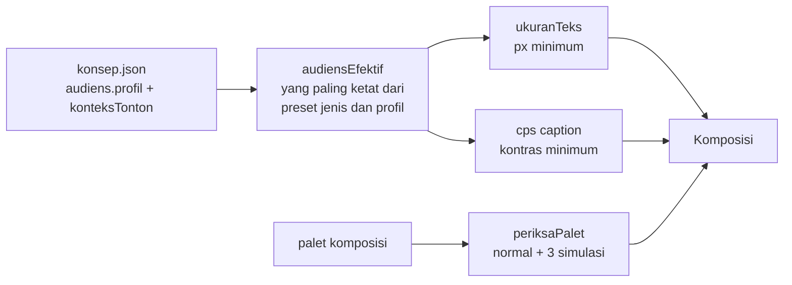

# Kualitas visual dan audiens

## Metadata

- Version: `v1.0.0`
- Last updated: `2026-11-07`
- Changeset: `Dokumen baru: profil audiens (data/audiens.json), ukuran teks menurut sudut pandang, uji buta warna dan jarak warna, ketajaman (garis 2 px, chroma 4:2:0, supersampling), efek dekoratif, dengan tingkat bukti dan batasnya.`

Panduan kualitas visual yang dapat diukur: seberapa besar teks harus tampil, apakah palet masih terbedakan oleh penonton buta warna, bagaimana garis tipis bertahan di encode 4:2:0, kapan efek dekoratif perlu dimatikan, dan bagaimana semua itu disesuaikan dengan audiens. API-nya ada di [api-runtime.md](api-runtime.md) (`ukuranTeks`, `periksaPalet`, `simulasiButaWarna`, `bedaWarna`, `paletOkabeIto`); datanya di [`data/audiens.json`](../data/audiens.json); uji di `scripts/uji-visual.mjs`.

Tingkat bukti memakai skema yang sama dengan preset jenis ([konsep-jenis-alur.md](konsep-jenis-alur.md#tingkat-bukti)): `bukti`, `standar`, `pedoman-industri`, `keputusan-desain`. **Sebagian besar angka di dokumen ini adalah `keputusan-desain`**: tidak ada riset yang menetapkan pengali numerik untuk video motion graphics. Yang didukung bukti adalah arahnya (lansia butuh teks lebih besar dan kontras lebih tinggi), bukan besarnya.

## Profil audiens

`data/audiens.json` memuat lima profil: `umum` (dewasa, bawaan), `remaja`, `anak`, `lansia`, dan `lowVision`. Setiap nilai membawa `bukti.tingkat` dan `bukti.rujukan`; `bun run konsep -- daftar audiens [profil]` menampilkannya.

| Atribut | umum | remaja | anak | lansia | lowVision | Cara dipakai |
| --- | --- | --- | --- | --- | --- | --- |
| `pengaliUkuranTeks` | 1,0 | 1,0 | 1,2 | 1,5 | 2,0 | argumen `audiens` di `ukuranTeks` |
| `cps` (subtitle Indonesia) | 17 | 17 | 13 | 14 | 13 | `caption.cps` di `konsep.json` |
| `pengaliTempoAdegan` | 1,0 | 0,9 | 1,3 | 1,4 | 1,5 | pengali durasi adegan dan `durasiBaca` |
| `kontrasTeksMin` | 4,5 | 4,5 | 4,5 | 7 | 7 | WCAG 1.4.3 dan 1.4.6 |
| `kontrasNonTeksMin` | 3 | 3 | 3 | 4,5 | 7 | `kontrasMin` di `periksaPalet` |
| `maksElemenBaru` | 4 | 4 | 3 | 3 | 2 | elemen informatif baru per adegan |
| `pengaliKecepatanNarasi` | 1,0 | 1,0 | 0,9 | 0,85 | 0,85 | pengali kecepatan baku narasi |

Atribut teks (`musik`, `tempoPotongan`, `animasi`, `bahasa`) memberi panduan kualitatif per profil. Tingkat bukti: `cps` umum dan anak adalah `pedoman-industri` (Netflix Indonesian Timed Text Style Guide: subtitle dewasa 17 cps, anak 13 cps; SDH dewasa 20, anak 17); kontras teks dan non-teks umum adalah `standar` (WCAG 2.2 SC 1.4.3 dan 1.4.11), kontras teks lansia dan low vision `standar` (SC 1.4.6, 7:1); sisanya `keputusan-desain` dengan arah dari W3C WAI "Older Users and Web Accessibility", Owsley 2011, Cowan 2001, dan Lillard & Peterson 2011 (rujukan lengkap di berkas data).

**Aturan komposisi.** Nilai efektif adalah yang paling ketat dari preset jenis dan profil: kontras maksimum, cps minimum, pengali ukuran teks maksimum, elemen baru minimum. Bila `konsep.json` menyebut beberapa profil (`audiens.profil: ["umum", "lansia"]`), dipakai yang paling ketat dari semuanya.

Hubungan dengan `bun run konsep`:

- `baru --audiens P[,P2]` menulis `audiens.profil` dan menurunkan `caption.cps` ke nilai efektif (mis. `--audiens anak` memberi 13).
- `periksa` menolak profil yang tidak dikenal dan memberi `PERINGATAN` bila `caption.cps` melebihi batas profil, atau `kontrasMin` efektif lebih rendah dari kebutuhan profil (timpa lewat `override` beralasan).
- `brief` menambahkan profil, penyesuaian efektif, dan konteks `ukuranTeks` yang dipetakan dari `audiens.konteksTonton` (`laptop-kantor` ke `laptop`, `ponsel` ke `ponselLanskap`, `ponsel-potret` ke `ponselPotret169`, `ponsel-vertikal` ke `ponselVertikalPenuh`, `tv` ke `tv`).
- `preset` menambahkan blok `audiens` (profil, nilai efektif, konteks) bila `audiens.profil` terisi.

Profil adalah titik awal untuk uji penonton, bukan klaim ilmiah.

## Ukuran teks

`ukuranTeks(tinggiFrame, peran, audiens, konteks)` menghitung ukuran font minimum dari sudut pandang, bukan piksel tetap. Dasarnya ukuran cetak kritis: pembaca berpenglihatan normal butuh tinggi-x sekitar 0,2 derajat (Legge & Bigelow 2011, `bukti`). Tinggi-x dikalikan pengali peran (judul 2,2; subjudul 1,5; isi dan caption 1,25; keterangan 1,0) dan pengali audiens, lalu dikonversi ke ukuran font (tinggi-x = 0,52 ukuran font) dan ke pecahan tinggi bingkai menurut konteks tonton. Geometri konteks (tinggi video di layar dan jarak mata) adalah asumsi tipikal, bukan pengukuran.

| Konteks | Asumsi | Sudut bingkai | Isi, umum, pada 1080 |
| --- | --- | --- | --- |
| `tv` | layar dilihat dari 3 tinggi layar | 18,9 derajat | 27 px (2,5%) |
| `laptop` | video 16:9 setinggi ~10 cm pada 55 cm | 10,4 derajat | 50 px (4,6%) |
| `ponselLanskap` (bawaan) | layar-penuh lanskap ~6,5 cm pada 35 cm | 10,6 derajat | 49 px (4,5%) |
| `ponselVertikalPenuh` | video 9:16 layar-penuh ~15 cm pada 33 cm | 25,6 derajat | 20 px (1,9%) |
| `ponselPotret169` | video 16:9 tersemat pada ponsel potret (~3,9 cm) | 6,6 derajat | 79 px (7,3%) |

Contoh untuk teks isi pada ponsel lanskap di bingkai 1080 tinggi: dewasa 49 px, anak 59 px, lansia 73 px, low vision 98 px. **Video 16:9 yang disematkan di ponsel potret (misalnya di feed) memerlukan teks sekitar 60% lebih besar daripada layar-penuh lanskap**; perlakukan konteks itu sebagai peringatan, bukan syarat, karena sebagian besar komposisi tidak dirancang untuknya. Pengali audiens (kecuali bukti arah) dan semua geometri konteks adalah `keputusan-desain`.

Templat `contoh-dasar` (1280x720) memenuhi `ukuranTeks` untuk audiens `umum` pada konteks `laptop`, `ponselLanskap`, dan `tv`: subjudul 40 px, judul lower-third 34 px, keterangan 28 px, judul 84 px (diuji di `uji-visual.mjs`). Ia tidak memenuhi `lansia` ataupun `ponselPotret169`; komposisi untuk audiens itu perlu menaikkan ukuran.

## Warna dan buta warna

- **Prevalensi.** Sekitar 8% pria keturunan Eropa dan 0,4% wanita (Birch 2012, `bukti`); sekitar 5% pria Asia (Okabe & Ito, pedoman). Tidak ada survei nasional Indonesia yang primer; studi sekolah kecil melaporkan 1,8% sampai 3,7% (kualitas rendah). Untuk desain dipakai asumsi konservatif sekitar 5% pria.
- **Simulasi.** `simulasiButaWarna(warna, jenis, keparahan = 1)` memakai matriks Machado, Oliveira & Fernandes 2009 pada RGB linear untuk `protanopia`, `deuteranopia`, dan `tritanopia`. Keparahan di bawah 1 hanya pendekatan (interpolasi linear terhadap identitas); model tidak memodelkan anomali trikromasi sebagian secara terpisah.
- **Jarak warna.** `bedaWarna(a, b)` adalah CIEDE2000 (Sharma, Wu & Dalal 2005), diuji terhadap 23 pasangan data uji Sharma sampai 1e-3.
- **Pemeriksaan palet.** `periksaPalet(palet, { ambang = 10, latar, kontrasMin = 3 })` menghitung selisih tiap pasangan warna dalam penglihatan normal dan tiga simulasi, melaporkan pasangan di bawah `ambang`, dan (bila `latar` diberikan) warna yang berkontras kurang dari `kontrasMin` terhadap latar. Ambang 10 adalah `keputusan-desain` (tidak ada ambang standar untuk palet kategorikal); kontras 3:1 untuk objek grafis adalah `standar` (WCAG 2.2 SC 1.4.11).
- **Warna bukan satu-satunya pembeda.** WCAG 2.2 SC 1.4.1 (`standar`) mewajibkan alternatif terlihat (label, ikon, bentuk, pola). `periksaPalet` tidak menggantikan itu; ia hanya menandai pasangan yang tidak terbedakan.

Hasil terukur pada latar `#101828` (ambang 10, kontras 3):

| Palet | Selisih minimum normal / protan / deutan / tritan | Pasangan di bawah 10 |
| --- | --- | --- |
| Okabe-Ito (`paletOkabeIto`, tanpa hitam) | 21,7 / 12,2 / 11,6 / 10,9 | 0 |
| Merah `#d62728`, hijau `#2ca02c`, kuning `#ffd700` | 36,5 / 19,4 / 4,6 / 33,5 | 1 (merah dan hijau pada deuteranopia) |
| Tableau10 klasik | 16,2 / 1,3 / 3,3 / 9,5 | 9 |
| Aksen contoh-dasar (`#e8590c`, `#38bdf8`, `#cbd5e1`) | 20,2 / 15,8 / 19,6 / 19,6 | 0 |

`#000000` di dalam `paletOkabeIto` tidak berkontras dengan latar gelap (1,18:1); pakai tanpa hitam di atas latar gelap. Nilai hex Okabe-Ito mengikuti praktik umum dan belum diverifikasi dari teks primer (halaman sumbernya hanya memuat gambar). Palet status merah, jingga, dan hijau tidak terbedakan oleh penonton deuteranopia: wajib redundansi bentuk atau teks.

Psikologi warna (biru berarti tepercaya, merah berarti urgensi) tidak punya dasar ilmiah yang kuat sebagai aturan desain (Elliot & Maier 2014; preferensi warna diprediksi asosiasi objek, Palmer & Schloss 2010); pakai warna merek dan konvensi yang dikenal penonton, disertai redundansi bentuk atau teks.

## Ketajaman dan encode

Hasil ukur lokal pada satu komposisi uji (180 atau 60 frame, CRF 18); bukan benchmark umum.

- **Garis berwarna minimal 2 px.** Encode 4:2:0 menurunkan resolusi kroma. Garis horizontal merah 1 px di atas biru kehilangan sekitar 45% puncak kanal merah (142 dari 255), garis 2 px bertahan (231 dari 255); garis putih atau netral 1 px nyaris tidak terpengaruh (233 dari 240). Praktik: garis berwarna dan batas jenuh dibuat minimal 2 px pada tata letak dasar, teks kecil memakai putih atau netral, dan aksen berwarna untuk bentuk besar. YouTube mewajibkan 4:2:0, jadi ini tidak bisa dihindari lewat encode. (`riset empiris lokal`, satu konten.)
- **Posisi piksel.** Garis 1 px pada batas piksel tampil sebagai dua baris setengah terang, dan `--skala` bukan bilangan bulat membuat ketajamannya bergantung posisi. Pakai garis >= 2 px atau letakkan di posisi yang jatuh pada piksel bulat setelah diskalakan.
- **Supersampling (rekomendasi, belum didukung renderer).** Pada uji teks tipis dan garis halus, render pada skala 2 lalu perkecil dengan lanczos ke ukuran keluaran menaikkan SSIM (+0,0054 pada 1080p, +0,0095 pada 720p) dan menghasilkan berkas 2,6 sampai 3 kali lebih kecil dibanding render langsung pada ukuran itu. `--skala` pada `render.mjs` membuat raster tajam tetapi **ukuran keluaran ikut membesar** (`--skala 2` pada komposisi 1280x720 menghasilkan 2560x1440); belum ada perintah renderer yang memperkecil kembali ke ukuran keluaran sebelum enkode, sehingga supersampling belum bisa dilakukan dalam satu langkah dan dicatat sebagai rekomendasi. Pengujian bahwa perkecilan menjaga warna BT.709 belum dilakukan. Sementara itu, untuk draf gunakan `--skala 1`; untuk final 1080p dari komposisi 1280x720, `--skala 1.5` (satu langkah). Biaya render naik kira-kira sebanding jumlah piksel.
- **Resolusi.** Untuk motion graphics datar, 1080p sudah di atas ambang ketajaman pada konteks tonton tipikal (kalkulasi; 57 piksel per derajat pada TV 3 tinggi layar, di atas 100 pada laptop dan ponsel). 1440p dan 4K tidak memberi manfaat persepsi yang terukur untuk konten ini.
- **Gradien gelap landai dan grain.** Gradien gelap yang landai rentan banding. Grain acak per frame memecah banding tetapi mahal: dengan encode CRF 18 pada 1080p, grain amplitudo sekitar satu level tidak memecah banding, tiga level menambah bitrate sekitar 43%, dan enam level sekitar 5,9 kali (`riset empiris lokal`). Tidak ada helper grain atau vignette di runtime; bila dibuat sendiri, tetap deterministik (`acak(seed)` per frame) dan batasi amplitudo.

## Efek dekoratif

Efek yang tidak membawa makna (glow, partikel, parallax latar, vignette, grain) tergolong "seductive details" yang menurunkan retensi dan transfer pada pembelajaran (Rey 2012; Sundararajan & Adesope 2020, meta-analisis; efek kecil sampai sedang, kebanyakan studi 6 sampai 12 menit). Vignette, glow, dan parallax tidak punya bukti manfaat perseptual langsung (`praktik`); grain berdampak langsung pada bitrate (di atas).

| Efek | edukasi, panduan, data, formal | kreatif, promo, sosial, acara | Bukti |
| --- | --- | --- | --- |
| Sorot elemen yang dibicarakan (signaling) | aktif | aktif | `bukti` (meta-analisis) |
| Scrim di bawah teks di atas gambar | aktif bila ada gambar | aktif | `standar` (WCAG F83) |
| Grain | **mati** | boleh, amplitudo kecil dan area terbatas | `riset empiris lokal` |
| Vignette | **mati** | boleh, ringan | `praktik`, tanpa bukti |
| Glow, neon, partikel | **mati** | boleh | `bukti` negatif untuk belajar |
| Parallax latar | **mati** | boleh | `praktik` |
| Kilatan | maksimal 3 per detik | maksimal 3 per detik | `standar` (WCAG 2.3.1) |

Ini panduan komposisi, bukan pemeriksaan otomatis: awvd belum memeriksa efek aktif.

## Pemeriksaan yang ada dan yang belum

- Ada: kontras teks dan kilatan di `bun run periksa`; `periksaPalet`, `ukuranTeks`, `audiensEfektif` (di `konsep.mjs`) sebagai pemeriksaan programatik yang dapat dipanggil dari uji atau skrip proyek.
- Belum: `periksa` belum memeriksa palet, ukuran teks dari DOM, kepadatan elemen, atau bitrate batas atas. Itu tetap rencana tanpa janji tanggal.

## Kesenjangan

- Pengali audiens, ambang jumlah elemen, pengali tempo, dan cps lansia adalah keputusan desain; tidak ada riset yang menetapkan angkanya untuk video motion graphics.
- Geometri konteks tonton adalah asumsi tipikal. Ketajaman diukur dengan SSIM dan PSNR (VMAF tidak tersedia), tanpa uji persepsi manusia.
- Hex Okabe-Ito, DOI Sharma 2005, dan sebagian sumber lansia dan anak hanya diverifikasi lewat ringkasan sekunder (lihat rujukan di `data/audiens.json`).
- Data buta warna Indonesia berasal dari studi sekolah kecil; tidak ada angka nasional primer. Budaya Indonesia (warna dan simbol) tidak punya sumber yang ditemukan; konfirmasi dengan audiens.

## Rujukan

- Legge, G. E., & Bigelow, C. A. (2011). Does print size matter for reading? *Journal of Vision*, 11(5), 8. DOI 10.1167/11.5.8
- Machado, G. M., Oliveira, M. M., & Fernandes, L. A. F. (2009). A physiologically-based model for simulation of color vision deficiency. *IEEE TVCG*, 15(6), 1291-1298. DOI 10.1109/TVCG.2009.113
- Sharma, G., Wu, W., & Dalal, E. N. (2005). The CIEDE2000 color-difference formula. *Color Research & Application*, 30(1), 21-30.
- Birch, J. (2012). Worldwide prevalence of red-green color deficiency. *JOSA A*, 29(3), 313-320. DOI 10.1364/JOSAA.29.000313
- Okabe, M., & Ito, K. Color Universal Design. https://jfly.uni-koeln.de/color/
- W3C. WCAG 2.2: SC 1.4.1, 1.4.3, 1.4.6, 1.4.11, 2.3.1. W3C WAI. Older Users and Web Accessibility. https://www.w3.org/WAI/older-users/
- Netflix. Indonesian Timed Text Style Guide. https://partnerhelp.netflixstudios.com/hc/en-us/articles/216009727
- Elliot, A. J., & Maier, M. A. (2014). Color psychology. *Annual Review of Psychology*, 65, 95-120. DOI 10.1146/annurev-psych-010213-115035
- Palmer, S. E., & Schloss, K. B. (2010). An ecological valence theory of human color preference. *PNAS*, 107(19), 8877-8882. DOI 10.1073/pnas.0906172107
- Rey, G. D. (2012). A review of research and a meta-analysis of the seductive detail effect. *Educational Research Review*, 7(3), 216-237. DOI 10.1016/j.edurev.2012.05.003
- Sundararajan, N., & Adesope, O. (2020). Keep it coherent: A meta-analysis of the seductive details effect. *Educational Psychology Review*, 32(3), 707-734. DOI 10.1007/s10648-020-09522-4
- Owsley, C. (2011). Aging and vision. *Vision Research*, 51(13), 1610-1622. DOI 10.1016/j.visres.2010.10.020
- Cowan, N. (2001). The magical number 4 in short-term memory. *Behavioral and Brain Sciences*, 24(1), 87-114. DOI 10.1017/S0140525X01003922
- Lillard, A. S., & Peterson, J. (2011). The immediate impact of different types of television on young children's executive function. *Pediatrics*, 128(4), 644-649.
- Bababekova, Y. dkk. (2011). Font size and viewing distance of handheld smart phones. *Optometry and Vision Science*, 88(7), 795-797. DOI 10.1097/OPX.0b013e3182198792

## Changelog

### 2026-11-07 - v1.0.0

- Dokumen baru: profil audiens, ukuran teks menurut sudut pandang, uji buta warna dan jarak warna, ketajaman (garis berwarna minimal 2 px, chroma 4:2:0, supersampling sebagai rekomendasi karena renderer belum memperkecil keluaran), dan efek dekoratif dimatikan untuk edukasi, panduan, data, dan formal.
